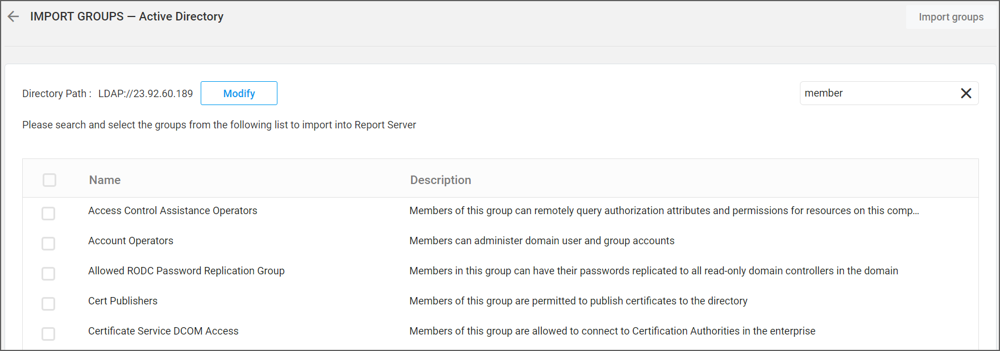
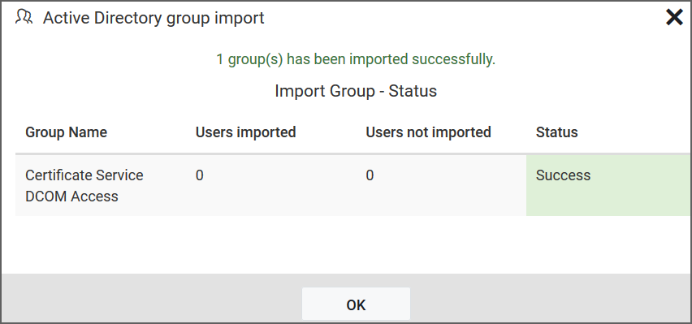
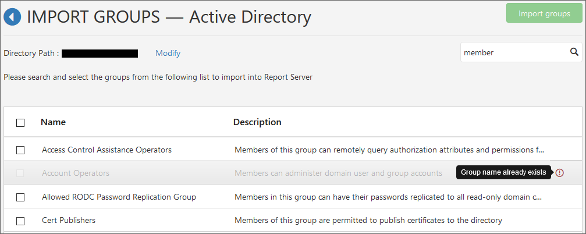

# Import Active Directory groups into Bold Reports®

Bold Reports® On-Premises Edition lets you search for groups in Active Directory and import them into the application. Users belonging to the System Administrator group can import Active Directory groups into the Bold Reports® application.

## What do I need before importing groups?

The Bold Reports® Report Server needs an Active Directory connection before you import groups.

> **Note:** The Active Directory connection must be configured in the [Active Directory Settings](./../../../../manage-app-settings/active-directory/) for importing groups.

## How do I search for Active Directory groups?

You can search for Active Directory groups in Bold Reports® based on any of the following properties, and then select them for import into the application:

* Group name
* Group description

A maximum of 1000 groups are searched and retrieved from Active Directory in a single request.

The Bold Reports® Server searches for groups within the distinguished name specified on the Active Directory settings page. The search results appear in the grid.
    

> **Note:** The search results will be based on a `starts with` query.

## How do I import the selected groups?

You import Active Directory groups into the Bold Reports® Report Server from the search results grid. Follow these steps:

1. Select the groups from the list.
2. Click **Import Groups** at the top-right corner.

After importing the Active Directory groups, a confirmation message is displayed, as shown in the following image.

The success message box shows which users were successfully imported into the Bold Reports® application and which were not.

## What happens to duplicate groups?

The Bold Reports® Report Server identifies groups that have the same name as existing groups as duplicate groups, and they cannot be imported.

## Frequently asked questions

### How many Active Directory groups can I retrieve in one search?

Bold Reports® searches and retrieves a maximum of 1000 groups from Active Directory in a single request.

### How does the group search match names?

The Bold Reports® group search results are based on a `starts with` query.

## See also

* [Synchronize Active Directory groups](./../../synchronize/synchronize-active-directory-groups/)
* [Import Microsoft Entra ID groups](./../import-azure-active-directory-groups/)
* [Manage groups](./../../manage-groups/)
