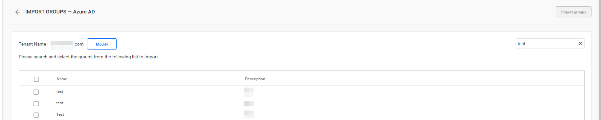
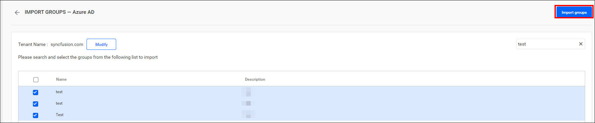
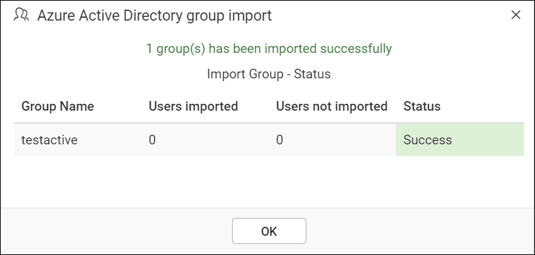
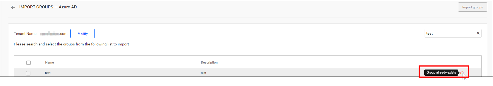

# Import Microsoft Entra ID groups into Bold Reports®

Bold Reports® On-Premises Edition lets you search for groups in Microsoft Entra ID (formerly Azure Active Directory) and import them into the application.

## What do I need before importing groups?

Bold Reports® On-Premises Edition needs a Microsoft Entra ID connection and a System Administrator account before you import groups.

> **Note:** Configure the Microsoft Entra ID connection in the [Microsoft Entra ID settings](./../../../../manage-app-settings/azure-active-directory/) before you import groups.

Only users in the `System Administrator` group can import Microsoft Entra ID groups into Bold Reports® On-Premises Edition.

## How do I search for Microsoft Entra ID groups?

Bold Reports® does not display Active Directory groups until you perform a search for the group.

You can search the Microsoft Entra ID groups using the property `Group name` and choose them to import into Bold Reports®.

A maximum of 1000 groups are searched and retrieved from Microsoft Entra ID in a single request.

Bold Reports® On-Premises Edition lists the search results of the groups in the grid, as shown in the image below.

## How do I import the selected groups?

You import Microsoft Entra ID groups into Bold Reports® On-Premises Edition from the search results grid. Follow these steps:

1. Select the groups from the list.
2. Click the `Import groups` button at the top right corner.

Bold Reports® On-Premises Edition imports the selected groups and displays a confirmation message, as shown in the image below.

The success message box shows which users were successfully imported and which were not imported into Bold Reports® On-Premises Edition.

## What happens to duplicate groups?

Microsoft Entra ID groups with the same group name as groups already in Bold Reports® On-Premises Edition are marked as duplicates and cannot be imported.

## Frequently asked questions

### Who can import Microsoft Entra ID groups?

Only users in the `System Administrator` group can import Microsoft Entra ID groups into Bold Reports® On-Premises Edition.

### How many groups can I retrieve in one search?

Bold Reports® searches and retrieves a maximum of 1000 groups from Microsoft Entra ID in a single request.

## See also

* [Synchronize Microsoft Entra ID groups](./../../synchronize/synchronize-azure-active-directory-groups/)
* [Import Active Directory groups](https://help.boldreports.com/enterprise-reporting/administrator-guide/manage-users/groups/import-groups/import-active-directory-groups/)
* [Manage groups](./../../manage-groups/)
