# Manage groups in Bold Reports® Report Server

In Bold Reports® On-Premises Edition, you can add, edit, and delete groups, assign users to them, and manage group permissions.

## What is a group?

A group in Bold Reports® is a collection of users to which permissions can be assigned. Users in a group inherit the permissions assigned to the group.

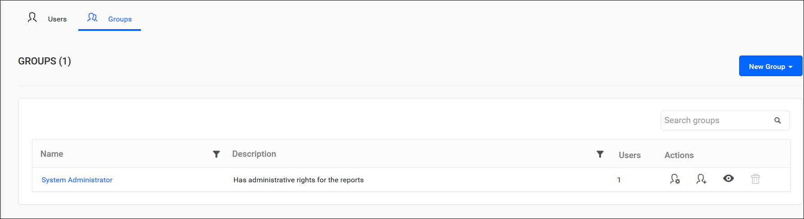

## How do I add a new group?

You add a new group in Bold Reports® On-Premises Edition from the groups management page. Follow these steps:

1. Click `New Group` on the groups management page.

2. Provide a name and an optional description for the group.

    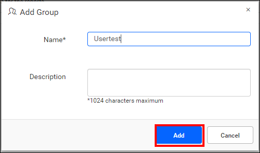

3. Click `Add`.

A new group is created, and you can proceed to [add users](#assign-users) or [manage permissions](#manage-permissions) for it.

## How do I edit a group?

You edit group information in Bold Reports® from the group's edit page. Follow these steps:

1. Click the name of the group you want to edit.

    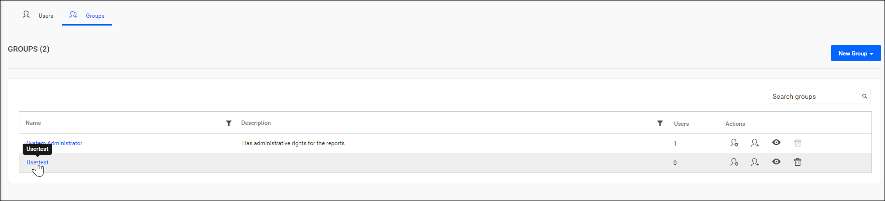

2. Click the `Edit Group` button.

    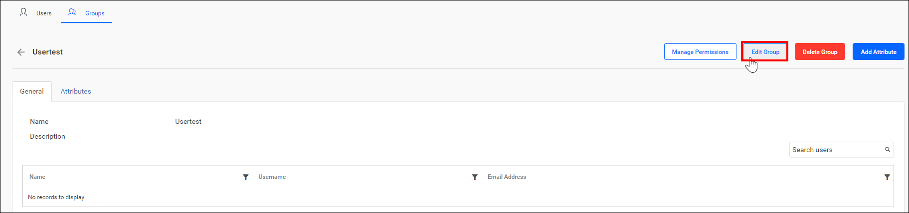

3. Make the necessary updates to the group and save the changes.

    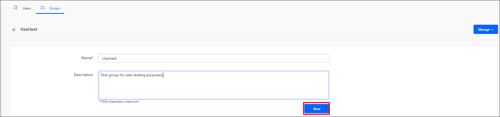

You can edit the group name and description on the group edit page. You can also assign users to or remove users from the group on that page.

## How do I delete a group?

You can delete groups in Bold Reports® if they are no longer needed. However, you cannot delete the `System Administrator` group.

### From group management page

The Bold Reports® group management page lets you delete one group or several groups at once.

* Click the `Delete` icon to remove a single group.

    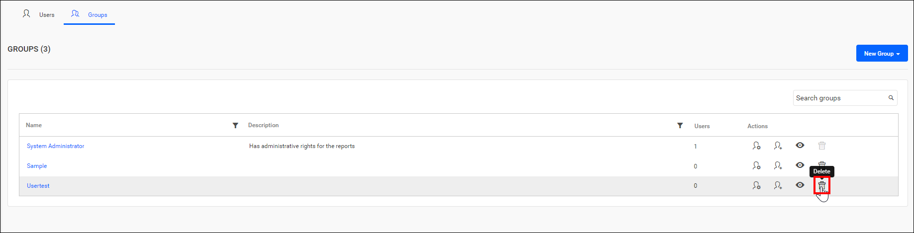

* To remove multiple groups, select them and then click `Delete Groups`.

    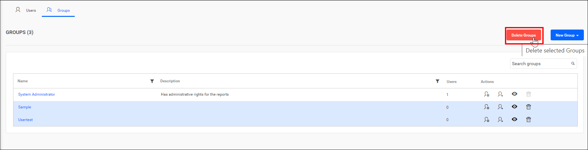

### From group edit page

You can also delete a group from its Bold Reports® group edit page, as shown in the following image.

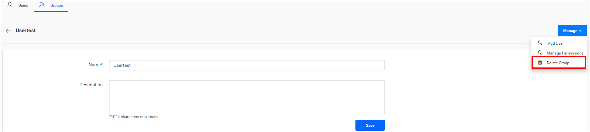

## Assign users

You can assign users to the selected group in Bold Reports®, so they inherit the permissions assigned to the group.

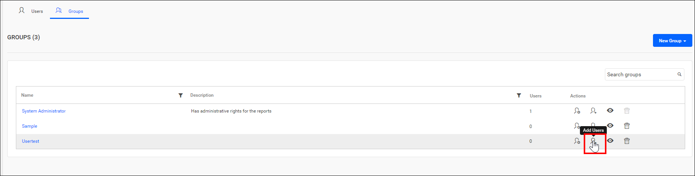

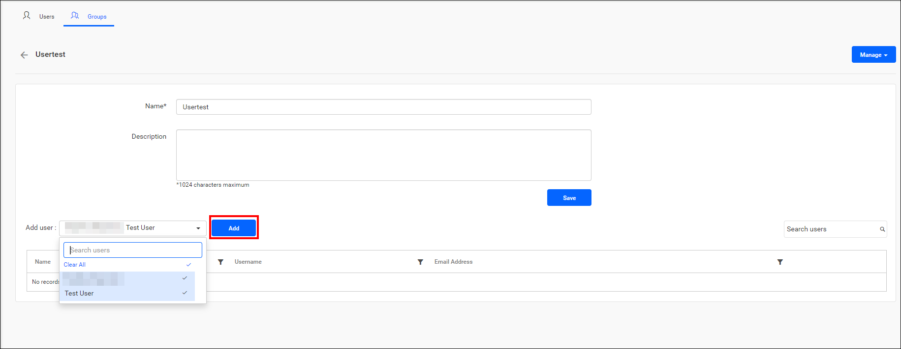

You can also remove users from the group if a user no longer needs the permissions of the group. Click `Remove` next to the user on the group edit page to remove the user from the group.

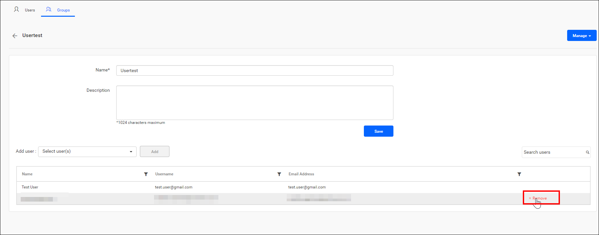

## Manage permissions

You can open the Bold Reports® Manage Permissions page for a group from either of the following pages:

* Click the `Manage Permission` icon for the respective group on the group management page.

    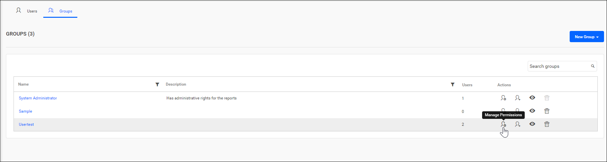

* Click the group's name on the group listing page to navigate to the group edit page. Then, select the `Manage Permissions` option from the `Manage` drop-down menu in the top right corner of the page.

    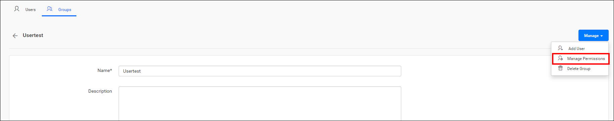

The Manage Permissions grid shows the permissions assigned directly to the group.

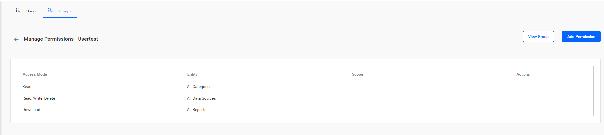

Click `Add Permission` to assign permissions to the group.

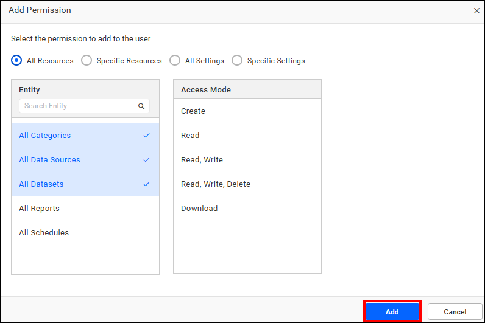

### How do I add a permission to the group?

To add a permission to a Bold Reports® group, follow these steps:

1. Select the entity.
2. Choose the scope if the entity is not of the `All Resource` or `All Settings` item type.
3. Select the access mode.
4. Click `Add` to include the specified permission to the group.

You can also select multiple scopes and entities to assign multiple permissions. For more information on how to add and manage permissions, see the [Manage Permissions](./../../../manage-permissions/) section.

## Frequently asked questions

### Can I delete the System Administrator group?

No. Bold Reports® does not let you delete the `System Administrator` group.

### How do users get permissions from a group?

Users assigned to a group in Bold Reports® inherit the permissions assigned to the group.

## See also

* [Import groups](./../import-groups/)
* [Synchronize groups](./../synchronize/)
* [Manage users](./../../users/manage-users/)
