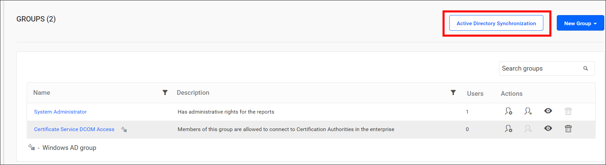
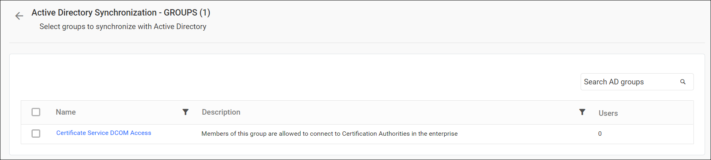
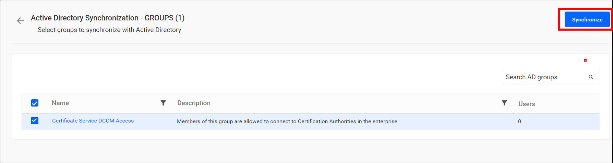
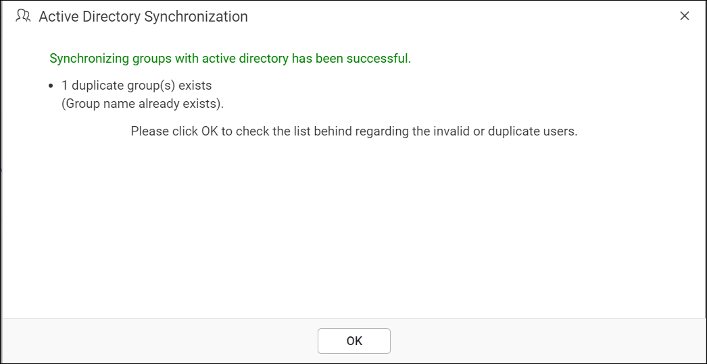
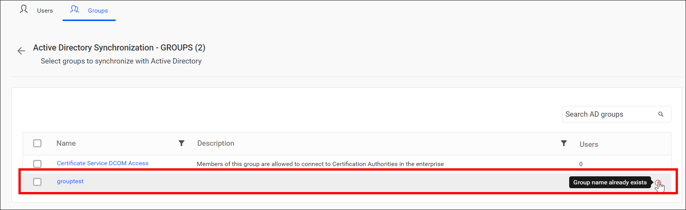

# Synchronize Active Directory groups in Bold Reports®

Bold Reports® On-Premises Edition synchronizes imported Active Directory groups and their users with Active Directory from the group synchronization page.

## What do I need before synchronizing groups?

Bold Reports® On-Premises Edition needs a configured Active Directory connection and imported groups before you synchronize.

> Before synchronizing the Active Directory groups, follow these steps:
> * Configure the [Active Directory Settings](./../../../../manage-app-settings/active-directory/).
> * [Import Active Directory Groups](./../../import-groups/import-active-directory-groups/) into Bold Reports® On-Premises Edition.

You can navigate to the group synchronization page from the groups page.

## Synchronize groups

The Bold Reports® Server displays a list of Active Directory groups that have already been imported.

To synchronize groups, follow these steps:

1. Select the groups you want to synchronize.
2. Click `Synchronize` at the top right corner.

### Synchronization procedure

The Bold Reports® Report Server applies the following changes from Active Directory during synchronization:

* The group details, such as name and description, are synchronized with the Active Directory Server.
* The Bold Reports® Report Server deletes the group if it has been deleted from the Active Directory Server.
* The Bold Reports® Server removes a user from the server group if the user has been deleted from the Active Directory Server group. If a new user is added to the Active Directory group, the Bold Reports® Server adds the user to the server group. If the new user is not already present in the Bold Reports® Server, a new user account is created and added to the group.

* After synchronization completes, the success message box displays the number of groups modified, deleted, and duplicated.

## What happens to duplicate groups?

The Bold Reports® Server identifies Active Directory groups that have the same group name as existing server groups as duplicate groups. Duplicate groups are not allowed to synchronize with Active Directory.

## Frequently asked questions

### What happens when a group is deleted in Active Directory?

The Bold Reports® Report Server deletes the group during synchronization if it has been deleted from the Active Directory Server.

### What happens when a new user joins an Active Directory group?

The Bold Reports® Server adds the user to the server group. If the user is not already present, a new user account is created and added to the group.

## See also

* [Import Active Directory groups](./../../import-groups/import-active-directory-groups/)
* [Synchronize Active Directory users](./../../../users/synchronize/synchronize-active-directory-users/)
* [Active Directory synchronization schedule](./../../../../manage-app-settings/synchronization-schedule/active-directory-synchronization-schedule/)
