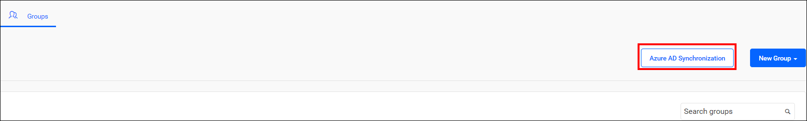
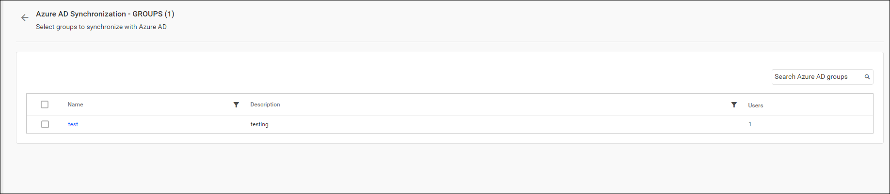
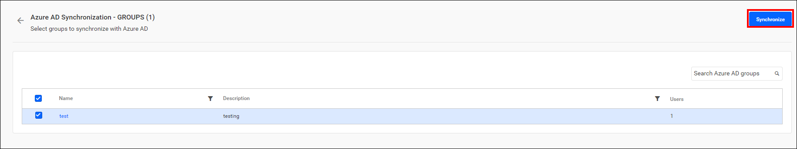
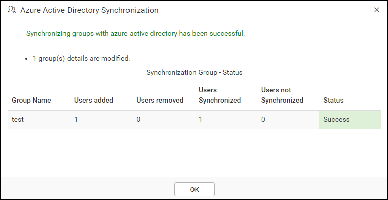
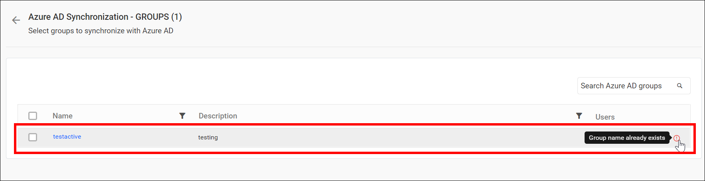

# Synchronize Microsoft Entra ID groups in Bold Reports®

Bold Reports® On-Premises Edition synchronizes imported Microsoft Entra ID (formerly Azure Active Directory) groups and their users with Microsoft Entra ID.

## What do I need before synchronizing groups?

Bold Reports® On-Premises Edition needs a configured Microsoft Entra ID connection and imported groups before you synchronize.

> *Note:* Before synchronizing the Microsoft Entra ID groups, follow these steps:
> 1. Configure the [Microsoft Entra ID settings](./../../../../manage-app-settings/azure-active-directory/).
> 2. Import groups from Microsoft Entra ID to Bold Reports® On-Premises Edition. For steps, see [Microsoft Entra ID group import](./../../import-groups/import-azure-active-directory-groups/).

You can navigate to the group synchronization page from the groups page, as shown in the image below.

## Synchronize Groups

Bold Reports® On-Premises Edition displays the Microsoft Entra ID groups that have already been imported, as shown in the image below.

To synchronize groups, follow these steps:

1. Select the groups you want to synchronize.
2. Click the `Synchronize` button at the top right corner.

### Synchronization procedure

Bold Reports® On-Premises Edition applies the following changes from Microsoft Entra ID during synchronization:

* Bold Reports® On-Premises Edition updates the group's name and description from Microsoft Entra ID.

* Bold Reports® On-Premises Edition deletes groups that have been deleted from Microsoft Entra ID.

* Bold Reports® adds or deletes users in the Bold Reports® group when they are added to or deleted from the Microsoft Entra ID group. If a new user is not present in Bold Reports®, a new user account is created and added to the group.

After synchronization completes, the success message box displays the number of groups modified, deleted, and duplicated, as shown in the image below.

## What happens to duplicate groups?

Microsoft Entra ID groups with the same group name as groups already in Bold Reports® On-Premises Edition are marked as duplicates. They cannot be synchronized with Microsoft Entra ID.

## Frequently asked questions

### What does synchronization update for a Microsoft Entra ID group?

Bold Reports® On-Premises Edition updates the group's name and description and adds or deletes group members to match Microsoft Entra ID.

### What happens to a group deleted from Microsoft Entra ID?

Bold Reports® On-Premises Edition deletes groups that have been deleted from Microsoft Entra ID.

## See also

* [Import Microsoft Entra ID groups](./../../import-groups/import-azure-active-directory-groups/)
* [Synchronize Microsoft Entra ID users](./../../../users/synchronize/synchronize-azure-active-directory-users/)
* [Microsoft Entra ID synchronization schedule](./../../../../manage-app-settings/synchronization-schedule/azure-active-directory-synchronization-schedule/)
