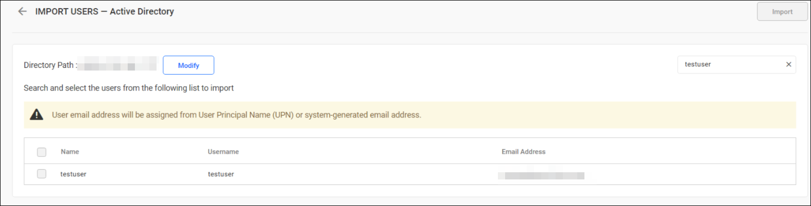
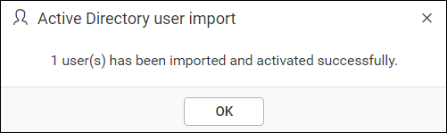
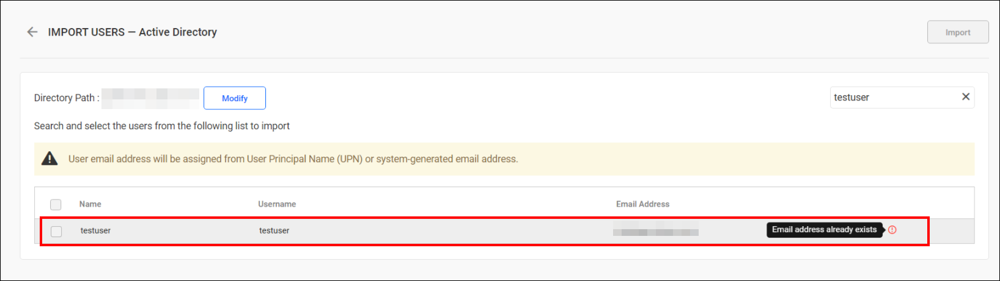
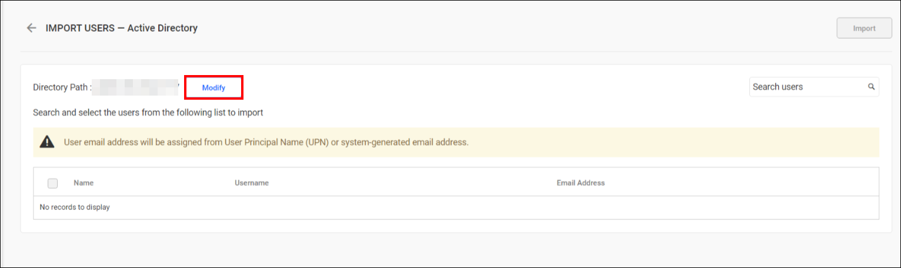

# Import Active Directory users into Bold Reports®

You can search for users in Active Directory and import them into Bold Reports® On-Premises Edition.

## What do I need before importing users?

Bold Reports® On-Premises Edition needs a configured Active Directory connection and a System Administrator account before you import users.

> **Note:** The Active Directory connection must be configured within the [Active Directory Settings](./../../../../manage-app-settings/active-directory/) to import users.

Users belonging to the `System Administrator` group can import Active Directory users to the Report Server.

## How do I search for Active Directory users?

You can search for Active Directory users in Bold Reports® using any of the properties listed below, and choose them to import into the application.

* User name
* First name
* Last name
* Email address
* Display name

A maximum of 1000 users are searched and retrieved from Active Directory in a single request.

The Bold Reports® application searches for users within the distinguished name specified on the Active Directory settings page. The search results appear in a grid.
    
> The search result will be based on a "starts with" query.

## How do I import the selected users?

You import Active Directory users into Bold Reports® from the search results grid. Follow these steps:

1. Select the users from the list.
2. Click **Import** at the top-right corner.

Once the import process is complete, a confirmation message is displayed, as shown in the following image.

## What happens to duplicate users?

Bold Reports® flags users with the same username or email address as existing Bold Reports® users as duplicate users. Duplicate users cannot be imported into Bold Reports®.

## How do I modify the Active Directory connection?

You modify the Bold Reports® Active Directory configuration settings by clicking **Modify**, as shown in the following image.

## Frequently asked questions

### How many Active Directory users can I retrieve in one search?

Bold Reports® searches and retrieves a maximum of 1000 users from Active Directory in a single request.

### Which users count as duplicates?

Bold Reports® treats users with the same username or email address as existing users as duplicates and does not import them.

## See also

* [Synchronize Active Directory users](./../../synchronize/synchronize-active-directory-users/)
* [Import Active Directory groups](./../../../groups/import-groups/import-active-directory-groups/)
* [Active Directory settings](./../../../../manage-app-settings/active-directory/)
