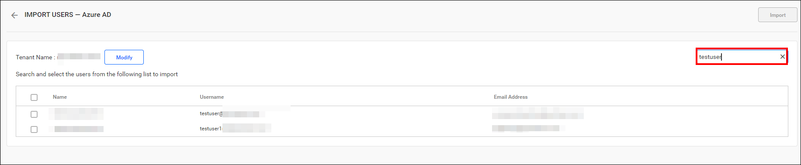
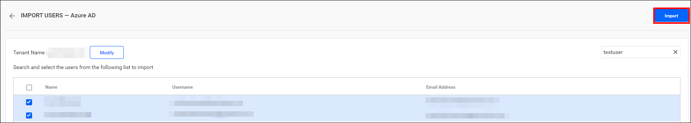
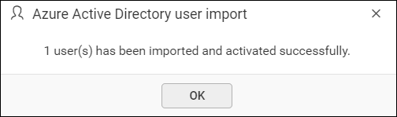
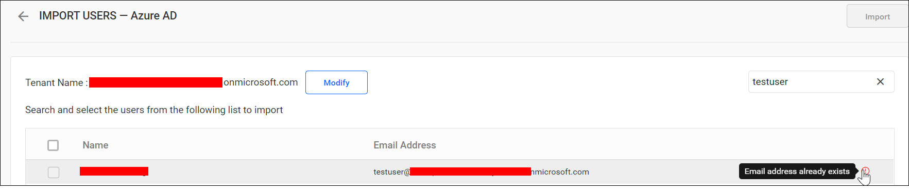
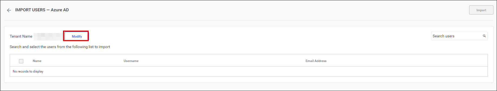

# Import Microsoft Entra ID users into Bold Reports®

You can search for users in Microsoft Entra ID (formerly Azure Active Directory) and import them into Bold Reports® On-Premises Edition.

## What do I need before importing users?

Bold Reports® On-Premises Edition needs a configured Microsoft Entra ID connection and a System Administrator account before you import users.

> **Note:** To import users, configure the Microsoft Entra ID connection in the [Microsoft Entra ID settings](./../../../../manage-app-settings/azure-active-directory/).

Only users in the `System Administrator` group can import Microsoft Entra ID users into Bold Reports®.

## How do I search for Microsoft Entra ID users?

Bold Reports® does not display Active Directory users until you perform a user search.

You can search for Microsoft Entra ID users using any of the properties below and select them for import into Bold Reports®.

* Full name
* Username
* Email Address

A maximum of 1000 users are searched and pulled from Microsoft Entra ID in a single request.

Bold Reports® lists the search results of the users in the grid, as shown in the image below.

> Note: The search result will be based on a "starts with" query.

## How do I import the selected users?

You import Microsoft Entra ID users into Bold Reports® from the search results grid. Follow these steps:

1. Select the users from the list.
2. Click the `Import` button at the top right corner.

    

Bold Reports® imports the selected users and displays a confirmation message, as shown in the image below.

## What happens to duplicate users?

Microsoft Entra ID users who have the same email address as existing Bold Reports® users are marked as duplicates. They cannot be imported into Bold Reports®.

## How do I modify the Microsoft Entra ID connection?

You modify the Bold Reports® Microsoft Entra ID configuration settings by clicking the `Modify` button, as shown below.

## Frequently asked questions

### Which properties can I search Microsoft Entra ID users by?

Bold Reports® lets you search Microsoft Entra ID users by full name, username, or email address.

### How many users can I retrieve in one search?

Bold Reports® searches and pulls a maximum of 1000 users from Microsoft Entra ID in a single request.

## See also

* [Synchronize Microsoft Entra ID users](./../../synchronize/synchronize-azure-active-directory-users/)
* [Import Microsoft Entra ID groups](./../../../groups/import-groups/import-azure-active-directory-groups/)
* [Microsoft Entra ID settings](./../../../../manage-app-settings/azure-active-directory/)
