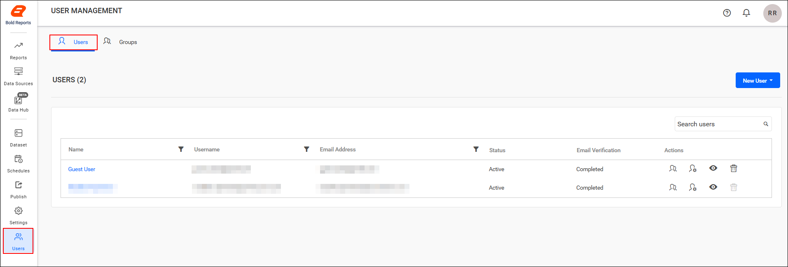
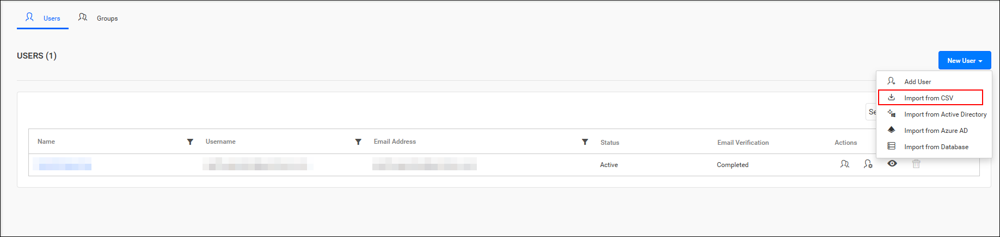
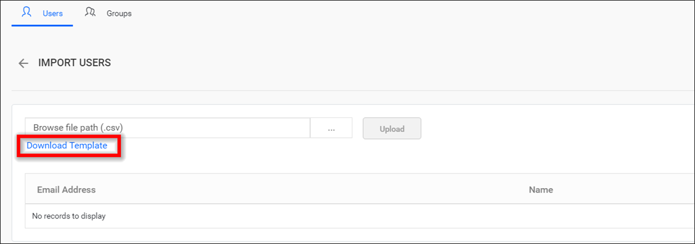
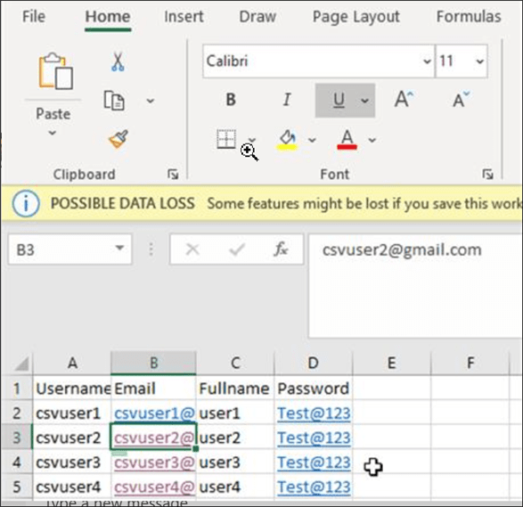
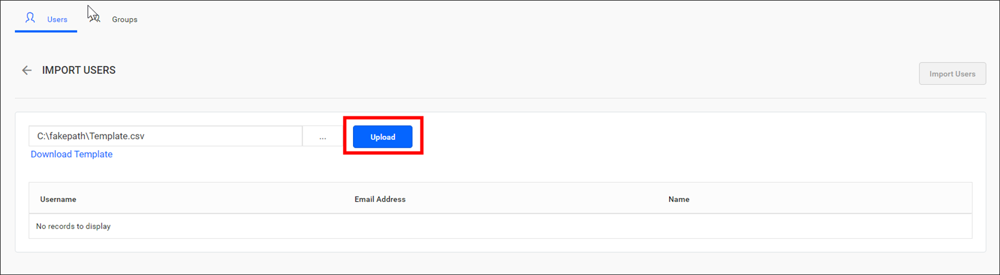
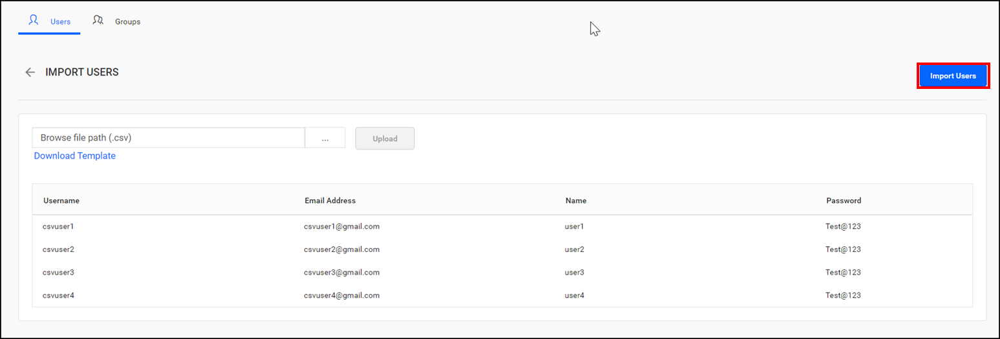
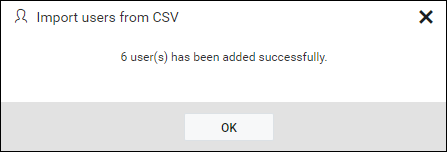

# Import users from a CSV file in Bold Reports®

Bold Reports® On-Premises Edition lets you add a large number of users at once from a CSV file. Download the CSV template file, add the users to it, and then import the file.

## How do I open the user management page?

You open the Bold Reports® user management page by clicking the `User` menu.

## Add users from the CSV file

To start a CSV import in Bold Reports®, click `Import from csv` in `New User`.

## What are the CSV template requirements?

The first row in the Bold Reports® CSV template represents the column heading. Bold Reports® assumes that the data starting from the second line in the file represents the user information.

The following columns are mandatory in the downloaded CSV file:

* Username
* Email address (It is mandatory only in the [Email required](https://help.boldreports.com/enterprise-reporting/administrator-guide/manage-users/account-activation/#email-required) mode).
* Full Name
* Password (It is mandatory only in the [Automatic activation](https://help.boldreports.com/enterprise-reporting/administrator-guide/manage-users/account-activation/#automatic-activation) mode).

## How do I import users with the CSV template?

Follow these steps to add users to Bold Reports® using the CSV template:

1. Download a CSV template.

    

2. Add users in the CSV file.

    

3. Save the CSV file and upload it.

    

4. Review the user details. Once the file is uploaded, the user details are displayed in the grid, as shown in the image below.

    

5. Import the users. After importing users in Bold Reports®, the success message is displayed:

    

## Frequently asked questions

### Is the email address always required in the CSV file?

No. The email address is mandatory only in the Bold Reports® Email required mode.

### When is the password column required?

The password column is mandatory only in the Bold Reports® Automatic activation mode.

## See also

* [Account activation](./../../../account-activation/)
* [Manage users](./../../manage-users/)
* [Import users from a database](./../import-users-from-database/)
