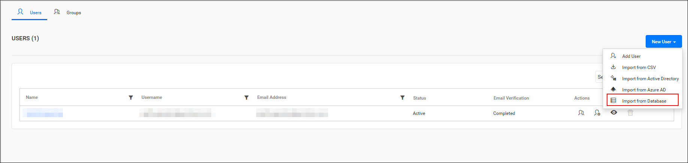
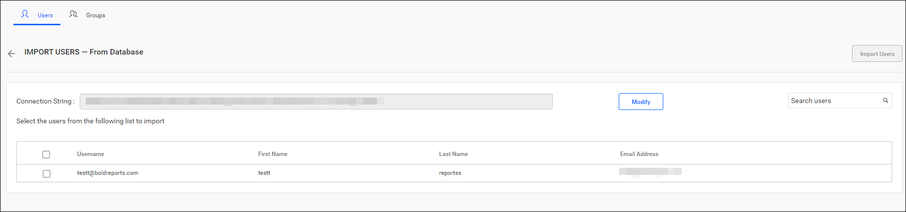
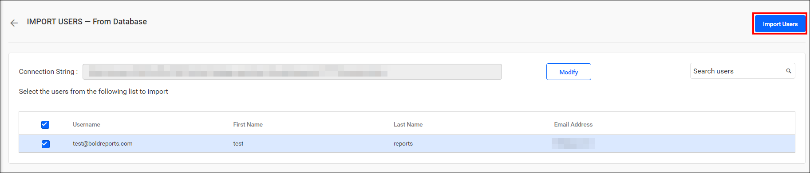
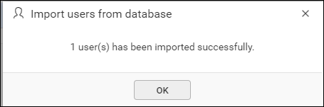
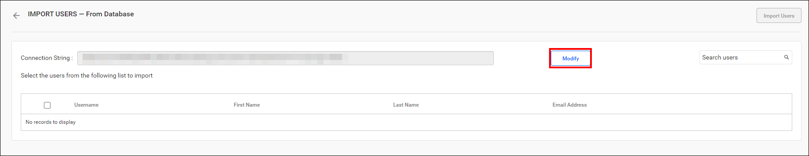

# Import users from a database into Bold Reports®

You can import users from an existing database into Bold Reports® On-Premises Edition from the User Management page.

## What do I need before importing database users?

Bold Reports® On-Premises Edition needs a configured database connection and a System Administrator account before you import users.

> **NOTE:** To import users from the existing database, you must configure the database connection in the [Database Settings](./../../../../manage-app-settings/database-settings/) within the User Directories tab.

Only users belonging to the `System Administrator` group can import users from the database into Bold Reports® On-Premises Edition.

## How do I list database users?

You list database users in Bold Reports® On-Premises Edition from the User Management page. Follow these steps:

1. Click `New User` on the User Management page.
2. Select `Import from Database`.

    

The link redirects to the import page, which appears as follows:

## How do I select and import users?

After you select columns, Bold Reports® displays the data retrieved from the database in the grid. Follow these steps:

1. Choose the users to be imported.
2. Click `Import Users` to proceed with the import.
    

Bold Reports® imports the selected users and displays a confirmation message, as shown in the following image.
    

## How do I modify the existing database connection?

You modify the Bold Reports® database configuration settings by clicking the `Modify` button:
    

## Frequently asked questions

### Where do I configure the database connection for user import?

You configure it in the Bold Reports® [Database Settings](./../../../../manage-app-settings/database-settings/) within the User Directories tab.

### Who can import users from a database?

Only users belonging to the `System Administrator` group can import users from the database into Bold Reports® On-Premises Edition.

## See also

* [Synchronize existing database users](./../../synchronize/synchronize-existing-database-users/)
* [Account activation](./../../../account-activation/)
* [Import users from CSV](./../import-users-from-csv/)
