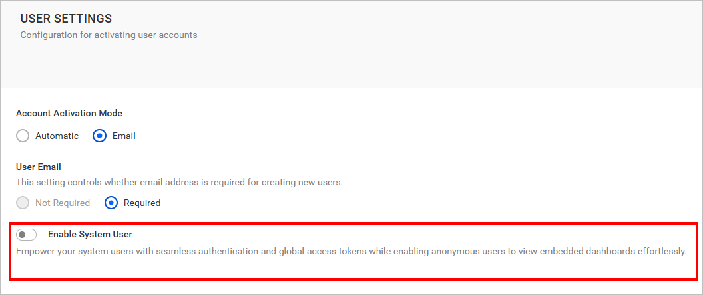
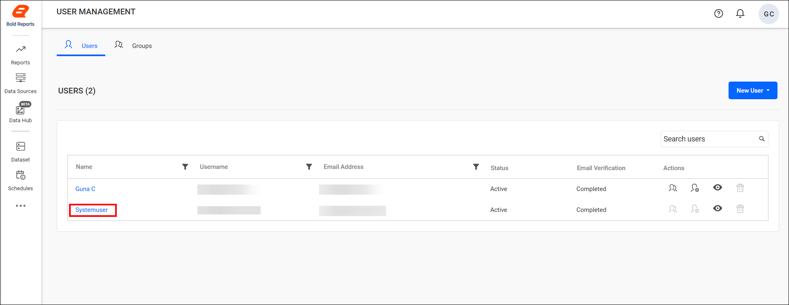
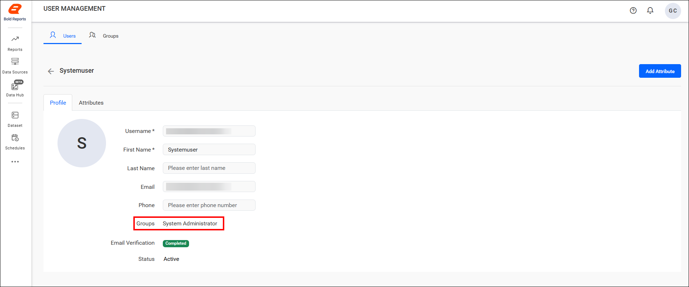

# System user authentication in Bold Reports®

Enable the `System User` option in Bold Reports® to streamline authentication and enhance accessibility. The option allows anonymous users to view reports and access REST APIs, and it generates global access tokens for secure and efficient system-wide authentication.

## What happens when I enable the System User option?

Enabling the Bold Reports® `System User` option grants a dedicated user account with elevated privileges across the entire application. When the option is enabled:

* The System User is automatically added to the Users page for each site.

* As a member of the System Administration group, the user gains full access to all features and modules within the application.

* The feature simplifies authentication for system-level operations by allowing:
    * Anonymous access for viewing reports and consuming REST APIs.
    * Generation of global access tokens for secure, system-wide authentication.

## When should I use the System User?

The Bold Reports® System User suits administrative tasks that need central control.

>Note: Ideal for scenarios where centralized control and unrestricted access are required for administrative tasks.

## Frequently asked questions

### Which group does the System User belong to?

The Bold Reports® System User is a member of the System Administration group and gains full access to all features and modules within the application.

### Where does the System User appear?

The System User is automatically added to the Users page for each site.

## See also

* [Manage users](./../manage-users/)
* [User roles](./../../../user-role/)
* [Manage permissions](./../../../manage-permissions/)
