# Manage users in Bold Reports® Report Server

In the Bold Reports® Report Server, you can add, edit, activate, deactivate, and delete users. You can also manage permissions and assign users to groups.

## Who can manage users?

In the Bold Reports® Report Server, only individuals belonging to the `System Administrator` group can add, edit, or delete users.

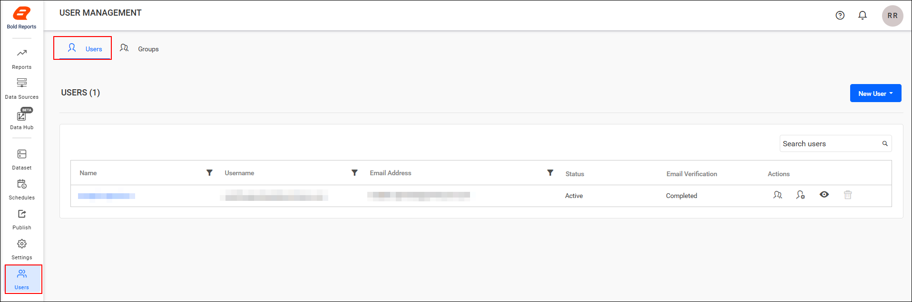

## How do I add new users?

You can add new users to the Bold Reports® Server individually or in bulk using CSV import.

### Add individual users

You add a single user to the Bold Reports® Server from the User Management page. Follow these steps:

1. Click `New User` on the User Management page.
2. Select `Add User`. The `Add User` dialog is displayed, as shown in the image below.

    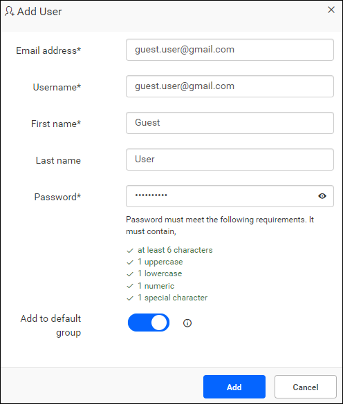

3. Enter the email address, username, first name, last name, and password.
4. To add the user to the default group, enable the **Add to default group** toggle button.
5. Click `Add`.

>**Important:** The `Add to default group` toggle appears only when the default group is set on the [Settings](./../../account-activation/#default-group-for-new-users) page.

> **NOTE** : An email address is mandatory only in the [Email required](https://help.boldreports.com/enterprise-reporting/administrator-guide/manage-users/account-activation/#email-required) mode. Users created with passwords in the Bold Reports® application will be recognized as local users.

Bold Reports® creates a new account for the user and sends an account activation email to the email address. The email contains an activation link to activate the Bold Reports® Server account.

The activation link sent to the user is valid only for 2 days. If the user has not activated within those 2 days, you can send a new activation link to the user from the user edit page. See the [Activate Users](#activate-users) section for more details.

The account stays in inactive status until the user activates it from the activation email.

## Add individual users with password

To add users with passwords in Bold Reports®, set the Account Activation Mode to `Automatic` on the `Accounts` settings page.

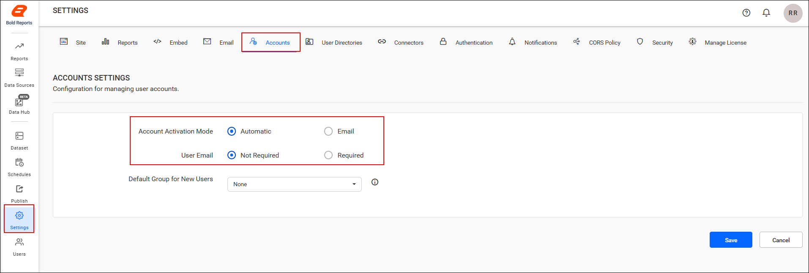

Then, follow these steps:

1. Click `New User` on the User Management page.
2. Click `Add User`. The `Add User` dialog box is displayed, as shown in the following image.

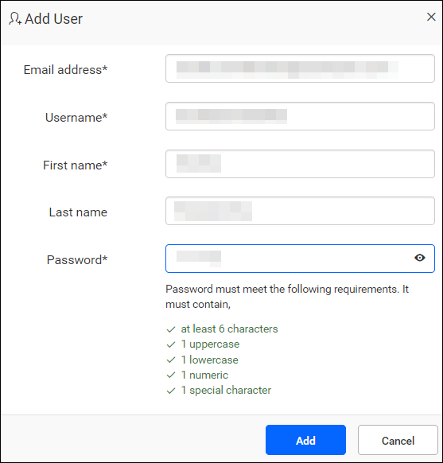

### What are the password requirements?

A Bold Reports® user password must contain:

* At least 6 characters
* 1 uppercase letter
* 1 lowercase letter
* 1 numeric digit
* 1 special character

## How do I add an existing UMS user?

You add an existing UMS user to a Bold Reports® site using the `Add User` dialog. Follow these steps:

1. Enter the email address of a user who is already present in UMS. The remaining fields are automatically filled and disabled.
2. Verify the user information.
3. Click `Add`.

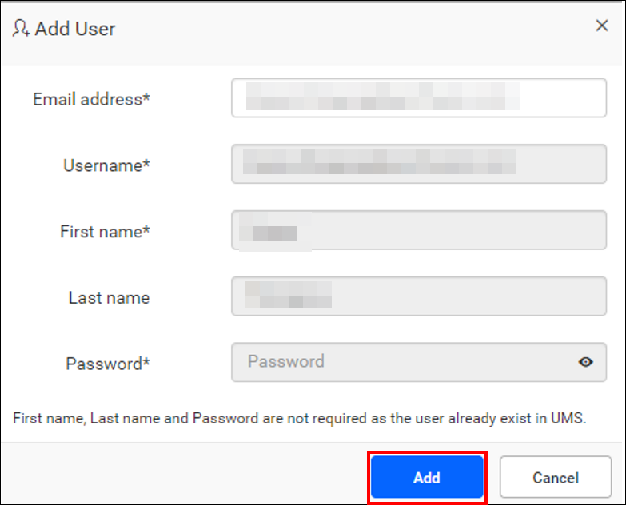

To learn how to add a user in UMS, see the [guide to managing users in UMS](https://help.boldreports.com/enterprise-reporting/administrator-guide/manage-sites/manage-users/).

## How do I import users from CSV?

Bold Reports® lets you add a large number of users at once. Download the CSV template file, add the users to it, and then import the file.

You can navigate to the user management page by clicking the `User` menu as follows:

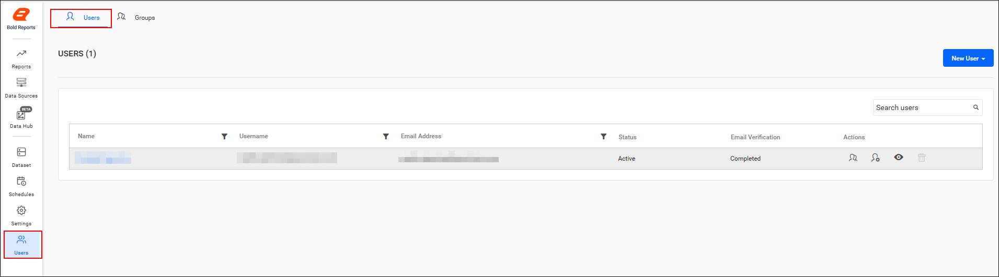

> **NOTE**: The CSV template used for the import can be downloaded from the following location in the Bold Reports® application. Users created with passwords in the Bold Reports® application will be considered local users.

## Add users from the CSV file

To start a CSV import in Bold Reports®, click `Import from csv` in `New User`.

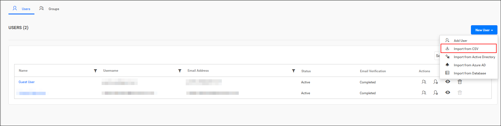

## What are the CSV file requirements?

The first row in the Bold Reports® CSV template represents the column heading. Bold Reports® assumes that the data starting from the second line in the file represents the user information.

The following columns are mandatory in the downloaded CSV file:

* Username
* Email address (It is mandatory only in the [Email required](https://help.boldreports.com/enterprise-reporting/administrator-guide/manage-users/account-activation/#email-required) mode)
* Full Name
* Password (It is mandatory only in the [Automatic activation](https://help.boldreports.com/enterprise-reporting/administrator-guide/manage-users/account-activation/#automatic-activation) mode)

Follow the steps below to add users using the CSV template:

1. Download a CSV template.

    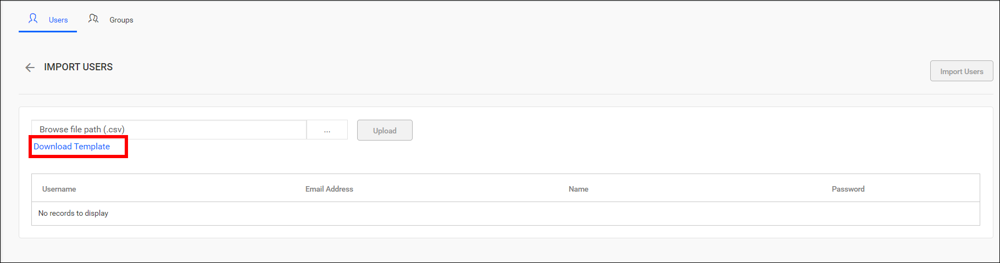

2. Add users in the CSV file.

    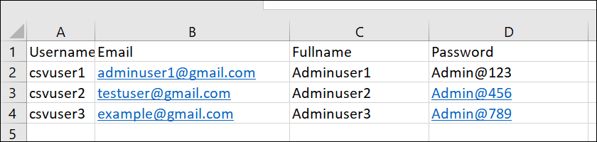

3. Save the CSV file and upload it.

    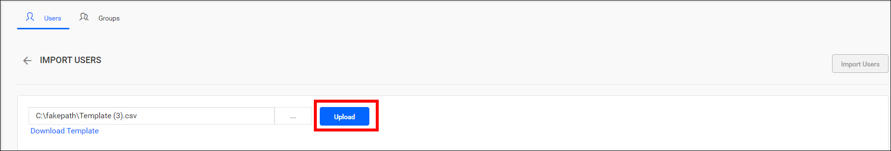

4. Review the user details. Once the file is uploaded, the user details are displayed in the grid, as shown in the image below.

    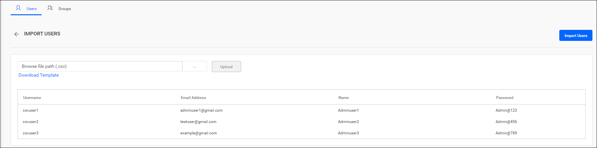

5. Click `Import Users` to import users from the CSV file.

    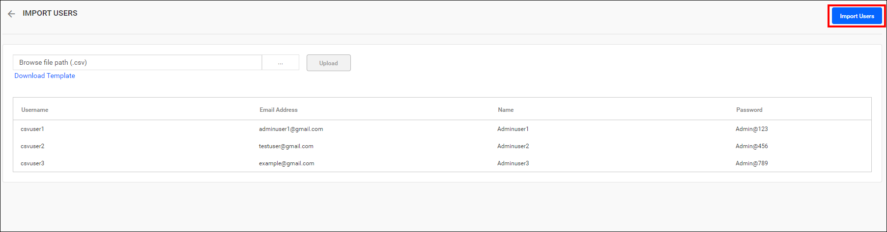

6. After importing users in Bold Reports®, the success message is displayed:

    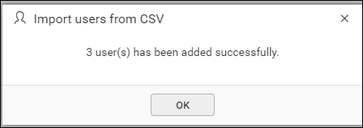

## How do I edit users?

You edit user profile details in Bold Reports® on the user edit page, as shown in the following images.
    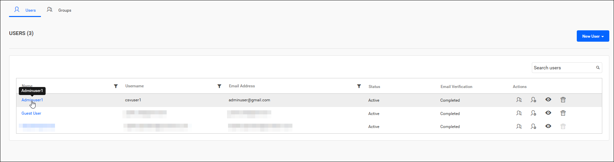
    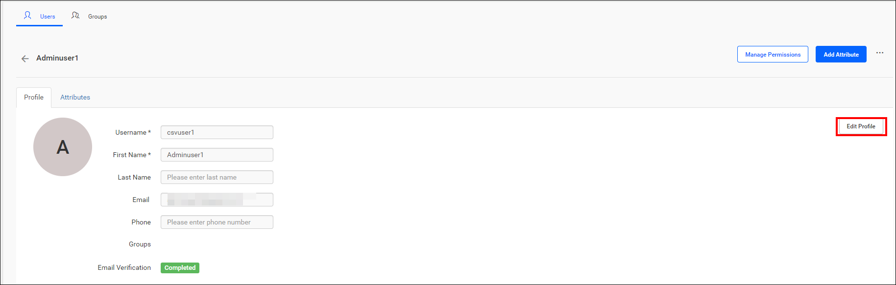
    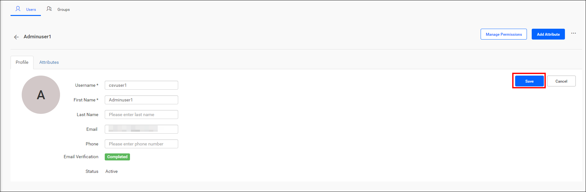

A user belonging to the `System Administrator` group can edit the username, first name, last name, and phone number for the user.

## How do I delete users?

You can delete users from a specific site in Bold Reports® when they are no longer needed on the site. You can delete users from the user management page or from the edit user page. Even if a user is removed from the site, the user is still available in the UMS.

### From user management page

On the Bold Reports® user management page, click `Delete User` to remove the user.

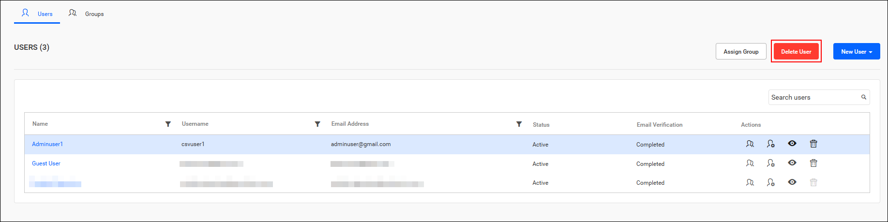

### From user edit page

On the Bold Reports® user's edit page, click `Delete User` from the menu, as shown in the image, to delete the user.

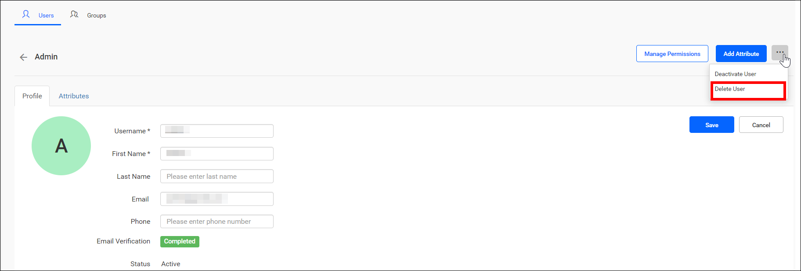

### Delete multiple users

You can delete several Bold Reports® users at once. Select multiple users from the user management page, and then click the **Delete User** button.

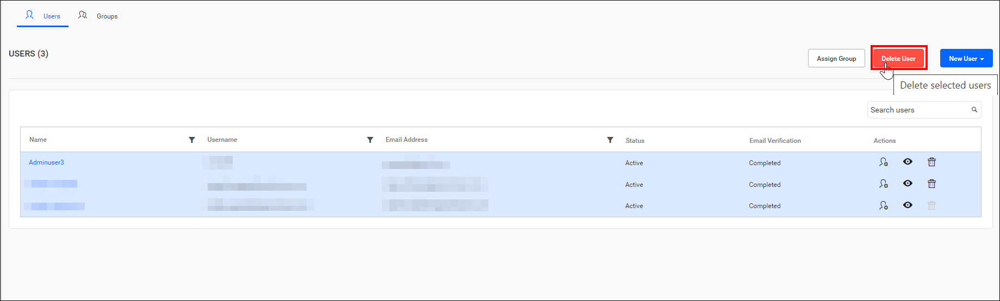

## How do I deactivate users?

You can deactivate Bold Reports® users at any time. Once deactivated, the user cannot log into Bold Reports®.
Click `Deactivate User` from the menu, as shown in the image:
    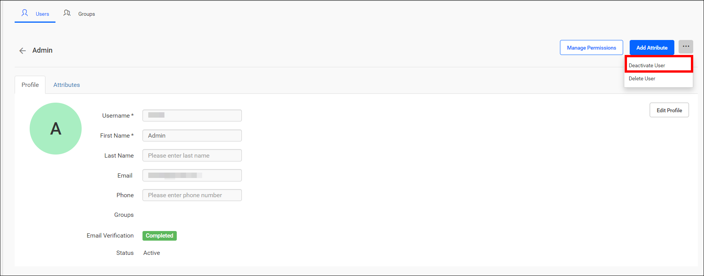

## Activate users

You activate inactive Bold Reports® users by clicking the `Active User` button on the user edit page.
    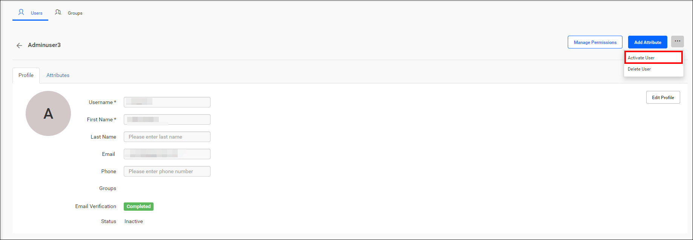

If the user's email verification is pending, you can complete the activation by clicking the `Resend Activation Code` button on the user edit page.

The button sends an account activation email to the user with an activation link to activate the account. Note that the activation link is valid only for 2 days.

If the user has not received the activation email within 2 days or missed activating the account, the `System Administrator` has to resend the activation email to the user.
    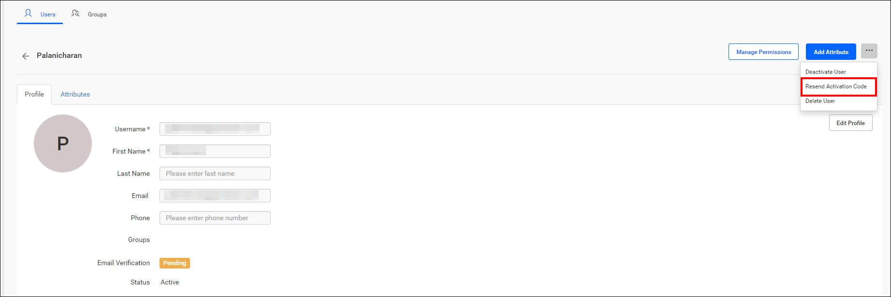

## How do I change a user's password?

An administrator can change a user's password in Bold Reports® from the Tenant management site. Follow these steps:

1. Go to the UMS site by clicking the profile, as follows:

    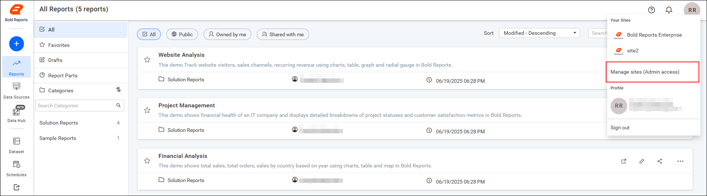

2. Click the `Users` option to manage users.
    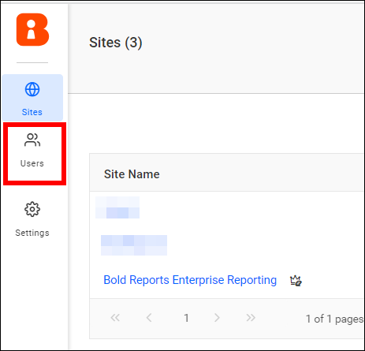

    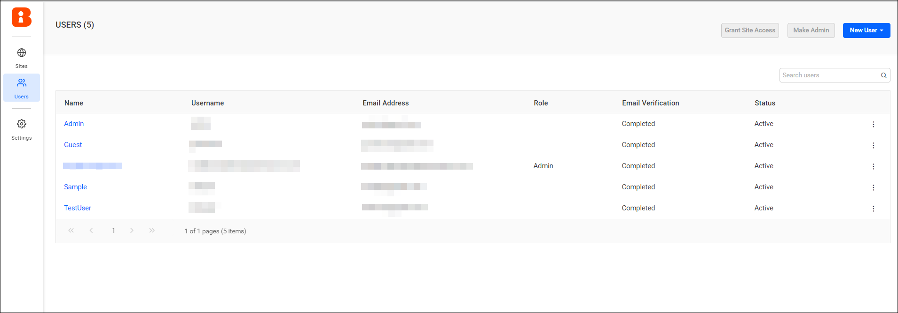

3. Click the name of the user whose password you want to change.

    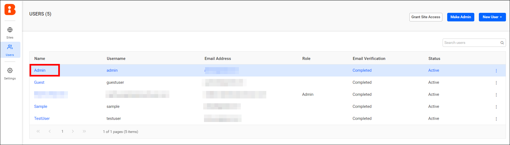

4. Enter the new password, and then click the `Update` button.

    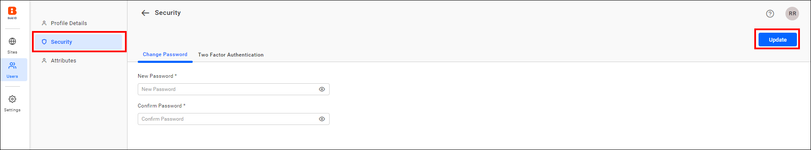

## How do I assign a group from the Users page?

You can add individual Bold Reports® users to a group directly from the Users listing page.

* Click the group icon on the Users listing page to add the user to a group.

    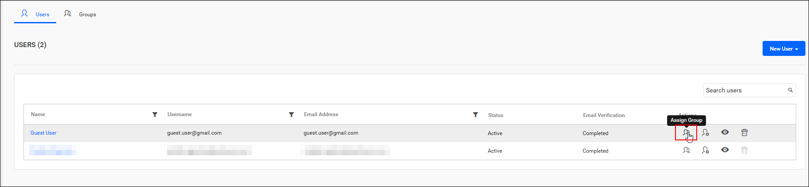

* From the group icon, add users to an existing group or create a new group for them.

    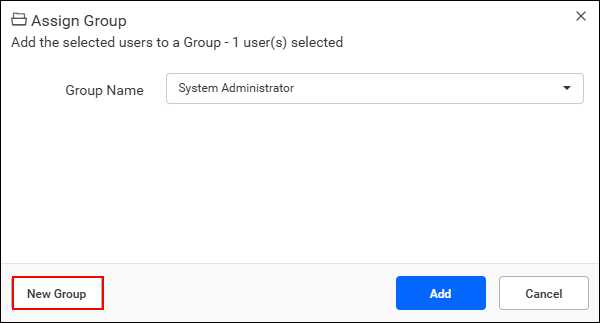

## Manage permissions

You can open the Bold Reports® `Manage Permissions` page for a user from either of the following pages:

1. Click the `Manage Permission` icon for the respective user in the users grid on the user management page.

    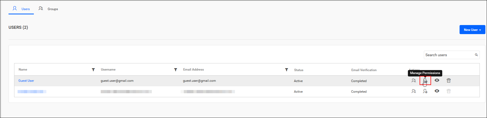

2. Click the user's name on the user listing page to navigate to the user profile page, and then click `Manage Permissions` on the user profile page.

    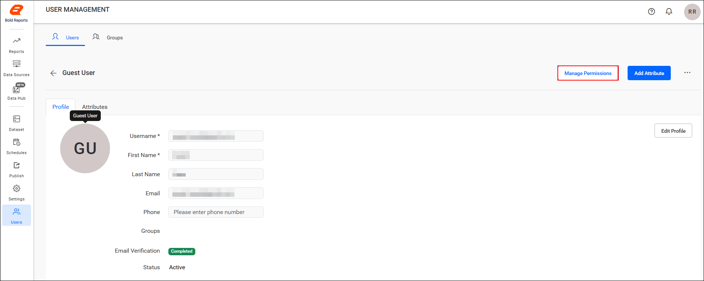

The `Manage Permissions` grid displays both permissions directly assigned to the user and those inherited from the assigned groups.

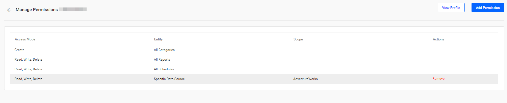

Click Add Permission to add permissions to the user.

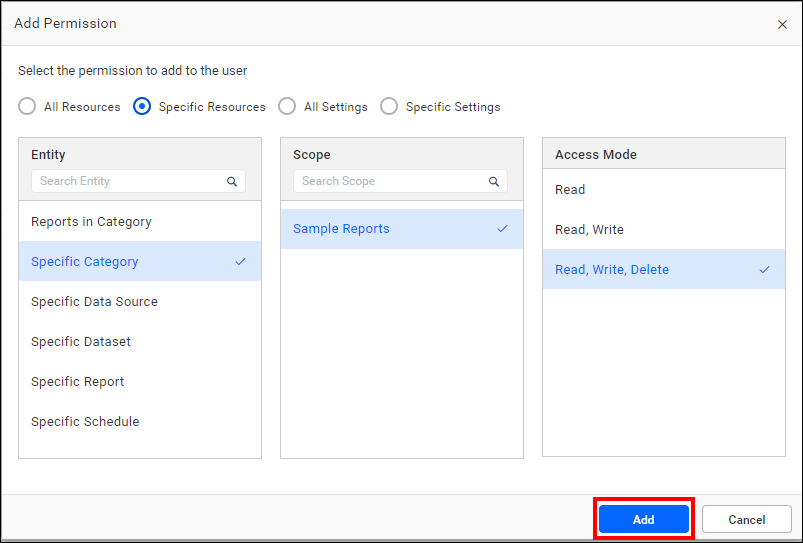

## How do I add permissions to users?

To add a permission to a Bold Reports® user, follow these steps:

1. Select the Entity.

2. Select the scope if the access mode is not Create or if the entity is a specific item type.

3. Select the access mode.

4. Click `Add` to add the framed permission to users.

You can also select multiple scopes and entities to assign multiple permissions. For more information on how to add and manage permissions, see [Manage Permissions](./../../../manage-permissions/).

## How do I assign users to a group?

You can assign Bold Reports® users to one or many groups from the user management page.
    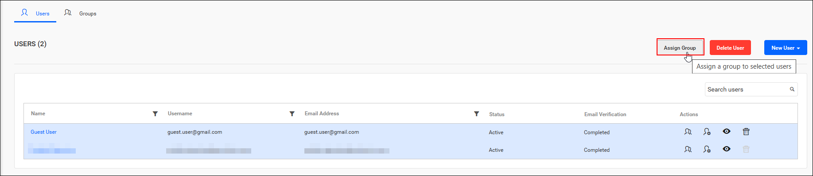

* Assign users to an existing group.

    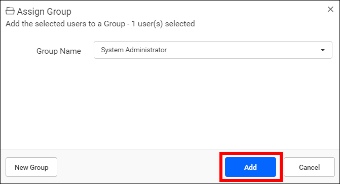

* Create a new group at the same time, and assign the selected users to the new group.

    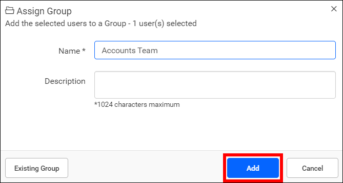

> **NOTE:** All the users in the group will have the permissions of the assigned group.

## Frequently asked questions

### How long is the activation link valid when I add a user?

The activation link sent from the Bold Reports® Server is valid only for 2 days. You can send a new link from the user edit page.

### Does deleting a user from a site remove the user from UMS?

No. Even if a user is removed from a Bold Reports® site, the user is still available in the UMS.

### What happens when a user is deactivated?

Once deactivated, the user cannot log into Bold Reports®.

## See also

* [Account activation](./../../account-activation/)
* [Import users](./../import-users/)
* [Manage groups](./../../groups/manage-groups/)
* [Manage permissions](./../../../manage-permissions/)
