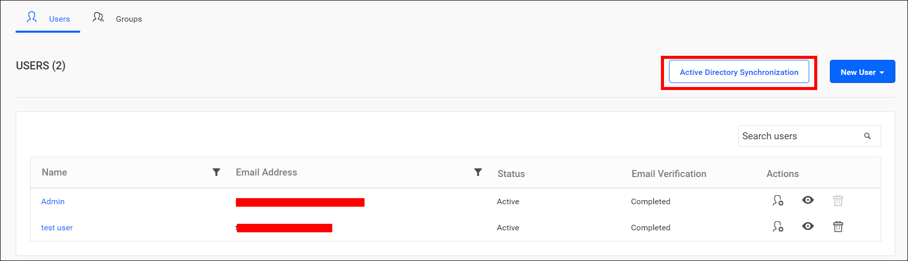
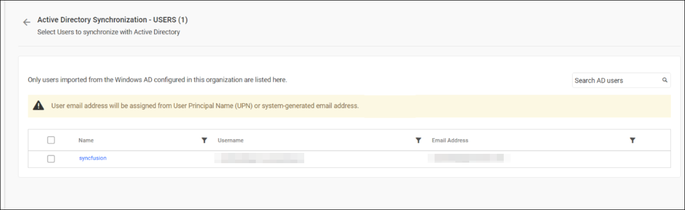
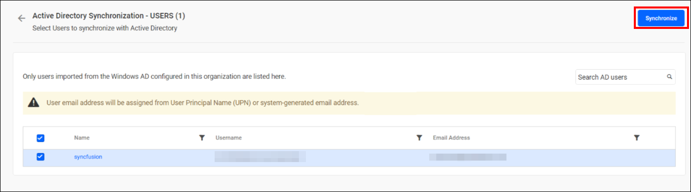
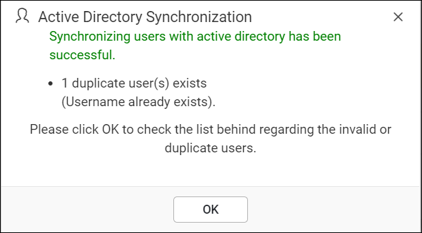
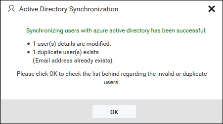

# Synchronize Active Directory users in Bold Reports®

The Bold Reports® Report Server synchronizes the details of imported Active Directory users with Active Directory from the user synchronization page.

## What do I need before synchronizing users?

The Bold Reports® Report Server needs a configured Active Directory connection and imported users before you synchronize.

> Before synchronizing the Active Directory users, follow the provided steps:
> 1. Configure the [Active Directory Settings](./../../../../manage-app-settings/active-directory/).
> 2. [Import Active Directory Users](./../../import-users/import-active-directory-users/) into Bold Reports® On-Premises Edition.

You can navigate to the user synchronization page from the users page.

## Synchronize users

The Bold Reports® Server lists the Active Directory users that have already been imported. Follow these steps to synchronize them:

1. Review the imported users in the grid.
    

2. Select the users you want to synchronize.
3. Click `Synchronize` at the top right corner.
    

### Synchronization procedure

The Bold Reports® Report Server applies the following changes from Active Directory during synchronization:

* The user details, including username, first name, last name, email address, and contact number, are synchronized with the Active Directory Server.
* The Report Server deletes a user if the user has been deleted from the Active Directory Server.
* After synchronization is complete, the success message box displays the number of modified, deleted, and duplicated users.
    

## What happens to duplicate users?

The Bold Reports® Report Server marks users with the same username or email address as existing Report Server users as duplicate users. Duplicate users are not synchronized into Active Directory.
    

## Frequently asked questions

### Which user details are synchronized from Active Directory?

The Bold Reports® Report Server synchronizes username, first name, last name, email address, and contact number with the Active Directory Server.

### What happens to a user deleted from Active Directory?

The Report Server deletes a user if the user has been deleted from the Active Directory Server.

## See also

* [Import Active Directory users](./../../import-users/import-active-directory-users/)
* [Synchronize Active Directory groups](./../../../groups/synchronize/synchronize-active-directory-groups/)
* [Active Directory synchronization schedule](./../../../../manage-app-settings/synchronization-schedule/active-directory-synchronization-schedule/)
