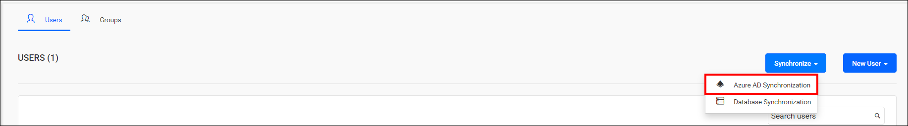
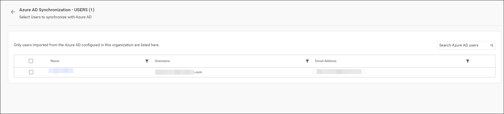
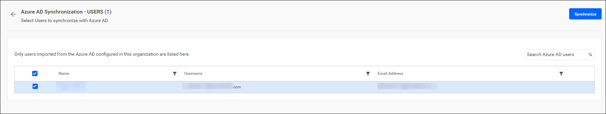
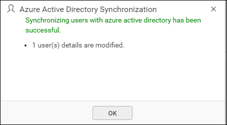
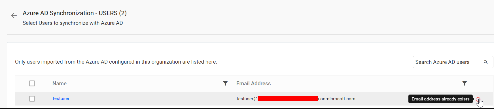

# Synchronize Microsoft Entra ID users in Bold Reports®

Bold Reports® synchronizes the details of imported Microsoft Entra ID (formerly Azure Active Directory) users with Microsoft Entra ID.

## What do I need before synchronizing users?

Bold Reports® needs a configured Microsoft Entra ID connection and imported users before you synchronize.

> **Note:** Before synchronizing the Microsoft Entra ID users, follow these steps:
> 1. Configure [Microsoft Entra ID settings](./../../../../manage-app-settings/azure-active-directory/).
> 2. Import users from Microsoft Entra ID to Bold Reports®. For steps, see [Microsoft Entra ID user import](./../../import-users/import-azure-active-directory-users/).

You can navigate to the user synchronization page from the users page, as shown in the image below.

## Synchronize Users

Bold Reports® lists the Microsoft Entra ID users that have already been imported, as shown in the image below.

>**Note:** Only users imported from the configured Microsoft Entra ID within this organization are listed here.

To synchronize users, follow these steps:

1. Choose the users you want to synchronize.
2. Click `Synchronize` at the top.

### Synchronization procedure

Bold Reports® applies the following changes from Microsoft Entra ID during synchronization:

* Bold Reports® synchronizes user details such as username, first name, last name, email address, and contact number with Microsoft Entra ID.

* Bold Reports® deletes users that have been deleted from Microsoft Entra ID.

After synchronization completes, the success message box shows the number of modified, deleted, and duplicated users, as shown in the image below.

## What happens to duplicate users?

Microsoft Entra ID users who have the same email address as existing Bold Reports® users are marked as duplicates. They cannot be synchronized.

## Frequently asked questions

### Which users appear on the synchronization page?

Bold Reports® lists only users imported from the configured Microsoft Entra ID within the organization.

### What happens to a user deleted from Microsoft Entra ID?

Bold Reports® deletes users that have been deleted from Microsoft Entra ID during synchronization.

## See also

* [Import Microsoft Entra ID users](./../../import-users/import-azure-active-directory-users/)
* [Synchronize Microsoft Entra ID groups](./../../../groups/synchronize/synchronize-azure-active-directory-groups/)
* [Microsoft Entra ID synchronization schedule](./../../../../manage-app-settings/synchronization-schedule/azure-active-directory-synchronization-schedule/)
