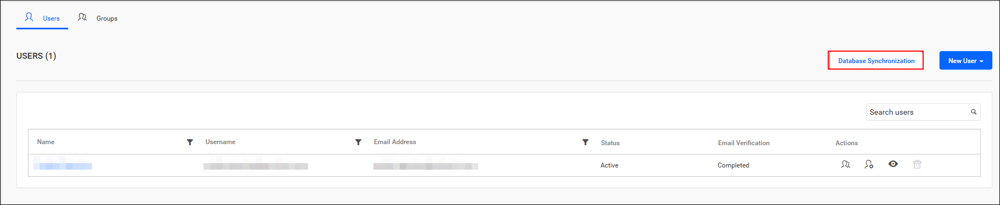
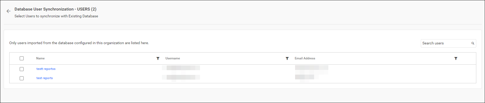
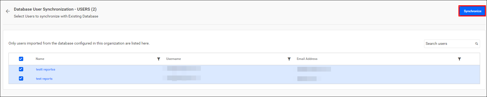
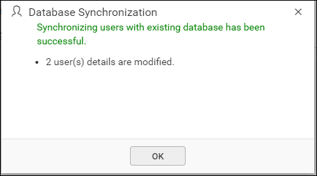
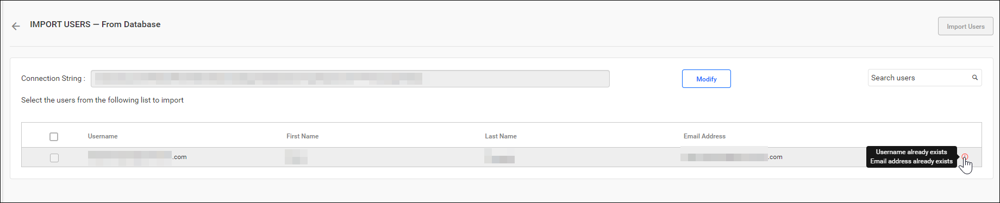

# Synchronize imported database users in Bold Reports®

Bold Reports® synchronizes the details of users imported from an existing database with that database.

## What do I need before synchronizing database users?

Bold Reports® needs configured database settings and imported database users before you synchronize.

> **Note:** Before synchronizing the Existing Database users, follow the provided steps:
> 1. Configure [Database Settings](./../../../../manage-app-settings/database-settings/).
> 2. Import users from the existing database into Bold Reports® by referring to the [Import Users from Database Guide](./../../../../manage-users/users/import-users/import-users-from-database/).

You can navigate to the user synchronization page from the users page, as shown in the image below:

## Synchronize Users

Bold Reports® lists the imported database users that are already present. Follow these steps to synchronize them:

1. Review the imported users, as shown in the image below.

    

    > **Note:** Only users imported from the configured database within this organization are listed here.

2. Select the users you want to synchronize.
3. Click `Synchronize` at the top.

    

### Synchronization procedure

Bold Reports® applies the following changes from the existing database during synchronization:

* Bold Reports® synchronizes the user details, such as first name, last name, email address, and contact number, with the existing database.

* Bold Reports® deletes the user if the user has been deleted from the existing database.

After synchronization completes, the success message box displays the number of modified, deleted, and duplicated users, as shown in the image below.
    

## What happens to duplicate users?

Bold Reports® marks existing database users who have the same email address as Bold Reports® users (already present) as duplicate users. Duplicate users are not allowed to synchronize with the imported existing database users.

## Frequently asked questions

### Which user details are synchronized from the database?

Bold Reports® synchronizes first name, last name, email address, and contact number with the existing database.

### Which users appear on the synchronization page?

Bold Reports® lists only users imported from the configured database within the organization.

## See also

* [Import users from a database](./../../import-users/import-users-from-database/)
* [Database settings](./../../../../manage-app-settings/database-settings/)
* [Database synchronization schedule](./../../../../manage-app-settings/synchronization-schedule/database-synchronization-schedule/)
