# Manage your user profile in Bold Reports®

On the Bold Reports® user profile page, you can view and manage your profile, security, permissions, access tokens, and notification settings. The options are:

* Profile details
* Security
* My permissions
* Personal Access Token
* Edit notification settings
* Forgot password

## Profile details

The Bold Reports® profile details section lets you view the profile, edit the profile details, and change the password.

### How do I view my profile?

To view your profile details, click the Profile icon located in the top-right corner of the Bold Reports® Report Server menu bar.
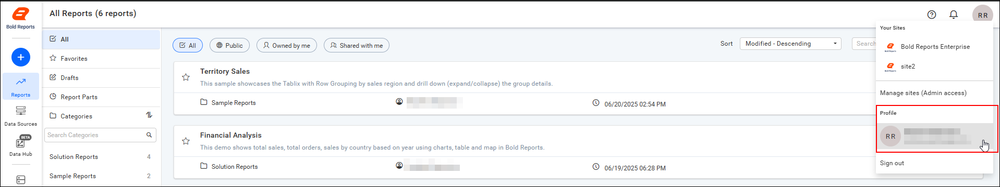

### How do I edit my profile?

You edit your profile details in your Bold Reports® account. Follow these steps:

1. Click `Bold Reports Account` on the profile page.
    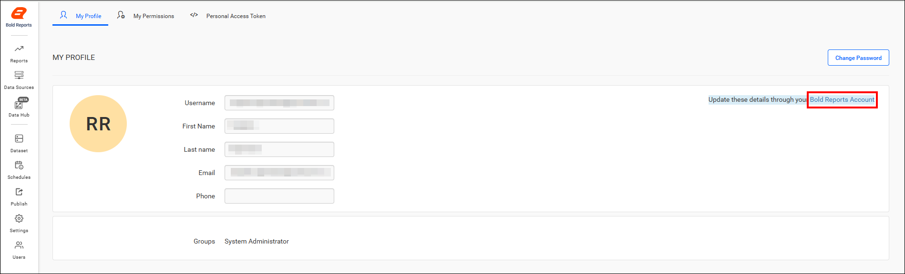

2. Edit the Username, First name, Last name, Phone number, and Profile picture of your account.
    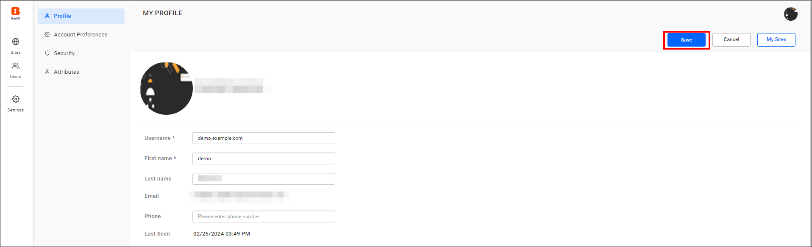

#### Upload Profile Picture

You can update or delete your Bold Reports® profile picture from your profile.

* To update your profile picture, click the pencil icon on your profile, upload the image, and click save.
    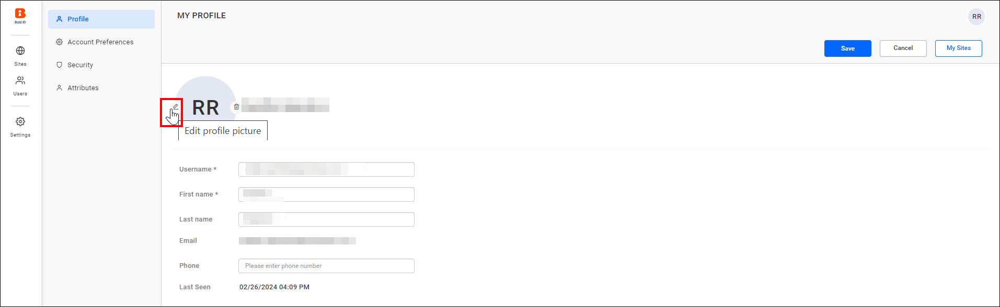
    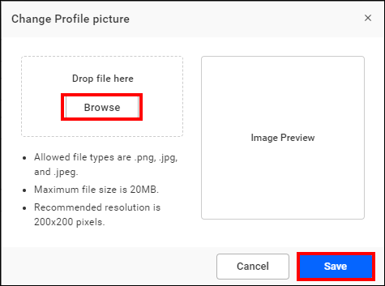

* To delete your profile picture, click the delete icon on your profile and proceed with `Yes`.
    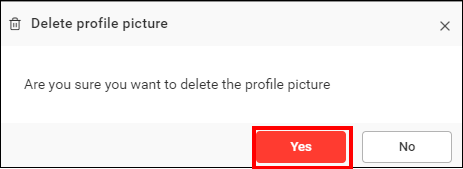

#### Account Preference

In the Bold Reports® account preference, set the language preference for your profile.
    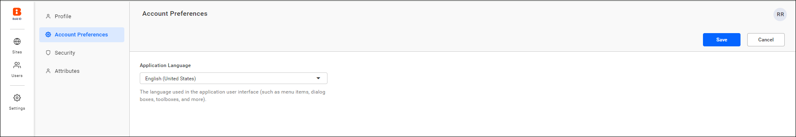

## Security

In the Bold Reports® Security section, you update your password and enable 2FA for your account.

### How do I change my password?

You change your Report Server login password from the Bold Reports® Security section. Follow these steps:

1. Click **Change Password**.
    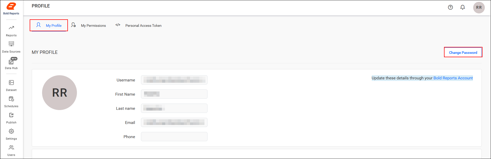

2. Set a new password, and then click **Save**.
    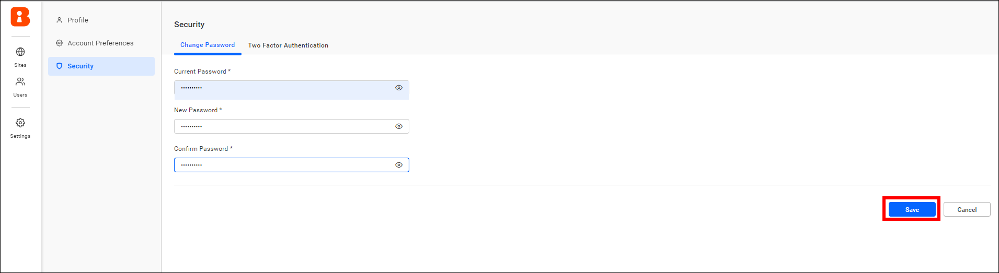

## Two Factor Authentication

Bold Reports® two-factor authentication (2FA) adds a verification code to your login. To learn about the implementation of 2FA in Bold Reports®, see the [Two-Factor Authentication Guide](../manage-sites/two-factor-authentication/).

### How do I enable two-factor authentication?

You enable 2FA for your Bold Reports® account from the Two-Factor Authentication tab. Follow these steps:

1. Go to the Two-Factor Authentication tab under the security section.
2. Click Enable Two-Factor Authentication.
    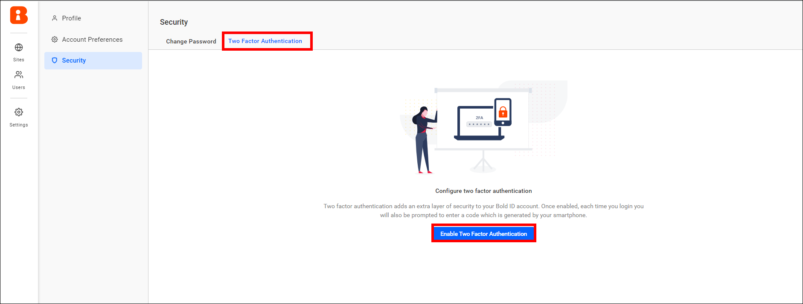

3. In the authenticator application, scan the QR code or manually enter the key shown under the QR code. The authenticator application adds your user account.
    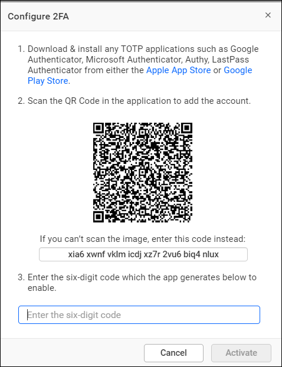

4. Enter the verification code shown in the authenticator application and click **Activate**.
    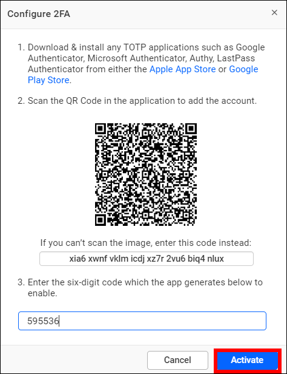

5. Copy the recovery codes and store them in a safe place. After you enable 2FA, 10 recovery codes are generated.
    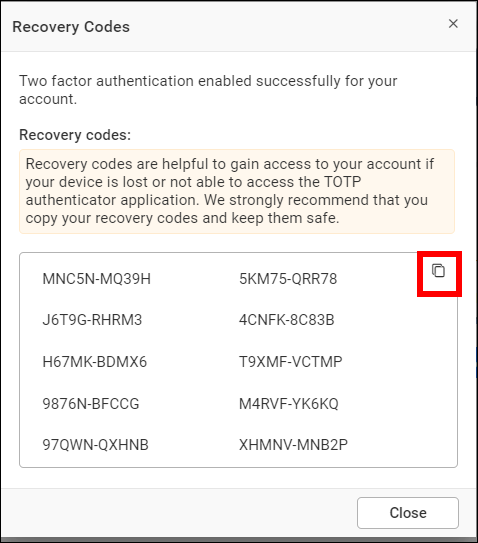

> **NOTE**: Each recovery code can be used only once. To get new recovery codes, use the `Regenerate Recovery Code` option in your profile.

### How do I disable two-factor authentication?

You disable 2FA for your Bold Reports® account from the same tab. Follow these steps:

1. Click `Remove Two-Factor Authentication`.
    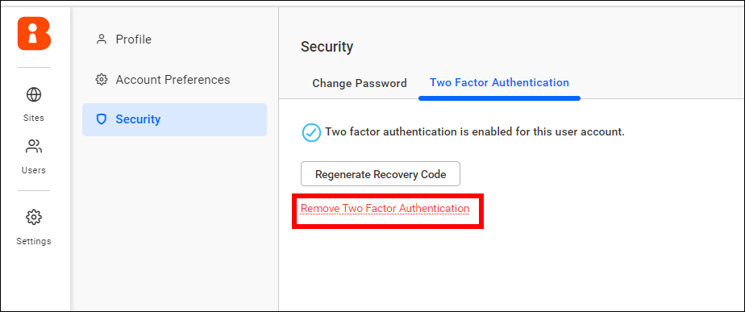

2. Enter the verification code shown in the authenticator application for the account and click **yes**.
    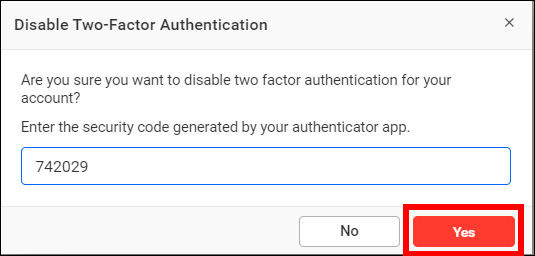

## My permissions

The Bold Reports® My permissions section shows your access permission list for each resource, such as reports, data sources, files, and schedules, in the Report Server.
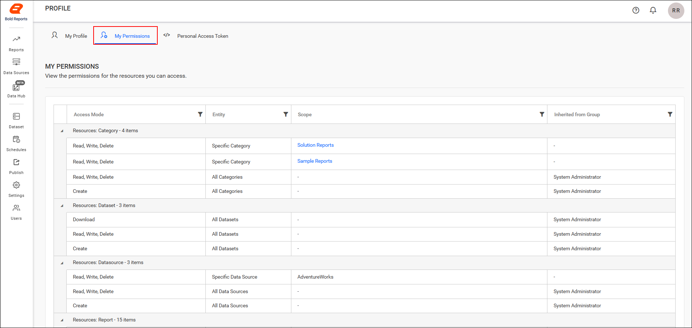

## Personal Access Token

A Bold Reports® authentication token can be used in API requests or other interactions with the Report Server to authenticate and authorize access to its resources. For more information on how to generate an authentication token, see the [Generate Authentication Token Guide](../../developer-guide/how-to/generate-authentication-token-for-bold-reports-server/).

## Edit notification settings

In the Bold Reports® Report Server, you can configure your own notification preferences and view or edit the following notification settings:

* System notifications
* Mail notifications
* Auto watch for comments of created items
* Auto watch for comments of accessible items

    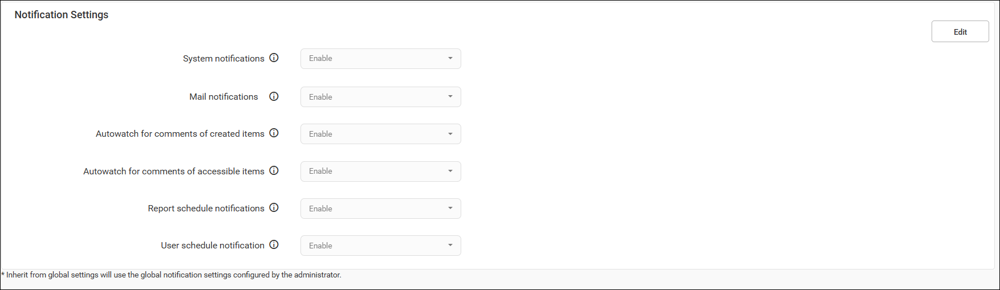

### Which notifications can I configure?

The Bold Reports® Report Server provides the following notifications:

1. **System notifications**

    * System notifications appear near the user's profile picture, as shown in the following image.
        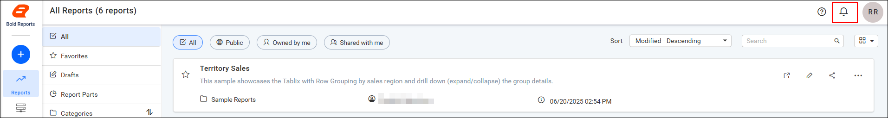

    * Users can navigate to the particular comment by clicking the report name in the notification section. To configure the user notification settings, users can navigate to the profile page by clicking settings.

        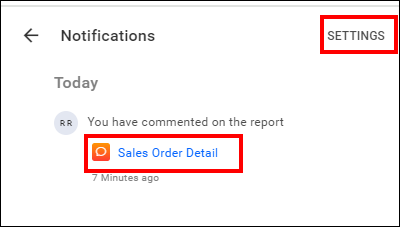

2. **Mail notifications**

    Enabling the mail notifications option notifies users through email for comments, permissions, schedules, views, user(s) and group(s) (manual and schedule) synchronization, and user account activation.

3. **Auto watch comments of created items**

    Enabling the option sends notifications for comments on all the items created by users.

4. **Auto watch comments of accessible items**

    Enabling the option sends notifications for comments on all the items that are accessed by users.

5. **Report schedule notification**

    Enabling or disabling the report schedule button lets you restrict the email notifications for scheduled reports.

6. **User schedule notification**

    Enabling or disabling the user schedule button lets you restrict the email notifications for admin users.

7. **Specific watch**

    Apart from the auto-watch of newly created and accessible item settings, users can also watch an item specifically.
    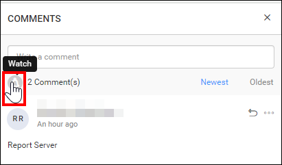
> You can toggle between a watch and unwatch for a report comment at any time.

### Inherit from global settings

To use the same settings as the Bold Reports® site notification settings, enable the **Inherit from global settings** option.
    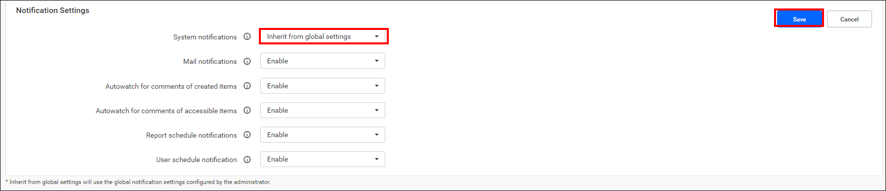

## Forgot Password

If you have forgotten your Bold Reports® password, you can reset it by following these steps:

1. Click the **Cannot access your account?** option on the login page.
    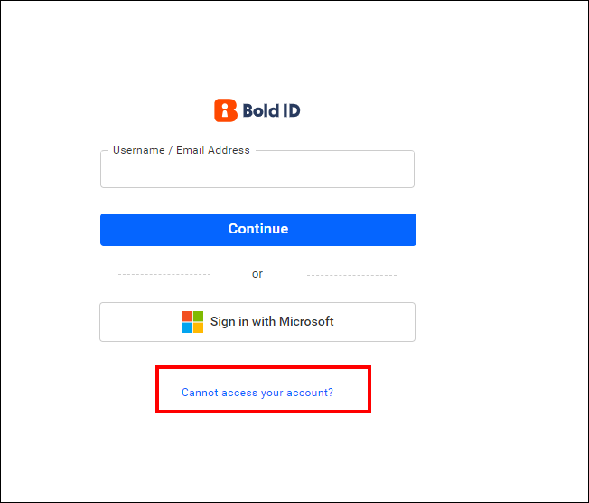

2. Enter your email to receive the reset password link.
3. Click `Send recovery link`.
    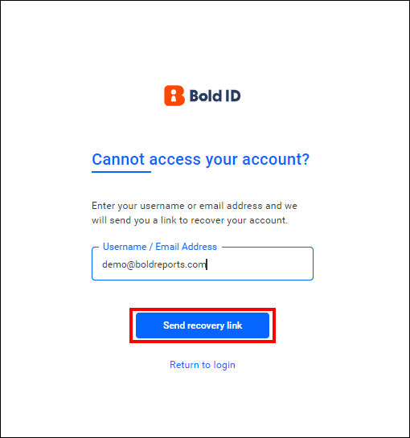

4. Check your inbox. You will receive an email to reset the password.
    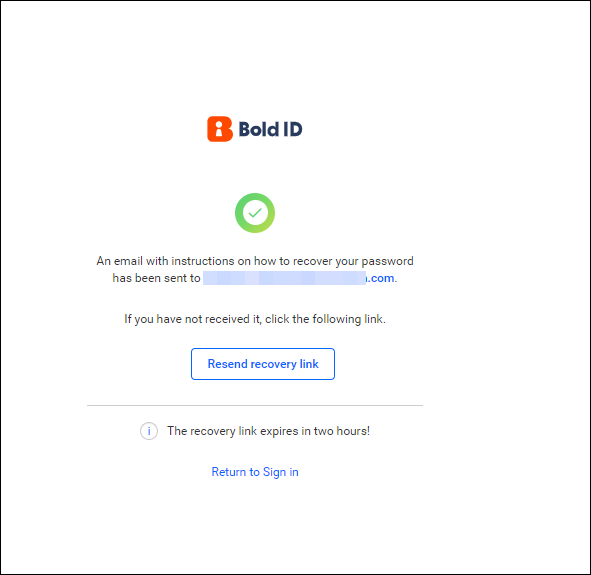

5. Click the link in the email you received, and reset the password.
    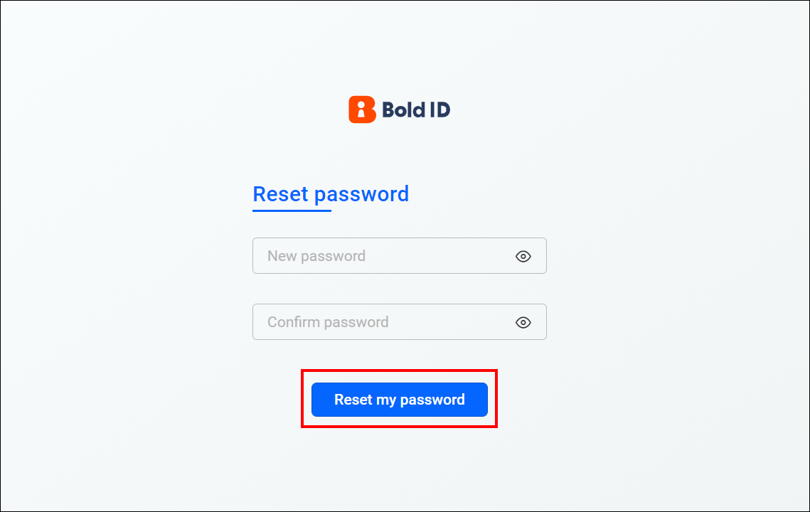

## Frequently asked questions

### How many recovery codes does Bold Reports® generate for 2FA?

Bold Reports® generates 10 recovery codes after you enable 2FA. Each recovery code can be used only once.

### How do I reset a forgotten password?

Click **Cannot access your account?** on the Bold Reports® login page, enter your email, and click `Send recovery link`. Then, reset the password from the link in the email.

## See also

* [Two-factor authentication](../manage-sites/two-factor-authentication/)
* [Manage users](../manage-users/users/manage-users/)
* [Manage permissions](../manage-permissions/)
