# Application startup for Bold Reports® Enterprise

Bold Reports® application startup lets you activate your account and start the Bold Reports® Enterprise Application. You can activate your account either by using your login credentials or by an offline unlock key.

> **NOTE**: If you have already installed Bold Reports® on your machine, go to [Activate Bold Reports® license](./../application-startup/#activate-bold-reports-license) to activate your Bold Reports® account.

## Application Startup for Bold Reports® Enterprise

The Bold Reports® application startup screen helps you configure storage options and set up the admin account.

The application startup holds the storage options configuration for the following applications:
1. Bold Reports® Sites: Manages user identities and sites.
2. Bold Reports® Server: Manages reports, data sources, dataset, schedules and the user permissions.

## New User - System Administrator

During Bold Reports® startup, you create a new user to access the Bold Reports® sites and reports with the details shown in the following image.

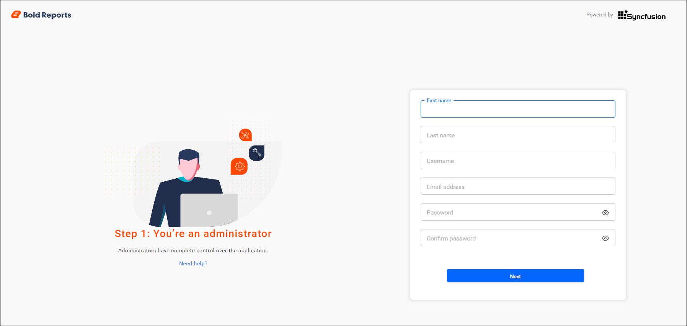

When you create the new user account, a new group called `System Administrator` is also created.

By default, the `System Administrator` group has permission to do the following:

* Create Reports.
* Create Data Sources.
* Create Dataset.
* Create Schedules.
* Create Users.
* Create Groups.
* Manage Permissions for users and groups.

The new user account is assigned to the `System Administrator` group by default.

## Database Configuration

Bold Reports® database configuration starts with choosing a database mode, followed by the connection details.

### Which database mode should I choose?

Before configuring the database, determine the mode for managing tenant data in Bold Reports®. Your selection impacts how tenant data is stored, secured, and maintained.

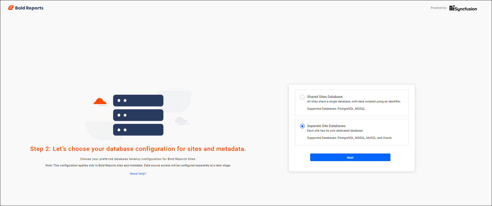

#### Shared Database Mode

In the Bold Reports® Shared Database mode, all tenants share a single database, with data logically separated using unique identifiers. The mode optimizes resource utilization, reduces infrastructure costs, and simplifies maintenance while maintaining data segregation. It is well suited for scalability and efficient management.
**Supported Databases:** PostgreSQL, MSSQL.

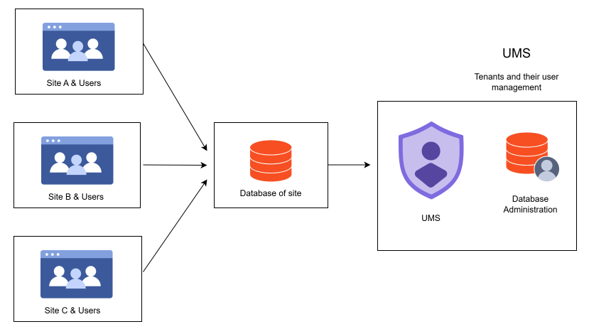

#### Separate Database Mode

In the Bold Reports® Separate Database mode, each tenant has a dedicated database, ensuring complete physical data separation. The mode provides enhanced security, independent management, and optimized performance for each tenant. However, it requires greater infrastructure investment and ongoing maintenance.

**Supported Databases:** MSSQL, PostgreSQL, MySQL, Oracle.

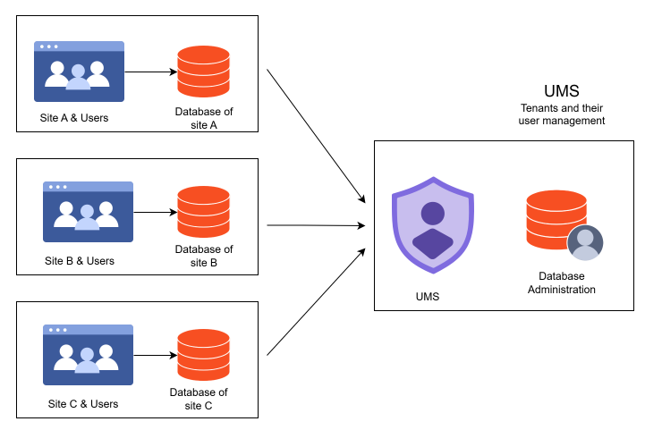

Once you select the preferred database mode, click Next to proceed to the database configuration step, where you enter the required connection details.

The database configuration lets you configure single or individual databases for Bold ID and Bold Reports®.

`Bold ID` database stores the sites, users, and their site access information.

`Bold Reports` database stores the reports, users, and their resource access permissions. You can use any one of the following databases to configure the Bold Reports® Server.

## Storage Options

Bold Reports® Server supports the following databases:

* Microsoft SQL server / Azure SQL
* PostgreSQL
* MySQL
* Oracle

You can connect to the SQL Server instance with the following options:

* Create new database.
* Use an existing database.

  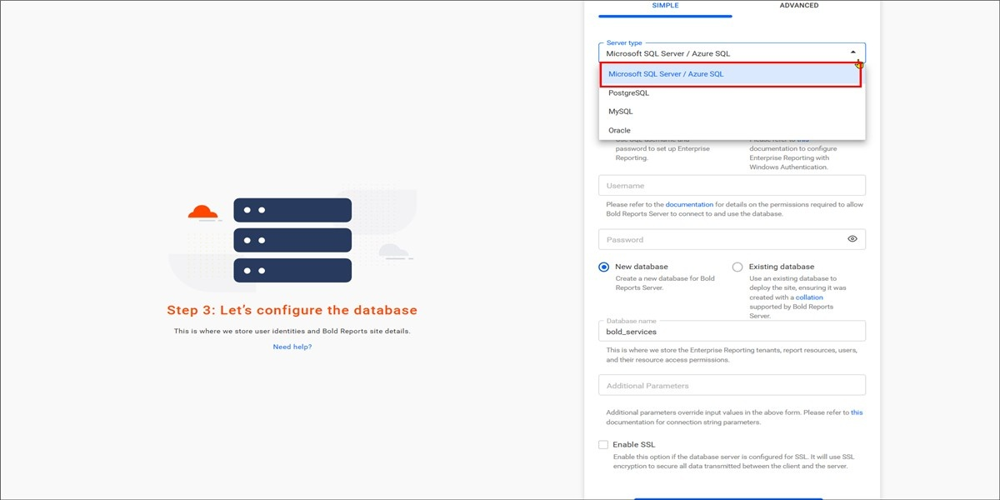

### How do I create a new database?

To create a new database for the Bold Reports® Server, follow the guide for your database server:

[Database Configuration for Bold Reports® Server in SQL Server](./sql-configuration/#sql-server-database-configuration-for-bold-reports-server-sites)

[Database Configuration for Bold Reports® Server in PostgreSQL](./postgresql-configuration/#postgresql-database-configuration-for-bold-reports-server-sites)

[Database Configuration for Bold Reports® Server in MySQL](./mysql-configuration/#mysql-database-configuration-for-bold-reports-server-sites)

[Database Configuration for Bold Reports® Server in Oracle](./oracle-configuration/#oracle-database-configuration-for-bold-reports-server-sites)

> **Note:** When creating a new site during installation, database users need specific permissions. Make sure the users are granted the necessary [database permissions](./../administrator-guide/faq/what-are-the-database-permissions-required-to-set-up-bold-reports/).

### How do I use an existing database?

You can use an existing database to store the Bold Reports® user identities and report details.

> The credentials that is given to connect to database Server instance must have permissions to:
> * Create Database
> * Create Table
> * Insert
> * Update Table
> * Alter Table
> * Select
> * Drop Table
> * Drop Database

You can select a simple or advanced mode for configuration.

#### Simple mode

Bold Reports® Simple mode configures a single database for Bold ID and Bold Reports®.

The configuration stores the user identities, site details, reports, users, and their access permissions in a single database.

The sites will be deployed to the local file system by default in **Simple mode**.

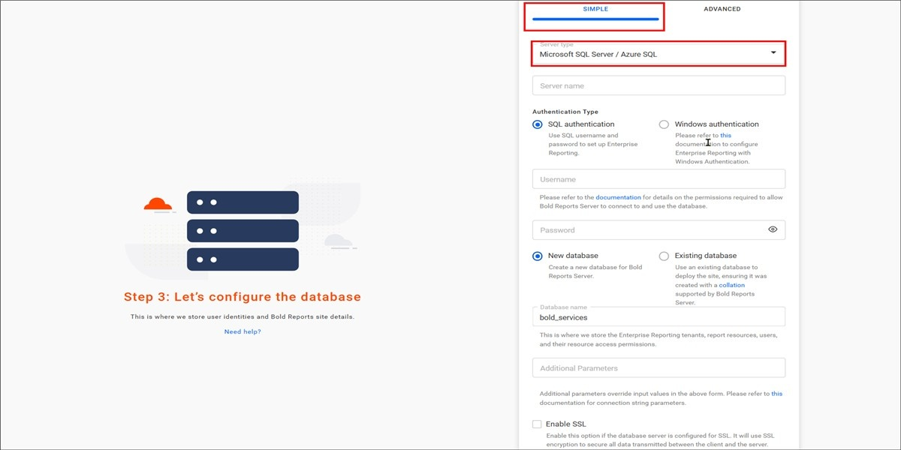

#### Advanced mode

Bold Reports® Advanced mode configures individual databases for Bold ID and Bold Reports®. You can choose between the local file system and Azure Blob Storage for Bold ID and Bold Reports®.

`Bold ID` database stores user identities and site details.

`Bold Reports` database stores reports, users, and their access permissions.

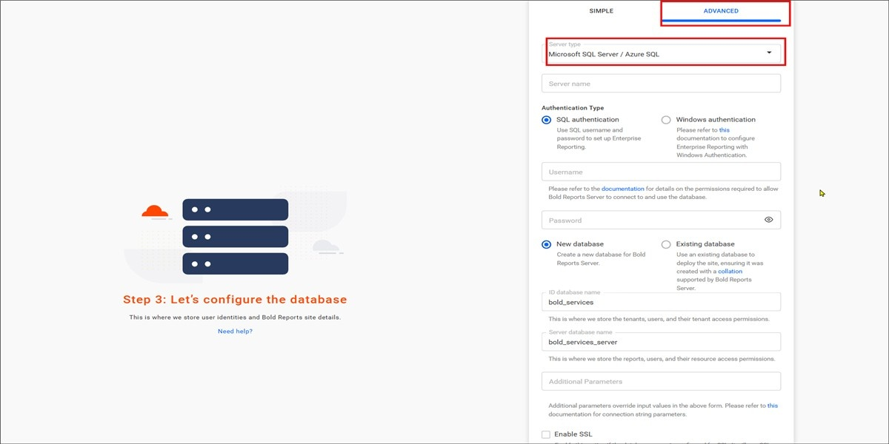

## Storage Configuration

In Bold Reports® advanced mode, you select the storage option from the `Storage Type` dropdown and provide the required credentials in the respective fields. The storage holds the resources in Bold ID and Bold Reports®.

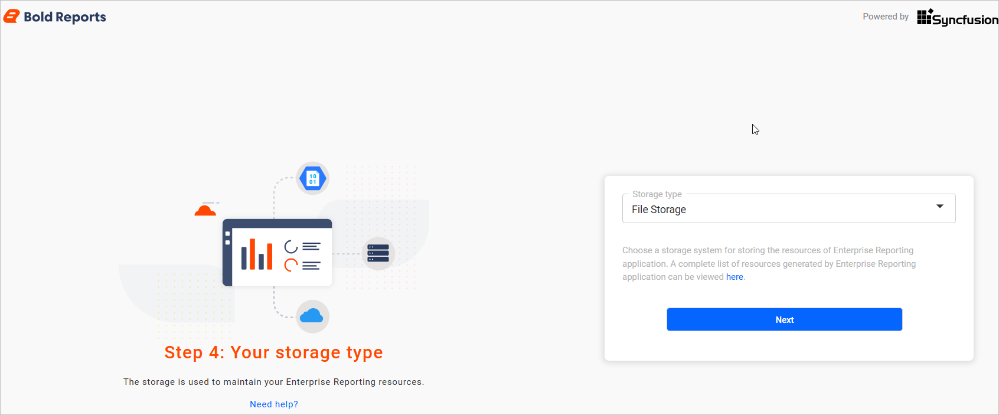

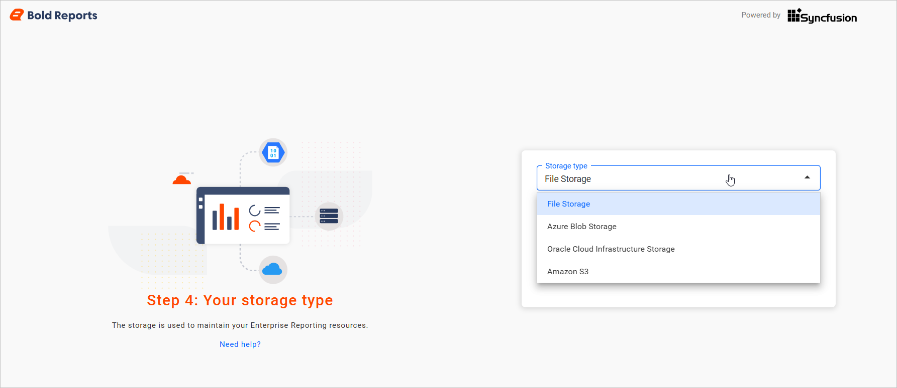

> By default, storage type is File Storage.

### Azure Blob Storage

To use Azure Blob Storage with Bold Reports®, select Blob Storage and provide the Azure Blob credentials in the required fields. For detailed configuration steps, see the <a href="https://docs.microsoft.com/en-us/azure/storage/blobs/storage-quickstart-blobs-portal">Azure Blob Storage Quickstart Guide</a>.

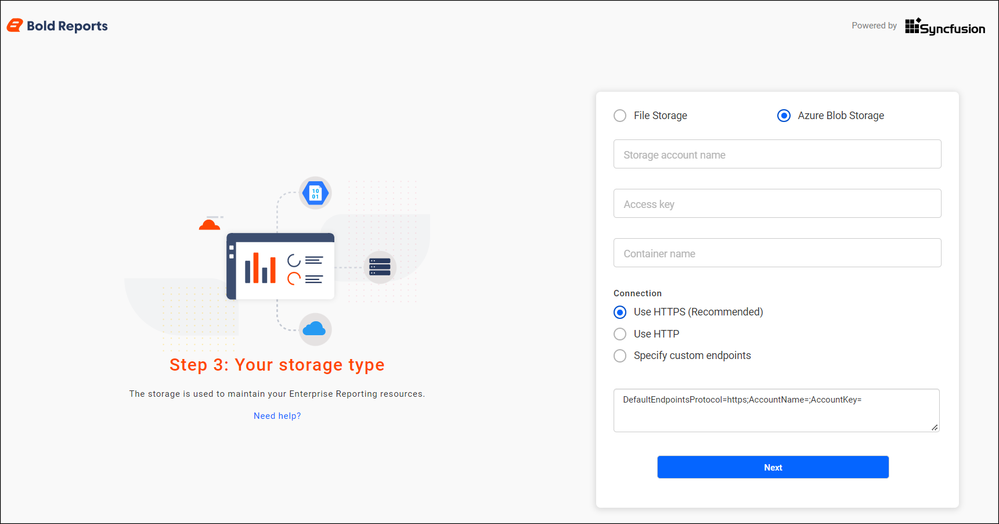

### Amazon S3

To use Amazon S3 with Bold Reports®, enter the AWS Access Key, Secret Key, Bucket Name, Root Folder Name, and Region details. For setup details, see [creating an Amazon S3 bucket](https://docs.aws.amazon.com/AmazonS3/latest/userguide/creating-bucket.html).

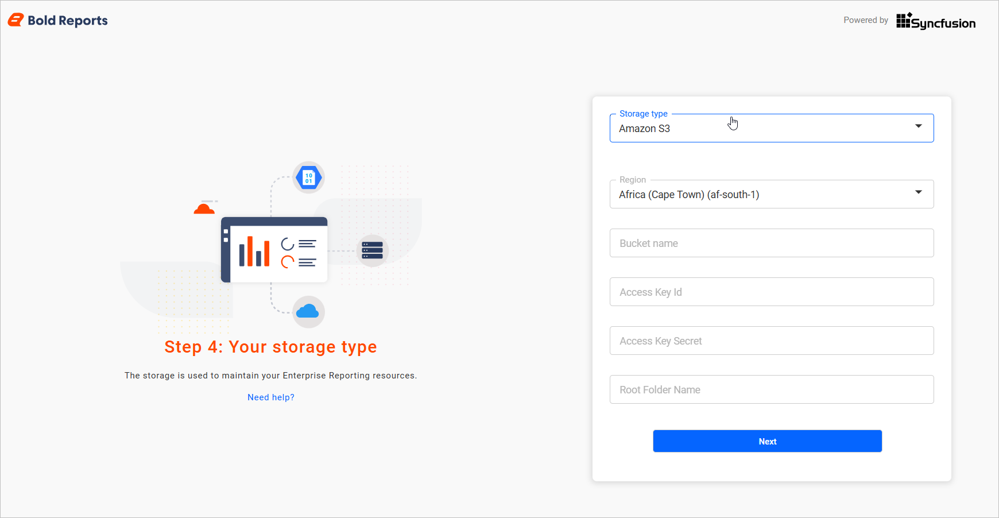

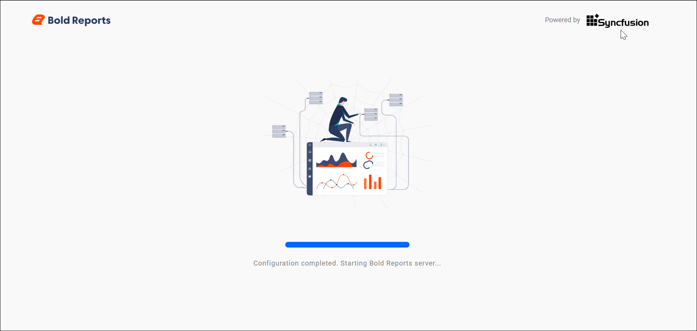

## Activate the account using login credentials

You can sign in to Bold Reports® with your registered email address to activate your subscription.

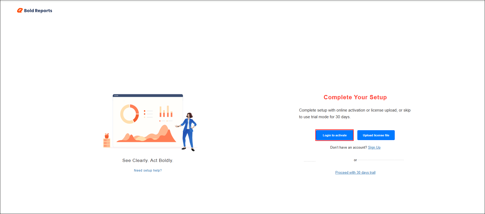

### Select Login option

From the Bold Reports® login window, choose your account type and proceed to login.

* Bold Reports® Login Credentials
* Azure AD

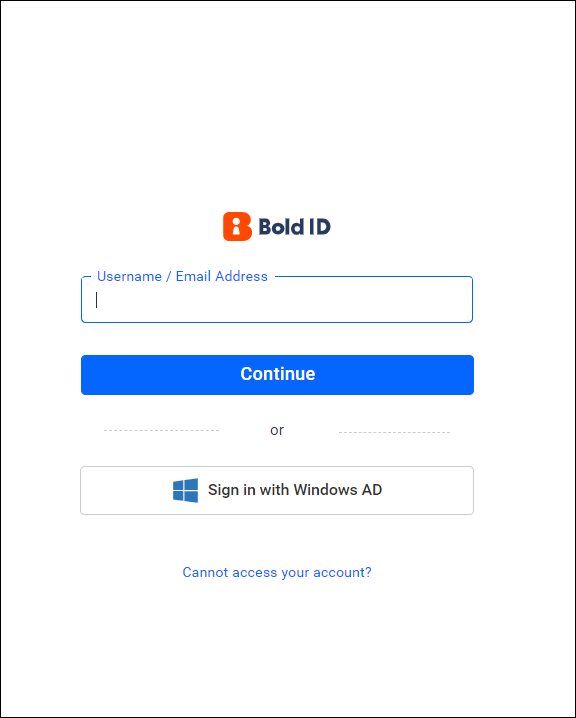

### Select license

If you have multiple Bold Reports® licenses, a license selection screen appears. Select the corresponding license to proceed with application startup. Otherwise, you are automatically redirected to the application startup screen.

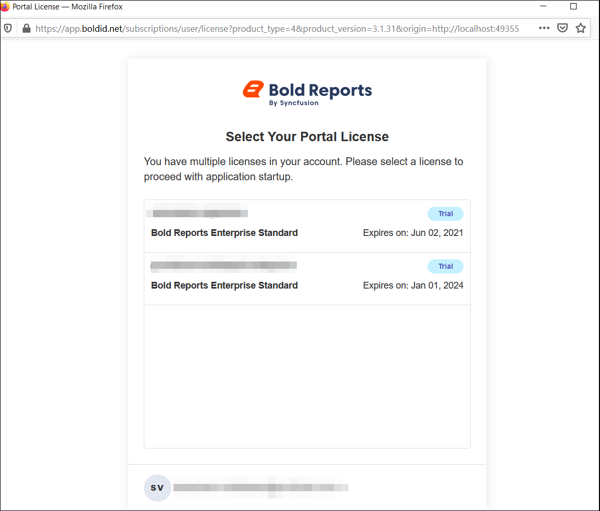

## Trial Mode Activation

Bold Reports® offers a 30-day free trial if you do not have an online or offline license.

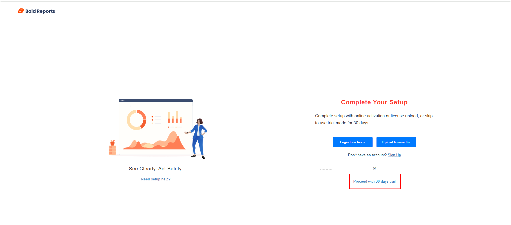

You can use the 30-day free trial to explore and evaluate the application's features. Once the 30-day trial period ends, the application displays a warning icon. Clicking the icon shows a message indicating that the trial period has expired.

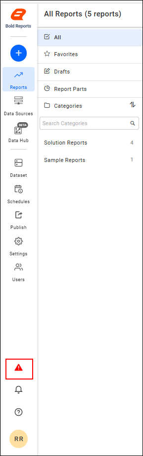
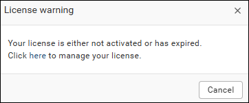

### Possible errors cases and their solution

The following table lists common Bold Reports® unlock key errors and their solutions.

| Cases      | Solution                                            |
|-------------------  |-----------------------------------------------------------  |
| Invalid File Type | Please ensure to upload the valid unlock key file (lic) downloaded from the <a href="https://www.boldreports.com/account/downloads?tab=self-service">Bold Reports® download page</a>. |
|  unlock key Expired    | Your unlock key date was expired. Please download the new unlock key file from the <a href="https://www.boldreports.com/account/downloads?tab=self-service">Bold Reports® download page</a>. |

> **NOTE:** If you are facing any other issues, contact us from <a href="https://www.boldreports.com/contact">our contact page</a>.

## Create Account Without Trial

If you do not have an account for Bold Reports®, you can request a new trial from the <a href="https://www.boldreports.com/pricing">Bold Reports® pricing page</a>.

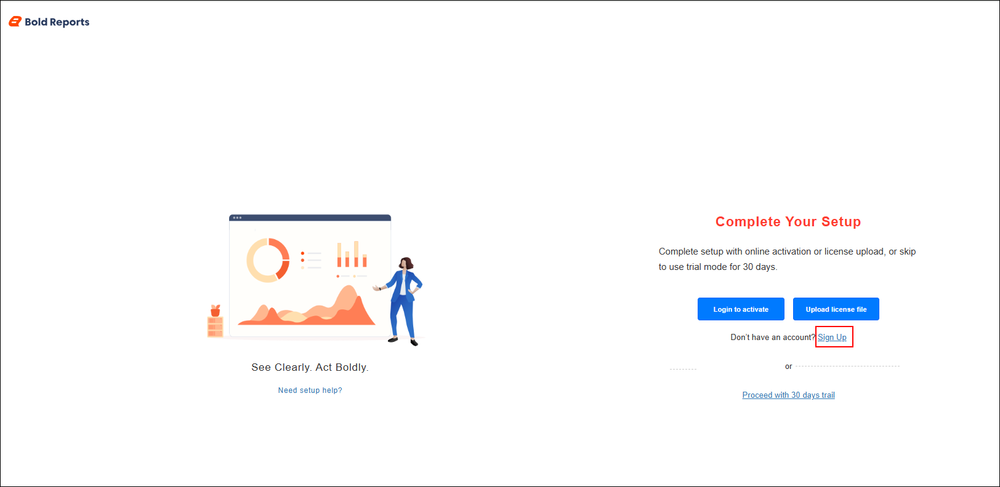

Once the process is completed, you can:

* Manage sites: manage permissions for the sites you have created.
* Go to Reports: create, edit, and update the reports, and so on.

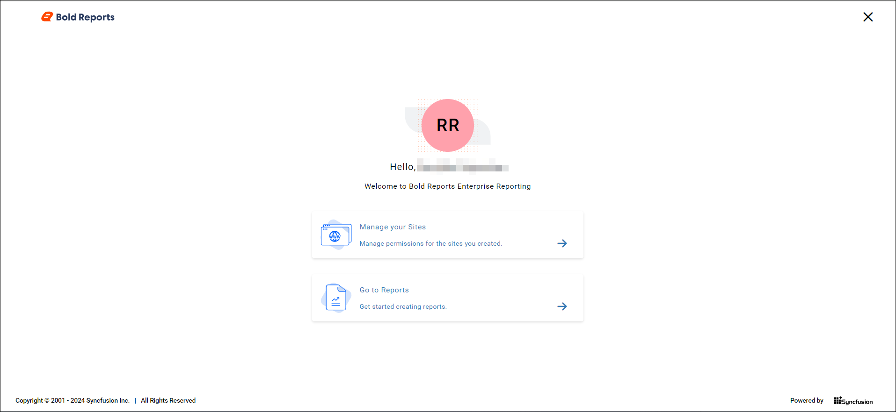

## What does the Report Server database store?

Bold Reports® Report Server stores the following information only to the server database:

* Information of reports.
* Information of shared data sources.
* Information of shared datasets.
* Categories.
* Schedules definitions.
* Permissions settings associated for report, data source, data set, categories, and schedules.
* Report Server configurations.

> The reports, dataset, and data source, which are added to the Bold Reports® Report Server will be maintained in some location based on storage type you have chosen while configuring the Bold Reports® Server application. For more information, see the <a href="./../../administrator-guide/faq/where-does-the-data-resides-in-bold-reports/">FAQ on where data resides in Bold Reports®</a>.

## Activate Bold Reports® license

You can activate your Bold Reports® license either by using your login credentials or by an offline unlock key. Follow these steps to open the license page:

1. Open the Manage License Page - `{domain}/ums/administration/license-settings`.
2. Choose the Enterprise Reporting tab.

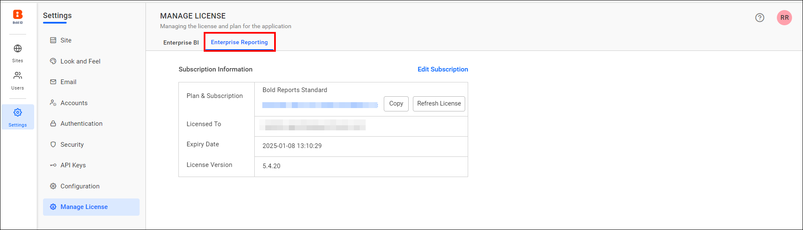

### Activate Bold Reports® license using the login credential

You can sign in to Bold Reports® with your registered email address to activate your subscription.

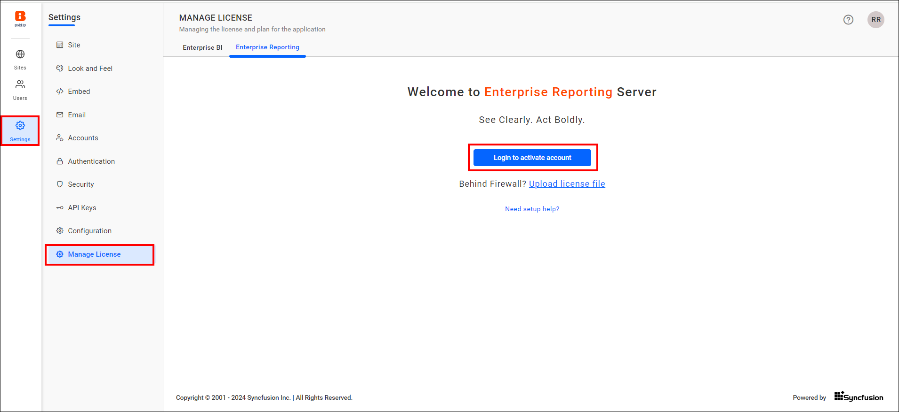

If you have multiple Bold Reports® licenses, a license selection screen appears. Select the corresponding license to activate Bold Reports®. Otherwise, your Bold Reports® license is automatically activated.

### Upload unlock key

You can activate the Bold Reports® license by uploading an offline unlock key.

> **NOTE:** Offline unlock key available for selected customers only. [Contact Bold Reports®](https://www.boldreports.com/contact) to get access to the offline unlock key.

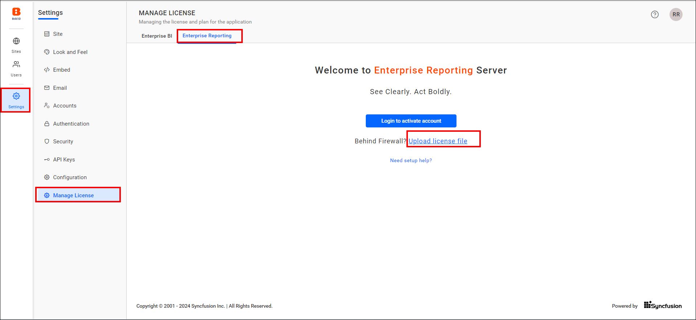

Once the unlock key is uploaded, click the `Upload License` button to activate the Bold Reports® License.

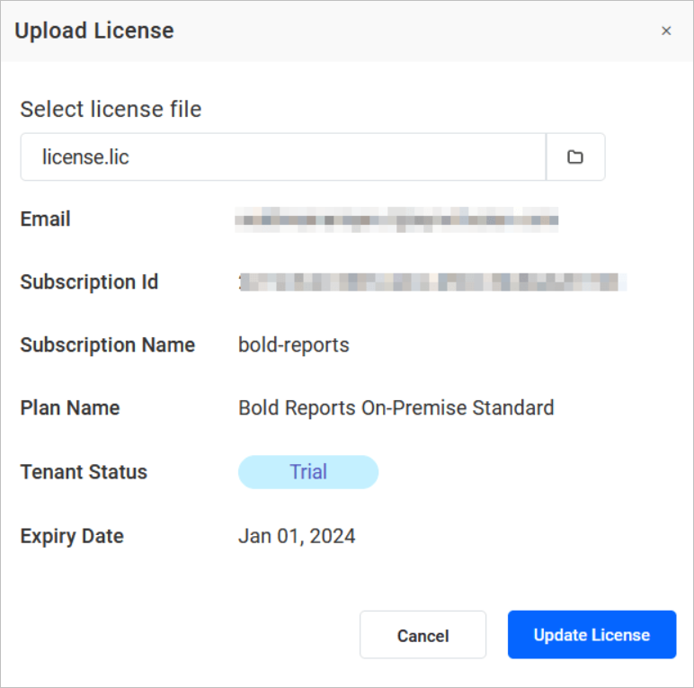

### Create site

To create a new Bold Reports® site, see the [Create Site](./../administrator-guide/manage-sites/create-site/) document.

## Frequently asked questions

### Which databases support the Shared Database mode?

Bold Reports® supports the Shared Database mode for PostgreSQL and MSSQL. The Separate Database mode supports MSSQL, PostgreSQL, MySQL, and Oracle.

### How long is the Bold Reports® free trial?

Bold Reports® offers a 30-day free trial. After it ends, the application displays a warning icon with a trial expired message.

### What is the default storage type?

By default, the Bold Reports® storage type is File Storage.

## See Also

* [**Create another site in multi-site application**](./../administrator-guide/manage-sites/create-site/)
* [SQL Server database configuration](./sql-configuration/)
* [Single database for all sites](./../administrator-guide/manage-sites/v7.1-or-later/single-database-for-all-sites/)
