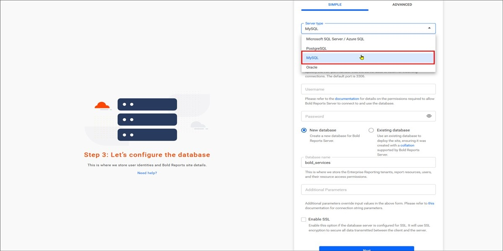
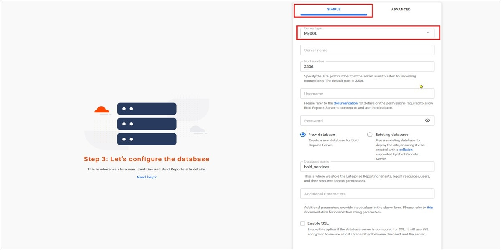
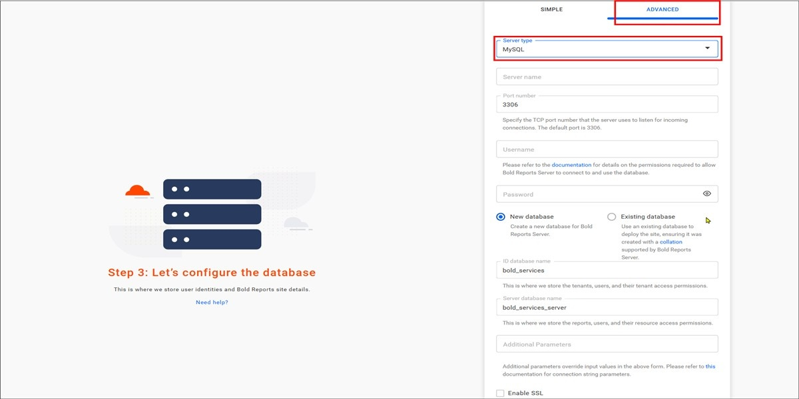

# Configure MySQL for Bold Reports® application startup

Bold Reports® supports MySQL databases for storing user identities and report details. MySQL support was introduced starting with version v2.4.19.

## MySQL Database Configuration for Bold Reports® Server Sites

The Bold Reports® MySQL configuration stores the reports, users, and their access permissions in a MySQL Server database.

To connect to the MySQL Server instance, follow these steps:

1. Select the server type as `MySQL` and provide the `Server name` and `Port number`.

2. Provide the Username and password of the server to be connected.

3. Choose how to connect to the MySQL Server:

    * Create new database.
    * Use an existing database.

4. Provide the database name and proceed further.

> **Important:** The Bold Reports® server will accept all the connections that use Transport Layer Security (TLS 1.2/1.3) encryption and AES Cryptography (128 bits). While configuring the Bold Reports® Server, choose the `Enable SSL` option to support encrypted data transfer.

> **Note:** You cannot create a MySQL database from Azure App Service.

## Which configuration mode should I use?

Bold Reports® lets you select simple or advanced mode for the MySQL configuration.

### Simple mode

Bold Reports® Simple mode configures a single database for Bold ID and Bold Reports®.

The configuration stores the user identities, sites details, reports, users and their access permissions in a single database.

The sites will be deployed to the local file system by default in **Simple mode**

### Advanced mode

Bold Reports® Advanced mode configures individual databases for Bold ID and Bold Reports®. You can choose between the local file system and Azure Blob Storage for Bold ID and Bold Reports®.

`Bold ID` database stores user identities and sites details.

`Bold Reports` database stores reports, users, and their access permissions.

## Frequently asked questions

### Which Bold Reports® version added MySQL support?

Bold Reports® introduced MySQL database support starting with version v2.4.19.

### Can I create a MySQL database from Azure App Service?

No. You cannot create a MySQL database from Azure App Service.

## See also

* [**Storage Configuration**](../../application-startup/#storage-configuration)
* [PostgreSQL configuration](../../application-startup/postgresql-configuration/)
* [SQL Server configuration](../../application-startup/sql-configuration/)
