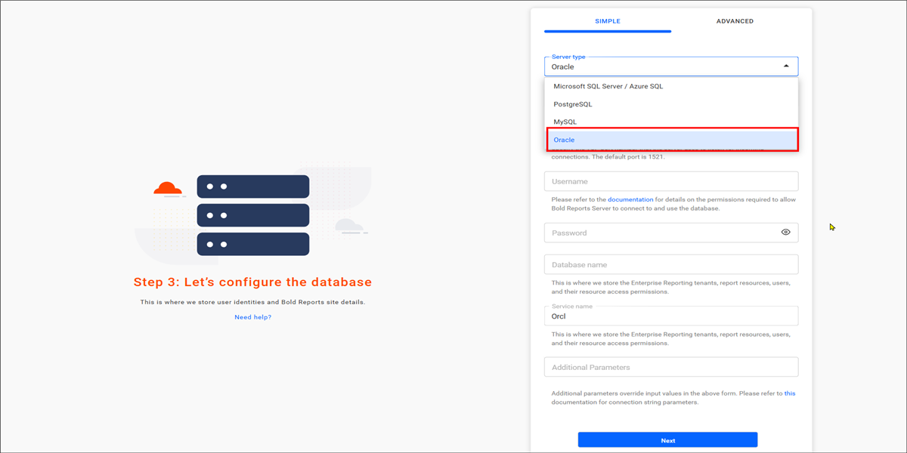
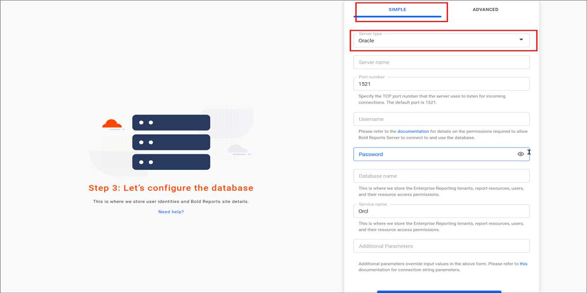

# Configure Oracle for Bold Reports® application startup

Bold Reports® supports Oracle databases for storing user identities and report details.

## Oracle Database Configuration for Bold Reports® Server Sites

The Bold Reports® Oracle configuration stores the reports, users, and their access permissions in an Oracle Server database. Follow these steps:

1. Select the server type as `Oracle` and provide the server details.

2. Set the database name to be the same as the username.
    

### Simple mode

Bold Reports® Simple mode configures a single database for Bold ID and Bold Reports®.

The configuration stores the user identities, sites details, reports, users and their access permissions in a single database.

The sites will be deployed to the local file system by default in **Simple mode**.

## Frequently asked questions

### What database name should I use for Oracle?

Set the Oracle database name to be the same as the username when you configure Bold Reports®.

### Where are sites deployed in Simple mode?

In Bold Reports® Simple mode, the sites are deployed to the local file system by default.

## See also

* [**Storage Configuration**](../../application-startup/#storage-configuration)
* [SQL Server configuration](../../application-startup/sql-configuration/)
* [PostgreSQL configuration](../../application-startup/postgresql-configuration/)
