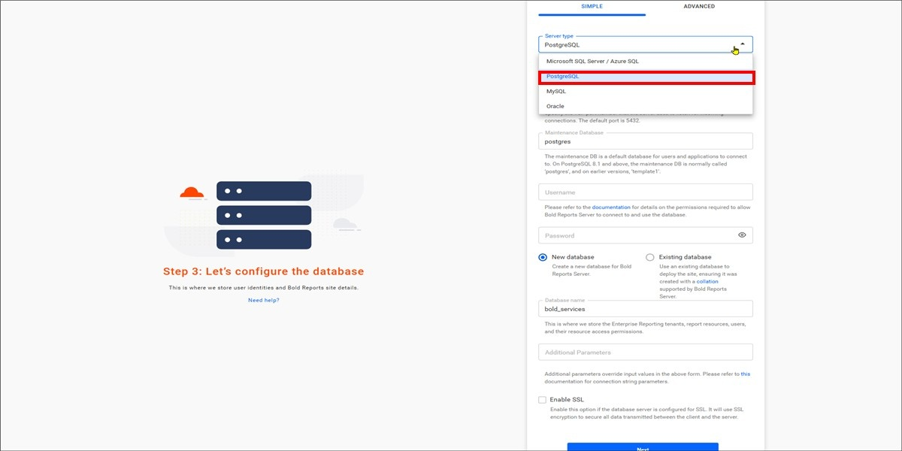
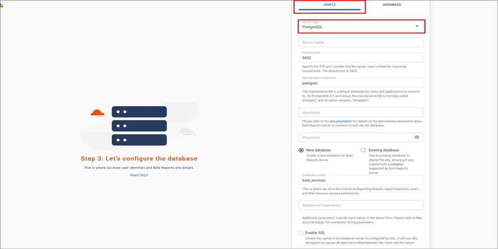
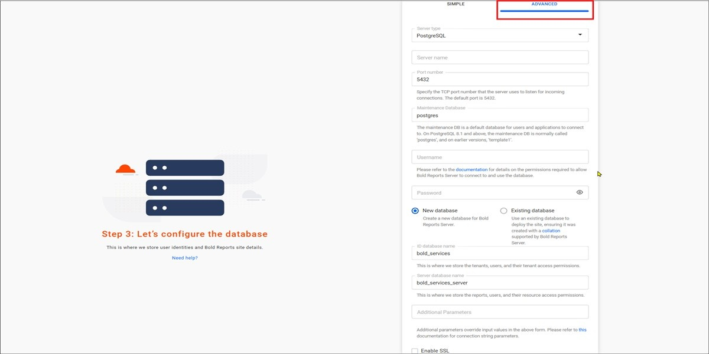

# Configure PostgreSQL for Bold Reports® application startup

Bold Reports® supports PostgreSQL databases for storing user identities and report details.

## PostgreSQL Database Configuration for Bold Reports® Server Sites

The Bold Reports® PostgreSQL configuration stores the reports, users, and their access permissions in a PostgreSQL Server database.

To connect to the PostgreSQL Server instance, follow these steps:

1. Select the server type as `PostgreSQL` and provide the server details.

2. Choose how to connect to the PostgreSQL Server:

    * Create new database.
    * Use an existing database.

3. Provide the database name and proceed further.

> **Important:** The Bold Reports® server will accept all the connections that use Transport Layer Security (TLS 1.2/1.3) encryption and AES Cryptography (128 bits). While configuring the Bold Reports® Server, choose the `Enable SSL` option to support encrypted data transfer.

## Which configuration mode should I use?

Bold Reports® lets you select simple or advanced mode for the PostgreSQL configuration.

### Simple mode

Bold Reports® Simple mode configures a single database for Bold ID and Bold Reports®.

The configuration stores the user identities, sites details, reports, users and their access permissions in a single database.

The sites will be deployed to the local file system by default in **Simple mode**

### Advanced mode

Bold Reports® Advanced mode configures individual databases for Bold ID and Bold Reports®. You can choose between the local file system and Azure Blob Storage for Bold ID and Bold Reports®.

`Bold ID` database stores user identities and sites details.

`Bold Reports` database stores reports, users, and their access permissions.

## Frequently asked questions

### Does Bold Reports® support encrypted PostgreSQL connections?

Yes. Choose the `Enable SSL` option while configuring the Bold Reports® Server to support encrypted data transfer.

### What is the difference between Simple and Advanced mode?

Bold Reports® Simple mode uses a single database for Bold ID and Bold Reports®. Advanced mode uses individual databases and lets you choose the local file system or Azure Blob Storage.

## See also

* [**Storage Configuration**](../../application-startup/#storage-configuration)
* [SQL Server configuration](../../application-startup/sql-configuration/)
* [MySQL configuration](../../application-startup/mysql-configuration/)
