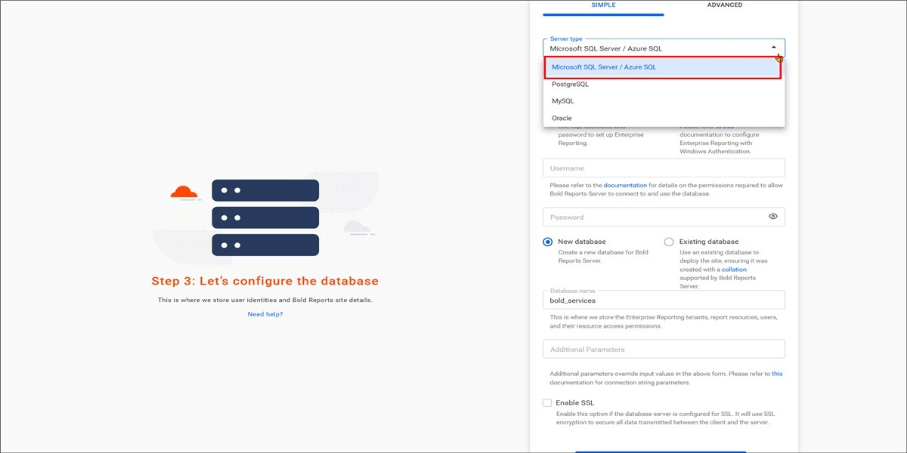
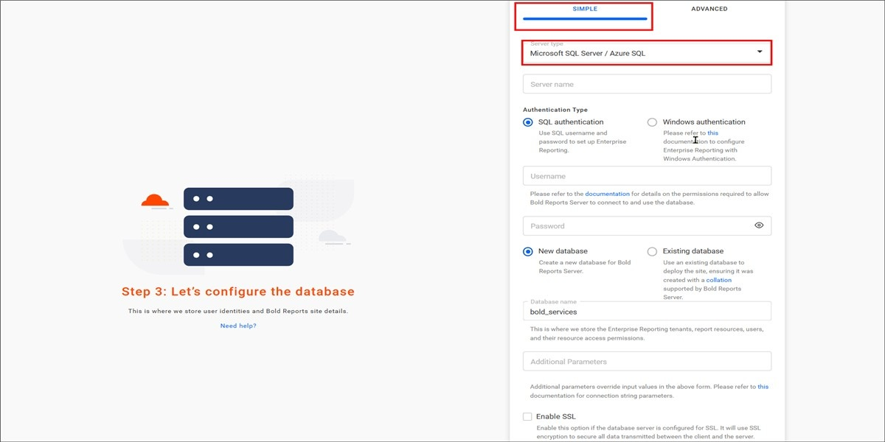
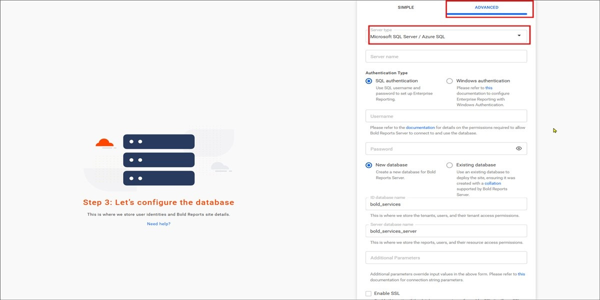

# Configure SQL Server for Bold Reports® application startup

Bold Reports® supports SQL Server databases for storing user identities and report details.

## SQL Server Database Configuration for Bold Reports® Server Sites

The Bold Reports® SQL Server configuration stores the reports, users, and their access permissions in a SQL Server database.

To connect to the SQL Server instance, follow these steps:

1. Select the server type as `Microsoft SQL Server / Azure SQL` and provide the server details.

2. Choose how to connect to the SQL Server:

    * Create new database.
    * Use an existing database.

3. Provide the database name and proceed further.

> **Important:** The Bold Reports® server will accept all the connections that use Transport Layer Security (TLS 1.2/1.3) encryption and AES Cryptography (128 bits). While configuring the Bold Reports® Server, choose the `Enable SSL` option to support encrypted data transfer.

### Simple mode

Bold Reports® Simple mode configures a single database for Bold ID and Bold Reports®.

The configuration stores the user identities, sites details, reports, users and their access permissions in a single database.

The sites will be deployed to the local file system by default in **Simple mode**.

### Advanced mode

Bold Reports® Advanced mode configures individual databases for Bold ID and Bold Reports®. You can choose between the local file system and Azure Blob Storage for Bold ID and Bold Reports®.

`Bold ID` database stores user identities and sites details.

`Bold Reports` database stores reports, users, and their access permissions.

## Frequently asked questions

### Which server type do I select for Azure SQL?

Select the `Microsoft SQL Server / Azure SQL` server type when you configure the Bold Reports® database.

### Does Bold Reports® support encrypted SQL Server connections?

Yes. Choose the `Enable SSL` option while configuring the Bold Reports® Server to support encrypted data transfer.

## See also

* [**Storage Configuration**](../../application-startup/#storage-configuration)
* [PostgreSQL configuration](../../application-startup/postgresql-configuration/)
* [Database permissions required to set up Bold Reports®](../../administrator-guide/faq/what-are-the-database-permissions-required-to-set-up-bold-reports/)
