# Bold Reports® Free Tier user guide

The Bold Reports® Free Tier lets you create reports, manage data sources and datasets, and schedule report delivery without a subscription. Use this guide to register and learn the platform's core capabilities.

## How do I register for the Bold Reports® Free Tier?

You register for the Bold Reports® Free Tier from the Bold Reports® website. Follow these steps:

1. Click **Try it for Free** on the [Bold Reports® page](https://www.boldreports.com/).
   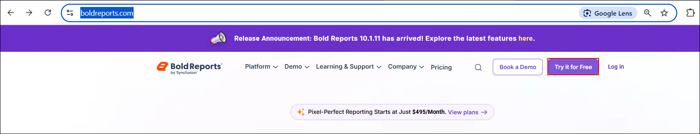

2. If you already have an account, click the **Login** link to sign in with your existing credentials.
   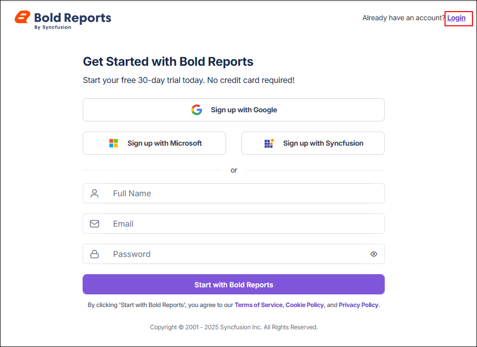

3. Otherwise, sign up using your Google, Microsoft, or Syncfusion® account. You can also enter your details manually by providing your full name, work email address, and password.

4. Click **Start with Bold Reports®**.
   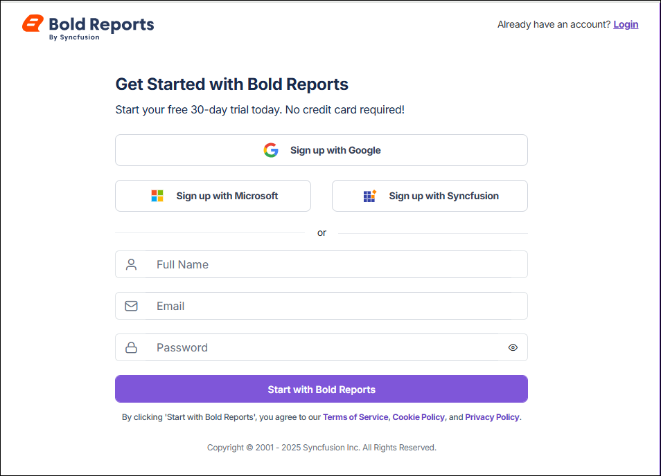

5. Verify your email. After you click **Start with Bold Reports®**, an email verification pop-up appears, and a verification email is sent to the registered email address. Open the email and click the **Verify your email address** button to complete the registration process. The verification link is valid only until the specified expiration date.

   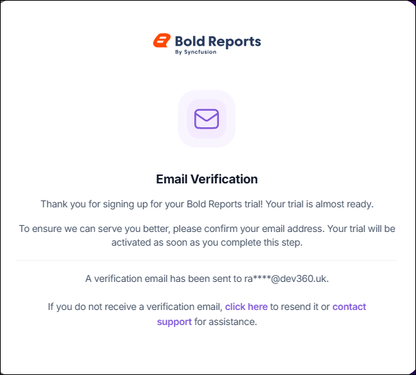
   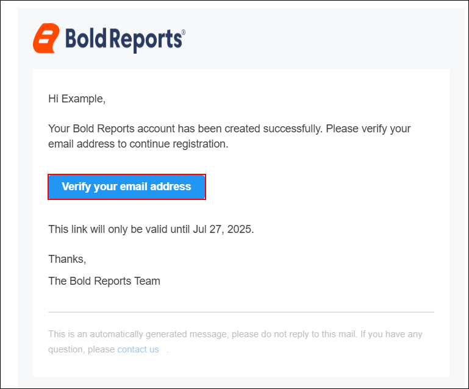

6. Wait for the registration to finish. After you click **Verify your email address**, a page appears indicating that your trial registration is being processed. When verification is completed successfully, you are redirected to the home page. If a network or other issue occurs during the process, you are redirected to the accounts page instead.
   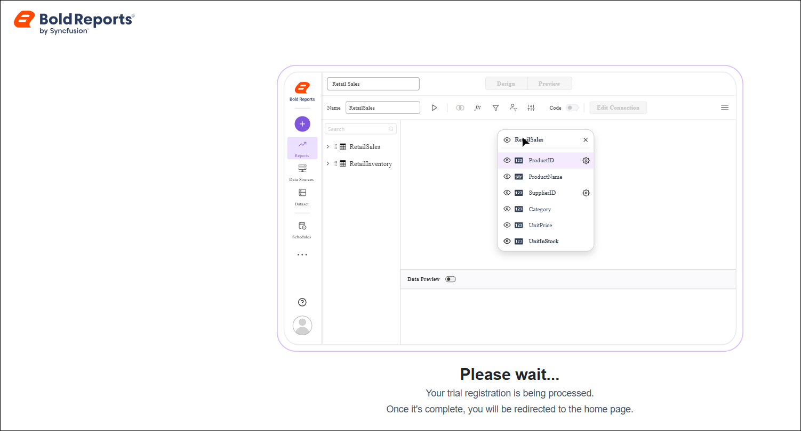

### What can I do after registration?

Once registration is complete, Bold Reports® redirects you to the Free Tier Dashboard, where you can:

* Navigate the main menu to access key sections such as Reports, Data Sources, Data Hub, Datasets, Schedules, Settings, Users, and more.
* Organize reports by categories to maintain a structured and easily navigable workspace.
* Customize the report list using sorting options to tailor the view to your preferences.
* Access the reports you opened before in the Recent section, so you can quickly resume where you left off.
* Use the search bar to find reports by name or category.
* Manage your account with administrative access, including updating your profile.
   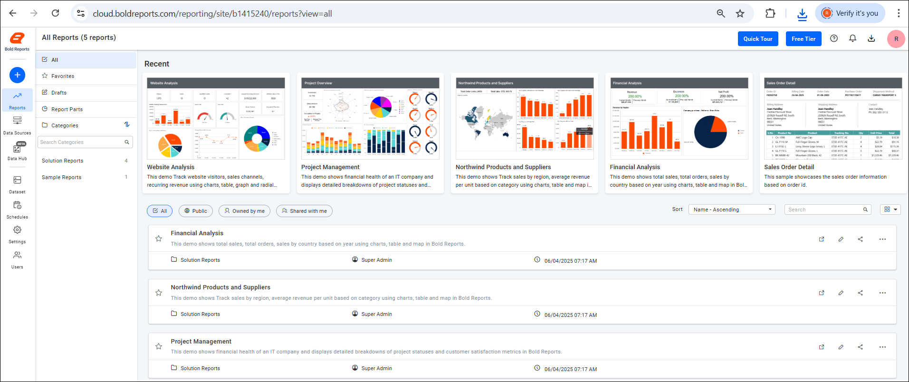

> **Note:** If the site remains inactive for 15 days, it will be automatically deleted, including any content associated with your account name.

#### Quick Tour

The Bold Reports® Quick Tour gives you a quick overview of the key features of the Free Tier Dashboard.

   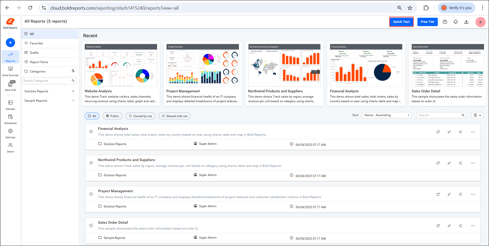

#### Free Tier

The Bold Reports® Free Tier provides access to essential reporting features, enabling users to explore Bold Reports® with limited resources and support.

   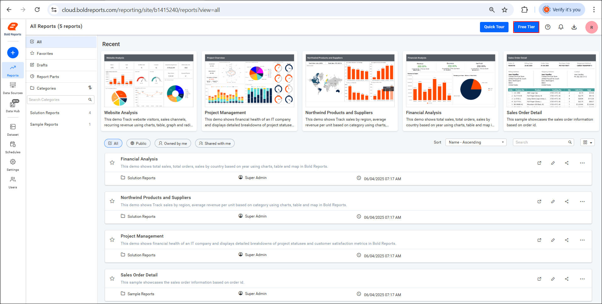

##### What do I get when I upgrade to a paid plan?

A paid Bold Reports® plan adds the following capabilities:

* **Backup & Disaster Recovery:** Keep your data safe and recover quickly from unexpected issues.
* **Live Chat Support:** Get real-time assistance from the support team, including support via WhatsApp.
* **24/5 Assistance:** Reach the support team during business hours throughout the week.
* **Infrastructure options:** Choose between shared cloud or managed dedicated deployments based on scale, security, and performance requirements.
* **On-premises edition:** Install Bold Reports® on your own servers or private cloud for additional data control and customization.

> **Note:** The Free Tier does not include these premium features. To access them, consider upgrading to a paid plan.

#### Download

You download Bold Reports® applications from the Download page. Follow these steps:

1. Click the **Download** icon located at the top-right corner of the dashboard.
   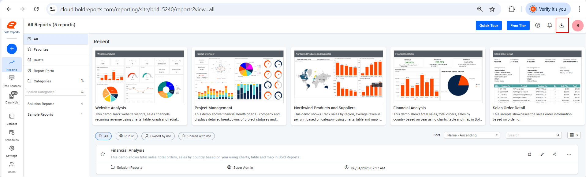
2. On the [Download](https://www.boldreports.com/account/downloads?tab=self-service) page that opens, download the application suitable for your operating system.

##### View Account

To view your Bold Reports® account details, click the **View Account** option under your profile. The option takes you to the [Bold Reports® account](https://www.boldreports.com/account) page.

   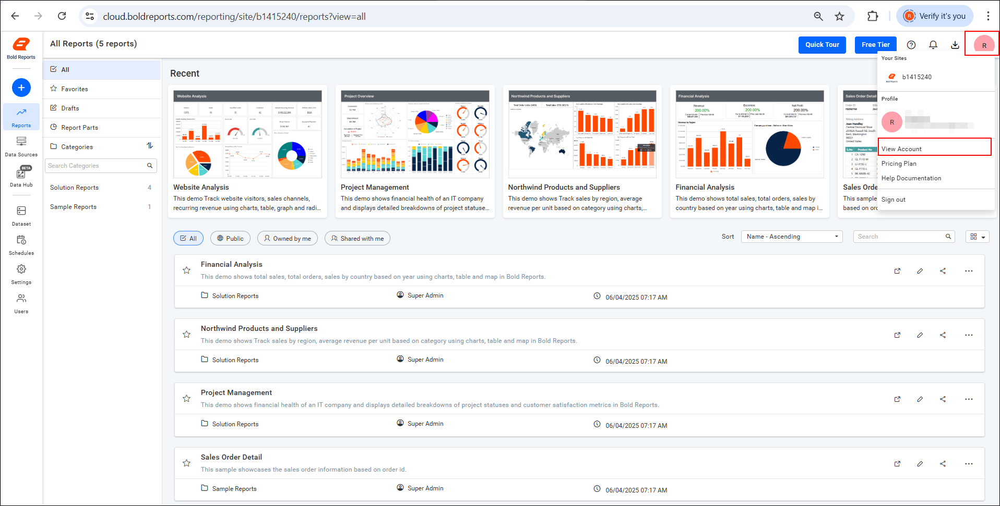

   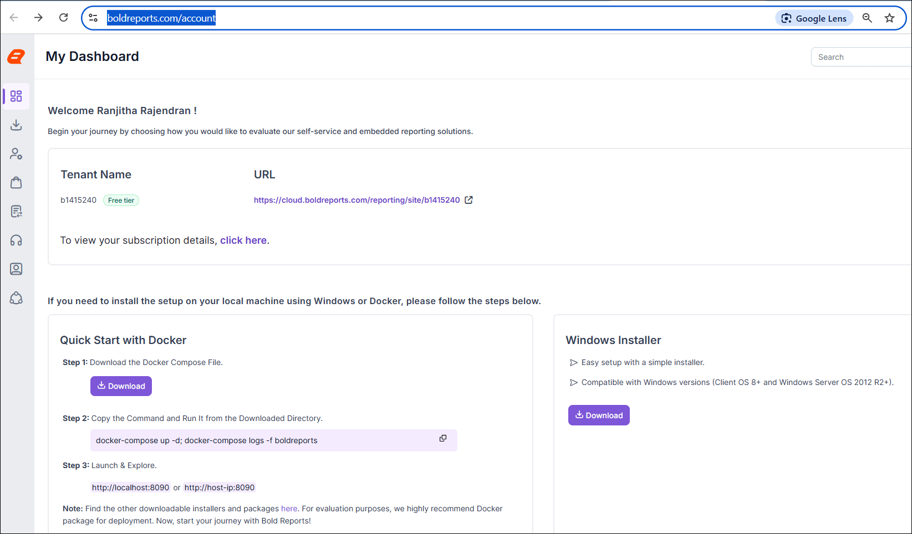

#### Pricing Plan

To view or manage your Bold Reports® subscription, click the **Pricing Plan** option under your profile. The option takes you to the [Bold Reports® Pricing Plan](https://www.boldreports.com/pricing) page, where you can:

* Compare available plans for both on-premises and cloud deployments.
* Review the features included in each plan to determine which best suits your reporting needs.
* Upgrade, downgrade, or modify your subscription based on your usage and requirements.

   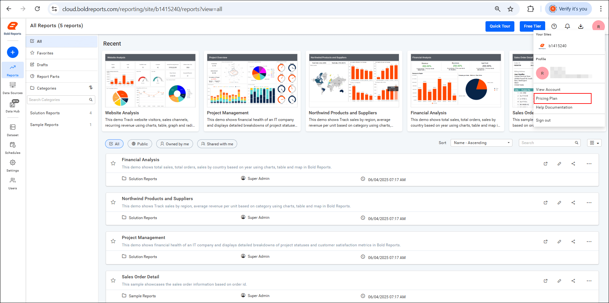

* See the [Bold Reports® help documentation](https://help.boldreports.com/) under the Profile section for additional guidance and support.

## Frequently asked questions

### What happens if my Free Tier site is inactive?

If the Bold Reports® Free Tier site remains inactive for 15 days, it is automatically deleted, including any content associated with your account name.

### Which accounts can I use to sign up?

You can sign up for the Bold Reports® Free Tier with a Google, Microsoft, or Syncfusion® account, or by entering your full name, work email address, and password.

## See also

* [Bold Reports® overview](./../)
* [Licensing](../licensing/)
* [User profile](../administrator-guide/user-profile/)
