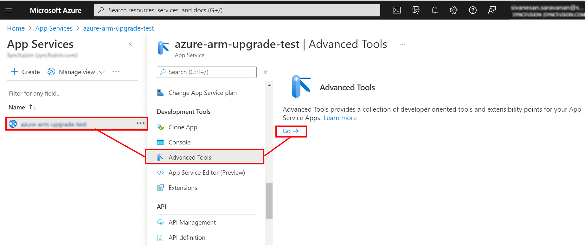
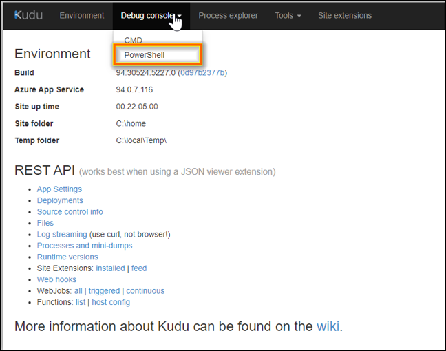
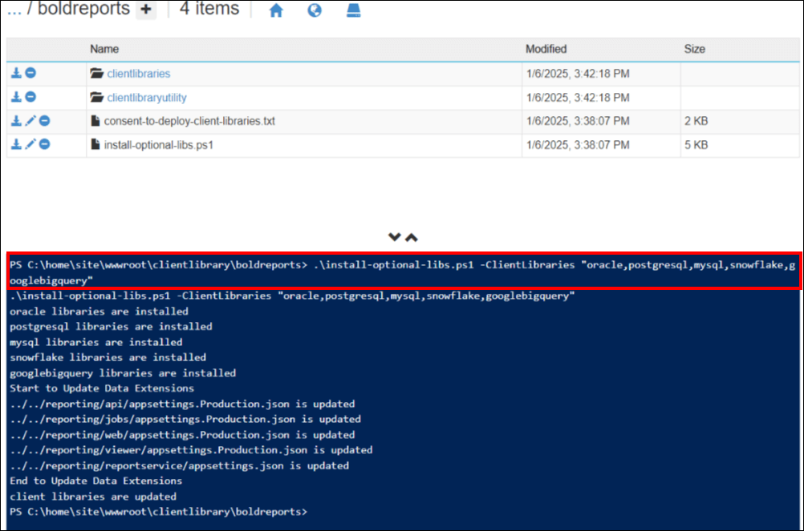

# Install client libraries for Bold Reports<sup>®</sup> in Azure App Service

Bold Reports<sup>®</sup> On-Premises Edition uses client libraries such as Oracle, MySQL, and PostgreSQL to connect with their respective SQL database variants. You need to read and accept the client library license to install client libraries.

## How do I install the client libraries?

You install Bold Reports<sup>®</sup> client libraries from the Kudu PowerShell console of your Azure App Service. Follow these steps:

1. Open the **kudu PowerShell console** for Bold Reports<sup>®</sup> Azure App service. You can access the Kudu service through the portal by navigating to `Web App dashboard > Advanced Tools > Click on Go`.
     

2. Select the **PowerShell** console.
     

3. Go to the client library location:

    ```console
     {drive}\home\site\wwwroot\clientlibrary\boldreports
    ```
4. Read the client library consent document, consent-to-deploy-client-libraries.txt, in that location. Read the client library `LICENSE` details.

5. Execute the following command to install client libraries:

    ```console
     .\install-optional-libs.ps1 -ClientLibraries "oracle,postgresql,mysql,snowflake,googlebigquery"
    ```
     

    The screenshot shows the install command running in the Kudu PowerShell console.

## Frequently asked questions

### Why does Bold Reports<sup>®</sup> need client libraries?

Bold Reports<sup>®</sup> On-Premises Edition uses client libraries such as Oracle, MySQL, and PostgreSQL to connect with their respective SQL database variants.

### Where are the client library files located in Azure App Service?

The Bold Reports<sup>®</sup> client library files are in `{drive}\home\site\wwwroot\clientlibrary\boldreports`.

## See also

* [Azure App Service prerequisites](../prerequisites/)
* [Deploy using an ARM template](../using-arm-template/)
* [Azure App Service recommendations](../recommendations/)
