# Upgrade Bold Reports® Enterprise Reporting to the latest version on Azure App Service

You can upgrade the Bold Reports® Azure App Service to a newer version by connecting its Deployment Center to the Bold Reports® Azure Git repository and syncing it.

## What do I need before upgrading?

To upgrade the Bold Reports® Azure App Service to a newer version, you must have access rights to edit the Report Server App Service.

## How do I upgrade Bold Reports® on Azure App Service?

Follow these steps to upgrade the Bold Reports® Azure App Service:

1. Stop the created **App Service** in the overview section.
   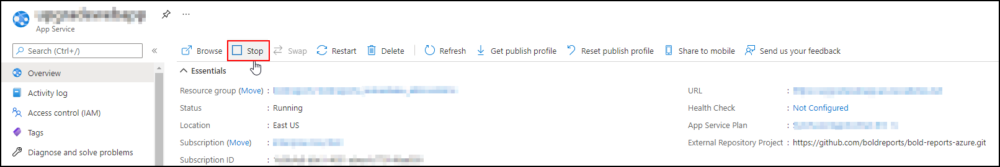

2. Select `Deployment Center` in the left panel of the Bold Reports® App Service.
   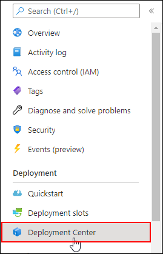

3. In the Deployment Center, click `Disconnect`. The deployment panel opens.
   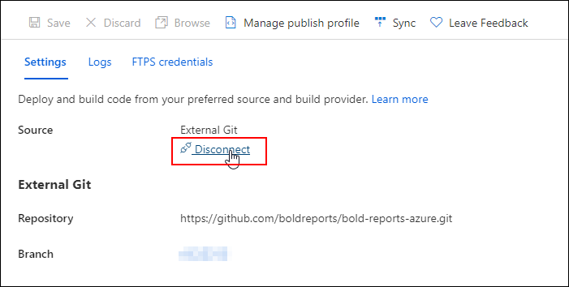

4. Choose the `External Git`.
   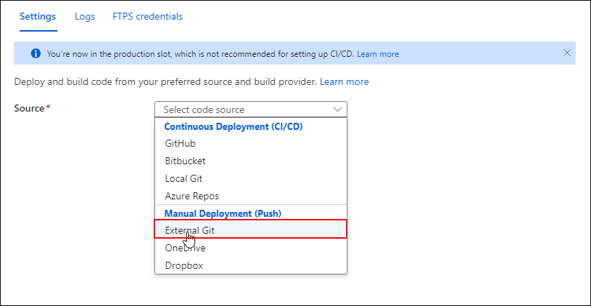

5. Fill in the following details in the `Settings` tab and click `Save`:
    * Repository: `https://github.com/boldreports/bold-reports-azure.git`
    * Branch: `v{release-version}`
    * Repository Type: `Public`
   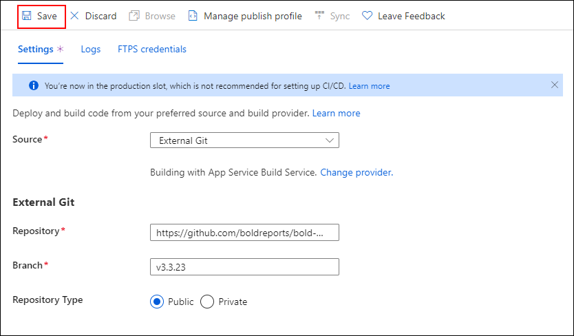

6. Azure displays the `Successfully set up deployment` notification.
   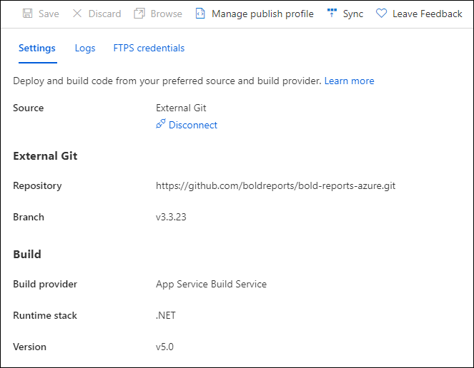
   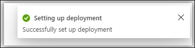

7. Select the `Sync` button on the deployment center page.
   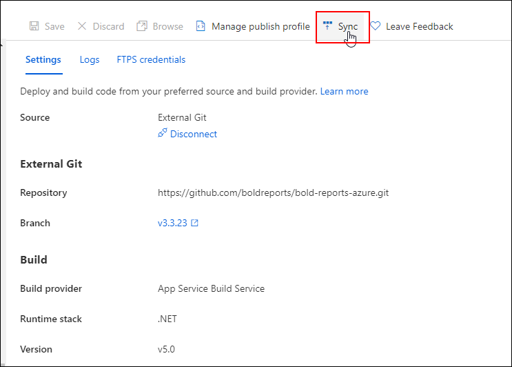

8. The notification shows that the synchronization request was submitted, and the deployment center page shows the synchronization progress.
   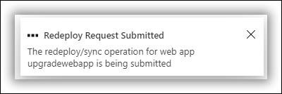

9. Wait until synchronization is completed.

10. >**Breaking Changes:** This step is applicable only for upgrading Azure App Service from version 3.x to a later version. Otherwise, skip this step.
      * In the `Configuration` section, change the following value in `General Settings`.
         <table>
         <tr>
          <th>Settings</th>
          <th>Value</th>
         </tr>
         <tr>
          <td>.NET version</td>
          <td>.NET 8 (LTS)</td>
         </tr>
         </table>

         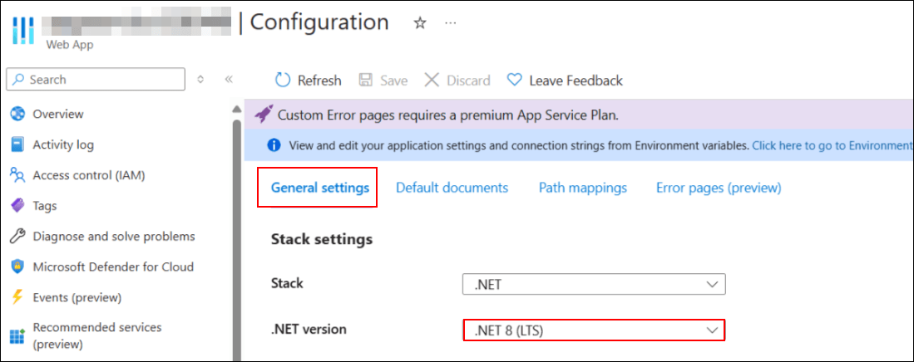
      * Add the following Physical Path in `Path Mappings` and `Save` the settings.
         <table>
         <tr>
          <th>Virtual Path</th>
          <th>Physical Path</th>
         </tr>
         <tr>
          <td>/reporting/viewer</td>
          <td>site\wwwroot\reporting\viewer</td>
         </tr>
         </table>

         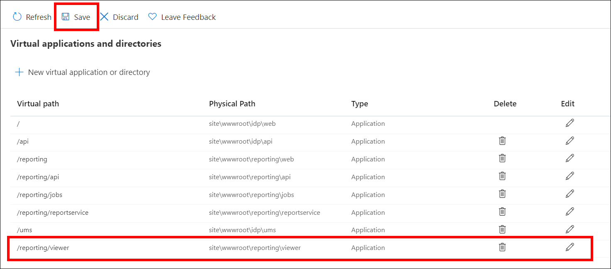
   The following **breaking changes** were introduced in `v6.1`. Starting from version 6.1, the Bold Reports® application supports 64-bit architecture. To host it on Azure App Service as a 64-bit application, make the following changes in the Azure App Service configuration:

11. Go to the **Configuration** of the app service and select `General settings`.
   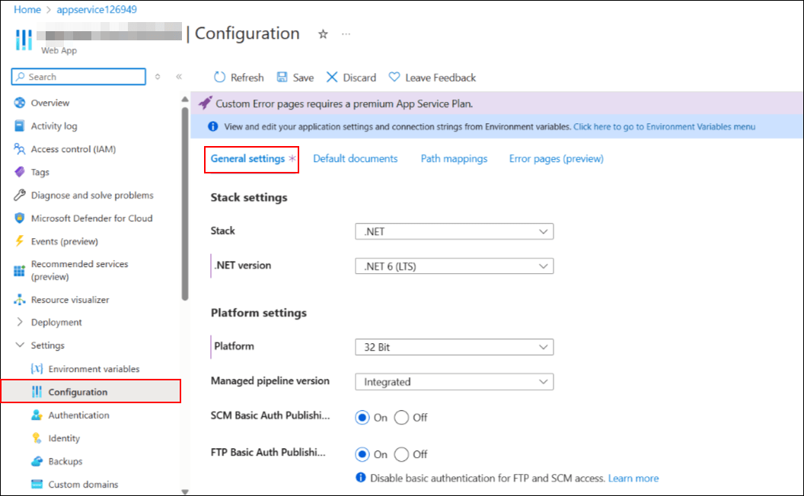

12. In the General settings, change the platform to 64-bit and save the changes.
   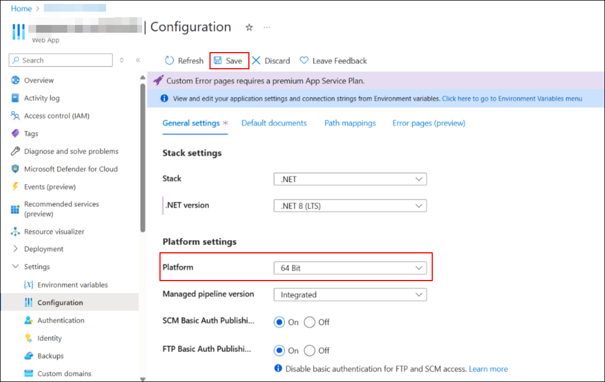

13. Start the app service. You can now access the application as a 64-bit app.
   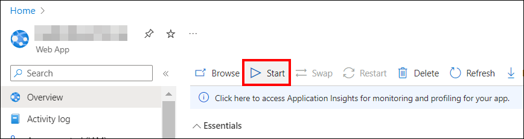

14. Starting from **v7.1**, **DataHub (ETL)** has been added to Report Server in Azure App Service. If you are upgrading Azure App Service from version 3.x to 7.1 and require ETL, see the [Integrating ETL with Bold Reports® in Azure App Service KB article](https://support.boldbi.com/kb/article/18581/integrating-etl-with-bold-bi-or-bold-reports-in-azure-app-service) for guidance. You can skip this step if DataHub is not needed.

15. The Bold Reports® upgrade is now complete. Launch Bold Reports® by clicking the `browse` option, or type the Bold Reports® URL in the browser.
   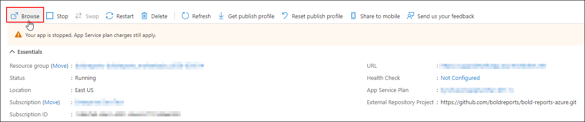

## Frequently asked questions

### Do I need to change the .NET version when I upgrade?

Only when you upgrade Azure App Service from version 3.x to a later version. In that case, set the .NET version to .NET 8 (LTS) in `General Settings` and add the `/reporting/viewer` path mapping.

### Why do I need to switch the platform to 64-bit?

Starting from version 6.1, the Bold Reports® application supports 64-bit architecture. To host it on Azure App Service as a 64-bit application, change the platform to 64-bit in the General settings.

## Also Refer:

* [Install Client libraries](./../../../azure-app-service/client-libraries/)

* [Installation and Deployment](./../../../../deployment/deploy-on-windows/installation-and-deployment/)
