# Upgrade Bold Reports® Enterprise Reporting version from 3.x to v5.4.30

You can upgrade the Bold Reports® Azure App Service from version 3.x to version 5.4.30 by syncing its Deployment Center with the Bold Reports® Azure Git repository.

## What changes between Bold Reports® versions?

* Bold Reports® releases several major versions in a year. Each version includes new features, bug fixes, and other improvements.

* You can review the features and enhancements in the [Release Notes](https://www.boldreports.com/resources/release-history/embedded-reporting/5-1/).

## What do I need before upgrading?

* To upgrade the Bold Reports® Azure App Service to version 5.4.30, you must have access rights to edit the Report Server App Service.

## How do I upgrade from version 3.x to version 5.4.30?

Follow these steps to upgrade the Bold Reports® Azure App service from version 3.x to version 5.4.30:

1. Log in to the [Azure portal](https://portal.azure.com/).
2. Select `App Services` in Microsoft Azure Services.
   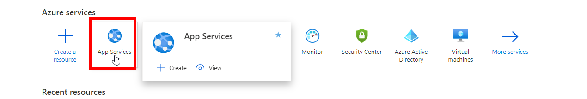
3. Select `Bold Reports Azure App Service`.
4. In the `Overview` section, click the `Stop` button.
   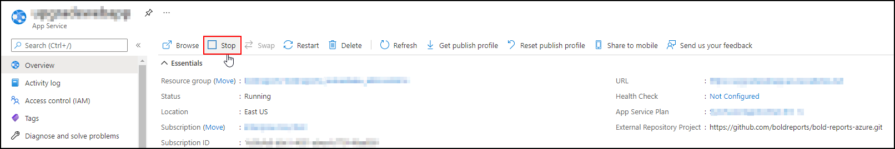
5. Select `Deployment Center` in the left panel of the Bold Reports® App Service.
   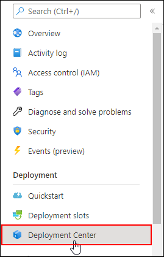
6. In the Deployment Center, click `Disconnect`. The deployment panel opens.
   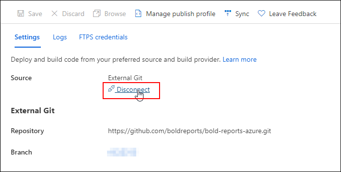
7. Choose the `External Git`.
   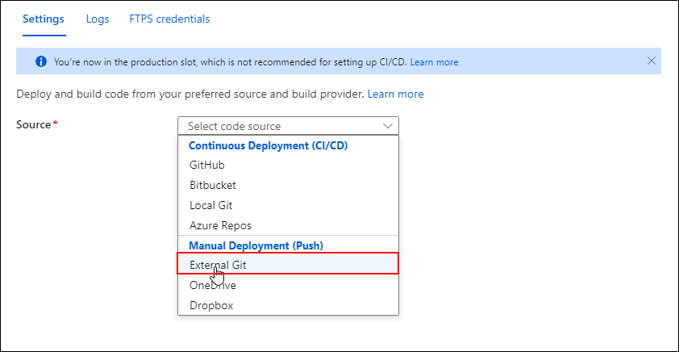
8. Fill in the following details in the `Settings` tab and click `Save`:
    * Repository: `https://github.com/boldreports/bold-reports-azure.git`
    * Branch: `v{release-version}`
    * Repository Type: `Public`
   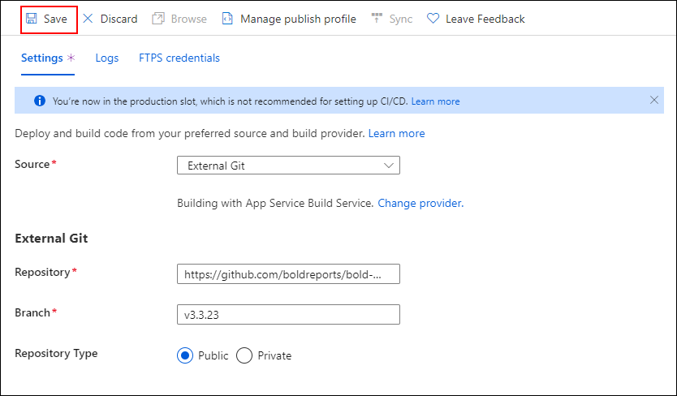
9. Azure displays the `Successfully set up deployment` notification.
   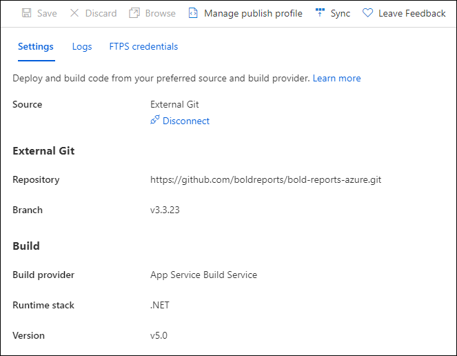
   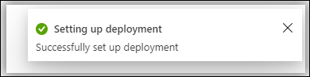
10. Select the `Sync` button on the deployment center page.
    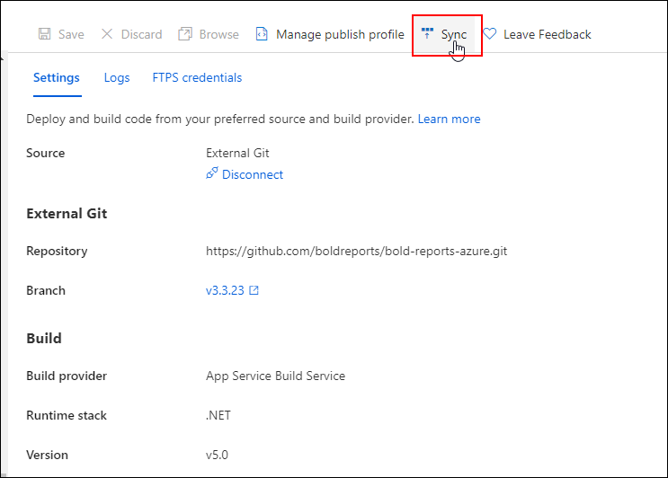
11. The notification shows that the synchronization request was submitted, and the deployment center page shows the synchronization progress.
    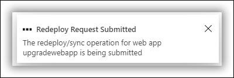
12. Wait until synchronization is completed.
13. >**Breaking Changes:** This step is applicable only for upgrading Azure App Service from version 3.x to version 5.4.30. Otherwise, skip this step.
      * In the `Configuration` section, change the following value in `General Settings`.
         <table>
         <tr>
          <th>Settings</th>
          <th>Value</th>
         </tr>
         <tr>
          <td>.NET version</td>
          <td>.NET 6 (LTS)</td>
         </tr>
         </table>

         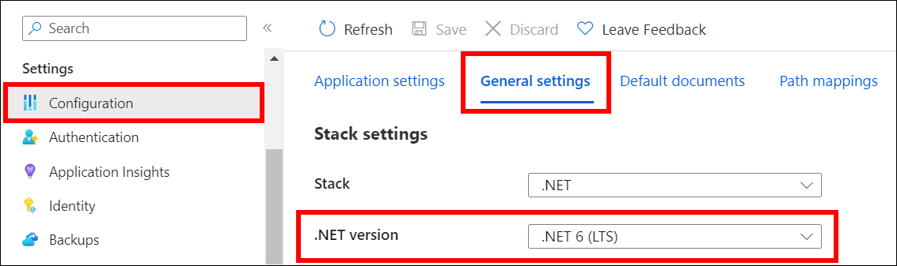
      * Add the following Physical Path in `Path Mappings` and `Save` the settings.
         <table>
         <tr>
          <th>Virtual Path</th>
          <th>Physical Path</th>
         </tr>
         <tr>
          <td>/reporting/viewer</td>
          <td>site\wwwroot\reporting\viewer</td>
         </tr>
         </table>

         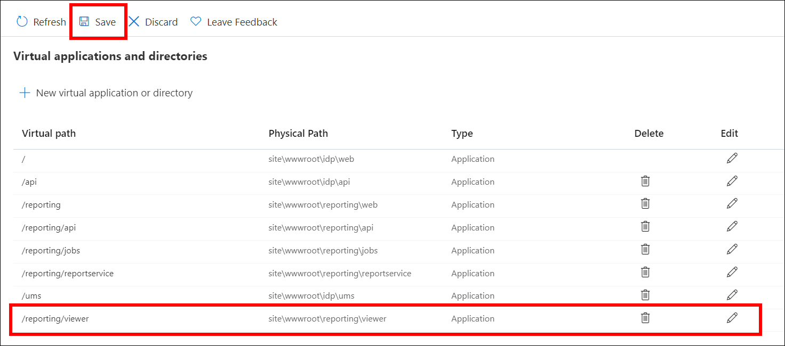
14. Start the Bold Reports® Azure App Service by clicking the `Start` button in the Overview section.
    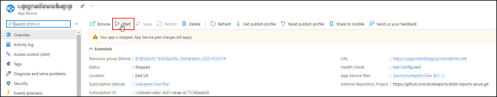
15. The Bold Reports® upgrade is now complete. Launch Bold Reports® by clicking the `Browse` option, or type the Bold Reports® URL in the browser.
    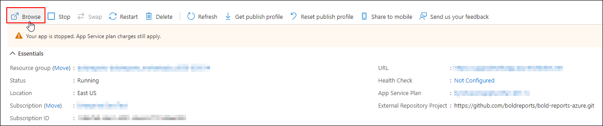

## Frequently asked questions

### Which .NET version does version 5.4.30 need on Azure App Service?

When you upgrade from version 3.x to version 5.4.30, set the .NET version to .NET 6 (LTS) in `General Settings`.

### Which path mapping do I add during the upgrade?

Add the virtual path `/reporting/viewer` with the physical path `site\wwwroot\reporting\viewer` in `Path Mappings`, and then save the settings.

## See also

* [Upgrade to a newer version](./../upgrade-to-latest/)
* [Install Client Libraries](./../../client-libraries/)
* [Deploying Bold Reports® in Azure App Service](./../../)
