# Create a Bold Reports® Azure App Service using the ARM template

You can deploy the Bold Reports® Azure web app (App Service) by running the Bold Reports® ARM template as a custom template deployment in the Azure portal.

## Which storage does the Azure App Service deployment support?

> **Note:** In Bold Reports®, Azure App Service exclusively supports Blob storage.

## How do I deploy Bold Reports® with the ARM template?

To deploy the Bold Reports® Azure web app using the ARM template, follow these steps:

1. Log in to the [Azure portal](https://portal.azure.com/).

2. Click **Create a resource** from the top menu.
   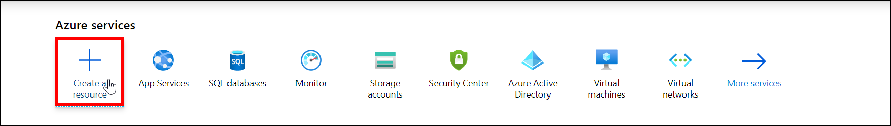

3. Search `Template deployment` in the marketplace and select it.
   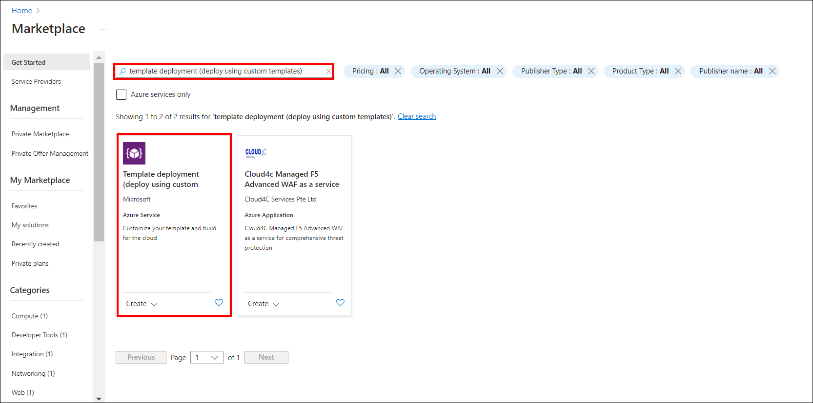

4. Click **Create**.
   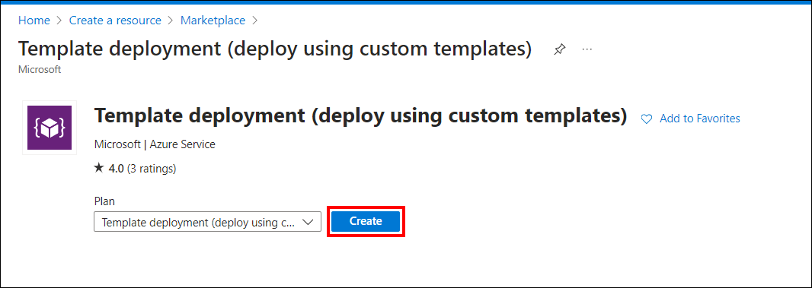

5. Choose **Build your own template in the editor** within the Custom Deployment window.
   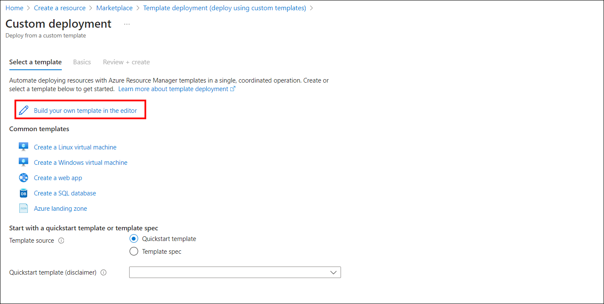

6. Download the [ARM template file](https://raw.githubusercontent.com/boldreports/bold-reports-azure/master/armtemplates/latest/AzureBlobStorage-BoldReports.json).

7. Copy all the contents of the template file, replace the contents of the Edit template window with them, and then click **Save**.
   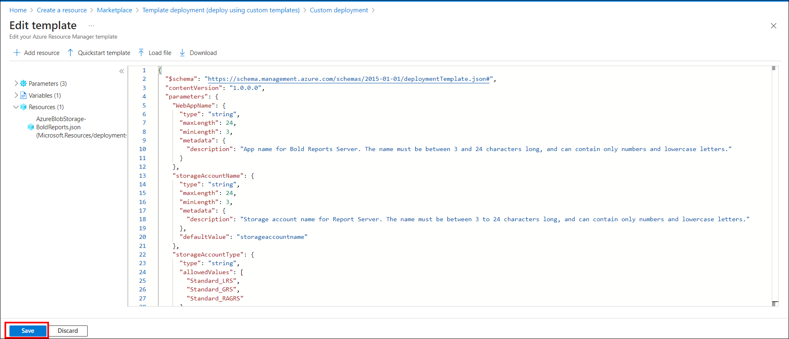

8. Fill in the following details to complete the deployment steps:
   * **Subscription:** Select the Azure subscription that you have. For more information about subscriptions, see the [Azure Subscription Guide](https://blogs.msdn.microsoft.com/arunrakwal/2012/04/09/create-windows-azure-subscription/).

   * **Resource group:** A logical group in Azure that groups your resources, like web apps, storage accounts, and networks. Learn more in the [Azure resource groups overview](https://docs.microsoft.com/en-us/azure/azure-resource-manager/resource-group-overview#resource-groups).

   * **Location**: Choose the location to deploy the app. **East US** is the recommended location.

   * **Storage Type:** Bold Reports® Web App stores resources in Blob storage.

   * **Web App name:** The name of the Bold Reports® Report Server that you want to use in the URL. Because it becomes the URL, it must be globally unique. If the chosen name is already in use, the deployment fails, and you need to restart with another unique name.

   * **Storage account name:** This field is mandatory for Blob storage and must be unique, like the Web App name. Learn more about storage accounts in the [storage accounts overview](https://learn.microsoft.com/en-us/azure/storage/common/storage-account-overview).

   * **Storage account type:** This field is mandatory for Blob storage. Learn more about storage account types on the [object replication overview page](https://learn.microsoft.com/en-us/azure/storage/blobs/object-replication-overview).

   > **Note:** The Web App name and Storage account name should be in lowercase only.

9. Click `Create` to start deploying the Bold Reports® On-Premises Edition Web App. The screenshots show the custom template details form.
   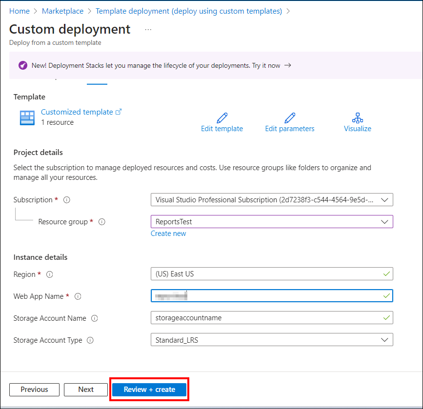
   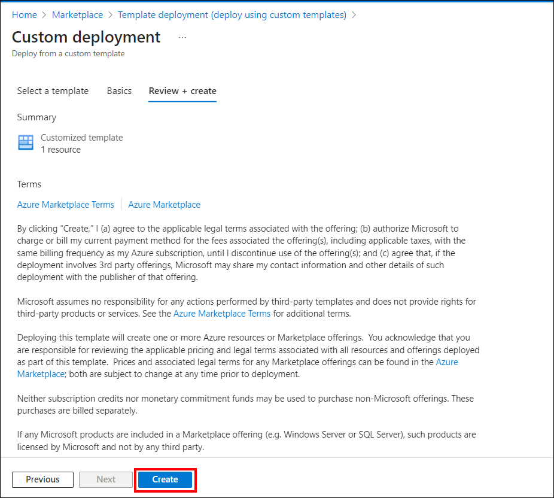

   The deployment of the Bold Reports® Multi-tenant App Service (Web App) starts.
   > **Note:** The deployment process is expected to take around 15 minutes to complete.

10. Track the progress of the Bold Reports® Azure App Service (web app) deployment. A green check mark appears at each successful stage.
    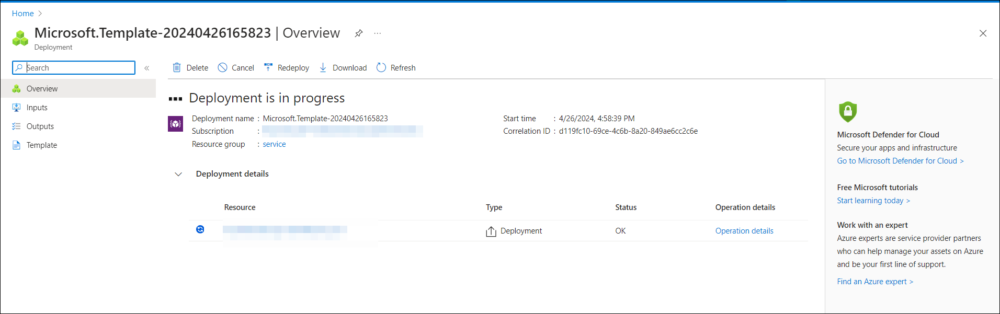

11. If the deployment of Bold Reports® completes successfully, go to Step 13.

12. If deployment fails, check the error details and select the Redeploy option to deploy Bold Reports® again (see Step 8 to fill in the details). Confirm a successful deployment with Step 10.
    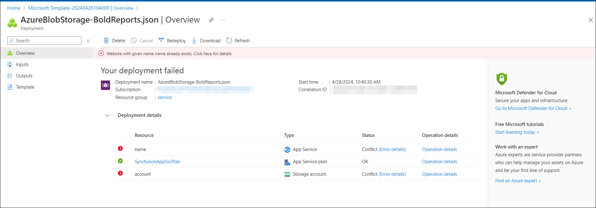
    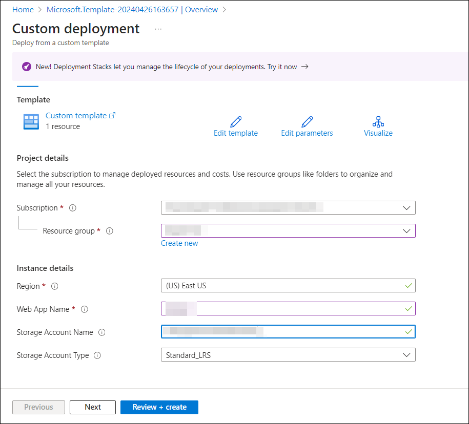
    <b>Note:</b> When you redeploy, provide a unique Web App name and Storage Account name. If the failed App Service, Storage account, or App Service Plan is still present in the resource group, remove it before you redeploy.

13. After successful deployment, navigate to the `Resource Group`. Then, select the `App Service`.
    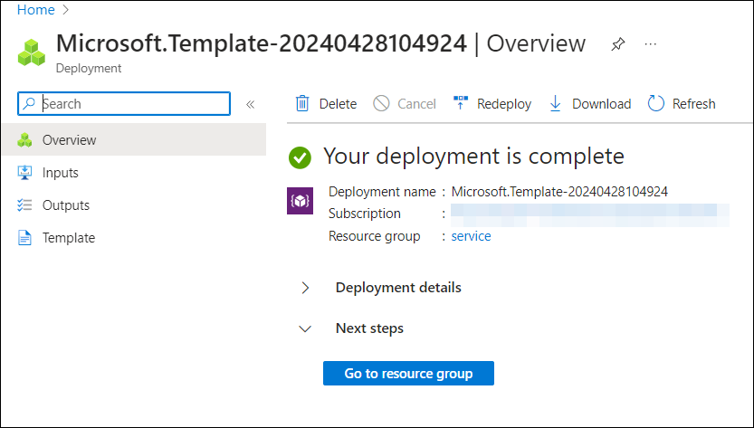
    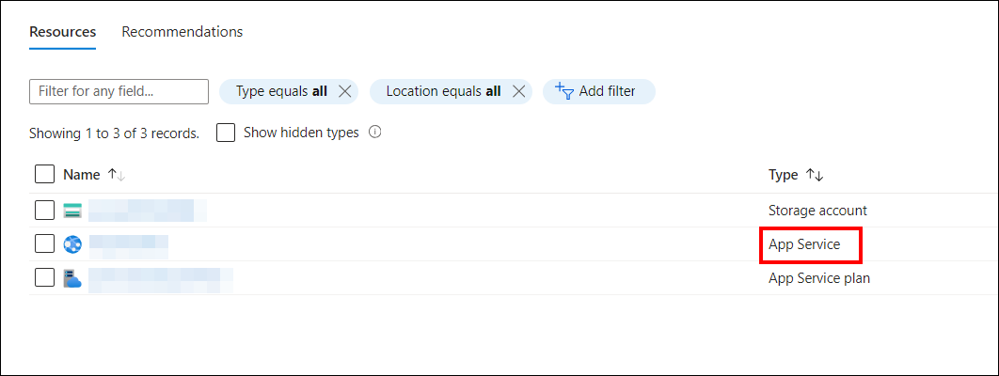

14. On the overview page, copy the `Default Domain` and paste the URL into your browser. Wait for it to load completely before you continue with the Bold Reports® application startup.
   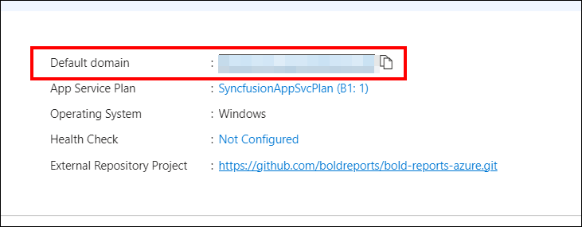

## Which App Service plans does the deployment use?

1. The App Service plan for the Bold Reports® On-Premise Web App is automatically created, defaulting to `Basic – B1`. Learn more about App Service plans in the [App Service plans overview](https://docs.microsoft.com/en-us/azure/app-service/azure-web-sites-web-hosting-plans-in-depth-overview). Bold Reports® On-Premise does not support free or shared App Service plans.

   Bold Reports® On-Premises Edition is compatible with basic, standard, and premium App Service plans in Azure. The recommended minimum App Service plan for optimal application performance is the basic plan.

   For improved performance, consider scaling up the App Service plan from basic to standard or premium. The following Microsoft guides explain how to scale up and scale out the App Service plan.

   [Scale up an app in Azure App Service](https://learn.microsoft.com/en-us/azure/app-service/manage-scale-up)

   [Scale out an app in Azure App Service](https://learn.microsoft.com/en-us/azure/azure-monitor/autoscale/autoscale-get-started)

## Frequently asked questions

### How long does the ARM template deployment take?

The deployment of the Bold Reports® Azure App Service is expected to take around 15 minutes to complete.

### What should I do if the deployment fails?

Check the error details and select the Redeploy option. Provide a unique Web App name and Storage Account name, and remove any failed App Service, Storage account, or App Service Plan from the resource group first.

### Does Bold Reports® support free or shared App Service plans?

No. Bold Reports® On-Premise does not support free or shared App Service plans. It is compatible with basic, standard, and premium plans.

## Next step

* [Install Client libraries](./../../../deployment/azure-app-service/client-libraries/)

* [Installation and Deployment](../../../deployment/deploy-on-windows/installation-and-deployment/)

* [Recommended Azure App Service configuration](./../../../deployment/azure-app-service/recommendations/)
