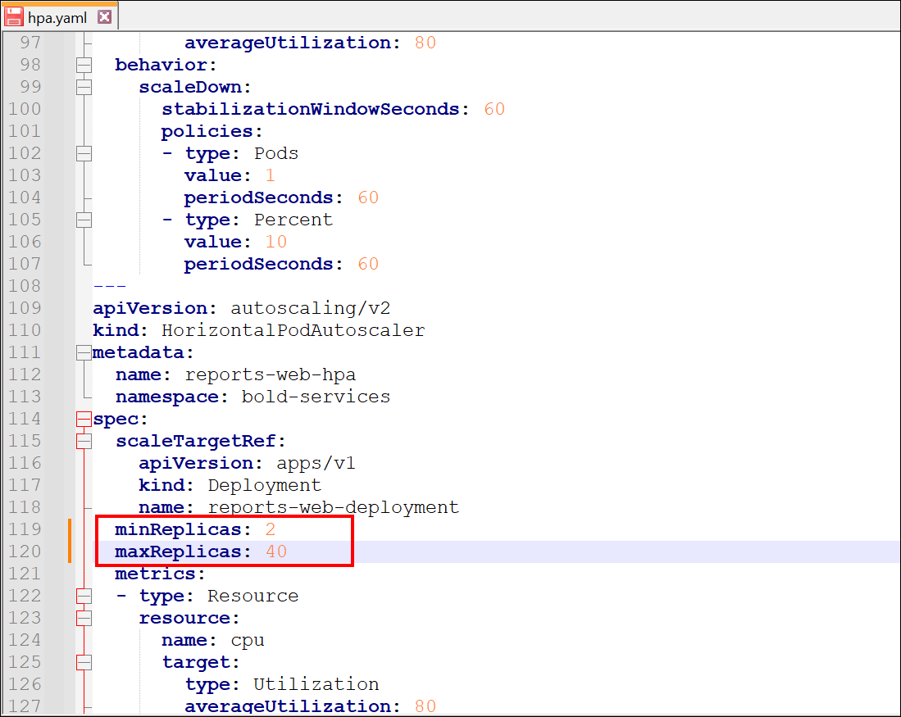
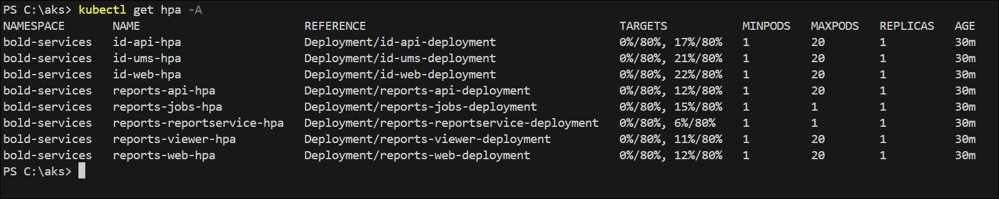
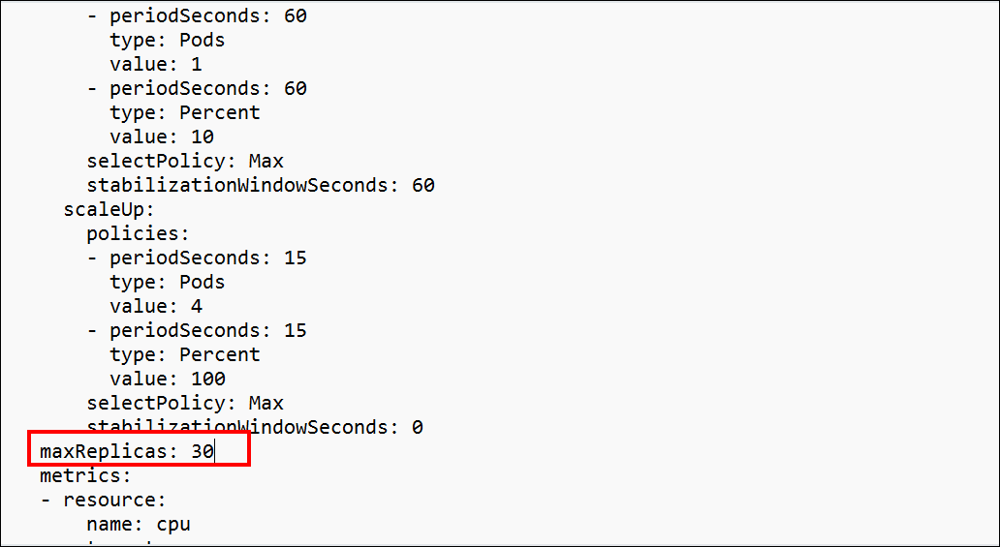
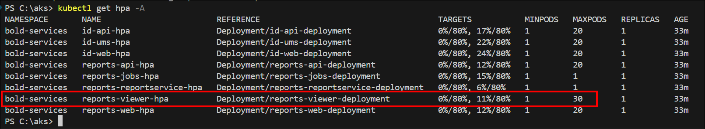

# Scaling Bold Reports<sup>®</sup>: Leveraging Multiple Replica Sets for High Availability and Performance

Bold Reports<sup>®</sup> on Kubernetes uses multiple replica sets of identical Pods to improve high availability and performance. You can adjust the `minReplicas` and `maxReplicas` values to match your workload.

## Introduction to Replicas in Kubernetes

A replica in a Kubernetes cluster typically refers to a set of identical Pods running concurrently. Kubernetes uses Replicas to manage the availability and scalability of applications such as Bold Reports<sup>®</sup>.

### Understanding Pods

**Pods:** Pods are the smallest deployable unit in Kubernetes, representing single instances of containerized applications.

### Controllers for Managing Replicas

**Replication Controller (deprecated) / Replica Set / Deployment:** Kubernetes controllers that manage multiple identical pods. They ensure that a specified number of Pod replicas are running at any given time. However, Deployment is the recommended way for managing replicas in modern Kubernetes. For Bold Reports<sup>®</sup>, a Deployment might be used to manage the replicas of Pods serving the reporting engine and related services.

### Ensuring High Availability and Scalability

**Replicas:** A Replica is an instance of a Pod within a Replica Set or Deployment. When you define a Replica Set or Deployment for Bold Reports<sup>®</sup>, you specify the desired number of replicas. Kubernetes ensures that this number of Pods are running and healthy based on the configuration you provide. Replicas are crucial for ensuring high availability and scalability.

## Multiple Replica

**Introduction to Multiple Replica Sets:** Multiple replica sets refer to the scenario in a Kubernetes cluster where more than one Replica Set manages sets of identical Pods.

**Functionality and Flexibility:** Each Replica Set manages its own set of Pods, which may serve different functions or components of the Bold Reports<sup>®</sup> application. This modular approach allows better management and scalability of specific components.

## What are the benefits of multiple replica sets?

**Enhanced Management Flexibility:** Multiple replica sets give Bold Reports<sup>®</sup> flexibility and granularity in managing its application components. You can scale and manage different parts of the application independently.

**Deployment Strategies:** Multiple replica sets enable deployment strategies like rolling updates for Bold Reports<sup>®</sup>. They enhance scalability, fault tolerance, and deployment strategies specific to the needs of the application.

## How does minReplicas ensure minimum availability?

The `minReplicas` parameter keeps a baseline number of Bold Reports<sup>®</sup> pods running.

* The `minReplicas` parameter defines the minimum number of replicas (instances) of a pod or deployment that should be maintained.
* Ensures that the application or workload always has a baseline level of availability, even during periods of low demand.
* Preventing the number of replicas from dropping below the specified minimum threshold helps maintain responsiveness and reliability.
* Useful for critical applications or services where continuous availability is essential.

> Bold Reports<sup>®</sup> is configured with a default `minReplicas` setting of 1. While users have the option to adjust the minimum value, it must always remain at least 1.

## How does maxReplicas limit scaling?

The `maxReplicas` parameter caps how far Bold Reports<sup>®</sup> pods can scale up.

* The `maxReplicas` parameter specifies the maximum number of replicas (instances) of a pod or deployment that can be scaled up to.
* Prevents over-provisioning of resources and helps control costs by limiting the maximum number of instances.
* Ensures that the application or workload does not consume excessive resources beyond what is necessary.
* Useful for managing resource utilization and ensuring scalability without exceeding infrastructure constraints.

> Bold Reports<sup>®</sup> is initially configured with a `maxReplicas` setting of 20, providing users with the flexibility to customize this value according to workload demands, with an upper limit of 100.

## Modifying Replica Scaling Settings in Bold Reports<sup>®</sup>

* Bold Reports<sup>®</sup> lets you edit the `minReplicas` and `maxReplicas` values, except for the jobs and designer `HPAs`, where both `minReplicas` and `maxReplicas` are fixed to 1.
* You can edit the `minReplicas` and `maxReplicas` values in two ways: before deployment and after deployment.

## Before Deployment

Before you deploy Bold Reports<sup>®</sup>, you can modify the `minReplicas` and `maxReplicas` configurations in the `hpa.yaml` file, downloaded from the GitHub repository, to align with your scalability goals.

After you edit the file, save the changes. The following screenshot shows the edited `hpa.yaml` file.



## After Deployment

After you deploy Bold Reports<sup>®</sup>, you can edit the replica values of each HPA with `kubectl`.

* List the available `HPAs` within the `hpa.yaml` file using the following command:

```sh
kubectl get hpa -A
```

   
* Open and edit the file using the following command:

```sh
    kubectl edit hpa hpa-name -n namespace
    e.g kubectl edit hpa reports-viewer-hpa -n bold-services
```

* When the command succeeds, the file opens. Change the values based on your workload, save the changes, and close the file. You receive a message similar to the one shown in the following image.
    

   

* Verify the changed replicas by listing the `HPAs` using the same command:

```sh
      kubectl get hpa -A
```

   

## Frequently asked questions

### What are the default replica settings in Bold Reports<sup>®</sup>?

Bold Reports<sup>®</sup> uses a default `minReplicas` of 1 and an initial `maxReplicas` of 20. The minimum must stay at least 1, and the maximum has an upper limit of 100.

### Can I change the replicas for the jobs and designer HPAs?

No. For the jobs and designer `HPAs`, both `minReplicas` and `maxReplicas` are fixed to 1.

## See also

* [High Availability in Bold Reports<sup>®</sup>](./../)
* [Deploy on Kubernetes](./../../deploy-on-kubernetes/)
* [Configuring Warm Standby for Bold Reports<sup>®</sup>](./../configuring-warm-standby-for-bold-reports/)
