# Self-Deploy a Bold Reports<sup>®</sup> Server on an AWS Virtual Machine

You can self-deploy the Bold Reports<sup>®</sup> Report Server on an AWS EC2 instance running Windows or Linux. Follow the steps for your instance type.

1. [Deploying Bold Reports<sup>®</sup> on an AWS Windows EC2 instance](#deploying-bold-reports-on-an-aws-windows-ec2-instance)

2. [Deploying Bold Reports<sup>®</sup> on an AWS Linux EC2 instance](#deploying-bold-reports-on-an-aws-linux-ec2-instance)

## Deploying Bold Reports<sup>®</sup> on an AWS Windows EC2 instance

To deploy Bold Reports<sup>®</sup> on an AWS Windows EC2 instance, set up the instance, connect to it, and then install and run the Report Server.

### How do I set up an AWS Windows EC2 instance?

To set up an AWS EC2 instance for the Bold Reports<sup>®</sup> Report Server, follow these steps:

1. Sign in to the [AWS portal](https://signin.aws.amazon.com/signin?redirect_uri=https%3A%2F%2Feu-north-1.console.aws.amazon.com%2Fec2%3FhashArgs%3D%2523%26isauthcode%3Dtrue%26region%3Deu-north-1%26state%3DhashArgsFromTB_eu-north-1_227745a042a5e383&client_id=arn%3Aaws%3Asignin%3A%3A%3Aconsole%2Fec2-tb&forceMobileApp=0&code_challenge=bULTZavHsGGJf1vmK_xILJyEIHizAy4aPkzK2HJkpoA&code_challenge_method=SHA-256).

2. From the EC2 console dashboard, choose `Launch instance`.

    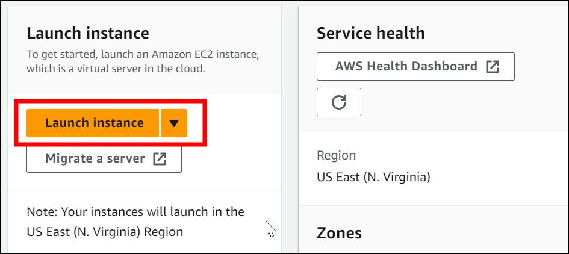

3. Enter a descriptive `Name` and tags for your instance.

    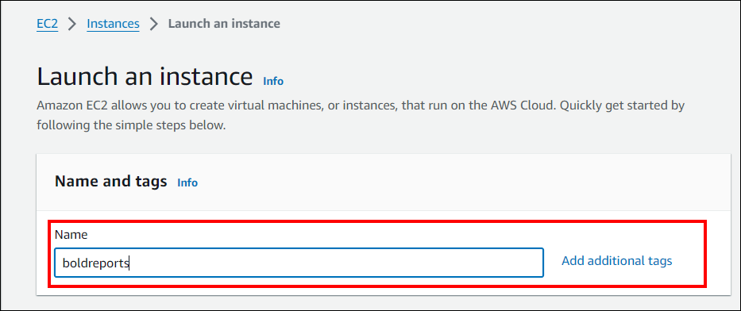

4. Choose `Windows` under Application and OS Images (Amazon Machine Image).

    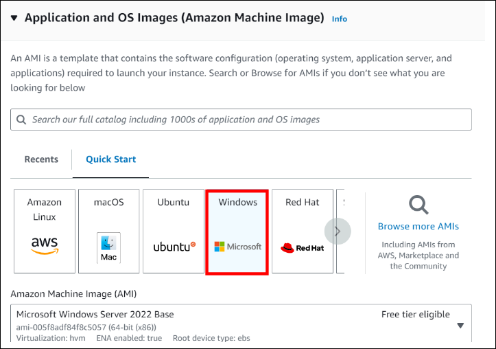

5. From the Instance type list, select the hardware configuration for your instance. The getting started guide lists the [minimum required hardware configuration](../../../deployment/getting-started/#hardware-requirements).

    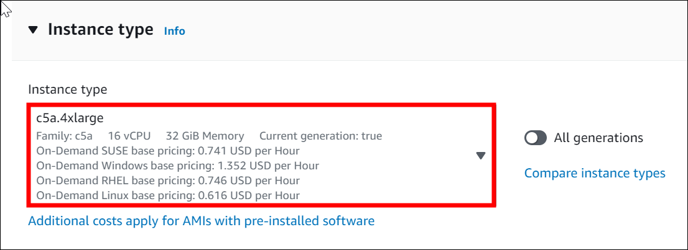

6. Under the `Key Pair (login)` section, either create a new RSA key pair or select an existing one.

    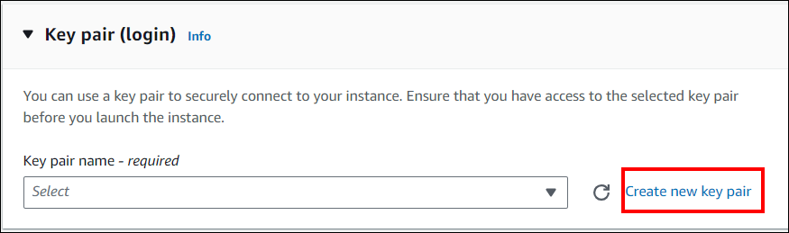
    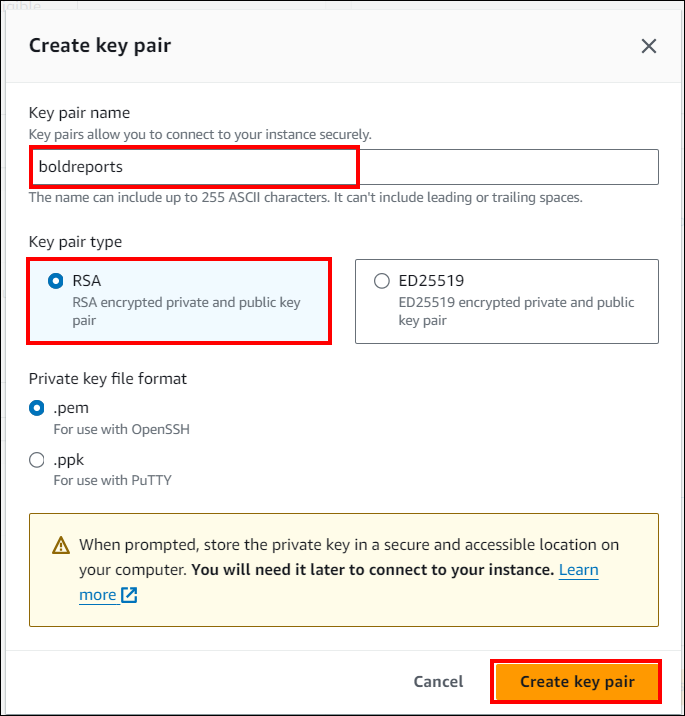

7. Next to Network settings, select **Edit**. For the Security group name, the wizard has already created and chosen a security group for you. Use this security group or choose the one you created during the setup process.

8. Keep the default selections for the other configuration settings for your instance.

    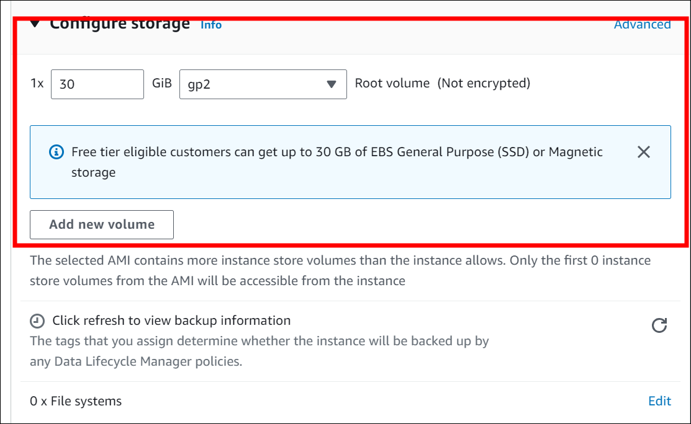

9. Review the summary of your instance configuration and click `Launch instance`.

    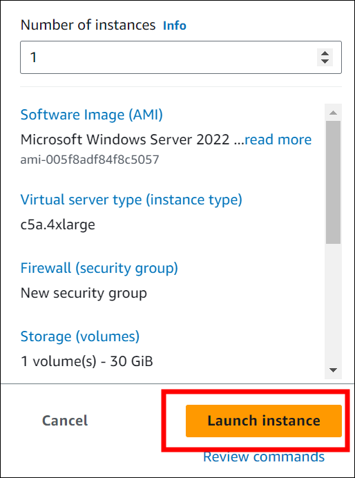

10. A confirmation page informs you that your instance is launching. To close the confirmation page and return to the console, select `View all instances`.

    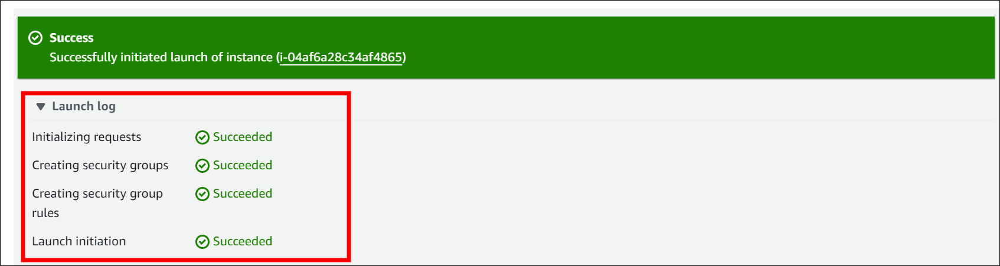

    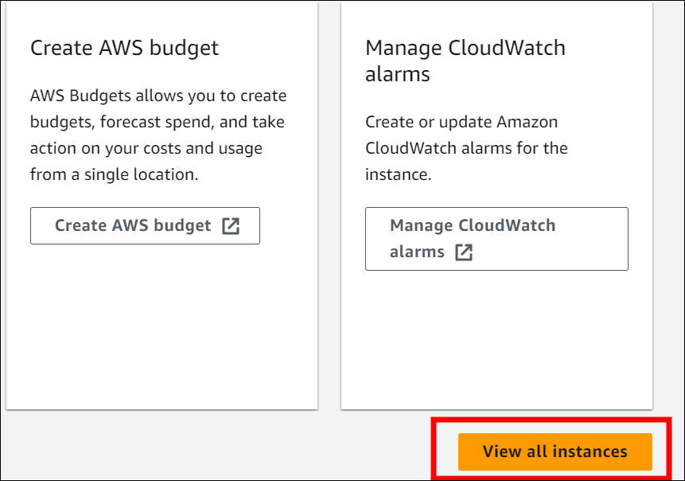

11. On the Instances List page, view the status of instance creation. Creating an instance takes a few moments. When you launch an instance, its initial state is pending. After the instance starts, its state changes to running, and it receives a public DNS name. If the Public IPv4 DNS column is hidden, click the settings icon in the top-right corner, enable **Public IPv4 DNS**, and click **Confirm**.

    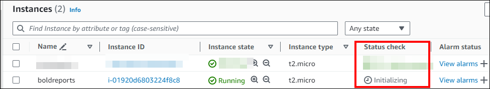

12. The instance may take a few minutes to be ready for you to connect. Make sure that your instance has passed its status check in the Status check column.

    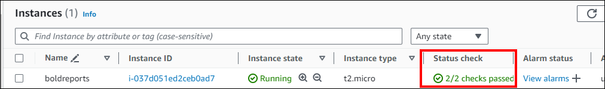

### How do I connect to the EC2 instance?

To connect to the AWS Windows EC2 instance that hosts Bold Reports<sup>®</sup>, use an RDP client and the decrypted admin password:

1. Navigate to the newly created EC2 instance from the AWS console.

    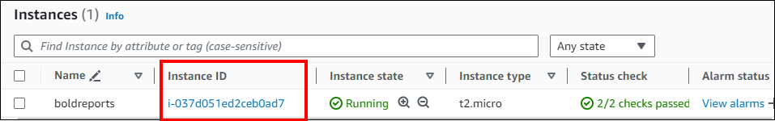

2. In the `Connect` instance section, navigate to the RDP client tab and select **Get Password**.

    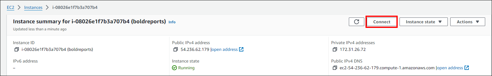

    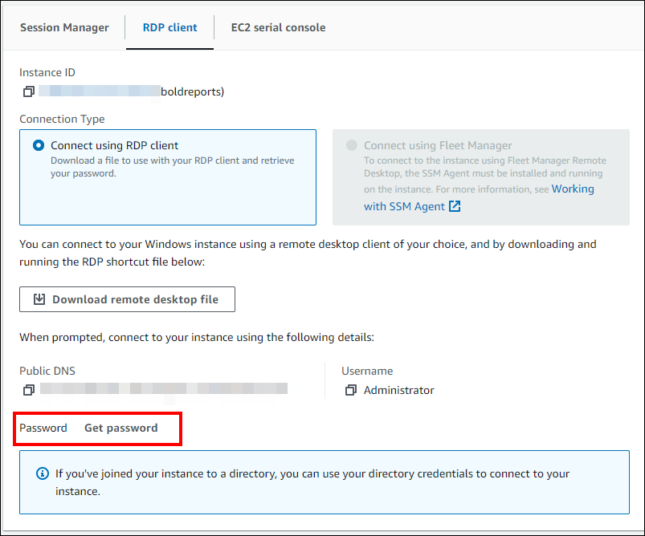

3. Upload the RSA (.pem) key pair that you downloaded during instance creation and click `Decrypt Password`.

    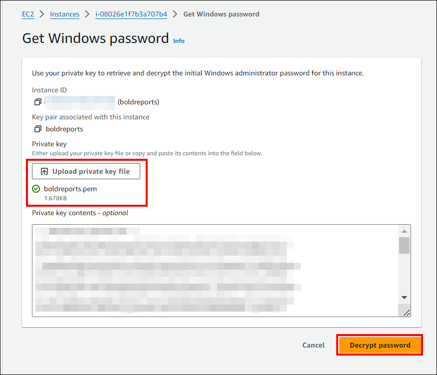

4. Download the Remote Desktop File (RDP) and copy the admin password.

    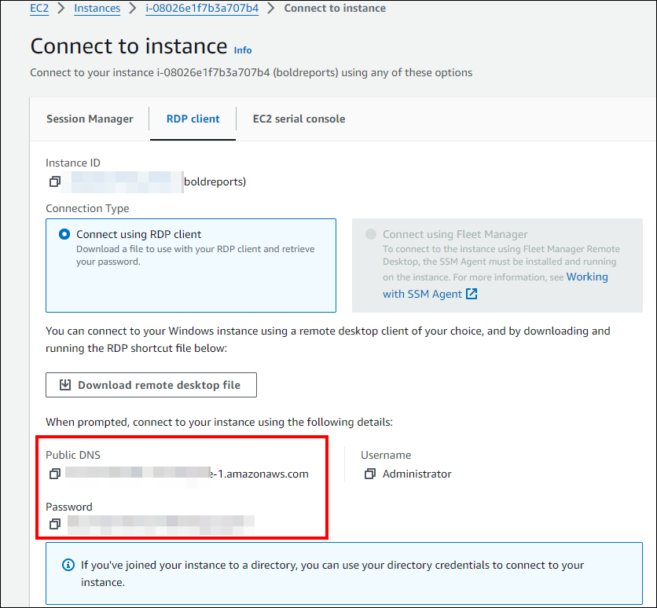

5. Open the .rdp file and click `Connect` when prompted with the unknown publisher warning. When asked for a password, enter the password that you copied from the AWS EC2 console.

    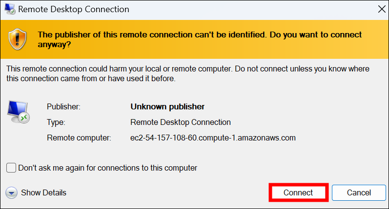

6. After a successful connection, the identity verification window appears. Click `Yes` to accept the certificate problems and connect to the virtual machine.

    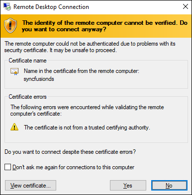

### How do I install and run the Bold Reports<sup>®</sup> Server on Windows?

To install and run the Bold Reports<sup>®</sup> Report Server on the Windows virtual machine (VM), follow these steps:

1. Install the Bold Reports<sup>®</sup> server on the virtual machine (VM) you created in the AWS portal by using the [installation and deployment guide](../../../deployment/deploy-on-windows/installation-and-deployment/).

2. Launch your application either by default or through the desktop shortcut. For example, `start Bold Reports in IIS`. Then, provide the application startup details and complete the setup process by selecting the appropriate license.

    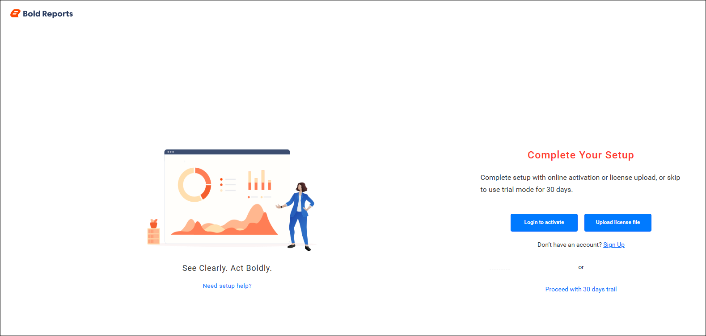

3. Follow the steps to initiate the [application startup](../../../application-startup/).

## Deploying Bold Reports<sup>®</sup> on an AWS Linux EC2 instance

To deploy the Bold Reports<sup>®</sup> Report Server on AWS Linux, create an AWS Linux EC2 instance and install the Report Server on it. The steps apply to Ubuntu, Red Hat Enterprise Linux (RHEL), and CentOS instances. The only differences are the operating system image you select during instance creation and the installation guide for that distribution.

### How do I set up an AWS Linux EC2 instance?

To set up an AWS Linux EC2 instance for the Bold Reports<sup>®</sup> Report Server, follow these steps:

1. Sign in to the AWS Management Console: <https://console.aws.amazon.com/ec2/>

2. From the EC2 console dashboard, click **Launch Instance**.

   

3. Under **Name and Tags**, enter a descriptive name for your instance.

   

4. Under **Application and OS Images (Amazon Machine Image)**, choose the Linux distribution that you want to deploy:

    * **Ubuntu**
      1. Select **Quick Start**.
      2. Choose **Ubuntu**.
      3. Select the required Ubuntu HVM version.

        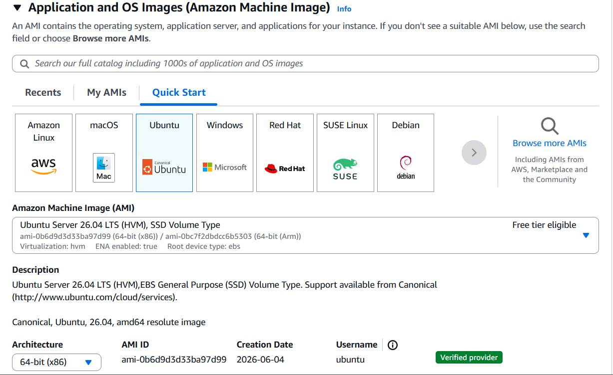

    * **Red Hat Enterprise Linux (RHEL)**
      1. Select **Quick Start**.
      2. Choose **Red Hat**.
      3. Select the required Red Hat Enterprise Linux version.

        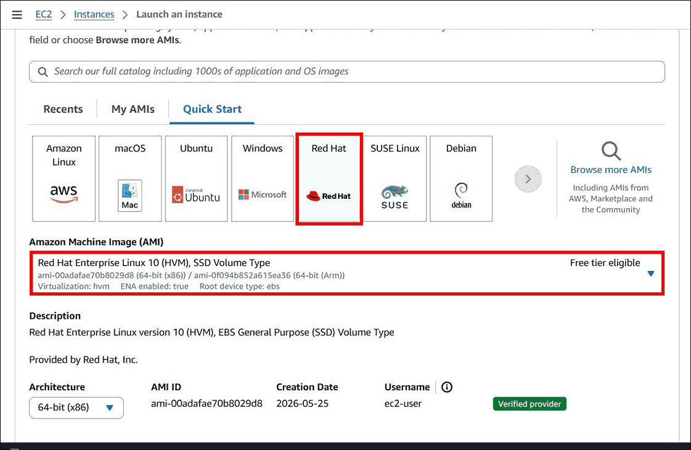

    * **CentOS**
      1. Select **Browse more AMIs**.
      2. Search for **CentOS**.
      3. Select the required CentOS image from the Marketplace or Community AMIs.

        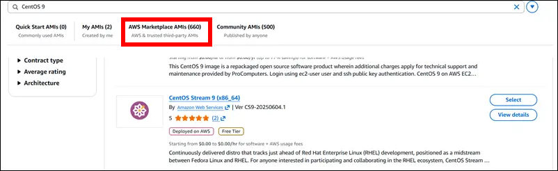

5. Under **Instance Type**, select an instance type based on your deployment requirements and expected user load.

   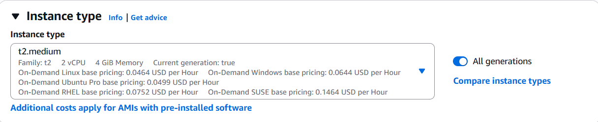

6. Under **Key Pair (login)**, select an existing key pair.

    * If you do not have a key pair, click **Create New Key Pair** and download the `.pem` file for future access.

   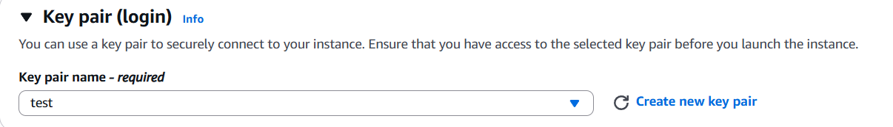

7. Under **Network Settings**, configure the firewall and security group settings. Make sure the following ports are open as required:

    * **22** - SSH
    * **80** - HTTP
    * **443** - HTTPS

   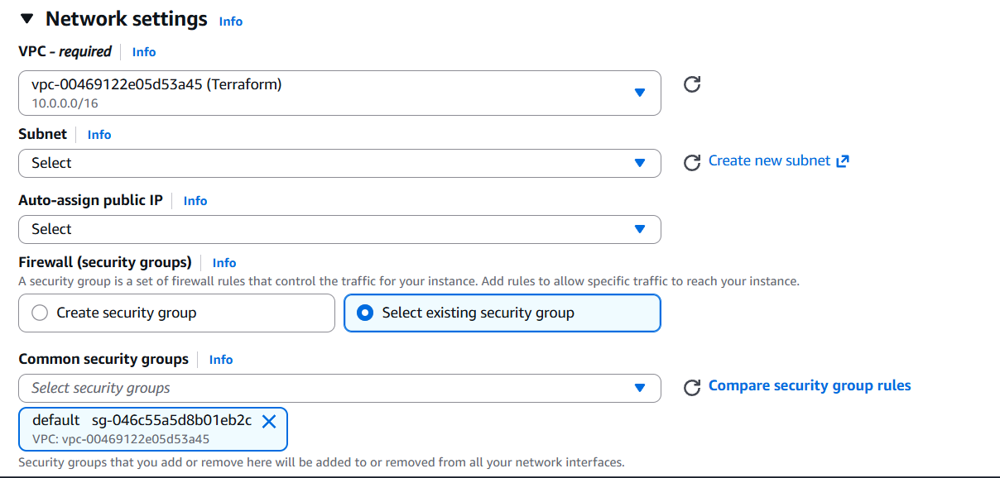

8. Keep the default selections for the remaining settings unless your deployment requires customization.

9. Review the configuration details in the **Summary** panel and click **Launch Instance**.

  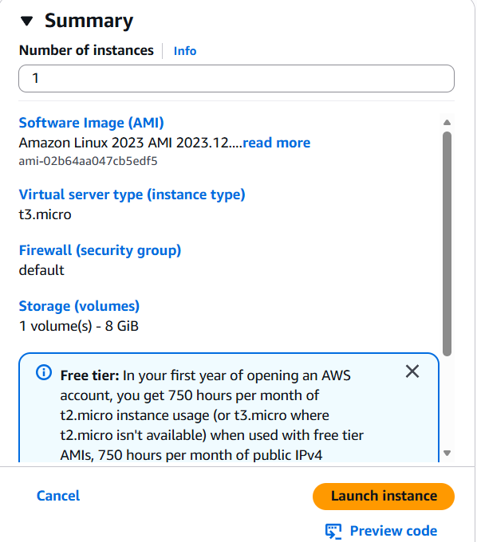

### How do I connect to the Linux EC2 instance?

You connect to the AWS Linux EC2 instance for Bold Reports<sup>®</sup> using SSH. The default username depends on the selected Linux distribution:

* Ubuntu: `ubuntu`
* Red Hat Enterprise Linux (RHEL): `ec2-user`
* CentOS: `ec2-user`

```bash
ssh -i "my-key.pem" <username>@ec2-xx-xx-xx-xx.compute-1.amazonaws.com
```

### How do I install and run the Bold Reports<sup>®</sup> Server on Linux?

To install and run the Bold Reports<sup>®</sup> Report Server on the Linux virtual machine (VM), follow these steps:

1. Install the Bold Reports<sup>®</sup> server on the virtual machine (VM) using the installation guide for your Linux distribution:

    * **Ubuntu**: [Ubuntu installation guide](../../../deployment/deploy-on-linux/bold-report-ubuntu/)
    * **Red Hat Enterprise Linux (RHEL)**: [RHEL installation guide](../../../deployment/deploy-on-linux/bold-reports-on-rhel/)
    * **CentOS**: [CentOS installation guide](../../../deployment/deploy-on-linux/bold-reports-on-centos/)

2. Launch your application either by default or through the desktop shortcut. For example, `start Bold Reports in IIS`. Then, provide the application startup details and complete the setup process by selecting the appropriate license.

    

3. Follow the steps to initiate the [application startup](../../../application-startup/).

## How do I deploy Bold Reports<sup>®</sup> on an AWS Linux CentOS EC2 instance?

To deploy Bold Reports<sup>®</sup> on an AWS CentOS EC2 instance, follow the knowledge base guide [Deploying Bold Reports<sup>®</sup> on an AWS CentOS EC2 instance](https://support.boldreports.com/kb/article/21385/bold-reports-deployment-on-amazon-linux-ami). The article gives step-by-step instructions for a successful installation and configuration of Bold Reports<sup>®</sup> on a CentOS environment.

## How do I deploy Bold Reports<sup>®</sup> on an AWS Linux RedHat EC2 instance?

To deploy Bold Reports<sup>®</sup> on an AWS RedHat EC2 instance, follow the knowledge base guide [Deploying Bold Reports<sup>®</sup> on an AWS RedHat EC2 instance](https://support.boldreports.com/kb/article/21385/bold-reports-deployment-on-amazon-linux-ami). The article gives step-by-step instructions for a successful installation and configuration of Bold Reports<sup>®</sup> on a RedHat environment.

## Frequently asked questions

### Which ports must be open on an AWS Linux EC2 instance?

Open port 22 for SSH, port 80 for HTTP, and port 443 for HTTPS as required.

### What is the default SSH username for each Linux distribution?

The default username is `ubuntu` for Ubuntu and `ec2-user` for Red Hat Enterprise Linux (RHEL) and CentOS.

## See also

* [Prerequisites to deploy Bold Reports<sup>®</sup> on AWS](../prerequisites/)
* [Deploy Bold Reports<sup>®</sup> on Amazon ECS](../ecs-deployment-guides/)
* [Upgrade the Bold Reports<sup>®</sup> VM on AWS](../upgrade-vm-latest-version/)
