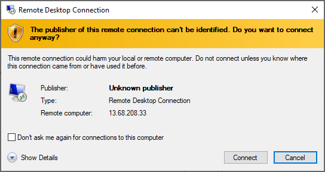
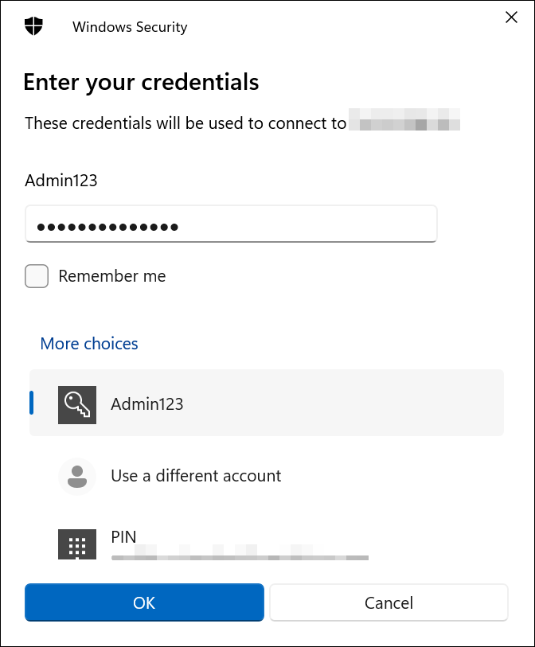
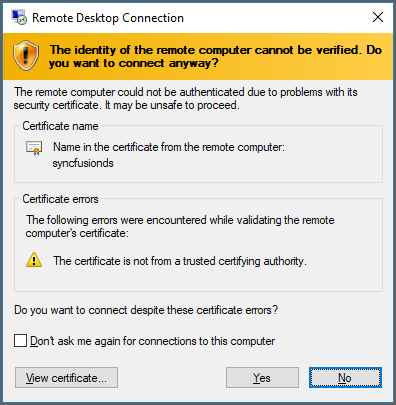
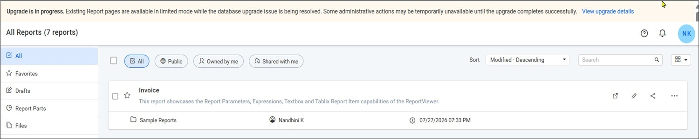
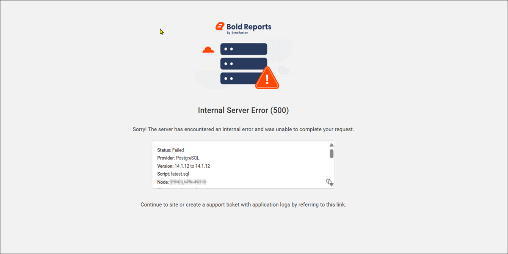
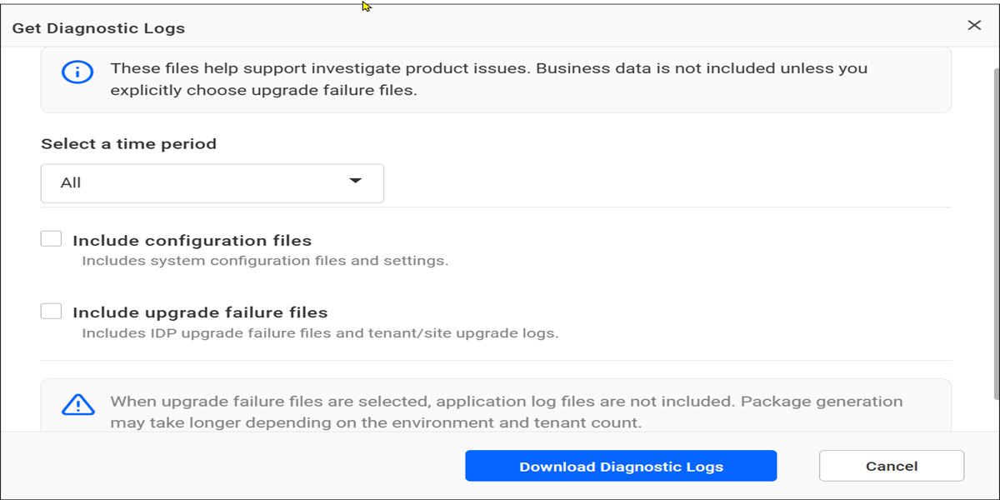

# Upgrade the Bold Reports® Report Server VM on AWS to the latest version

You can upgrade the Bold Reports® Report Server VM on AWS from an older version to the latest Bold Reports® On-Premises Edition version.

## How do I upgrade the Bold Reports® VM on AWS?

To upgrade the Bold Reports® Report Server VM from an older version, follow these steps:

1. Open the downloaded .rdp file and click `Connect` when prompted with the unknown publisher warning. The screenshot shows the unknown publisher warning.

    

2. Enter the credentials provided when deploying the VM and click `OK`.

    

3. After a successful connection, an identity verification window appears. Click **Yes** to accept the certificate problems and connect to the virtual machine.

    

4. After you connect to the virtual machine, follow the steps to [upgrade the Report Server to a newer version](../../upgrade/on-premises/upgrade-bold-reports-to-latest-version/).

## Upgrade Failure Notification

The Bold Reports® Report Server shows an upgrade failure notification when a database script execution fails during an application upgrade. The upgrade process continues without interrupting access to existing reports. A notification banner indicates that the upgrade is still in progress and that some administrative actions may be temporarily unavailable until the issue is resolved.

  

Click `View upgrade details` to view information about the upgrade failure, including the upgrade status, database provider, version details, failed script information, and error message.

  

> **Note:** If this notification banner is displayed, the upgrade process encountered an issue. To resolve the issue, [contact Bold Reports® support](https://www.boldreports.com/contact) and share the upgrade-related logs with the support team for further investigation.

### How do I download the upgrade logs?

You download the Bold Reports® upgrade-related logs from the UMS:

* Navigate to **UMS** > **Sites**, click the **Help** icon in the upper-right corner, and select **Get Diagnostic Logs**. Select **Include upgrade failure files** and click **Download Diagnostic Logs** to download the upgrade-related logs.
  

## Frequently asked questions

### Can users access reports if the upgrade fails?

Yes. If a database script execution fails, the upgrade process continues without interrupting access to existing reports.

### What information does View upgrade details show?

View upgrade details shows the upgrade status, database provider, version details, failed script information, and error message.

## See also

* [Prerequisites to deploy Bold Reports® on AWS](../prerequisites/)
* [Self-deploy a Bold Reports® Server on an AWS instance](../self-deploy-bold-reports-server-on-amazon-web-service/)
* [Deploying Bold Reports® in AWS](../)
