# Bold Reports® in the Microsoft Azure Marketplace

You can create a Bold Reports® Report Server virtual machine in the Azure portal from the pre-configured Bold Reports® image in the Azure Marketplace.

## How do I create a Bold Reports® VM from the Azure Marketplace image?

The pre-configured server image in the Azure Marketplace is one of the fastest ways to get the Bold Reports® Server up and running in Azure. To start, follow these steps:

1. Sign in to the [Azure portal](https://portal.azure.com/#home).

2. Click the `Create a resource` option in the upper-left corner.

   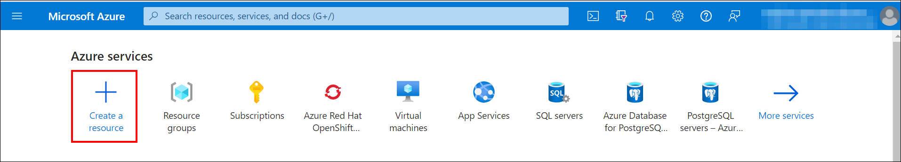

3. Search for `Bold Reports Enterprise`.

   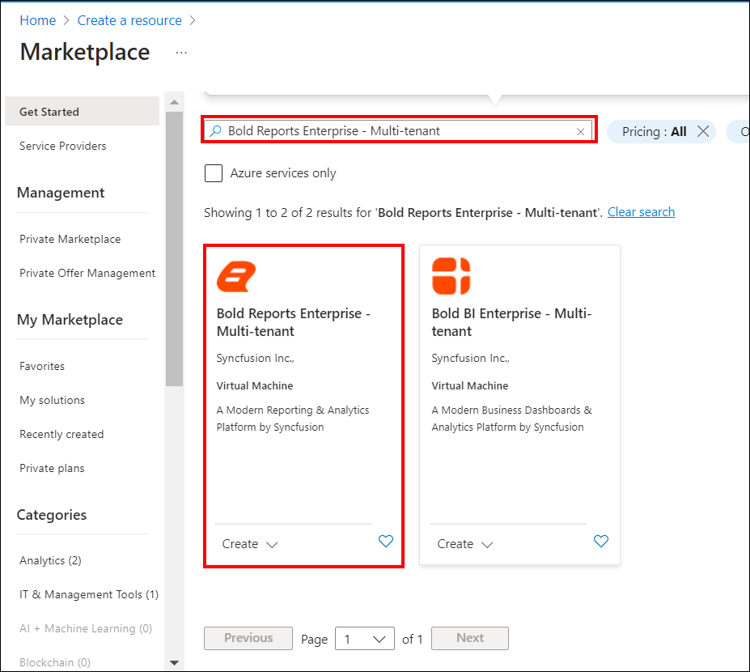

4. Select Bold Reports® Enterprise Multi-tenant and click the `Create` button.

  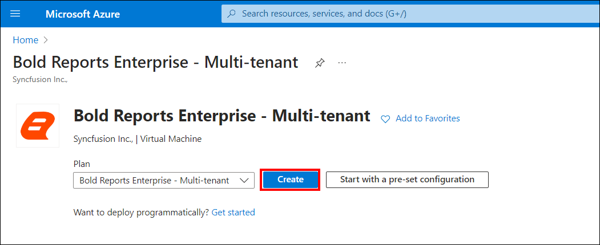

### Basics blade

The Basics blade requests administrative information for the Bold Reports® virtual machine.

* **Resource group:** Select an existing resource group or type the name for a new one. To learn more, see the [Azure resource groups overview](https://learn.microsoft.com/en-us/azure/azure-resource-manager/management/overview#resource-groups).

* **Virtual machine name:** Enter a name for the virtual machine. The name must be within 1-15 characters and should not contain special characters.

* **Region:** Select an Azure data center location where you want to run the VM.

* **Size:** The default plan is Standard E2 size, but you can change it by selecting the `Change Size` option.

* **Username:** Enter a user name to create a local account on the VM. The local account is used to sign in and manage the VM.

* **Password:** Enter a strong password to create a local account on the VM. The password must be within 12-123 characters and meet three out of the four following complexity requirements: one lowercase character, one uppercase character, one number, and one special character.

* When finished, click `Next` to proceed to the `Disks` blade.

  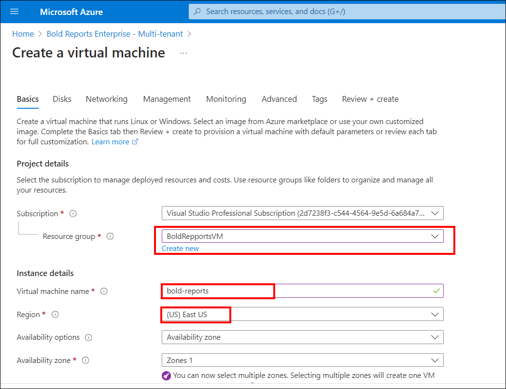

  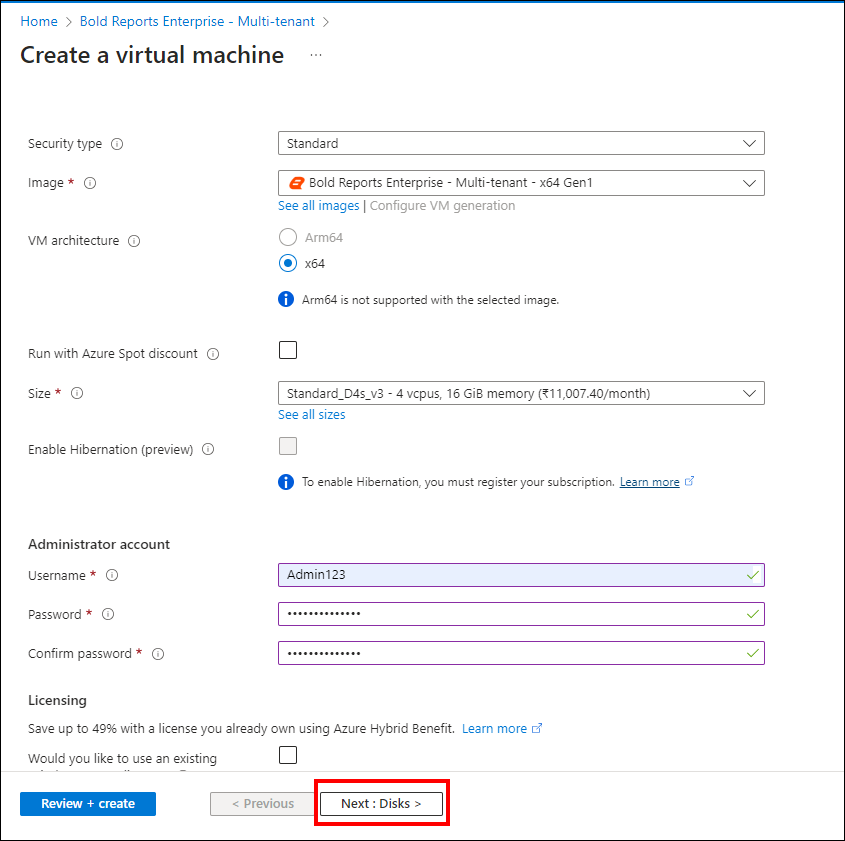

### Settings blade

The Settings blade requests storage and network options for the Bold Reports® virtual machine. You can accept the default settings, and Azure creates appropriate entries at the required location. If you select the desired virtual machine size, consider Azure premium storage by choosing `Premium (SSD)` as the disk type.

### Disks

The Disks settings control storage for the Bold Reports® virtual machine.

**Storage:** Premium disks (SSD), backed by solid-state drives, offer consistent and low-latency performance. They provide the best balance between price and performance. They are ideal for I/O-intensive applications and production workloads. Standard disks (HDD), backed by magnetic drives, are preferable for applications where data is accessed infrequently. When all the changes are completed, click **OK**.

**Use managed disks:** Enable this feature to automatically manage disk availability in Azure. Managed disks provide data redundancy and fault tolerance without the need to create and manage storage accounts. Managed disks may not be available in all regions. To learn more, see the [managed disks overview document](https://learn.microsoft.com/en-us/azure/virtual-machines/managed-disks-overview).

**Storage account:** Disks for Azure virtual machines are created in storage accounts. To learn more, see the [storage accounts overview page](https://learn.microsoft.com/en-us/azure/storage/blobs/storage-blobs-overview).

  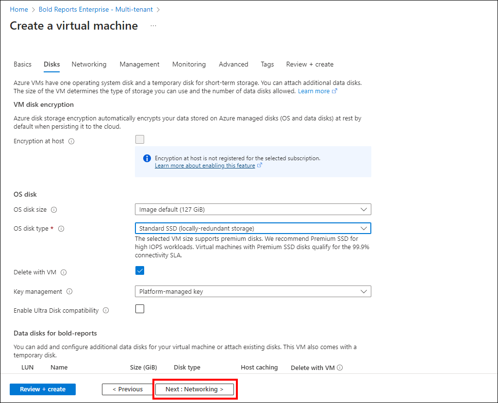

### Networking

The Networking settings define how the Bold Reports® virtual machine connects to other resources and the Internet.

**Virtual network:** Virtual networks in Azure are logically isolated from each other. You can configure their IP address ranges, subnets, route tables, gateways, and security settings, similar to traditional networks in a data center. By default, virtual machines in the same virtual network can access each other.

**Subnet:** A subnet is a range of IP addresses within a virtual network that can be used to isolate virtual machines from each other or from the Internet.

**Public IP address:** Use the public IP address to communicate with the virtual machine from outside the virtual network.

  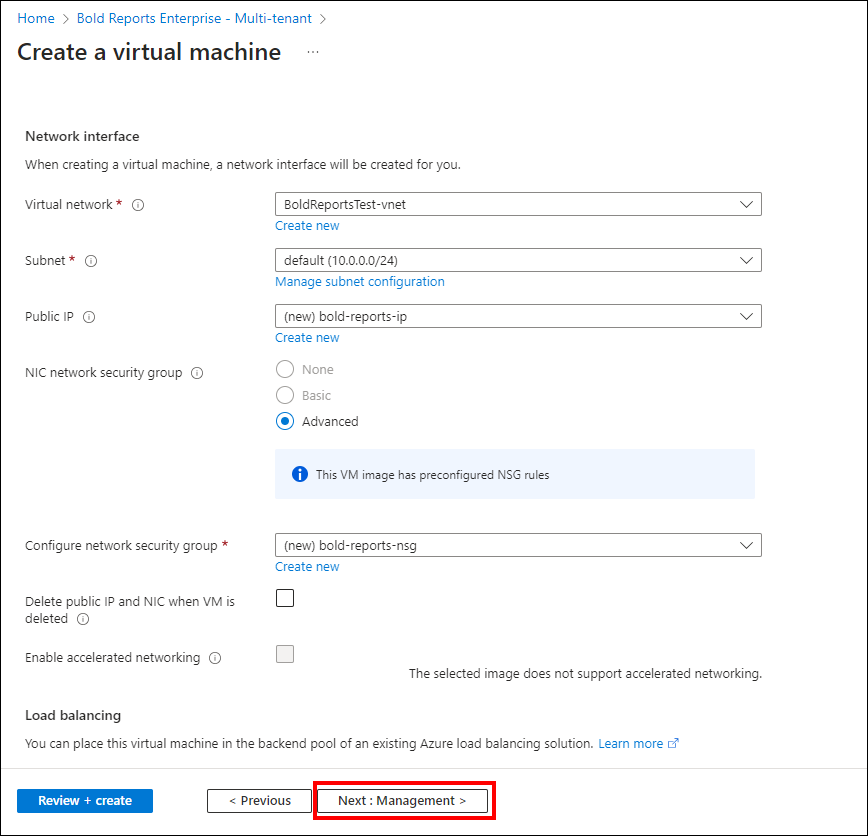

### Management

The Management settings control diagnostics for the Bold Reports® virtual machine.

* **Boot diagnostics:** Capture serial console output and screenshots of the virtual machine running on the host to help diagnose startup issues.

* **Guest OS diagnostics:** Obtain metrics for every minute of the virtual machine. You can use them to create alerts and stay informed about the applications.

* **Diagnostics storage account:** Metrics are written to the storage account, so you can analyze them with your own tools.

  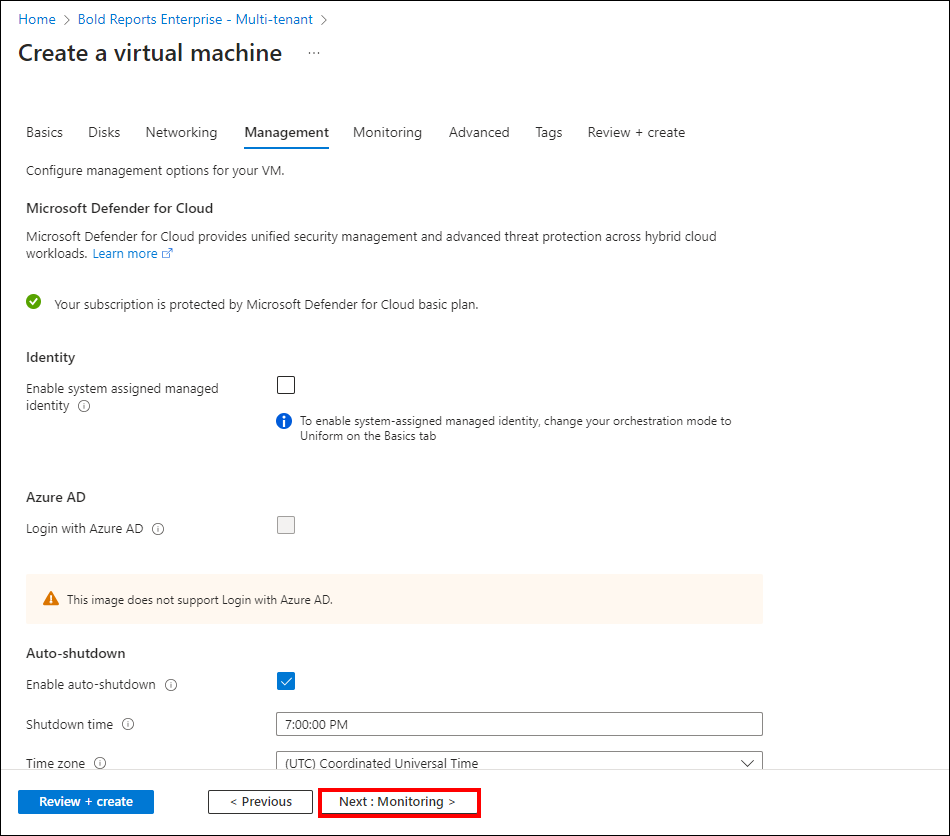

  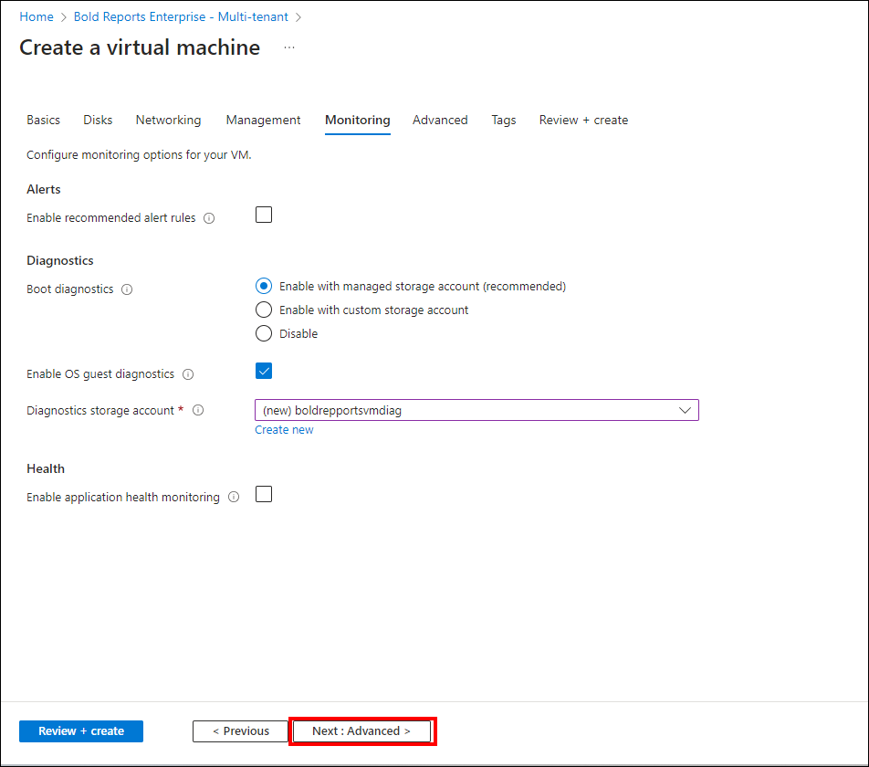

### Advanced

The Advanced settings let you add extensions to the Bold Reports® virtual machine.

* **Extensions:** Add new features like configuration management or antivirus protection to the virtual machine using extensions. For more information, see the [Azure VM extensions documentation](https://learn.microsoft.com/en-us/azure/virtual-machines/extensions/features-windows).

  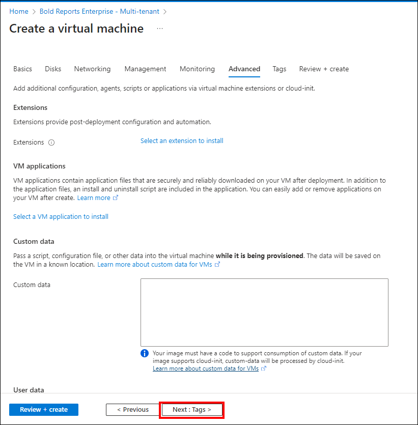

### High availability

The High availability settings add redundancy for the Bold Reports® application.

* **Availability set:** Group two or more virtual machines in an availability set to provide redundancy to the application. This configuration ensures the availability of at least one virtual machine and meets the 99.95% Azure SLA during planned or unplanned maintenance events. You cannot change the availability set of the virtual machine after it is created.

  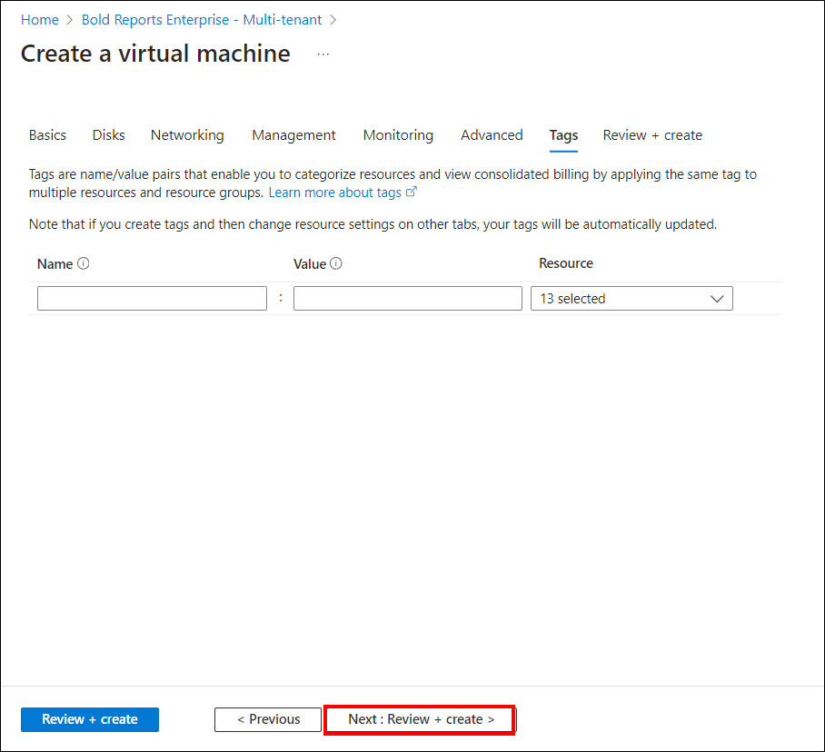

When all the changes are completed, click the `Review + Create` button.

### Review and create

On the review and create page, start the Bold Reports® Enterprise - Multi-tenant server virtual machine deployment:

* Click **Create** to start the deployment.

  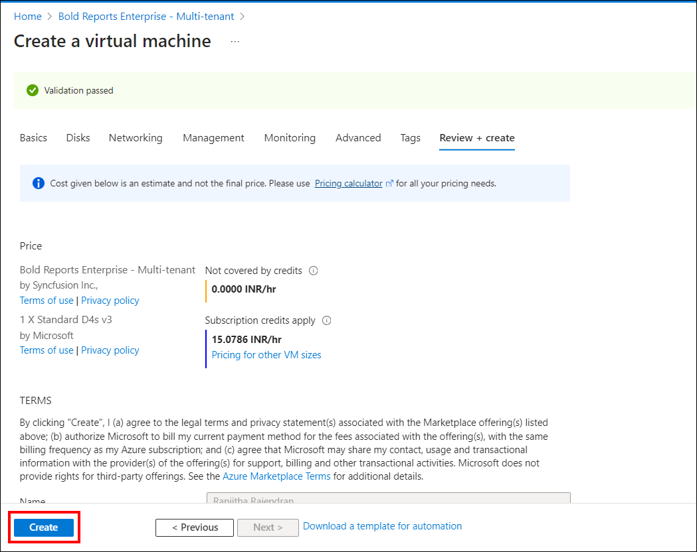

  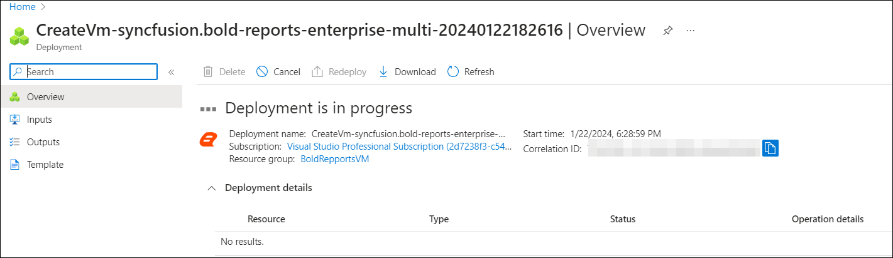

### How do I connect to the Bold Reports® Enterprise Multi-tenant Server virtual machine?

After the deployment completes, you connect to the Bold Reports® Server VM through a Remote Desktop Connection (RDP). Follow these steps:

1. Click `Connect` on the virtual machine overview window. The Azure portal downloads a Remote Desktop Protocol (.rdp) file.

   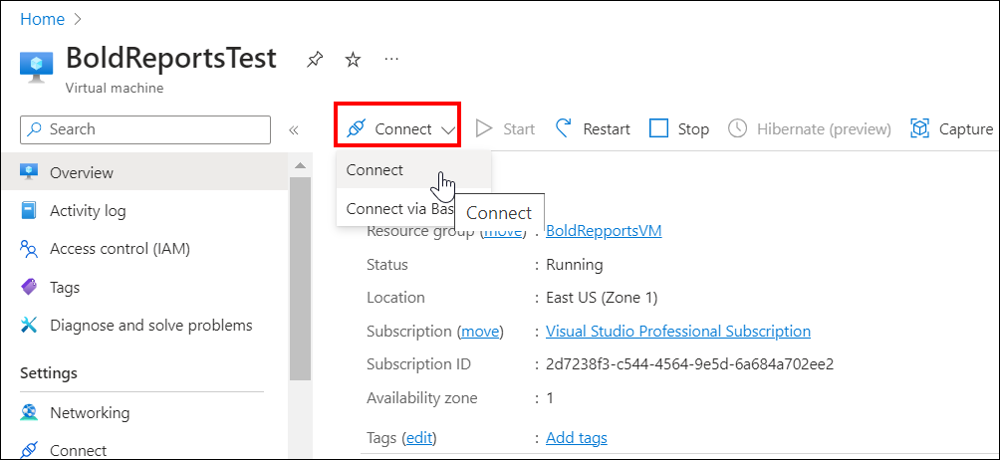

   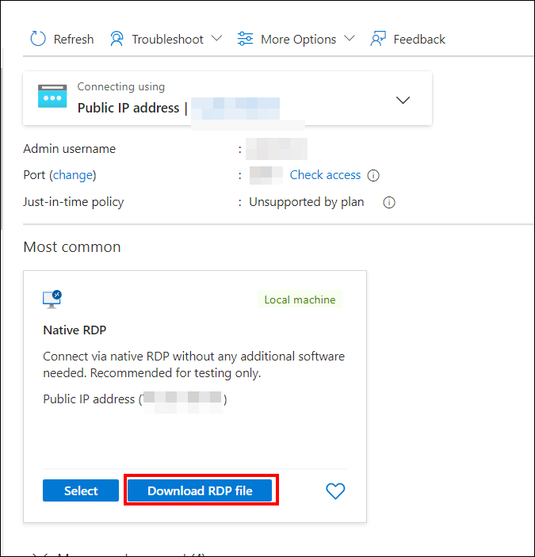

2. Open the .rdp file and click `Connect` for the unknown publisher warning.

   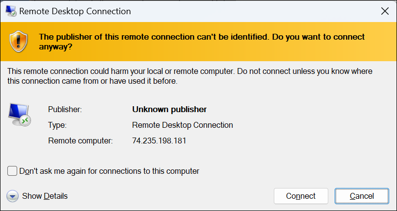

3. Enter the credentials you provided during the VM deployment, and click **OK**.

   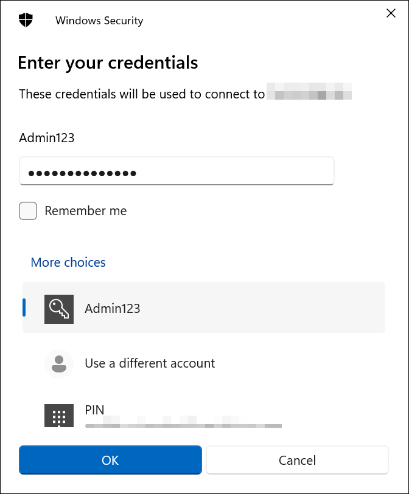

4. After a successful connection, the identity verification window appears. Click `Yes` to accept the certificate problems and connect to the virtual machine.

  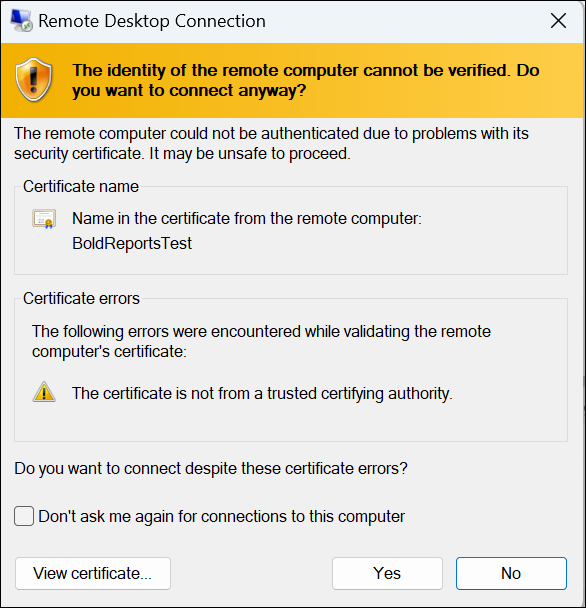

### How do I run the Bold Reports® Server?

The Bold Reports® virtual machine includes a desktop shortcut that starts the server. To run the Bold Reports® server, follow these steps:

1. Open the `Start Bold Reports in IIS` shortcut to run the Bold Reports® server. Then, provide the application startup details and complete your setup by selecting the appropriate license.

   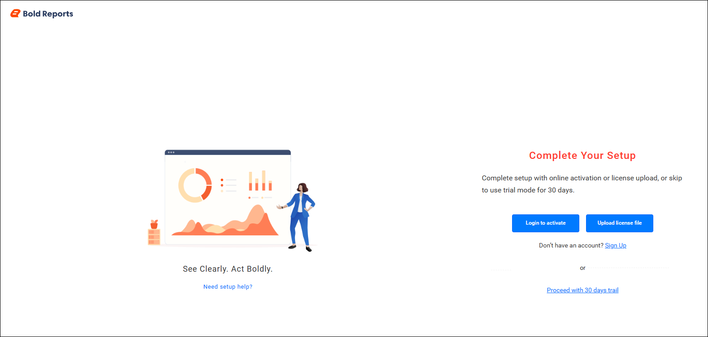

2. Follow the steps to perform the [application startup](../../../application-startup/).

## Frequently asked questions

### What is the default VM size for the Azure Marketplace image?

The default plan is Standard E2 size. You can change it by selecting the `Change Size` option.

### What are the password requirements for the VM local account?

The password must be within 12-123 characters and meet three of four complexity requirements: one lowercase character, one uppercase character, one number, and one special character.

## See also

* [Prerequisites to deploy Bold Reports® on Azure](../prerequisites/)
* [Recommended Azure VM configuration](../vm-configuration/)
* [Upgrade the Bold Reports® VM on Azure](../upgrade-vm-to-latest-version/)
