# Self-deploy a Bold Reports® Server on Microsoft Azure

You can self-deploy the Bold Reports® Report Server on a Microsoft Azure virtual machine. Set up a Windows Server VM, connect to it through Remote Desktop, and then install and run the server.

## How do I set up a Microsoft Azure VM?

To set up a Microsoft Azure VM for the Bold Reports® Report Server, follow these steps:

1. Sign in to the [Azure Portal](https://portal.azure.com/#home).

2. Click `Create a resource`.

   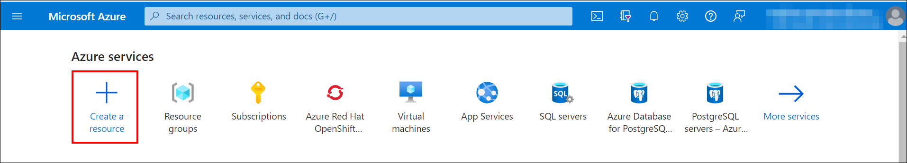

3. Select the `Compute` option under the `Categories` section.

   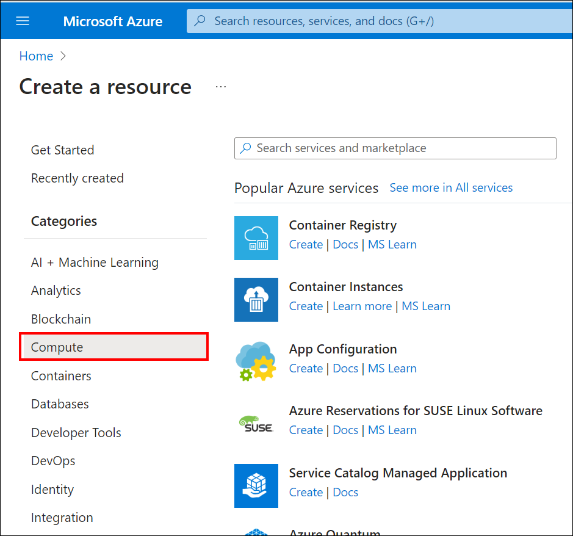

4. Search for `Windows Server` and select it.

   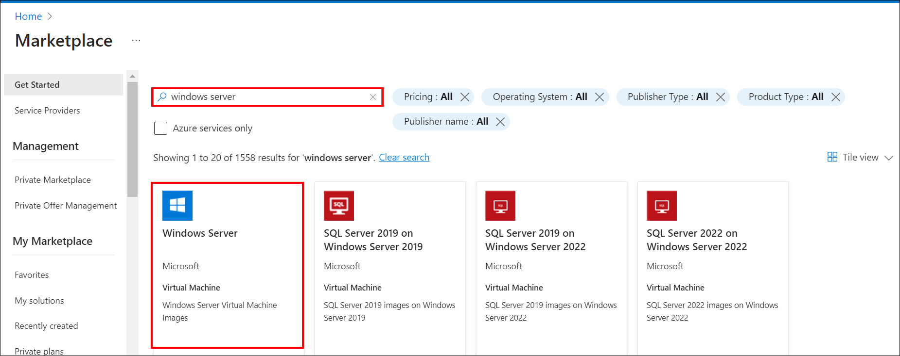

5. Choose the Windows Server software plan that meets the Bold Reports® [system requirements](../../getting-started/#hardware-requirements) and click `Create`.

   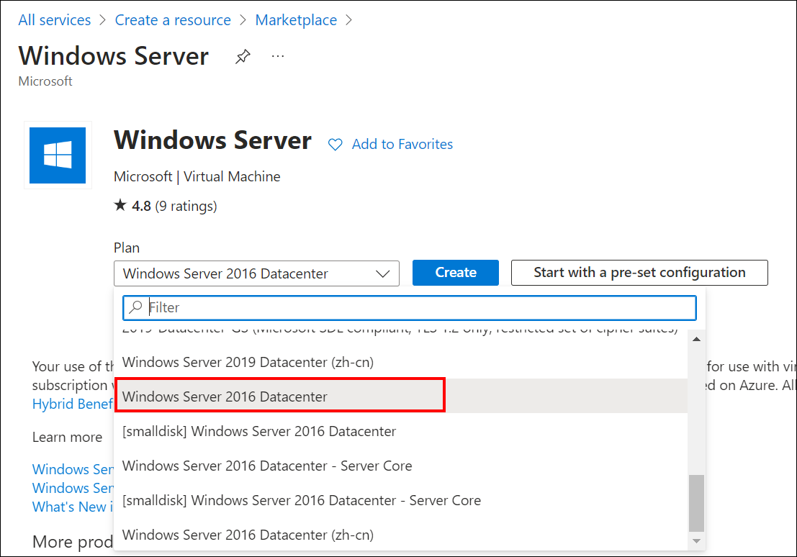

6. Provide the necessary administrative information for the new VM on the `Basics` blade.

   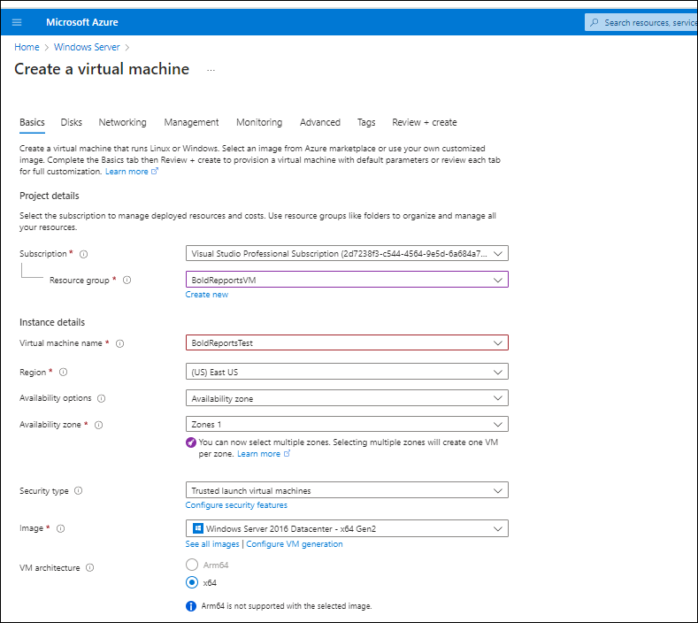

   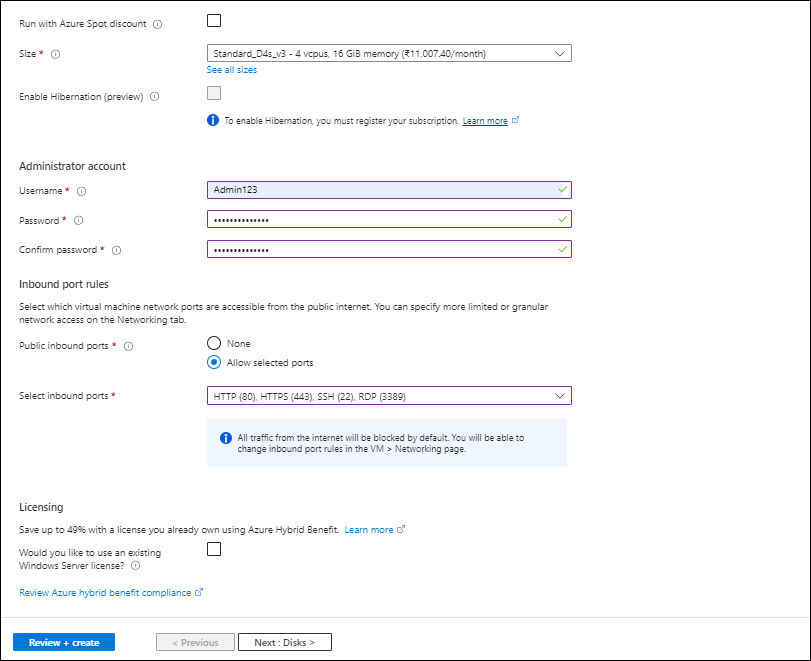

    **Subscription:** Associate this VM with the Azure subscription.

    **Resource group:** Choose `Create new` and enter the name of the new resource group to host the VM's resources.

    **Virtual Machine Name:** Enter a name for your VM (maximum of 15 characters).

    **Region:** Choose your preferred region for your VM.

    **Username:** Enter your username, which you use to log in to the VM using the Remote Desktop Protocol (RDP).

    **Password:** Enter your password, which you need to log in to the VM using RDP.

7. Under the `Disks` blade, choose the VM OS disk type (**SSD** is recommended).

   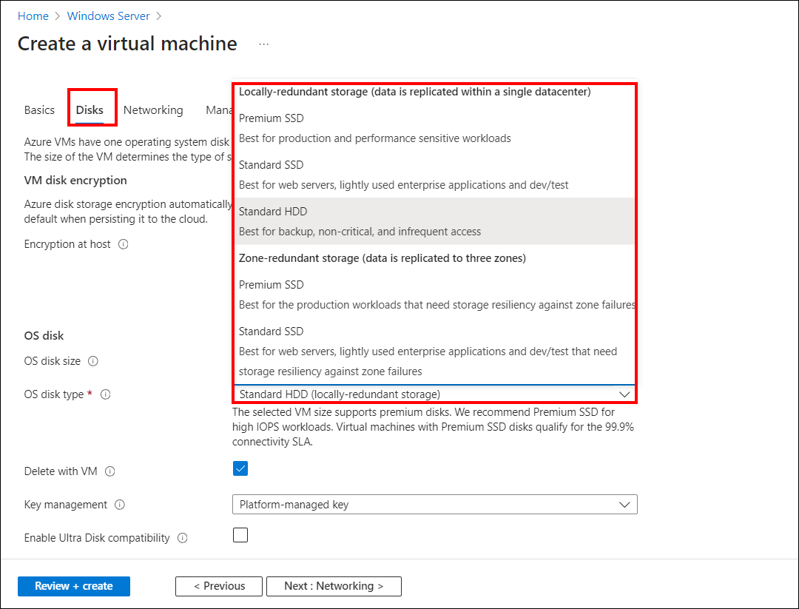

    **VM disk type:** Choose SSD or HDD as you prefer (SSD is recommended for better performance).

    **Size:** Choose the VM size that meets the Bold Reports® [system requirements](../../getting-started/#hardware-requirements). For example, choose the D2s_V3 size, and then click **Select**.

8. Under the `Networking` blade, select `Advanced` in `NIC network security group`. Click `Create new` in the **Configure network security group** option to add an inbound security rule. The rule allows specific types of internet traffic to reach your VM.

   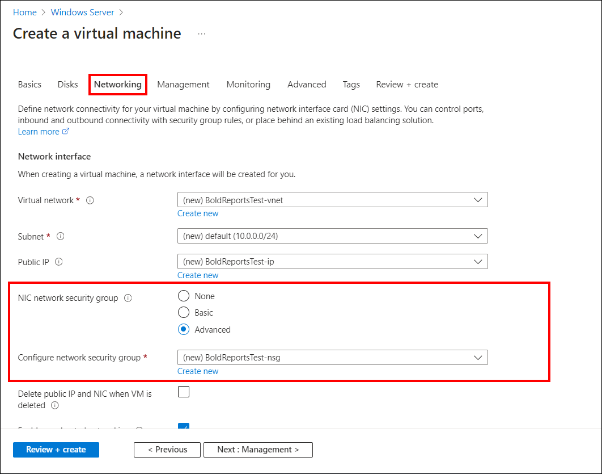

   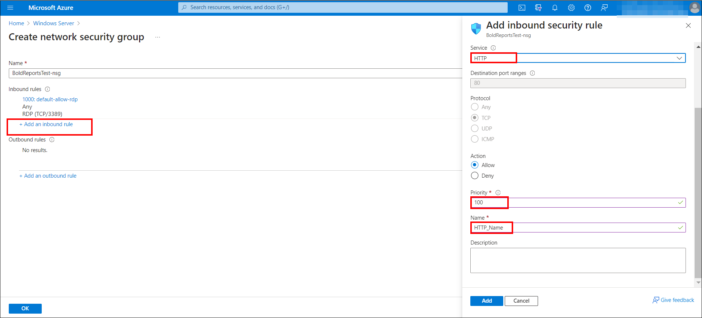

9. Choose `HTTP` from the `Service` drop-down list on the `Add inbound security rule` blade.

10. In the `Priority` box, assign a numerical priority to the rule, such as 100. Rules with lower numbers are processed first. For instance, a rule with a priority of 100 is processed before a rule with a priority of 110.

11. In the **Name** box, type a name for the inbound rule, and then click **OK**.

12. Repeat the steps to create an inbound security rule for the HTTPS service with a priority of 101.

13. When finished, the Create network security group dialog should have three rules allowing RDP, HTTP, and HTTPS access. Click **OK**.

14. Review your settings and click **Create**.

  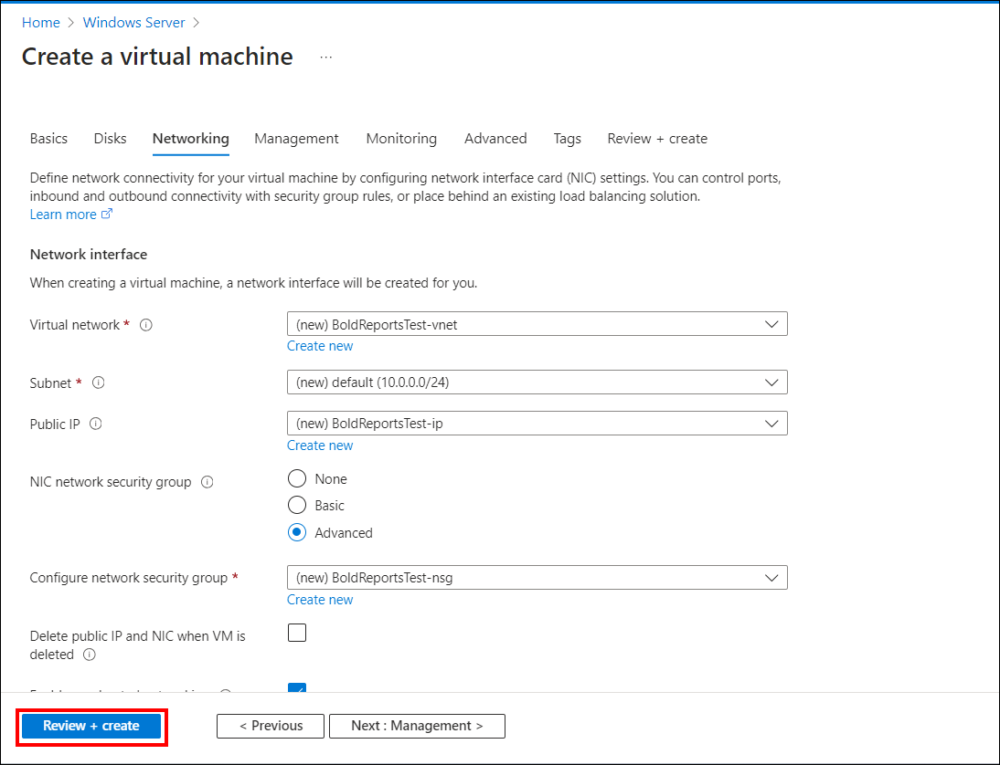

  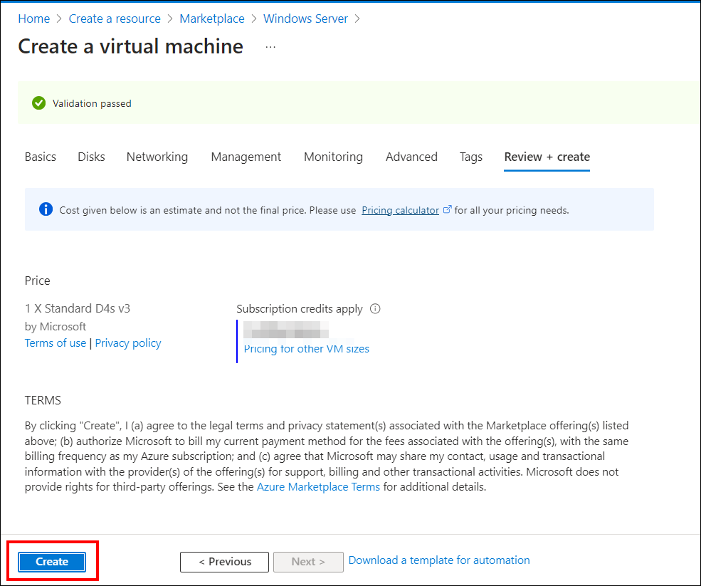

  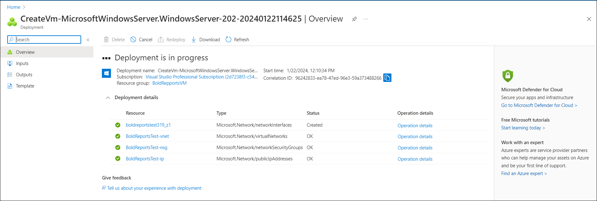

## How to Connect the VM Through the Remote Desktop Connection

To connect to the Azure VM that hosts the Bold Reports® server, use a Remote Desktop Connection:

1. Click `Connect` on the virtual machine overview window to download a Remote Desktop Protocol (`.rdp`) file from the Azure portal.

   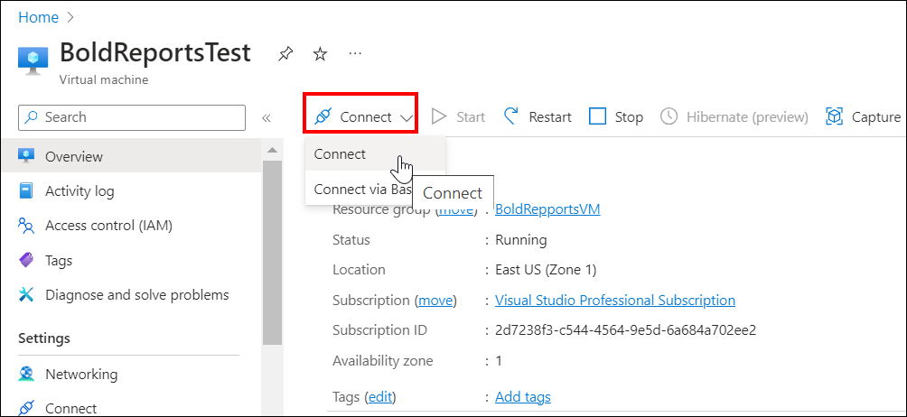

   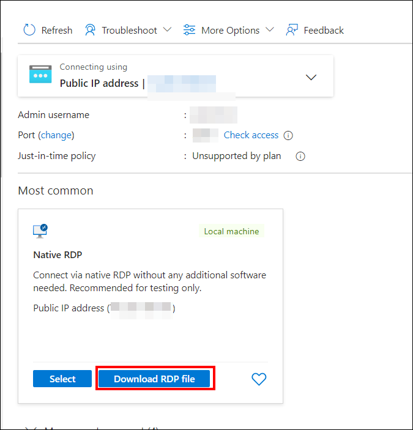

2. Open the .rdp file and click **Connect** to proceed, despite the warning from an unknown publisher.

   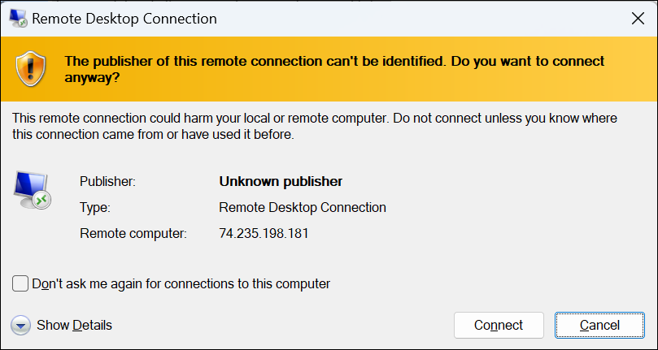

3. Enter the credentials that you provided when creating the VM, and click **OK**.

   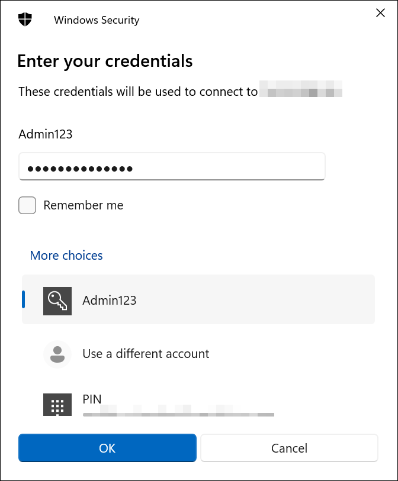

4. After a successful connection, the identity verification window appears. Click `Yes` to accept the certificate problems and connect to the virtual machine.

  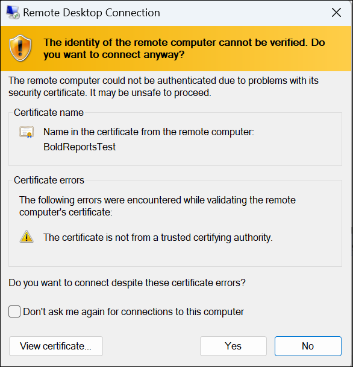

### How do I install and run the Bold Reports® Server on the Azure VM?

To install and run the Bold Reports® server on the Azure virtual machine (VM), follow these steps:

1. Install the Bold Reports® server on the virtual machine (VM) you created in the Azure portal by using the [Windows installation and deployment guide](../../../deployment/deploy-on-windows/installation-and-deployment/).

2. Launch your application either by default or through your desktop shortcut menu item. For example, start Bold Reports® in IIS. Then, provide the application startup details and complete your setup by selecting the appropriate license.

   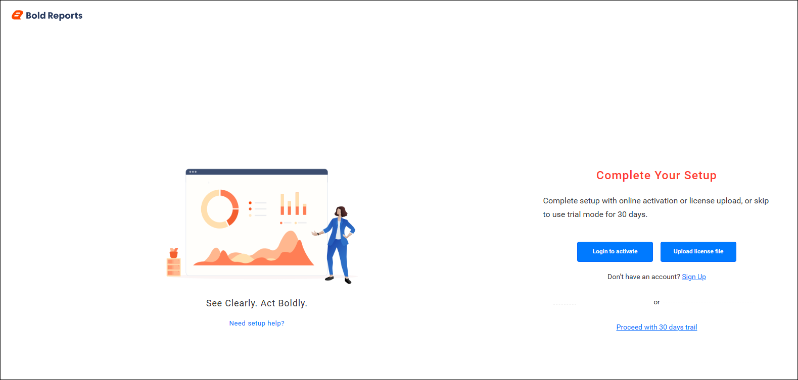

3. Follow the steps to do the [application startup](../../../application-startup/).

## Frequently asked questions

### Which inbound rules does the Azure VM need?

The network security group needs three rules allowing RDP, HTTP, and HTTPS access. The HTTP rule uses priority 100 in the example, and the HTTPS rule uses priority 101.

### How long can the Azure VM name be?

The virtual machine name can have a maximum of 15 characters.

## See also

* [Prerequisites to deploy Bold Reports® on Azure](../prerequisites/)
* [Recommended Azure VM configuration](../vm-configuration/)
* [Upgrade the Bold Reports® VM on Azure](../upgrade-vm-to-latest-version/)
