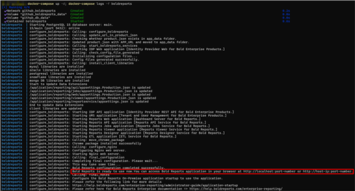
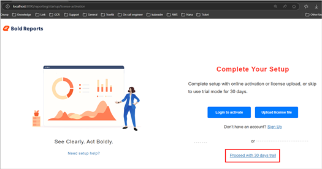

# Deploy Bold Reports<sup>®</sup> Evaluation on Docker

The Bold Reports<sup>®</sup> Evaluation Image streamlines the Bold Reports<sup>®</sup> evaluation process by integrating a PostgreSQL server within the Bold Reports<sup>®</sup> container. This image tag is intended for evaluation purposes only and should not be used in production environments.

## How do I deploy the Bold Reports<sup>®</sup> evaluation image with Docker Compose?

You deploy the Bold Reports<sup>®</sup> evaluation image using Docker Compose, with volume mounts configured for data persistence. Follow these steps:

1. Download the Docker Compose file by using the following command:

   ```sh
   curl -o docker-compose.yml "https://raw.githubusercontent.com/boldreports/bold-reports-docker/refs/heads/master/deploy/single-container-eval-no-license/docker-compose.yml"
   ```

2. Run the following command. It starts the Bold Reports<sup>®</sup> application container and displays the Bold Reports<sup>®</sup> container logs, which show the installation status of the Bold Reports<sup>®</sup> application.

   ```sh
   docker-compose up -d; docker-compose logs -f boldreports
   ```

   The following screenshot shows the output of the docker-compose up command.

   

3. Access the Bold Reports<sup>®</sup> application by entering the URL as `http://localhost:8090` or `http://host-ip:8090` in the browser. The application configures its startup in the background and displays the license activation page within a few seconds. You can either activate your license using the available option or try the trial version by selecting the **Proceed with 30 Days Trial** option.

   The following screenshot shows the license activation (registration) page.

   

   > **Note:** The default port number mentioned in the compose file is 8090. If you change the port number, use that port number to access the Bold Reports<sup>®</sup> application.

4. After you select the license option, the application redirects you to the reports listing page.

   > **Note:** </br> 1. The deployment steps above are recommended for evaluation purposes only. For a production use case, you need to mount the volume to the host path location or online storage and use managed DB servers. </br>2. Don't use localhost IP (`http://127.0.0.1`) with `port` to access the application.

## Shutdown and cleanup

Bold Reports<sup>®</sup> evaluation containers are stopped and removed with Docker Compose commands.

The command **docker-compose down** removes the containers and default network, but preserves the volumes of Bold Reports<sup>®</sup> and PostgreSQL. <br /><br />
The command **docker-compose down --volumes** removes the containers, default network, and all the volumes.

## Frequently asked questions

### Can I use the Bold Reports<sup>®</sup> evaluation image in production?

No. The Bold Reports<sup>®</sup> evaluation image is intended for evaluation purposes only and should not be used in production environments.

### Which port does the Bold Reports<sup>®</sup> evaluation image use?

The Bold Reports<sup>®</sup> compose file uses port 8090 by default. If you change it, use your new port number to access the application.

## See also

* [Deploy Bold Reports<sup>®</sup> on Docker single container](./../bold-reports-on-single-container/)
* [Deploy Bold Reports<sup>®</sup> on Docker multiple containers](./../bold-reports-on-multi-container/)
* [Docker prerequisites for Bold Reports<sup>®</sup>](./../../prerequisites/)
