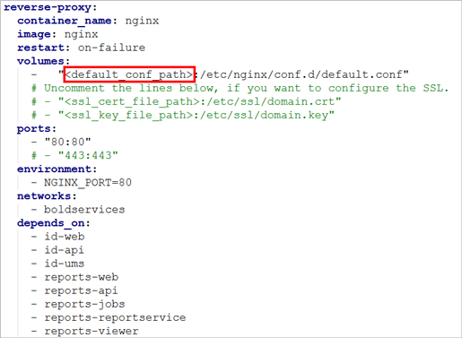

# Deploy Bold Reports<sup>®</sup> on Docker Multiple Container

Bold Reports<sup>®</sup> can be deployed using Docker containers to simplify setup, enhance scalability, and streamline maintenance. A multi-container Docker setup enables you to run Bold Reports<sup>®</sup> in isolated containers that work together.

## How do I prepare the Bold Reports<sup>®</sup> multi-container project?

You prepare the Bold Reports<sup>®</sup> multi-container project by creating a project directory, downloading the compose and Nginx files, and editing them. Follow these steps:

1. Create an empty project directory.<br/>
  
   You can name the directory something easy for you to remember. This directory is the context for your application image. The project directory should contain a `docker-compose.yml` file, which is complete in itself for a good starter Bold Reports<sup>®</sup> project.

2. Make and change into your project directory.
   For example, if you named your directory `my_boldreports`:

   ```sh
    cd my_boldreports/
   ```

3. Download the docker-compose YML file and configuration file for Nginx files by running the following commands:

   ```sh
   curl -o docker-compose.yml "https://raw.githubusercontent.com/boldreports/bold-reports-docker/refs/heads/master/deploy/multiple-container/docker-compose.yml"
   curl -o default.conf "https://raw.githubusercontent.com/boldreports/bold-reports-docker/refs/heads/master/deploy/multiple-container/default.conf"  
   ```

4. Replace `<app_base_url>` with the DNS or IP address you want to use to access the application.
   For example, <br/>
       `http://example.com` <br/>
       `https://example.com` <br/>
       `http://<public_ip_address>` <br/>
       `http://host.docker.internal` <br/>

   > **Note:** <br/>* If you use the IP address for the Base URL, use the public IP of the machine instead of the internal IP or local IP address. Applications can communicate with each other using the public IP alone. Host machine IP will not be accessible inside the application container.<br/>* Use <http://host.docker.internal> instead of <http://localhost>. Host machine localhost DNS will not be accessible inside the container. So, docker desktop provides `host.docker.internal` and `gateway.docker.internal` DNS for communication between docker applications and host machine. Make sure that the host.docker.internal DNS has your IPv4 address mapped in your hosts file on Windows(C:\Windows\System32\drivers\etc\hosts) or Linux (/etc/hosts).<br/>* Provide the HTTP or HTTPS scheme for APP_BASE_URL value.

5. You can also change the Port number other than `80`.

6. Provide the **default.conf** file path, which you downloaded earlier, in the `<default_conf_path>` place.

   For example: <br><b>Windows:</b> `"D:/boldreports/docker/default.conf":"/etc/nginx/conf.d/default.conf"`<br> <b>Linux:</b> `"/var/boldreports/docker/default.conf:/etc/nginx/conf.d/default.conf"`

   The following screenshot shows the default.conf path in the docker-compose.yml file.

   

7. Allocate a directory in your host machine to store the shared folders for applications’ usage. Replace the directory path with `<host_path_boldservices_data>` and `<host_path_db_data>` in **docker-compose.yml**   file.
   For example, <br><b>Windows:</b> `device: 'D:/boldreports/boldservices_data'` and `device: 'D:/boldreports/db_data'` <br><b>Linux:</b> `device: '/var/boldreports/boldservices_data'` and `device: '/var/boldreports/db_data'`

   > **Note:**
   > The docker volumes `boldservices_data` and `db_data` persist data of Bold Reports<sup>®</sup> and PostgreSQL respectively. [Learn more about docker volumes](https://docs.docker.com/storage/volumes/)

## Build the project

Bold Reports<sup>®</sup> starts when you run `docker-compose up -d` from your project directory.
<br />

The `docker-compose up` command runs in detached mode, pulls the needed Docker images, and starts the boldreports and database containers.
> **Note:**
> To use the PostgreSQL server deployed with Bold Reports<sup>®</sup> using the `docker-compose.yaml` file, use `pgdb` as the host name of the PostgreSQL server.

## Bring up Bold Reports<sup>®</sup> in a web browser

Bold Reports<sup>®</sup> should now be running in `<app_base_url>` (as appropriate).

> **Note:**
> The Bold Reports<sup>®</sup> site is not immediately available on port 80 because the containers are still being initialized and may take a couple of minutes before the first load.

## Application Startup

Configure the Bold Reports<sup>®</sup> On-Premises Edition application startup to use the application. Refer to the following application startup guide for more details.

<https://help.boldreports.com/enterprise-reporting/administrator-guide/application-startup/>

## Shutdown and cleanup

Bold Reports<sup>®</sup> multi-container deployments are stopped and removed with Docker Compose commands.

The command **docker-compose down** removes the containers and default network, but preserves the volumes of Bold Reports<sup>®</sup> and PostgreSQL. <br /><br />
The command **docker-compose down --volumes** removes the containers, default network, and all the volumes.

## Frequently asked questions

### Why can't I use localhost as the Bold Reports<sup>®</sup> base URL in Docker?

Host machine localhost DNS is not accessible inside the Bold Reports<sup>®</sup> container. Use `http://host.docker.internal` or the public IP of the machine instead.

### Why is Bold Reports<sup>®</sup> not available right after docker-compose up?

The Bold Reports<sup>®</sup> containers are still being initialized and may take a couple of minutes before the first load.

## See also

* [Deploy Bold Reports<sup>®</sup> on Docker single container](./../bold-reports-on-single-container/)
* [Configure SSL for Bold Reports<sup>®</sup> on Docker](./../how-to-configure-ssl-for-docker-compose/)
* [Upgrade Bold Reports<sup>®</sup> on Docker](./../upgrade-to-latest-version/)
