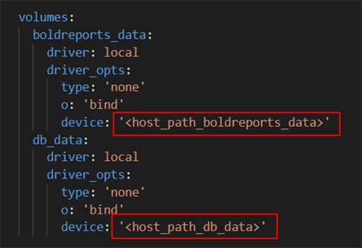
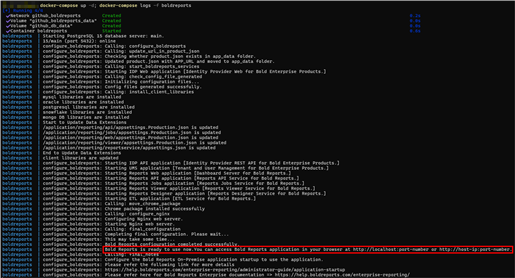
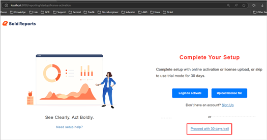

# Deploy Bold Reports<sup>®</sup> on Docker Single Container

The Bold Reports<sup>®</sup> Production Image, recommended for production sites, lets you store the application data on your host machine to make the Bold Reports<sup>®</sup> container a stateful application. The Bold Reports<sup>®</sup> application reads and writes the data on your host machine.

## How do I deploy the Bold Reports<sup>®</sup> production image?

You deploy the Bold Reports<sup>®</sup> Production Image with Docker Compose. Follow these steps:

1. Download the Docker Compose file by using the following command:

   ```sh
   curl -o docker-compose.yml "https://raw.githubusercontent.com/boldreports/bold-reports-docker/refs/heads/master/deploy/single-container/docker-compose.yml"
   ```

2. Allocate a directory in your host machine to store the shared folders for applications’ usage. Replace the directory path with `<host_path_boldreports_data>` and `<host_path_db_data>` in **docker-compose.yml** file.

   For example, <br><b>Windows:</b> `device: 'D:/boldreports/boldreports_data'` and `device: 'D:/boldreports/db_data'` <br><b>Linux:</b> `device: '/var/boldreports/boldreports_data'` and `device: '/var/boldreports/db_data'`

   The following screenshot shows the host path volumes in the docker-compose.yml file.

   
   > **Note:** The docker volumes **boldreports_data** and **db_data** persist data of Bold Reports<sup>®</sup> and PostgreSQL respectively. [Learn more about docker volumes](https://docs.docker.com/storage/volumes/)

3. Run the following command. It starts the Bold Reports<sup>®</sup> and Postgres SQL containers and displays the Bold Reports<sup>®</sup> logs, which show the installation status of the Bold Reports<sup>®</sup> application.

   ```sh
   docker-compose up -d; docker-compose logs -f boldreports
   ```

   The following screenshot shows the output of the docker-compose up command.

   
   > **Note:**
   > To use the PostgreSQL server deployed with Bold Reports<sup>®</sup> using the `docker-compose.yaml` file, use `pgdb` as the host name of the PostgreSQL server.

4. Access the Bold Reports<sup>®</sup> application by entering the URL as `http://localhost:8090` or `http://host-ip:8090` in the browser. The browser displays the License page within a few seconds.
   > **Note:** The default port number mentioned in the compose file is 8090. If you change the port number, use that port number to access the Bold Reports<sup>®</sup> application.

   The following screenshot shows the License (registration) page.

   

   > **Note:** Don't use `http://127.0.0.1` with `port` to access the application.

## Shutdown and cleanup

Bold Reports<sup>®</sup> single container deployments are stopped and removed with Docker Compose commands.

The command **docker-compose down** removes the containers and default network, but preserves the volumes of Bold Reports<sup>®</sup> and PostgreSQL. <br /><br />
The command **docker-compose down --volumes** removes the containers, default network, and all the volumes.

## Frequently asked questions

### Which host name do I use for the bundled PostgreSQL server?

Use `pgdb` as the host name of the PostgreSQL server deployed with Bold Reports<sup>®</sup> using the `docker-compose.yaml` file.

### What is the difference between docker-compose down and docker-compose down --volumes?

For Bold Reports<sup>®</sup>, **docker-compose down** preserves the Bold Reports<sup>®</sup> and PostgreSQL volumes. **docker-compose down --volumes** also removes all the volumes.

## See also

* [Deploy Bold Reports<sup>®</sup> on Docker multiple containers](./../bold-reports-on-multi-container/)
* [Configure SSL for Bold Reports<sup>®</sup> on Docker](./../how-to-configure-ssl-for-docker-compose/)
* [Upgrade Bold Reports<sup>®</sup> on Docker](./../upgrade-to-latest-version/)
