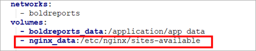
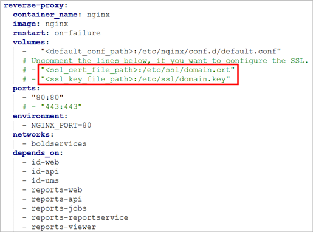

# How to configure SSL for Bold Reports® application on Docker

You configure SSL for a Bold Reports® Docker Compose deployment by adding your `.key` and `.crt` certificate files to Nginx and restarting the container. The steps differ for single container and multi container deployments.

* [Single container deployment](#single-container-deployment)
* [Multi container deployment](#multi-container-deployment)

## Single container deployment

Bold Reports® single container deployments use an `nginx` volume to hold the SSL certificate. Follow these steps:

1. In the docker-compose yaml file, add the following line under volume in the `boldreports` service:

   ~~~ bash
   - nginx_data:/etc/nginx/sites-available
   ~~~

   The following screenshot shows the nginx volume in the docker-compose.yml file.

   

2. Add the following block for `nginx` in volume and allocate a directory in your host machine to store the shared folders for applications’ usage. Replace the directory path with `<host_path_nginx_data>` in the docker-compose.yml file and bring up a container.

   ~~~sh
   nginx_data:
     driver: local
     driver_opts:
       type: 'none'
       o: 'bind'
       device: '<host_path_nginx_data>'
   ~~~

    For example,  <b>Windows:</b> `device: 'D:/boldreports/nginx_data'` and `device: 'D:/boldreports/nginx_data'`  <b>Linux:</b> `device: '/var/boldreports/nginx_data'` and `device: '/var/boldreports/nginx_data'`

3. Copy the SSL certificate in `.key` and `.crt` format and paste it inside the `nginx` mount folder.

4. Refer to the following SSL termination document for SSL changes in the `nginx` file.

   <https://github.com/bold-reports/bold-reports-docker/blob/master/docs/ssl-termination.md>
5. Restart the Bold Reports® container using the following command:

   ~~~sh
   docker restart <container-name or container ID>
   ~~~

## Multi container deployment

Bold Reports® multi container deployments take the SSL certificate path in the docker-compose yaml file and use a separate Nginx container. Follow these steps:

1. Add an SSL certificate path with the `.key` and `.crt` file in the docker-compose yaml file.

   The following screenshot shows the certificate paths in the docker-compose.yml file.

   

2. Refer to the following SSL termination document for SSL changes in the `nginx` file.

   <https://github.com/bold-reports/bold-reports-docker/blob/master/docs/ssl-termination.md>
3. Restart the Nginx container using the following command:

   ~~~sh
   docker restart <container-name or container ID>
   ~~~

## Frequently asked questions

### Which certificate files does Bold Reports® need for SSL on Docker?

Bold Reports® needs the SSL certificate in `.key` and `.crt` format.

### Which container do I restart after adding SSL?

For a Bold Reports® single container deployment, restart the Bold Reports® container. For a multi container deployment, restart the Nginx container.

## See also

* [Deploy Bold Reports® on Docker single container](./../bold-reports-on-single-container/)
* [Deploy Bold Reports® on Docker multiple containers](./../bold-reports-on-multi-container/)
* [Upgrade Bold Reports® on Docker](./../upgrade-to-latest-version/)
