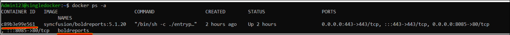
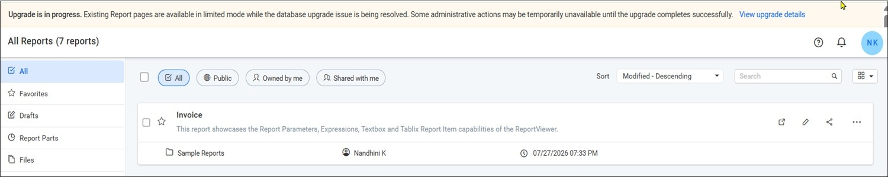
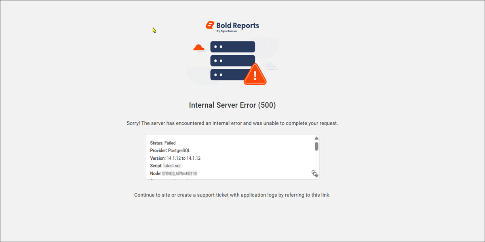
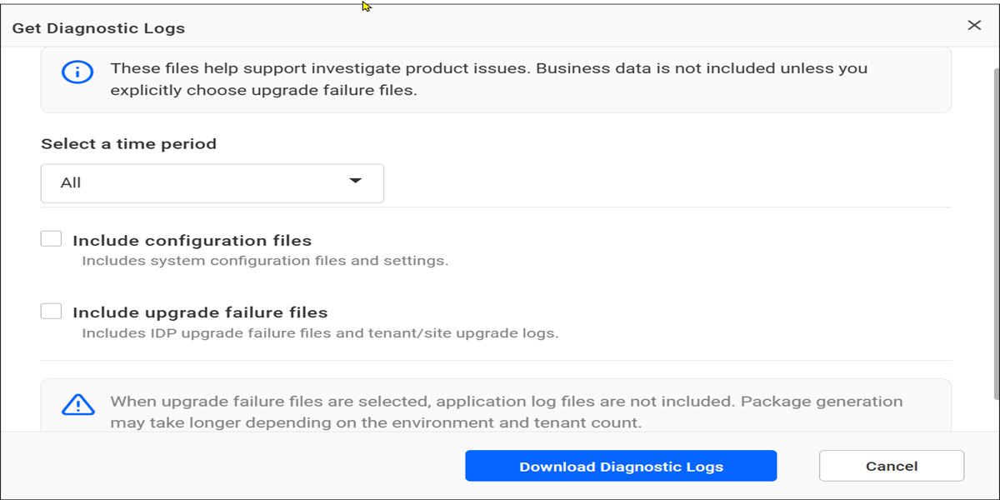

# Upgrading Bold Reports<sup>®</sup> on Docker to the latest version

To upgrade Bold Reports<sup>®</sup> to a newer version in your Docker environment, back up your data, download the new docker-compose file, and redeploy the containers. You can review the features and enhancements in the [Release Notes](https://www.boldreports.com/product-updates/embedded-reporting/v-10-1/#rlx-release-10-1-12).

## What should I back up before upgrading?

Before you upgrade Bold Reports<sup>®</sup> to a newer version, back up the following items:

* Files and folders from the shared location that you have mounted to the deployments via volume.
* Database backup - Take a backup of the database to restore in case the upgrade is not successful or if the applications do not work properly after the upgrade.

### How do I upgrade a single container deployment?

Bold Reports<sup>®</sup> updates the database schema from your current version to the upgraded version. The upgrade process retains all resources and settings from the previous deployment.

* If you use the docker compose YAML file for deployment, download the [single-container docker-compose file](https://raw.githubusercontent.com/boldreports/bold-reports-docker/v10.1.11/deploy/single-container/docker-compose.yml) and use the following command to bring down the containers from where you deployed the docker compose file:

    ```console
    docker-compose down
    ```

* Copy the downloaded files and replace the existing files in the deployed folder. Then, enter the required values in the necessary fields, as already configured in the existing Bold Reports<sup>®</sup> application.

* Run the following command to upgrade Bold Reports<sup>®</sup>:

    ```console
    docker-compose up -d
    ```

* If you used the command to deploy Bold Reports<sup>®</sup> in a **single container**, follow these steps to upgrade.
  Use the following command to list all the containers:
    ```console
    docker ps -a
    ```

    The following screenshot shows the container list for a single container deployment.

    

    Remove the container without deleting the persistent volume that is already mounted to it. Use the following command to remove the container:
    ```console
    docker rm --force <containername>
    ```

    **Example:** `docker rm --force boldreports`

    Create a container with the same container name and persistent volume path.

    ```sh
    docker run --name boldreports -p 80:80 -p 443:443 \
    -e APP_URL=<app_base_url> \
    -e OPTIONAL_LIBS=<optional_library_names> \
    -v <existing_host_path_for_appdata_files>:/application/app_data \
    -v <existing_host_path_for_nginx_config>:/etc/nginx/sites-available \
    -d syncfusion/boldreports:<tag>
    ```

    **Example:** docker run --name boldreports -p 80:80 -p 443:443 -e APP_URL=`"http://10.103.215.44"` -e OPTIONAL_LIBS="mysql,oracle,postgresql,snowflake,googlebigquery,monogodb" -v "/home/Admin123/upgrade/app_data":/application/app_data -v "/home/Admin123/upgrade/nginx":/etc/nginx/sites-available -d syncfusion/boldreports:10.1.11

    > **Note:** When upgrading Bold Reports<sup>®</sup>, ensure that the volume mount remains the same, and only the tag needs to be changed. After you run the container, wait a couple of minutes to access the URL.

    After upgrading the Bold Reports<sup>®</sup> application, follow the [Puppeteer enablement guide](https://github.com/boldreports/bold-reports-docker/blob/master/docs/enable-puppeteer-when-upgrading-lower-to-v5.4.20.md) to enable Puppeteer.

#### How do I upgrade a multiple container deployment?

Bold Reports<sup>®</sup> updates the database schema from your current version to the upgraded version. The upgrade process retains all the resources and settings from the previous deployment.

Download the [docker-compose](https://raw.githubusercontent.com/boldreports/bold-reports-docker/v10.1.11/deploy/multiple-container/docker-compose.yml) and [default.conf](https://raw.githubusercontent.com/boldreports/bold-reports-docker/v10.1.11/deploy/multiple-container/default.conf) files, and use the following command to bring down the containers from where you deployed the docker compose file:

```sh
docker-compose down
```

Copy the downloaded files and replace them in the existing deployed folder. Then, provide the values in the required fields, as already done for the existing Bold Reports<sup>®</sup> application. Run the following command to upgrade Bold Reports<sup>®</sup>.

```sh
docker-compose up -d
```

After upgrading the Bold Reports<sup>®</sup> application, follow the [Puppeteer enablement guide](https://github.com/boldreports/bold-reports-docker/blob/master/docs/enable-puppeteer-when-upgrading-lower-to-v5.4.20.md) to enable Puppeteer.

## What happens if the upgrade fails?

If a database script execution fails during a Bold Reports<sup>®</sup> upgrade, the upgrade process continues without interrupting access to existing reports. In such cases, a notification banner indicates that the upgrade is still in progress and that some administrative actions may be temporarily unavailable until the issue is resolved.

  The following screenshot shows the upgrade in progress notification banner.

  

Click `View upgrade details` to view information about the upgrade failure, including the upgrade status, database provider, version details, failed script information, and error message.

  

> **Note:** If this notification banner is displayed, the upgrade process encountered an issue. To resolve the issue, [contact Bold Reports<sup>®</sup> support](https://www.boldreports.com/contact) and share the upgrade-related logs with the support team for further investigation.

* Navigate to **UMS** > **Sites**, click the **Help** icon in the upper-right corner, and select **Get Diagnostic Logs**. Select **Include upgrade failure files** and click **Download Diagnostic Logs** to download the upgrade-related logs.

  The following screenshot shows the Get Diagnostic Logs option in the Help menu.

  

## Frequently asked questions

### Does upgrading Bold Reports<sup>®</sup> on Docker keep my settings?

Yes. The Bold Reports<sup>®</sup> upgrade process retains all resources and settings from the previous deployment and updates the database schema.

### What do I change when upgrading a single container?

For a Bold Reports<sup>®</sup> single container, keep the same volume mount and change only the image tag.

## See also

* [Deploy Bold Reports<sup>®</sup> on Docker single container](./../bold-reports-on-single-container/)
* [Deploy Bold Reports<sup>®</sup> on Docker multiple containers](./../bold-reports-on-multi-container/)
* [Upgrade Bold Reports<sup>®</sup> on-premises](./../../../upgrade/on-premises/)
