# Self-deploy a Bold Reports® Server on Google Cloud Platform

You can self-deploy the Bold Reports® Report Server on a Google Cloud Platform (GCP) VM instance by creating the instance, connecting to it, and installing the server. Follow the steps for your instance type.

1. [Deploying Bold Reports® on a GCP Windows Instance](#deploying-bold-reports-on-a-gcp-windows-instance)
2. [Deploying Bold Reports® on a GCP Linux Instance](#deploying-bold-reports-on-a-gcp-linux-instance)

## Deploying Bold Reports® on a GCP Windows Instance

Bold Reports® on a GCP Windows instance needs three tasks: set up the instance, connect with RDP, and install the server.

### How do I set up a GCP Windows instance?

You set up a GCP Windows instance for Bold Reports® Server in the Google Cloud Console. Follow these steps:

* Go to [Google Cloud Console](https://console.cloud.google.com/.). and log in to your GCP account.

* Navigate to `Compute Engine` and click `VM Instances`.

  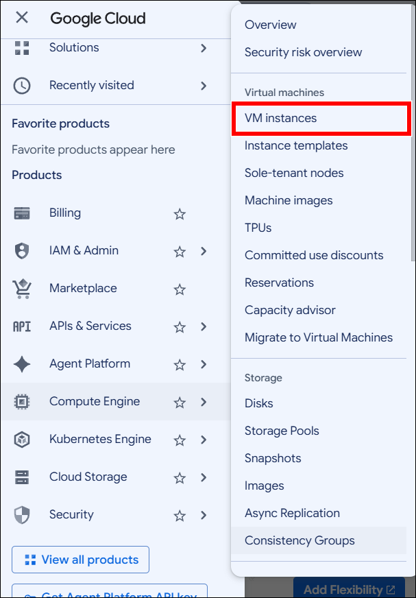

* On the VM Instances page, click the `Create Instance` button to start creating a new VM instance.

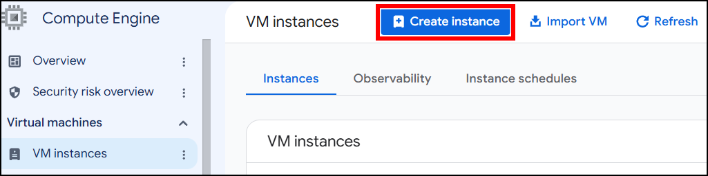

* Enter a `name` for your VM instance. Select the `region` and `zone` where you want to create the VM instance. Select the `machine type` for your VM instance.

  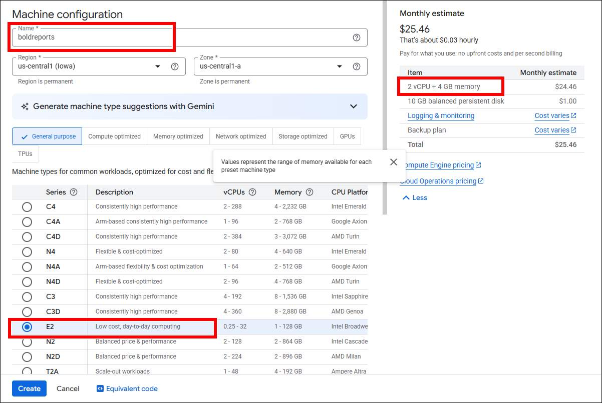

  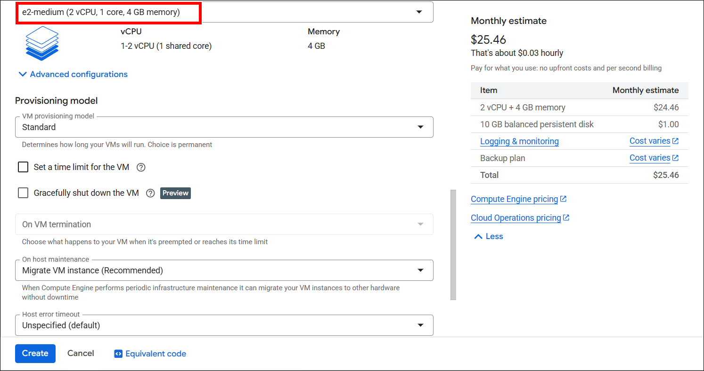

* Click `Change` in the Boot disk section to begin configuring your boot disk. Select `Windows Server` from the Operating system list on the Public images tab. Choose `Windows Server 2019` or later from the Version list. Refer to the recommended system configuration for Bold Reports® Server and click `Select`.

  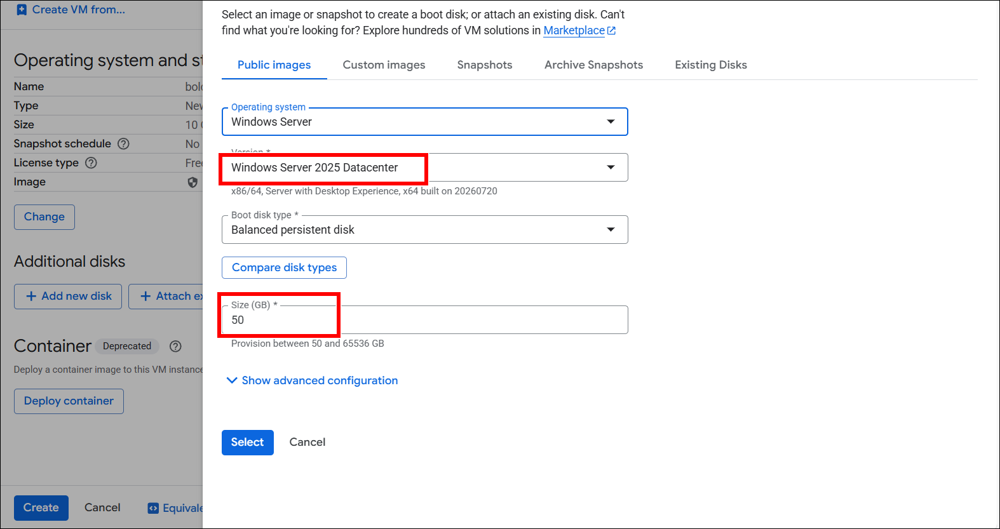

* In the Firewall section, allow specific network traffic. Then, click `Create` to create the VM.

  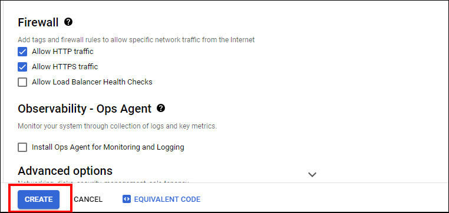

* Wait a short while for the VM instance to start. When it is ready, its status changes to `running`.

  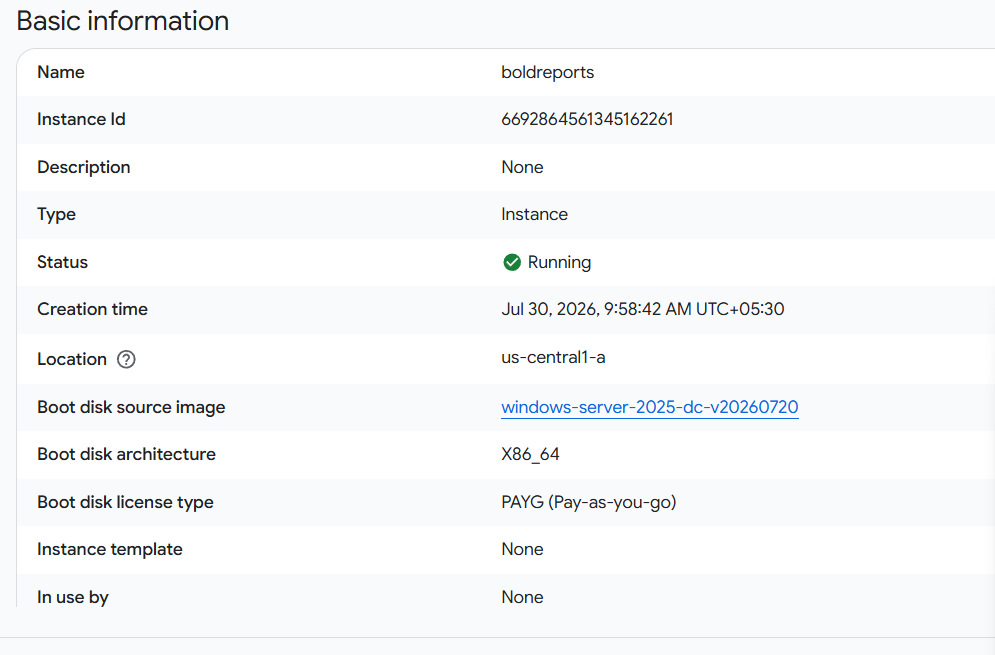

### How do I connect to the Windows instance using RDP?

You connect to the GCP Windows instance that hosts Bold Reports® Server with Remote Desktop (RDP). Follow these steps:

* Find your Windows VM instance and make note of its external IP address.

* On your local machine (Windows), search for `Remote Desktop Connection` in the Start menu and open the application.

* In the `Remote Desktop Connection` window, enter the external IP address of your Windows VM. Click `Connect` to establish the RDP connection.

  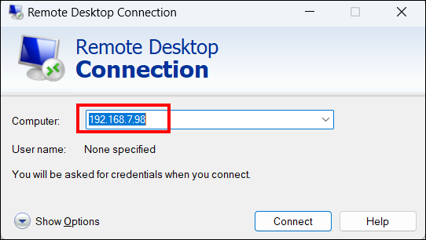

* You may be prompted for credentials. Enter the username and password for the Windows user account on the VM, then click `Yes` in the prompted window.

  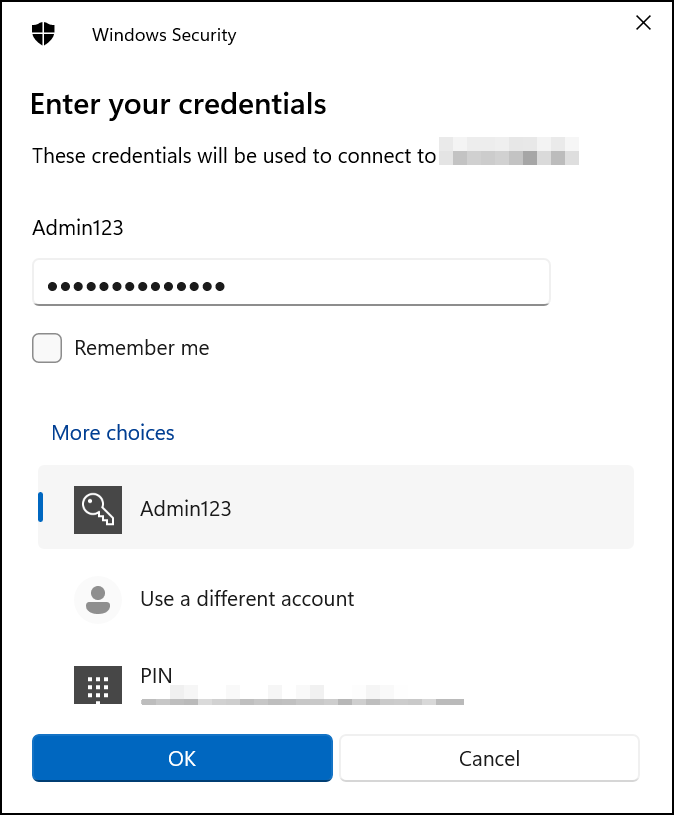

  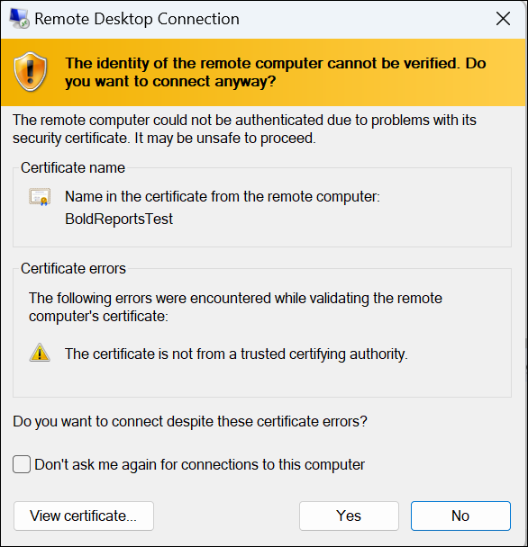

* After you connect, you see the Windows desktop of your VM, and you can interact with it as if you were using a local Windows machine.

* Other methods are available for connecting to your Windows instance. Refer to the Google Cloud documentation:

  <https://cloud.google.com/compute/docs/instances/connecting-to-windows>

### How do I install and run the Bold Reports® Server on Windows?

Install and run the Bold Reports® Report Server on the Windows virtual machine (VM) by following these steps:

* Install Bold Reports® Enterprise Reporting Server on the created Windows virtual machine (VM) using the Windows installation documentation.

* Launch the Bold Reports® application from the desktop shortcut or IIS hosted URL after the installation.

  The following screenshot shows the application startup login page.

  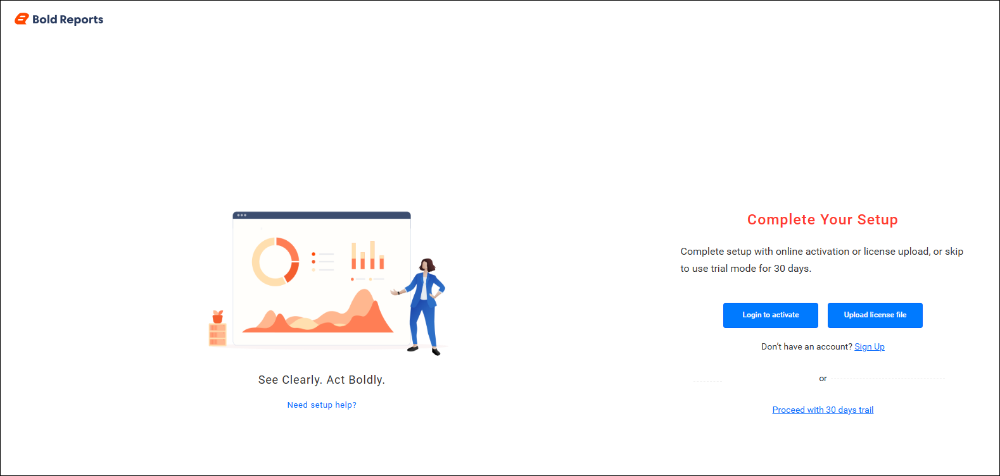

* Complete the application startup and configuration process.

## Deploying Bold Reports® on a GCP Linux Instance

Bold Reports® on a GCP Linux instance needs three tasks: set up the instance, connect with SSH, and install the server.

### How do I set up a GCP Linux instance?

You set up a GCP Linux instance for Bold Reports® Server in the Google Cloud Console. Follow these steps:

* Go to [Google Cloud Console](https://console.cloud.google.com/) and log in to your GCP account.

* Navigate to `Compute Engine` and click `VM Instances`.

  

* On the VM Instances page, click the `Create Instance` button to start creating a new VM instance.

  

* Enter a `name` for your VM instance, select the `region` and `zone` where you want to create the VM instance, and choose the `machine type` for your VM instance.

  

  

* Click `Change` in the Boot disk section to begin configuring your boot disk. Under the Public images tab, choose `Ubuntu` from the Operating system list. Select `Ubuntu 20.04 LTS` or later from the Version list. Refer to the recommended system configuration for Bold Reports® Server and click `Select`.

  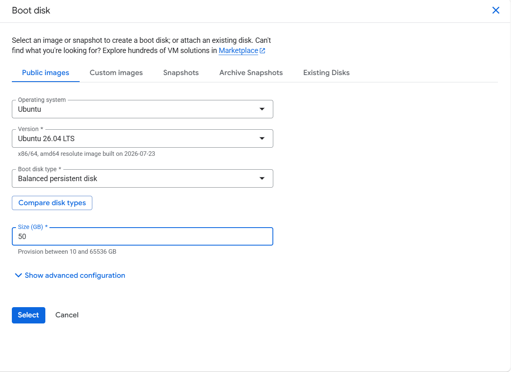

* In the Firewall section, allow specific network traffic. Then, click `Create` to create the VM.

  

* Wait a short while for the VM instance to start. When it is ready, its status changes to `running`.

  

### How do I connect to the Linux instance using SSH?

You connect to the GCP Linux instance that hosts Bold Reports® Server with SSH from the browser. Follow these steps:

* Navigate to the `VM Instances` page.

* Locate the VM instance you want to connect to and click the `SSH` button next to it. Click `Open in browser window`. A new browser window opens with an SSH connection to your VM.

  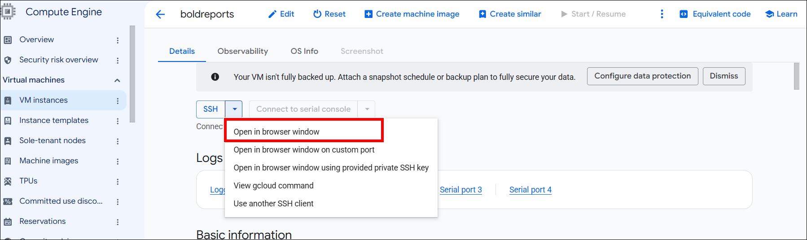

* When you connect to the VM instance for the first time, SSH may prompt you to confirm the connection.

  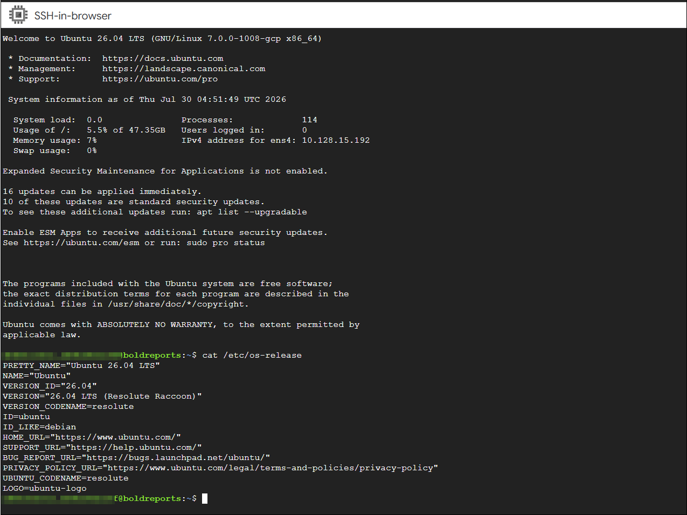

* After you connect, a terminal window opens where you can interact with your Linux VM.

* Other methods are available for connecting to your Linux instance. Refer to the Google Cloud documentation:

  <https://cloud.google.com/compute/docs/connect/standard-ssh>

### How do I install and run the Bold Reports® Server on Linux?

Install and run the Bold Reports® Report Server on the Linux virtual machine (VM) by following these steps:

* Install Bold Reports® Enterprise Reporting Server on the created Linux virtual machine (VM) using the Linux installation documentation.

* After the installation, access the server using the VM IP address or configured domain name through a web browser.

  The following screenshot shows the application startup login page.

  

* Complete the application startup and configuration process to begin creating and managing reports.

## Frequently asked questions

### Which operating system versions can I use for Bold Reports® on GCP?

For Bold Reports® Server on GCP, choose `Windows Server 2019` or later for a Windows instance, or `Ubuntu 20.04 LTS` or later for a Linux instance.

### How do I open Bold Reports® after installing it on a GCP Linux VM?

Access the Bold Reports® server using the VM IP address or configured domain name through a web browser.

## See also

* [Prerequisites to use Bold Reports® server on GCP](./../prerequisites/)
* [Deploy Bold Reports® on Linux](./../../deploy-on-linux/)
* [Deploy Bold Reports® on Windows](./../../deploy-on-windows/)
