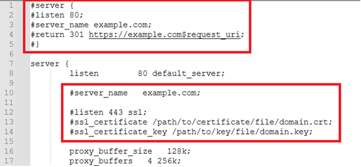
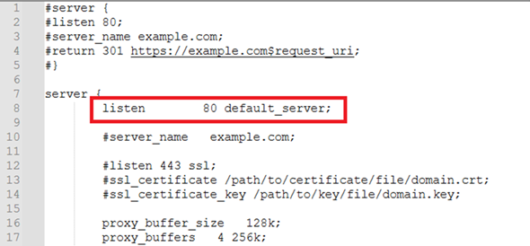
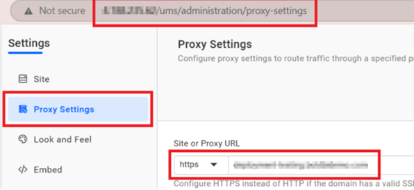
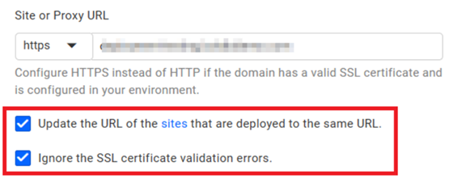

# Bold Reports<sup>®</sup> Installation and Deployment on Ubuntu for v6.1 or later

You can install and deploy Bold Reports<sup>®</sup> v6.1 or later on an Ubuntu Linux server by installing the prerequisites, running the Bold Reports<sup>®</sup> Linux package installer, and configuring Nginx and SSL.

## What do I need before deploying on Ubuntu?

Bold Reports<sup>®</sup> on Ubuntu needs the following server access and packages before you run the installer:

1. Access to a Linux server with a standard user account and sudo privileges.
2. Install `Nginx` by running the following commands:

    ```sh
    sudo apt-get update
    ```  
    ```sh
    sudo apt-get install nginx
    ```

3. Install `zip` by running the following command:
    ```sh
    sudo apt-get install zip
    ```
4. Install `GDIPlus` package using the following command:
    ```sh
    sudo apt-get install libgdiplus
    ```
5. Install `python 3.9 or later` by running the following command:

    **Ubuntu Version:22.04 :**
    ```sh
    sudo apt-get install -y python3
    ```
    **Ubuntu Version:20.04 :**
    ```sh
    sudo apt update && sudo apt install wget software-properties-common && sudo add-apt-repository ppa:deadsnakes/ppa && sudo apt update && sudo apt install python3.9
    ```
6. Install pip dependency packages for ETL service by running the following command:
    ```sh
    sudo apt-get install python3-pip && sudo python3 -m pip install --upgrade pip && sudo pip install duckdb===1.1.2 dlt===0.4.12 pymysql pyodbc pg8000 poetry pandas===2.2.2 numpy===1.26.4 "dlt[parquet]" "dlt[filesystem]"
    ```
7. Add an `openssl conf` path in the environment if it does not exist.
    ```sh
    export OPENSSL_CONF=/etc/ssl/
    ```

### How do I install the Bold Reports<sup>®</sup> application on Ubuntu?

You install Bold Reports<sup>®</sup> on Ubuntu by downloading the Linux package and running the `install-boldreports.sh` script. Follow these steps:

1. Register and download the Bold Reports<sup>®</sup> Linux package from the [registration and download section](./../../../deployment/getting-started/#registration-and-download).

2. Download the Bold Reports<sup>®</sup> Linux package by running the following command:
    ```console
    sudo wget {Bold Reports Linux package link}
    ```
3. Extract the zip file by running the following command:
    ```console
    sudo unzip {Bold Reports Linux package zip file}
    ```
4. Change the directory to `BoldReports_EnterpriseReporting-Linux` by running the following command:
    ```console
    cd BoldReports_EnterpriseReporting-Linux
    ```
5. Run the following command to deploy Bold Reports<sup>®</sup> on your Linux machine:
    ```console
     sudo bash install-boldreports.sh -i {new} -u {user} -h {host URL} -n {true or false}
     ```

     * **i:** Installation type : Specifies whether it is a new or upgrade installation.

     * **u:** Specify the user or group that manages the service.

     * **h:** Domain or IP address of the machine with HTTP protocol.

     * **n:** Setting this to `true` automatically configures Bold Reports<sup>®</sup> with the Nginx front-end server.

    > **IMPORTANT:** If you have any existing applications running on that Linux machine using Nginx, set “-n” value to false and configure [Nginx manually](#manually-configure-nginx).

    Example for a new installation:

    ```console
        sudo bash install-boldreports.sh -i new -u www-data -h http://linux.example.com -n true
    ```

6. If you use Bold Reports<sup>®</sup> version 11.1.10 or above and want to use an HTTPS domain with SSL configuration, run the following command to deploy Bold Reports<sup>®</sup> along with SSL configuration:

    ```console
        sudo bash install-boldreports.sh -i {new} -u {user} -h {host URL} -n {true or false} --ssl-cert {ssl certificate path} --ssl-key {ssl key path}
    ```
    > **IMPORTANT:** It is mandatory to give paths for SSL certificate and key in —ssl-cert and —ssl-key. If paths are not given or if the given path does not exist, then the installation will be stopped.

    * **ssl-cert:** Specify the path in which the SSL certificate is present.

    * **ssl-key:** Specify the path in which the SSL key is present.

    Example for a new installation with SSL configuration:

    ```console
        sudo bash install-boldreports.sh -i new -u www-data -h https://linux.example.com -n true --ssl-cert /etc/ssl/domain.crt --ssl-key /etc/ssl/domain.key
    ```

After the installation is complete, open the host URL in the browser and continue the application startup.

### Manually configure Nginx

To configure Nginx as a reverse proxy that forwards requests to the Bold Reports<sup>®</sup> app, modify `/etc/nginx/sites-available/default`. Open it in a text editor and add the following code:

```cmd
       #server {
       #listen 80;
       #server_name example.com;
       #return 301 https://example.com$request_uri;
       #}

         server {
       listen        80 default_server;

       #server_name   example.com;

       #listen 443 ssl;
       #ssl on;
       #ssl_certificate /path/to/certificate/file/domain.crt;
       #ssl_certificate_key /path/to/key/file/domain.key;

       proxy_read_timeout 300;
       proxy_connect_timeout 300;
       proxy_send_timeout 300;
       send_timeout 300;
       client_max_body_size 200M;

       location / {
      root /var/www/bold-services/application/idp/web/wwwroot;
        proxy_pass http://localhost:6500/;
        proxy_http_version 1.1;
        proxy_set_header Upgrade $http_upgrade;
        proxy_set_header Connection keep-alive;
        proxy_set_header Host $host;
        proxy_cache_bypass $http_upgrade;
        proxy_set_header X-Forwarded-For $proxy_add_x_forwarded_for;
        proxy_set_header X-Forwarded-Proto $scheme;
        fastcgi_buffers 16 16k;
        fastcgi_buffer_size 32k;
    }
    location /api {
        proxy_pass         http://localhost:6501/api;
        proxy_http_version 1.1;
        proxy_set_header   Upgrade $http_upgrade;
        proxy_set_header   Connection keep-alive;
        proxy_set_header   Host $host;
        proxy_cache_bypass $http_upgrade;
        proxy_set_header   X-Forwarded-For $proxy_add_x_forwarded_for;
        proxy_set_header   X-Forwarded-Proto $scheme;
    }
    location /ums {
        root               /var/www/bold-services/application/idp/ums/wwwroot;
        proxy_pass         http://localhost:6502/ums;
        proxy_http_version 1.1;
        proxy_set_header   Upgrade $http_upgrade;
        proxy_set_header   Connection keep-alive;
        proxy_set_header   Host $host;
        proxy_cache_bypass $http_upgrade;
        proxy_set_header   X-Forwarded-For $proxy_add_x_forwarded_for;
        proxy_set_header   X-Forwarded-Proto $scheme;
    }
    location /ums/signalr/progresshub {
        proxy_pass         http://localhost:6502/ums/signalr/progresshub;
        proxy_http_version 1.1;
        proxy_set_header   Upgrade $http_upgrade;
        proxy_set_header   Connection "upgrade";
        proxy_set_header   Host $host;
        proxy_cache_bypass $http_upgrade;
        proxy_set_header   X-Forwarded-For $proxy_add_x_forwarded_for;
        proxy_set_header   X-Forwarded-Proto $scheme;
    }
    location /reporting {
    root /var/www/bold-services/application/reporting/web/wwwroot;
        proxy_pass         http://localhost:6550/reporting;
        proxy_http_version 1.1;
        proxy_set_header   Upgrade $http_upgrade;
        proxy_set_header   Connection keep-alive;
        proxy_set_header   Host $host;
        proxy_cache_bypass $http_upgrade;
        proxy_set_header   X-Forwarded-For $proxy_add_x_forwarded_for;
        proxy_set_header   X-Forwarded-Proto $scheme;
    }
    location /reporting/messageHub {
        proxy_pass         http://localhost:6550/reporting/messageHub;
        proxy_http_version 1.1;
        proxy_set_header   Upgrade $http_upgrade;
        proxy_set_header   Connection "upgrade";
        proxy_set_header   Host $host;
        proxy_cache_bypass $http_upgrade;
        proxy_set_header   X-Forwarded-For $proxy_add_x_forwarded_for;
        proxy_set_header   X-Forwarded-Proto $scheme;
    }
    location /reporting/api {
        proxy_pass         http://localhost:6551/reporting/api;
        proxy_http_version 1.1;
        proxy_set_header   Upgrade $http_upgrade;
        proxy_set_header   Connection keep-alive;
        proxy_set_header   Host $host;
        proxy_cache_bypass $http_upgrade;
        proxy_set_header   X-Forwarded-For $proxy_add_x_forwarded_for;
        proxy_set_header   X-Forwarded-Proto $scheme;
    }
    location /reporting/jobs {
        proxy_pass         http://localhost:6552/reporting/jobs;
        proxy_http_version 1.1;
        proxy_set_header   Upgrade $http_upgrade;
        proxy_set_header   Connection keep-alive;
        proxy_set_header   Host $host;
        proxy_cache_bypass $http_upgrade;
        proxy_set_header   X-Forwarded-For $proxy_add_x_forwarded_for;
        proxy_set_header   X-Forwarded-Proto $scheme;
    }
    location /reporting/reportservice {
        root               /var/www/bold-services/application/reporting/reportservice;
        proxy_pass         http://localhost:6553;
        proxy_http_version 1.1;
        proxy_set_header   Upgrade $http_upgrade;
        proxy_set_header   Connection keep-alive;
        proxy_set_header   Host $host;
        proxy_cache_bypass $http_upgrade;
        proxy_set_header   X-Forwarded-For $proxy_add_x_forwarded_for;
        proxy_set_header   X-Forwarded-Proto $scheme;
    }
    location /reporting/viewer {
        proxy_pass         http://localhost:6554/reporting/viewer;
        proxy_http_version 1.1;
        proxy_set_header   Upgrade $http_upgrade;
        proxy_set_header   Connection keep-alive;
        proxy_set_header   Host $host;
        proxy_cache_bypass $http_upgrade;
        proxy_set_header   X-Forwarded-For $proxy_add_x_forwarded_for;
        proxy_set_header   X-Forwarded-Proto $scheme;
    }
    location /etlservice/ {
        root               /var/www/bold-services/application/etl/etlservice/wwwroot;
        proxy_pass         http://localhost:6509/;
        proxy_http_version 1.1;
        proxy_set_header   Upgrade $http_upgrade;
        proxy_set_header   Connection "upgrade";
        proxy_set_header   Host $http_host;
        proxy_cache_bypass $http_upgrade;
        proxy_set_header   X-Forwarded-For $proxy_add_x_forwarded_for;
        proxy_set_header   X-Forwarded-Proto $scheme;
    }
    location /etlservice/_framework/blazor.server.js {
        root               /var/www/bold-services/application/etl/etlservice/wwwroot;
        proxy_pass         http://localhost:6509/_framework/blazor.server.js;
        proxy_http_version 1.1;
        proxy_set_header   Upgrade $http_upgrade;
        proxy_set_header   Connection "upgrade";
        proxy_set_header   Host $http_host;
        proxy_cache_bypass $http_upgrade;
        proxy_set_header   X-Forwarded-For $proxy_add_x_forwarded_for;
        proxy_set_header   X-Forwarded-Proto $scheme;
   }
}
```

After you set up the Nginx configuration, run `sudo nginx -t` to verify the syntax of the configuration files. If the configuration file test is successful, force Nginx to pick up the changes by running `sudo nginx -s reload`.

## When do I configure SSL for Bold Reports<sup>®</sup> on Ubuntu?

Configure SSL for Bold Reports<sup>®</sup> on Ubuntu only in either of the following two cases:

* If you have set the “-n” value to false along with HTTPS domain and manually configured Nginx during initial deployment.

* If you have deployed Bold Reports<sup>®</sup> application using HTTP domain and now want to change the domain as HTTPS.

Otherwise, you can skip this section.

### How do I configure SSL in Nginx?

You configure SSL for Bold Reports<sup>®</sup> by editing the Nginx config file and updating the Site URL in UMS. Follow these steps:

1. Uncomment the following marked lines in the Nginx config file.

    The following screenshot shows the lines to uncomment in the Nginx config file.

    

2. Comment the following marked line in the Nginx config file.

    The following screenshot shows the line to comment in the Nginx config file.

    

3. Replace `example.com` with your domain name.
4. Define the path of the SSL certificate: `ssl_certificate /etc/ssl/domain.crt`.
5. Specify the directory where the SSL certificate key is located: `ssl_certificate_key /etc/ssl/domain.key`.
6. Save and run `sudo nginx -t` to verify the syntax of the configuration file. If the configuration file test is successful, force Nginx to pick up the changes by running `sudo nginx -s reload`.
7. Navigate to the proxy settings page of the UMS application ({domain_name}/ums/administration/proxy-settings) and update the Site URL with the new domain, as shown in the following image.

    

    * You can ignore SSL certificate errors by checking the checkbox for ignoring the SSL certificate errors.

    * Select the checkbox to update the URL as shown in the following image, and save the proxy settings by clicking **Save**.

    

## Frequently asked questions

### When should I set the -n value to false?

Set the `-n` value to false if you have existing applications running on the Linux machine using Nginx, and then configure [Nginx manually](#manually-configure-nginx) for Bold Reports<sup>®</sup>.

### Which Bold Reports<sup>®</sup> version supports the SSL options in the installer?

Bold Reports<sup>®</sup> version 11.1.10 or above supports the `--ssl-cert` and `--ssl-key` options to deploy with SSL configuration.

## Next steps

* [Install Optional Libraries](./../../../deployment/deploy-on-linux/install-opt-library/)

* [Application Startup](../../../application-startup/)

* [Linux prerequisites for Bold Reports<sup>®</sup>](./../../../deployment/deploy-on-linux/prerequisites/)

* [Upgrade Bold Reports<sup>®</sup> on Linux](./../../../deployment/deploy-on-linux/upgrade-linux-server/)
