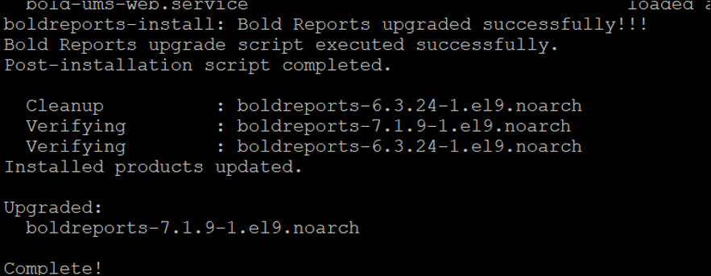
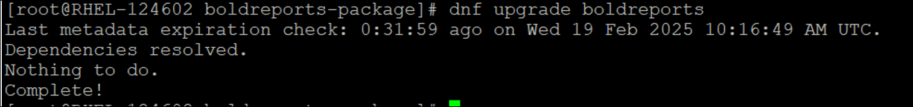

# Installing and Upgrading Bold Reports<sup>®</sup> Using an RPM Package

Bold Reports<sup>®</sup> version 7.1 and later supports installing and upgrading Bold Reports<sup>®</sup> using an RPM package. You add the Bold Reports<sup>®</sup> YUM repository, install the `boldreports` package with dnf, and run the install script.

## How do I install Bold Reports<sup>®</sup> using an RPM package?

You install Bold Reports<sup>®</sup> from an RPM package by adding the EPEL and Bold Reports<sup>®</sup> repositories, installing the package, starting Nginx, and running the install script.

1. Before installing Bold Reports<sup>®</sup>, make sure the **EPEL (Extra Packages for Enterprise Linux)** repository is installed on your machine. If it is not installed, run the following command:

    ```sh
    sudo dnf install https://dl.fedoraproject.org/pub/epel/epel-release-latest-9.noarch.rpm
    ```

2. Run the following command to configure the Bold Reports<sup>®</sup> YUM repository:

    ```sh
    dnf install https://rpm.boldreports.com/RPM/repo/boldreports-repo-1.1-1.noarch.rpm
    ```

3. After the repository is configured, install the Bold Reports<sup>®</sup> package by running the following command:

    ```sh
    dnf install boldreports
    ```

4. After the package is installed, make sure Nginx is enabled and started by running the following commands:

    ```sh
    systemctl  enable nginx
    systemctl start nginx
    ```

5. Navigate to **/opt/boldreports/boldreports-package/** and run the following command to install Bold Reports<sup>®</sup>:

    ```sh
    sudo bash install-boldreports.sh -i {new} -u {user} -h {host URL} -n {true or false}
    eg : sudo bash install-boldreports.sh -i new -u root -h http://linux.example.com -n true
    ```

6. To configure Nginx for SSL, follow the SSL steps in the CentOS deployment guide.

    [Configure Nginx for SSL](https://help.boldreports.com/enterprise-reporting/deployment/deploy-on-linux/bold-reports-on-centos/#configure-ssl)

## How do I upgrade Bold Reports<sup>®</sup> using an RPM package?

You upgrade an RPM-installed Bold Reports<sup>®</sup> application with a dnf upgrade command that checks the Bold Reports<sup>®</sup> repository for a newer version.

1. Run the following command to upgrade Bold Reports<sup>®</sup>. Wait until the script completes the upgrade process:

    ```sh
    dnf upgrade or dnf upgrade boldreports
    ```

2. After the package is upgraded, you see the following message. You can then access the application and verify the version. The screenshot shows the upgraded Bold Reports<sup>®</sup> version message.
    

3. The upgrade command checks the Bold Reports<sup>®</sup> repository and upgrades the application if an updated version is available. If no upgrade is available, it displays the following message.
    

> **Note:** To clear the DNF package cache and refresh the repository metadata, run the following commands:<br>
> sudo dnf clean all<br>
> sudo dnf makecache --refresh

## Frequently asked questions

### Which Bold Reports<sup>®</sup> versions support RPM installation?

Bold Reports<sup>®</sup> supports installing and upgrading with an RPM package starting from version 7.1.

### What happens if no upgrade is available?

The Bold Reports<sup>®</sup> upgrade command checks the repository and displays a message that no upgrade is available.

### How do I refresh the DNF repository metadata?

Run `sudo dnf clean all` and then `sudo dnf makecache --refresh` to clear the DNF package cache and refresh the Bold Reports<sup>®</sup> repository metadata.

## See also

* [Install optional libraries on Linux](./../../../deployment/deploy-on-linux/install-opt-library/)
* [Upgrade the Bold Reports<sup>®</sup> Linux package](./../../../deployment/deploy-on-linux/upgrade-linux-server/)
* [Application startup](./../../../application-startup/)
