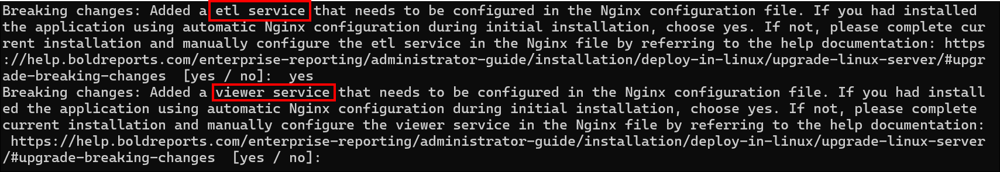
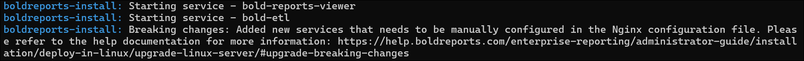
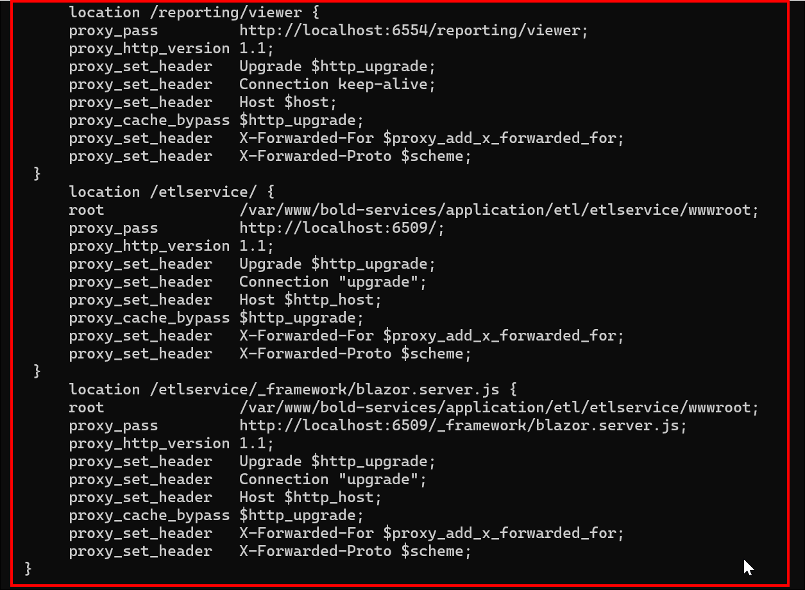
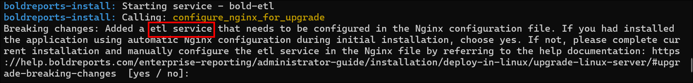
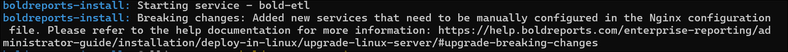
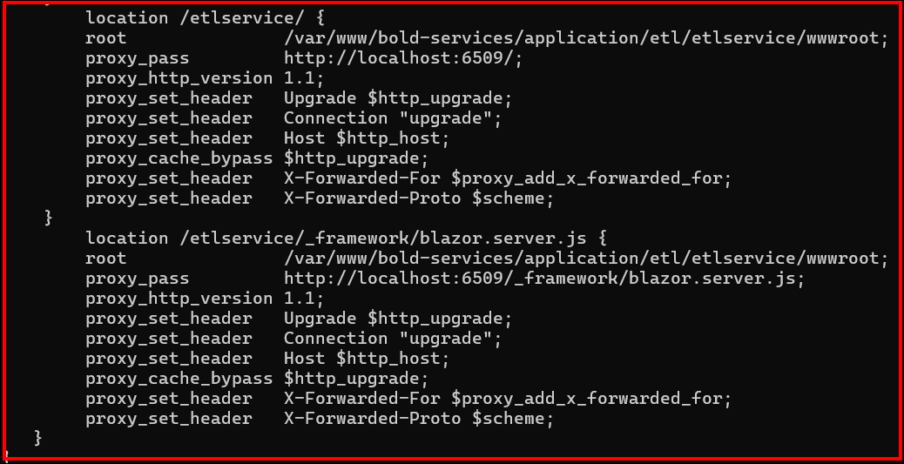
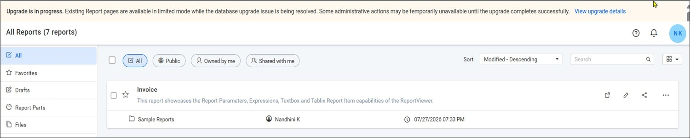
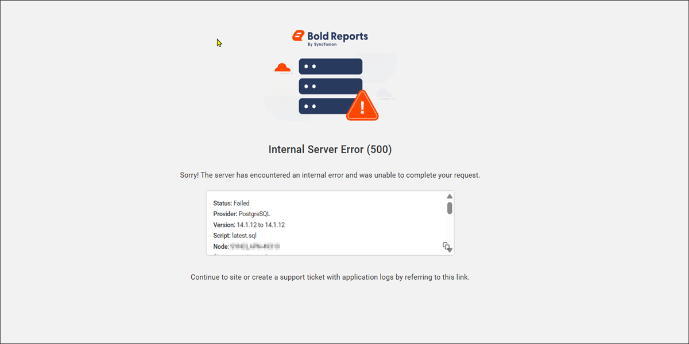
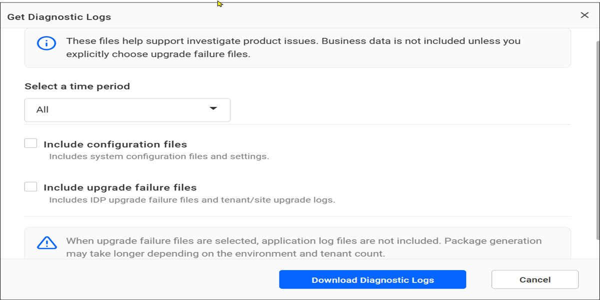

# Upgrading the Bold Reports<sup>®</sup> Linux package to the Latest Version

You can upgrade the Bold Reports<sup>®</sup> Linux package from any version to a newer version by running the `install-boldreports.sh` script with the upgrade option. Upgrades from v3.x or v5.x also need Nginx configuration changes.

## How do I upgrade the Bold Reports<sup>®</sup> Linux package?

You upgrade the Bold Reports<sup>®</sup> Linux package by installing the prerequisites, downloading the new package, and running the install script with `-i upgrade`.

1. Register and download the Bold Reports<sup>®</sup> Linux package from the [getting started guide](../../getting-started/).

2. Install the `pv` tool by running the following command:

   ```sh
      sudo apt-get install pv
   ```

3. Install python 3.9 or later by running the following command:

   **Ubuntu Version:22.04 :**

   ```sh
      sudo apt-get install -y python3
   ```

   **Ubuntu Version:20.04 :**

   ```sh
      sudo apt update && sudo apt install wget software-properties-common && sudo add-apt-repository ppa:deadsnakes/ppa && sudo apt update && sudo apt install python3.9
   ```

4. Install the pip dependency packages for the ETL service by running the following command:

   ```sh
   sudo apt-get install python3-pip && sudo python3 -m pip install --upgrade pip && sudo pip install duckdb===1.1.2 dlt===0.4.12 pymysql pyodbc pg8000 poetry pandas===2.2.2 numpy===1.26.4 "dlt[parquet]" "dlt[filesystem]"
   ```

5. Download the Bold Reports<sup>®</sup> Linux package by running the following command:

   ```sh
      sudo wget {Bold Reports Linux package link}
   ```

6. Extract the zip file.

   ```sh
      sudo unzip {Bold Reports Linux package zip file}
   ```

7. Change the directory to `BoldReports_EnterpriseReporting-Linux` by running the following command:

   ```sh
      cd BoldReports_EnterpriseReporting-Linux
   ```

8. Run the following command to deploy Bold Reports<sup>®</sup> on your Linux machine:

   ```sh
      sudo bash install-boldreports.sh -i {upgrade} -u {user} -h {host URL}
   ```

   * **i:** Installation type. Specifies whether it is a new or upgraded installation.

   * **u:** The user or group that manages the service.

   * **h:** Domain or IP address of the machine with the HTTP protocol.

Example for upgrading the installation:

   ```sh
   sudo bash install-boldreports.sh -i upgrade -u www-data -h http://linux.example.com
   ```

### What do I do after the upgrade completes?

After the Bold Reports<sup>®</sup> upgrade completes, install the optional client libraries and open the application in a browser.

* Follow the [optional client libraries installation guide](../install-opt-library/) and install the optional client libraries after the installation is completed.

* Open the host URL in the browser and use the upgraded Bold Reports<sup>®</sup> application.

> NOTE: The Bold Reports<sup>®</sup> Linux package backup file will be available in the following location: /var/www/.

## Upgrade breaking changes v3.x to latest

Bold Reports<sup>®</sup> upgrades from v3.x need extra Nginx configuration for the report viewer and ETL service locations.

> The following breaking changes apply only when you upgrade the Bold Reports<sup>®</sup> application from version v3.x to a later version.

**Automatic Nginx configuration**:

* If you chose automatic Nginx configuration during the initial installation, the following prompt message appears. Choose **Yes** to proceed with the installation.
   

* If you choose **No**, follow the manual Nginx configuration step.

**Manual Nginx configuration**:

* If you manually configured Nginx during the initial installation, the following message appears.
   

* For manual Nginx configuration, modify the default Nginx configuration file in location`/etc/nginx/sites-available`. Open it in a text editor and add the following code, as shown in the image:

   ```cmd
      location /reporting/viewer {
         proxy_pass         http://localhost:6554/reporting/viewer;
         proxy_http_version 1.1;
         proxy_set_header   Upgrade $http_upgrade;
         proxy_set_header   Connection keep-alive;
         proxy_set_header   Host $host;
         proxy_cache_bypass $http_upgrade;
         proxy_set_header   X-Forwarded-For $proxy_add_x_forwarded_for;
         proxy_set_header   X-Forwarded-Proto $scheme;
      }

      location /etlservice/ {
        root               /var/www/bold-services/application/etl/etlservice/wwwroot;
        proxy_pass         http://localhost:6509/;
        proxy_http_version 1.1;
        proxy_set_header   Upgrade $http_upgrade;
        proxy_set_header   Connection "upgrade";
        proxy_set_header   Host $http_host;
        proxy_cache_bypass $http_upgrade;
        proxy_set_header   X-Forwarded-For $proxy_add_x_forwarded_for;
        proxy_set_header   X-Forwarded-Proto $scheme;
      }
      location /etlservice/_framework/blazor.server.js {
        root               /var/www/bold-services/application/etl/etlservice/wwwroot;
        proxy_pass         http://localhost:6509/_framework/blazor.server.js;
        proxy_http_version 1.1;
        proxy_set_header   Upgrade $http_upgrade;
        proxy_set_header   Connection "upgrade";
        proxy_set_header   Host $http_host;
        proxy_cache_bypass $http_upgrade;
        proxy_set_header   X-Forwarded-For $proxy_add_x_forwarded_for;
        proxy_set_header   X-Forwarded-Proto $scheme;
      }
   ```

**Nginx configuration file code**:

The following screenshot shows the Nginx configuration file with the added code.

   

After you update the Nginx configuration, run `sudo nginx -t` to verify the syntax of the configuration files. If the configuration file test is successful, run `sudo nginx -s reload` to force Nginx to pick up the changes.

## Upgrade breaking changes v5.x to latest

Bold Reports<sup>®</sup> upgrades from v5.x need extra Nginx configuration for the ETL service locations.

> The following breaking changes apply only when you upgrade the Bold Reports<sup>®</sup> application from version v5.x to a later version.

**Automatic Nginx configuration:**

* If you chose automatic Nginx configuration during the initial installation, the following prompt message appears. Choose `Yes` to proceed with the installation.
   

* If you choose `No`, follow the manual Nginx configuration steps below.

**Manual Nginx configuration:**
* If you manually configured Nginx during the initial installation, the following message is displayed.
   

* For manual Nginx configuration, modify the default Nginx configuration file located at `/etc/nginx/sites-available`. Open it in a text editor and add the following code, as shown in the image below:

   ```cmd
         location /etlservice/ {
         root               /var/www/bold-services/application/etl/etlservice/wwwroot;
         proxy_pass         http://localhost:6509/;
         proxy_http_version 1.1;
         proxy_set_header   Upgrade $http_upgrade;
         proxy_set_header   Connection "upgrade";
         proxy_set_header   Host $http_host;
         proxy_cache_bypass $http_upgrade;
         proxy_set_header   X-Forwarded-For $proxy_add_x_forwarded_for;
         proxy_set_header   X-Forwarded-Proto $scheme;
         }
         location /etlservice/_framework/blazor.server.js {
         root               /var/www/bold-services/application/etl/etlservice/wwwroot;
         proxy_pass         http://localhost:6509/_framework/blazor.server.js;
         proxy_http_version 1.1;
         proxy_set_header   Upgrade $http_upgrade;
         proxy_set_header   Connection "upgrade";
         proxy_set_header   Host $http_host;
         proxy_cache_bypass $http_upgrade;
         proxy_set_header   X-Forwarded-For $proxy_add_x_forwarded_for;
         proxy_set_header   X-Forwarded-Proto $scheme;
         }
   ```

**Nginx configuration file code:**

The following screenshot shows the Nginx configuration file with the ETL service code added.

   

After you update the Nginx configuration, run **sudo nginx -t** to verify the syntax of the configuration files. If the configuration file test is successful, run `sudo nginx -s reload` to force Nginx to pick up the changes.

## What happens if the upgrade fails?

If a database script fails during a Bold Reports<sup>®</sup> upgrade, the upgrade process continues without interrupting access to existing reports. A notification banner shows that the upgrade is still in progress and that some administrative actions may be temporarily unavailable until the issue is resolved.

  

Click `View upgrade details` to view information about the upgrade failure. The details include the upgrade status, database provider, version details, failed script information, and error message.

  

> **Note:** If this notification banner is displayed, the upgrade process encountered an issue. To resolve the issue, [contact Bold Reports<sup>®</sup> support](https://www.boldreports.com/contact) and share the upgrade-related logs with the support team for further investigation.

### How do I download the upgrade failure logs?

You download the Bold Reports<sup>®</sup> upgrade failure logs from the **Get Diagnostic Logs** option in UMS.

* Navigate to **UMS** > **Sites**, click the **Help** icon in the upper-right corner, and select **Get Diagnostic Logs**. Select **Include upgrade failure files** and click **Download Diagnostic Logs** to download the upgrade-related logs.
  

## Frequently asked questions

### Where is the Linux package backup file stored after an upgrade?

The Bold Reports<sup>®</sup> Linux package backup file is available in `/var/www/`.

### Can I still open reports if the upgrade fails?

Yes. If a database script fails, the Bold Reports<sup>®</sup> upgrade continues without interrupting access to existing reports.

## See also

* [Install optional libraries on Linux](../install-opt-library/)
* [Linux prerequisites for Bold Reports<sup>®</sup>](../prerequisites/)
* [Bold Reports<sup>®</sup> on CentOS](../bold-reports-on-centos/)
