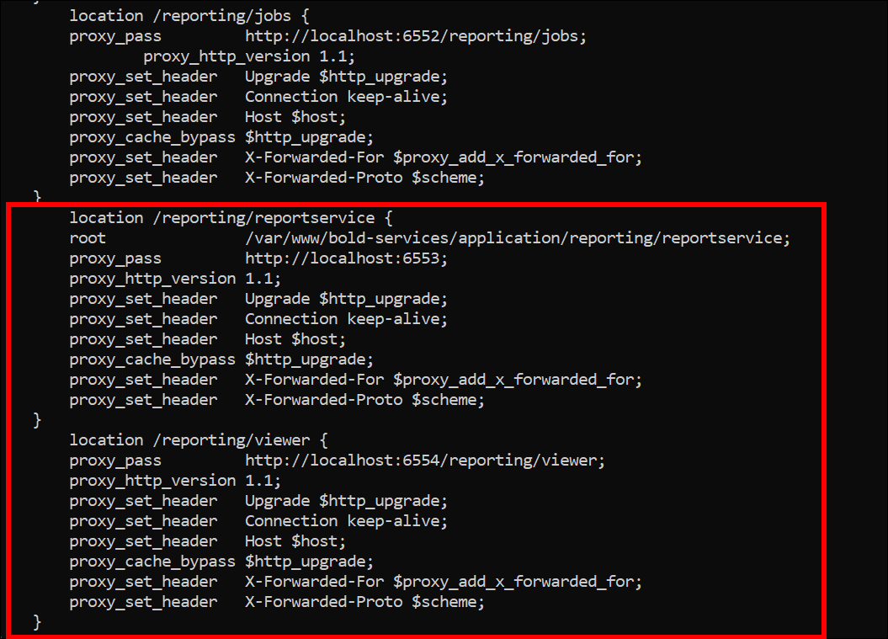
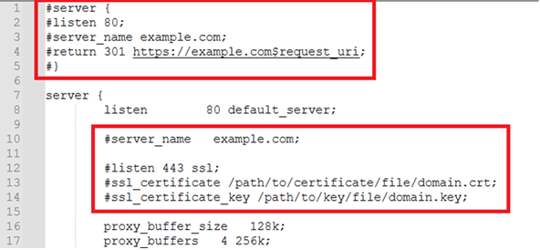
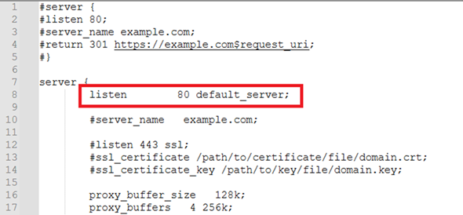

# Bold Reports<sup>®</sup> v5.x or Older Installation and Deployment on Ubuntu

You can install Bold Reports<sup>®</sup> version 5.x or older on Ubuntu by installing the required packages and running the Bold Reports<sup>®</sup> Linux package installer. You can also configure Nginx as a reverse proxy manually and secure the site with SSL.

## What do I need before installing Bold Reports<sup>®</sup> on Ubuntu?

Bold Reports<sup>®</sup> on Ubuntu needs a sudo-enabled user account, Nginx, zip, GDIPlus and an OpenSSL configuration path.

1. Access to a Linux server with a standard user account and sudo privileges.
2. Install `Nginx` by running the following commands:

    ```console
    sudo apt-get update
    ```  
    ```console
    sudo apt-get install nginx
    ```

3. Install `zip` by running the following command:
    ```console
    sudo apt-get install zip
    ```
4. Install the `GDIPlus` package by running the following command:
    ```console
    sudo apt-get install libgdiplus
    ```
5. Add an `openssl conf` path in the environment if it does not exist.
    ```console
    export OPENSSL_CONF=/etc/ssl/
    ```

## How do I configure the Bold Reports<sup>®</sup> application on Ubuntu?

You configure Bold Reports<sup>®</sup> on Ubuntu by downloading the Linux package, extracting it, and running the `install-boldreports.sh` script.

1. Register and download the Bold Reports<sup>®</sup> Linux package from the [registration and download section](./../../../getting-started/#registration-and-download).

2. Download the Bold Reports<sup>®</sup> Linux package by running the following command:
    ```console
    sudo wget {Bold Reports Linux package link}
    ```
3. Extract the zip file by running the following command:
    ```console
    sudo unzip {Bold Reports Linux package zip file}
    ```
4. Change the directory to `BoldReports_EnterpriseReporting-Linux` by running the following command:
    ```console
    cd BoldReports_EnterpriseReporting-Linux
    ```
5. Run the following command to deploy Bold Reports<sup>®</sup> on your Linux machine:
    ```console
     sudo bash install-boldreports.sh -i {new} -u {user} -h {host URL} -n {true or false}
     ```

     * **i:** Installation type. Specifies whether it is a new or upgrade installation.

     * **u:** The user or group that manages the service.

     * **h:** Domain or IP address of the machine with HTTP protocol.

     * **n:** Set this to `true` to configure Bold Reports<sup>®</sup> with the Nginx front-end server automatically.

    > **IMPORTANT:** If existing applications on that Linux machine use Nginx, set the "-n" value to false and [configure Nginx manually](#manually-configure-nginx).

    Example for a new installation:

    ```console
        sudo bash install-boldreports.sh -i new -u www-data -h http://linux.example.com -n true
    ```

After the Bold Reports<sup>®</sup> installation is complete, open the host URL in the browser and continue the application startup.

## What changes after upgrading from v3.1.x to v5.2.26?

Bold Reports<sup>®</sup> v5.2.26 needs updated **reportservice** and **viewer** sections in the Nginx configuration file when you upgrade from v3.1.x with manual Nginx configuration.

>**Note**:
> * After upgrading the Bold Reports<sup>®</sup> application to v5.2.26 from v3.1.x, update the following section of the **reportservice** and **viewer** codes in the Nginx configuration file in the location `/etc/nginx/sites-available`.
> * Make this breaking change only for manual Nginx configuration.

Update the **reportservice** and **viewer** codes in the Nginx configuration file as follows:

```cmd
    location /reporting/reportservice {
        root               /var/www/bold-services/application/reporting/reportservice;
        proxy_pass         http://localhost:6553;
        proxy_http_version 1.1;
        proxy_set_header   Upgrade $http_upgrade;
        proxy_set_header   Connection keep-alive;
        proxy_set_header   Host $host;
        proxy_cache_bypass $http_upgrade;
        proxy_set_header   X-Forwarded-For $proxy_add_x_forwarded_for;
        proxy_set_header   X-Forwarded-Proto $scheme;
    }
    location /reporting/viewer {
        proxy_pass         http://localhost:6554/reporting/viewer;
        proxy_http_version 1.1;
        proxy_set_header   Upgrade $http_upgrade;
        proxy_set_header   Connection keep-alive;
        proxy_set_header   Host $host;
        proxy_cache_bypass $http_upgrade;
        proxy_set_header   X-Forwarded-For $proxy_add_x_forwarded_for;
        proxy_set_header   X-Forwarded-Proto $scheme;
    }
```

The following screenshot shows the updated Nginx configuration.



After you update the Nginx configuration, run `sudo nginx -t` to verify the syntax of the configuration files. If the configuration file test is successful, run `sudo nginx -s reload` to force Nginx to pick up the changes.

## Manually configure Nginx

You configure Nginx manually as a reverse proxy that forwards requests to the Bold Reports<sup>®</sup> app. Modify /etc/nginx/sites-available/default: open it in a text editor and add the following code:

```cmd
       #server {
       #listen 80;
       #server_name example.com;
       #return 301 https://example.com$request_uri;
       #}

         server {
       listen        80 default_server;

       #server_name   example.com;

       #listen 443 ssl;
       #ssl on;
       #ssl_certificate /path/to/certificate/file/domain.crt;
       #ssl_certificate_key /path/to/key/file/domain.key;

       proxy_read_timeout 300;
       proxy_connect_timeout 300;
       proxy_send_timeout 300;
       send_timeout 300;
       client_max_body_size 200M;

       location / {
      root /var/www/bold-services/application/idp/web/wwwroot;
        proxy_pass http://localhost:6500/;
        proxy_http_version 1.1;
        proxy_set_header Upgrade $http_upgrade;
        proxy_set_header Connection keep-alive;
        proxy_set_header Host $host;
        proxy_cache_bypass $http_upgrade;
        proxy_set_header X-Forwarded-For $proxy_add_x_forwarded_for;
        proxy_set_header X-Forwarded-Proto $scheme;
        fastcgi_buffers 16 16k;
        fastcgi_buffer_size 32k;
    }
    location /api {
        proxy_pass         http://localhost:6501/api;
        proxy_http_version 1.1;
        proxy_set_header   Upgrade $http_upgrade;
        proxy_set_header   Connection keep-alive;
        proxy_set_header   Host $host;
        proxy_cache_bypass $http_upgrade;
        proxy_set_header   X-Forwarded-For $proxy_add_x_forwarded_for;
        proxy_set_header   X-Forwarded-Proto $scheme;
    }
    location /ums {
        root               /var/www/bold-services/application/idp/ums/wwwroot;
        proxy_pass         http://localhost:6502/ums;
        proxy_http_version 1.1;
        proxy_set_header   Upgrade $http_upgrade;
        proxy_set_header   Connection keep-alive;
        proxy_set_header   Host $host;
        proxy_cache_bypass $http_upgrade;
        proxy_set_header   X-Forwarded-For $proxy_add_x_forwarded_for;
        proxy_set_header   X-Forwarded-Proto $scheme;
    }
    location /ums/signalr/progresshub {
        proxy_pass         http://localhost:6502/ums/signalr/progresshub;
        proxy_http_version 1.1;
        proxy_set_header   Upgrade $http_upgrade;
        proxy_set_header   Connection "upgrade";
        proxy_set_header   Host $host;
        proxy_cache_bypass $http_upgrade;
        proxy_set_header   X-Forwarded-For $proxy_add_x_forwarded_for;
        proxy_set_header   X-Forwarded-Proto $scheme;
    }
    location /reporting {
    root /var/www/bold-services/application/reporting/web/wwwroot;
        proxy_pass         http://localhost:6550/reporting;
        proxy_http_version 1.1;
        proxy_set_header   Upgrade $http_upgrade;
        proxy_set_header   Connection keep-alive;
        proxy_set_header   Host $host;
        proxy_cache_bypass $http_upgrade;
        proxy_set_header   X-Forwarded-For $proxy_add_x_forwarded_for;
        proxy_set_header   X-Forwarded-Proto $scheme;
    }
    location /reporting/messageHub {
        proxy_pass         http://localhost:6550/reporting/messageHub;
        proxy_http_version 1.1;
        proxy_set_header   Upgrade $http_upgrade;
        proxy_set_header   Connection "upgrade";
        proxy_set_header   Host $host;
        proxy_cache_bypass $http_upgrade;
        proxy_set_header   X-Forwarded-For $proxy_add_x_forwarded_for;
        proxy_set_header   X-Forwarded-Proto $scheme;
    }
    location /reporting/api {
        proxy_pass         http://localhost:6551/reporting/api;
        proxy_http_version 1.1;
        proxy_set_header   Upgrade $http_upgrade;
        proxy_set_header   Connection keep-alive;
        proxy_set_header   Host $host;
        proxy_cache_bypass $http_upgrade;
        proxy_set_header   X-Forwarded-For $proxy_add_x_forwarded_for;
        proxy_set_header   X-Forwarded-Proto $scheme;
    }
    location /reporting/jobs {
        proxy_pass         http://localhost:6552/reporting/jobs;
        proxy_http_version 1.1;
        proxy_set_header   Upgrade $http_upgrade;
        proxy_set_header   Connection keep-alive;
        proxy_set_header   Host $host;
        proxy_cache_bypass $http_upgrade;
        proxy_set_header   X-Forwarded-For $proxy_add_x_forwarded_for;
        proxy_set_header   X-Forwarded-Proto $scheme;
    }
    location /reporting/reportservice {
        root               /var/www/bold-services/application/reporting/reportservice;
        proxy_pass         http://localhost:6553;
        proxy_http_version 1.1;
        proxy_set_header   Upgrade $http_upgrade;
        proxy_set_header   Connection keep-alive;
        proxy_set_header   Host $host;
        proxy_cache_bypass $http_upgrade;
        proxy_set_header   X-Forwarded-For $proxy_add_x_forwarded_for;
        proxy_set_header   X-Forwarded-Proto $scheme;
    }
    location /reporting/viewer {
        proxy_pass         http://localhost:6554/reporting/viewer;
        proxy_http_version 1.1;
        proxy_set_header   Upgrade $http_upgrade;
        proxy_set_header   Connection keep-alive;
        proxy_set_header   Host $host;
        proxy_cache_bypass $http_upgrade;
        proxy_set_header   X-Forwarded-For $proxy_add_x_forwarded_for;
        proxy_set_header   X-Forwarded-Proto $scheme;
    }
}
```

After you set up the Nginx configuration, run `sudo nginx -t` to verify the syntax of the configuration files. If the configuration file test is successful, run `sudo nginx -s reload` to force Nginx to pick up the changes.

## How do I configure SSL?

You can configure the Bold Reports<sup>®</sup> site with your SSL certificate if you have one for your domain. Follow these steps, or skip them if you do not need SSL:

1. Uncomment the following marked lines in the Nginx config file. The screenshot shows the SSL lines to uncomment.

    

2. Comment out the following marked line in the Nginx config file. The screenshot shows the line to comment out.

    

3. Replace `example.com` with your domain name.
4. Define the path of the SSL certificate: `ssl_certificate /etc/ssl/domain.crt`.
5. Specify the directory where the SSL certificate key is located: `ssl_certificate_key /etc/ssl/domain.key`.
6. Save the file and run sudo `nginx -t` to verify the syntax of the configuration file. If the configuration file test is successful, run `sudo nginx -s reload` to force Nginx to pick up the changes.

>**NOTE**: If you configure the application with SSL, update the URLs in the product.
>json with `HTTPS`. The file is located in `/var/www/bold-services/application/app_data/configuration`.

## Frequently asked questions

### Which file do I edit to configure Nginx manually on Ubuntu?

For Bold Reports<sup>®</sup> on Ubuntu, modify /etc/nginx/sites-available/default and add the reverse proxy code.

### What must I update after enabling SSL?

After you configure Bold Reports<sup>®</sup> with SSL, update the URLs in the product.json with `HTTPS` in `/var/www/bold-services/application/app_data/configuration`.

## Next steps

* [Install Optional Libraries](./../../../deploy-on-linux/install-opt-library/)

* [Application Startup](./../../../../application-startup/)
