# Install Bold Reports<sup>®</sup> over Bold BI

You can install Bold Reports<sup>®</sup> Enterprise Edition on a machine where Bold BI is already installed, as a sub-application of the existing Bold BI site in IIS. Both products then share one common Bold ID login.

## How do I install Bold Reports<sup>®</sup> over Bold BI?

You install Bold Reports<sup>®</sup> On-Premises Edition over Bold BI by running the Bold Reports<sup>®</sup> Enterprise Reporting installer and choosing whether to use the existing Bold ID.

1. Run the Bold Reports<sup>®</sup> Enterprise Reporting installer on your machine. The screenshot shows the installer setup screen.

    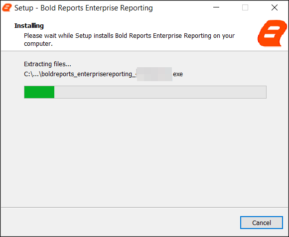

2. Check the license agreement for the Bold Reports<sup>®</sup> On-Premises Edition by clicking `License Terms and Conditions`, and then click `Next`.

    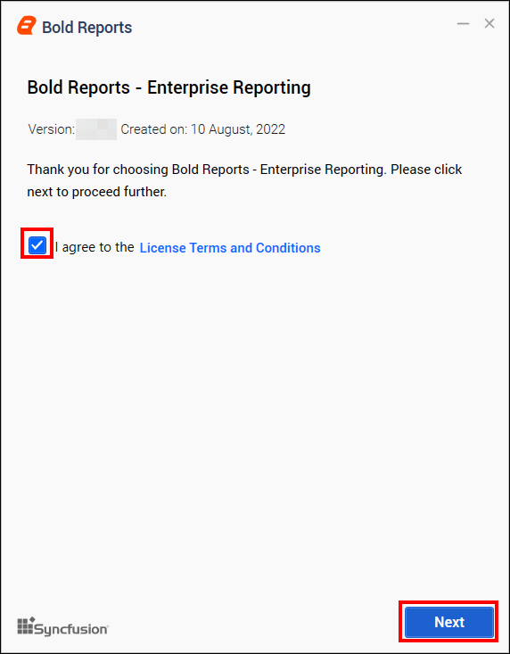

3. A prompt appears, asking whether you want to proceed using the existing Bold ID for Bold Reports<sup>®</sup> On-Premises Edition.

    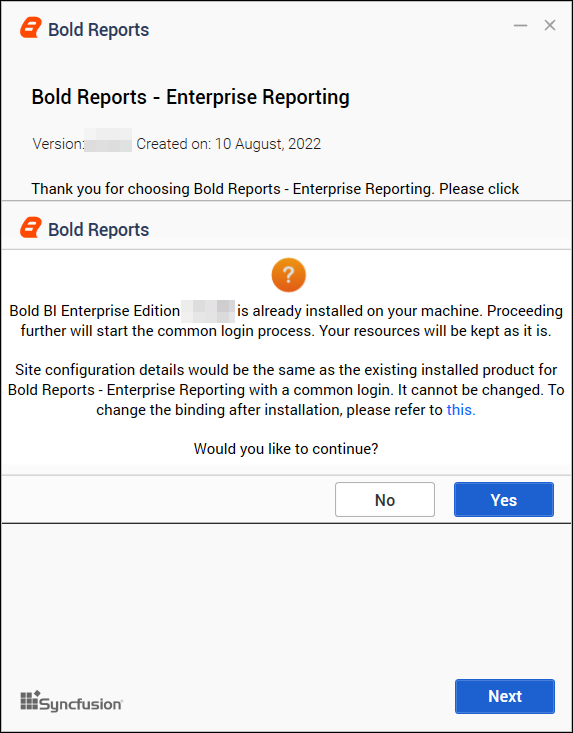

## Proceed with installation without Common Login

If you select `No` to proceed without common login, the Bold Reports<sup>®</sup> Enterprise Reporting installation is cancelled. The screenshot shows the cancelled installation.

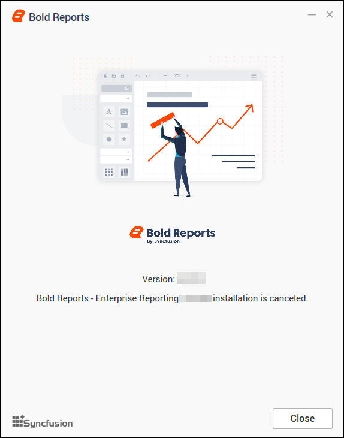

## Proceed with installation with common login

If you select `Yes` to use common login for both Bold BI products and Bold Reports<sup>®</sup>, the installer automatically detects the existing Bold Reports<sup>®</sup> hosting details. It displays them in the following web hosting type. You cannot modify these details: verify them and click Next.

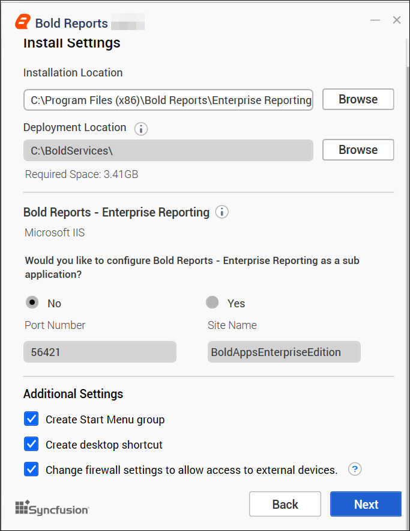

## Why do I need the Chromium Packages?

Bold Reports<sup>®</sup> needs the Chromium packages to export images and PDFs from reports and schedules.

> **IMPORTANT:** Chromium packages are necessary to enable image and PDF export features in reports and schedules from Bold Reports<sup>®</sup>. Without these packages, the image and PDF export options will be disabled.

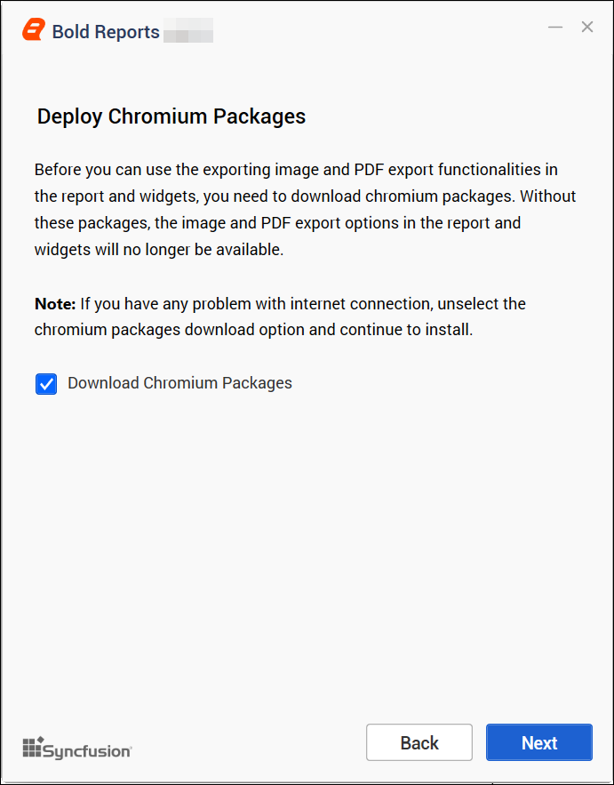

> **NOTE**: If you have problems with your internet connection or have no connection, clear the option to download Chromium Packages and continue with the installation. Follow the guide for [manually installing the Chromium Packages](./../../../administrator-guide/faq/how-to-install-chromium-packages/).

## What is Bold Data Hub?

Bold Data Hub is a Bold Reports<sup>®</sup> application that loads data from various data sources into PostgreSQL, MSSQL, MySQL, and Apache Doris. It provides options to schedule the job at regular intervals to pull data from data sources. It supports transformation using SQL scripts. By default, Python 3 is installed for Bold Data Hub.

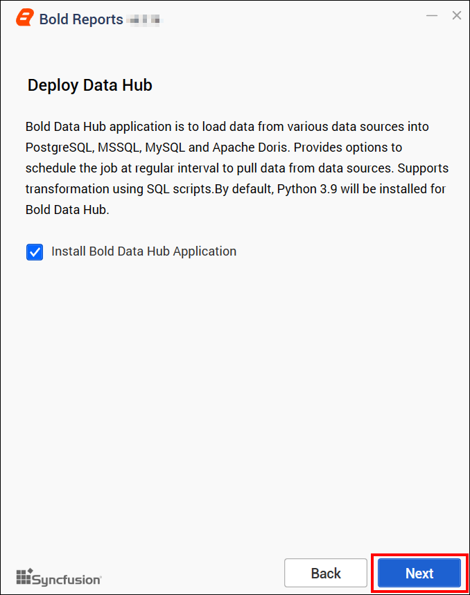

> For Windows OS, Python 3.9 version is required along with Bold Reports<sup>®</sup> On-Premises Edition for Bold Data Hub. If Python 3.9 version is already installed, please specify the Python path in `{Drive}:\BoldServices\etl\etlservice\appsettings.json` and restart the app on the IIS server.

```sh
"PythonPath": "<Drive>:\\BoldServices\\Python39"
```

## How do I install the Client Libraries and finish the setup?

Bold Reports<sup>®</sup> On-Premises Edition shows a client library prompt next, and then you activate the license and create the Bold Reports<sup>®</sup> site.

1. The `client library prompt` opens. Bold Reports<sup>®</sup> On-Premises Edition uses client libraries, such as Oracle, PostgreSQL, Snowflake, MySQL, and GoogleBigQuery, to connect with their respective SQL database variants. Check the license of each library and provide consent for installation. Only the selected client libraries ship with the product. Read and accept the license to ship the selected client libraries, and then click `Install`.
    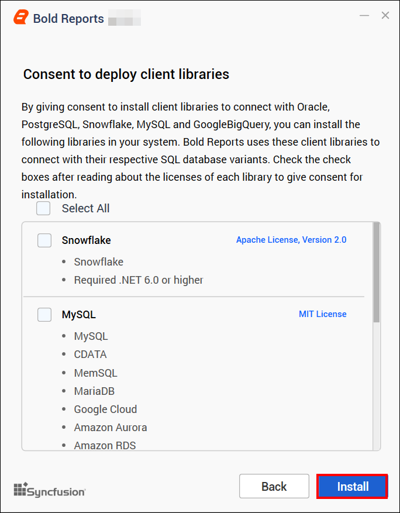

2. After the installation is complete, click `Launch Application` and set up your Bold Reports<sup>®</sup> site.

    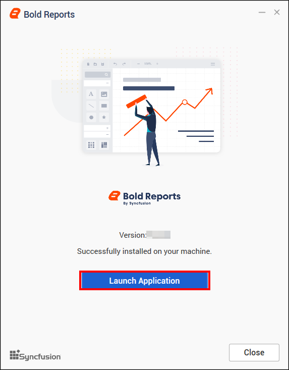

3. The application opens in your browser. Log in with the username and password that are already registered on Bold BI.

    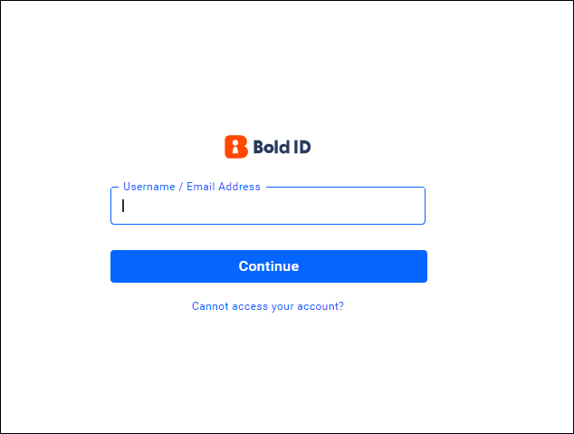

4. After you log in, click your profile and select `Manage Sites` (Admin Access).
    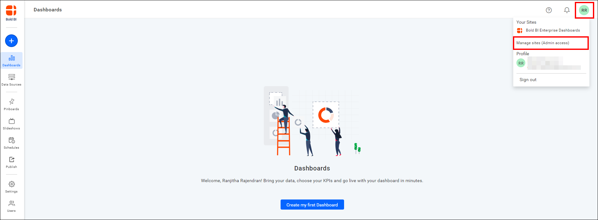

5. Navigate to **Settings > Manage License > Enterprise Reporting**. Then, click `Login to activate account` to register on the site.

    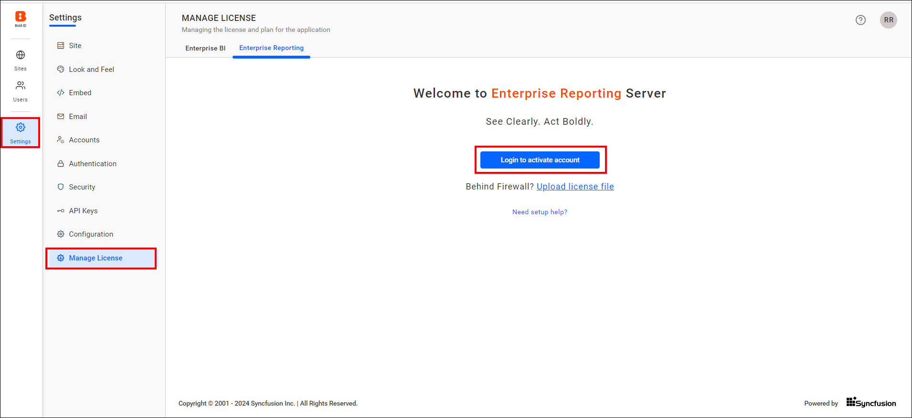

6. After you log in, your subscription details are displayed. You are now ready to use the Bold Reports<sup>®</sup> application.

    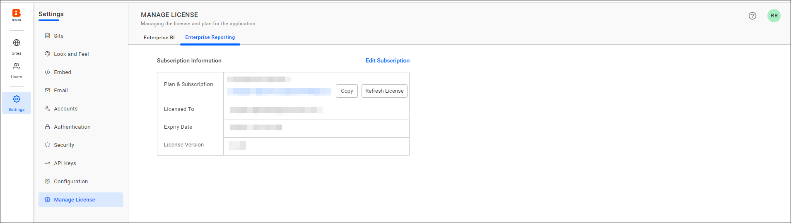

7. After registering the site, create the site for Bold Reports<sup>®</sup> manually from the site management page by opening the following URL:
    `http://{hostname}/ums/sites?action=create-new-site`<br>
    Set up the Bold Reports<sup>®</sup> site by following the steps in the [create site setup guide](./../../../administrator-guide/manage-sites/create-site/).

## How is the application structured when common login is selected?

Bold Reports<sup>®</sup> is installed as a sub-application within the existing Bold BI site, which is hosted on IIS. Using the common Bold ID makes the following changes to IIS:

* Bold BI is normally hosted with the site name `BoldBIEnterpriseEdition` in IIS. After you use the common login (Bold ID), the site name changes to `BoldAppsEnterpriseEdition`.
* Bold Reports<sup>®</sup> is hosted as a sub-app called `reporting` under the `BoldAppsEnterpriseEdition` site.

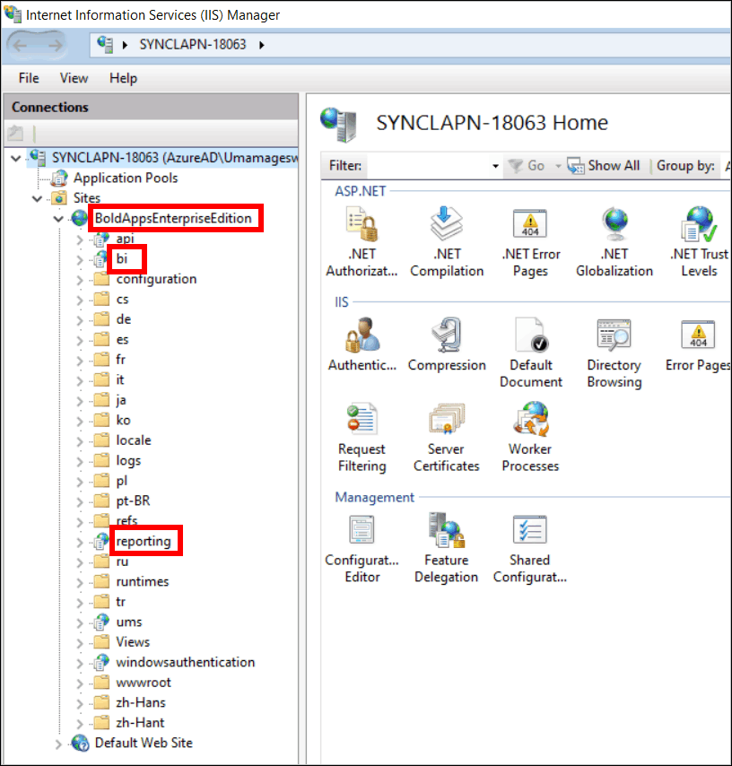

> **NOTE:** Bold ID is the common identity provider application in Bold products that provides Single Sign-On (SSO) to both Bold Reports<sup>®</sup> and Bold BI.

## Frequently asked questions

### What happens if I choose not to use common login?

If you select `No` at the common login prompt, the Bold Reports<sup>®</sup> Enterprise Reporting installation is cancelled.

### What happens if I skip the Chromium Packages?

Without the Chromium packages, the Bold Reports<sup>®</sup> image and PDF export options are disabled.

### Which IIS site hosts Bold Reports<sup>®</sup> after a common login install?

Bold Reports<sup>®</sup> is hosted as the `reporting` sub-app under the `BoldAppsEnterpriseEdition` site in IIS.

## See also

* [Windows prerequisites for Bold Reports<sup>®</sup>](../prerequisites/)
* [Install and deploy Bold Reports<sup>®</sup> on Windows](../installation-and-deployment/)
* [Silent installation on Windows](../silent-installation/)
