# Install and Deploy Bold Reports<sup>®</sup> Enterprise on Windows

You can install Bold Reports<sup>®</sup> Enterprise on Windows and host it in IIS or IIS Express by following these steps. You can host it as the main application or as a sub-application, and change its bindings later.

## How do I unlock the setup?

You start the Bold Reports<sup>®</sup> Enterprise installation by running the installer and reviewing the license agreement.

1. Run the Bold Reports<sup>®</sup> Enterprise Installer. The screenshot shows the installer setup screen.

    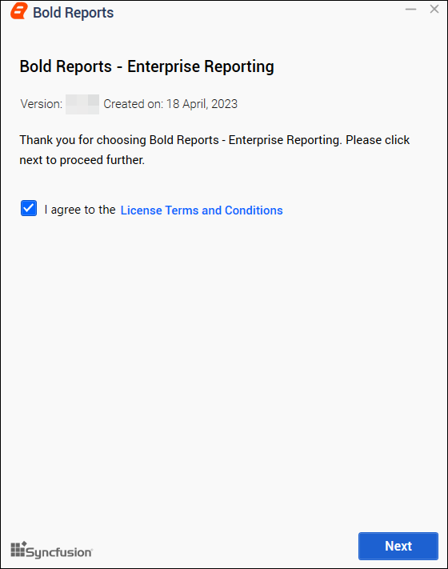

2. Check the license agreement for Bold Reports<sup>®</sup> On-Premises Edition by clicking `License Terms and Conditions`.

## Which hosting type is available?

Bold Reports<sup>®</sup> On-Premises Edition is provided for hosting in the IIS web-server type.

## How do I host Bold Reports<sup>®</sup> in IIS?

To host Bold Reports<sup>®</sup> Enterprise in IIS, you provide the port number, location, and site name.

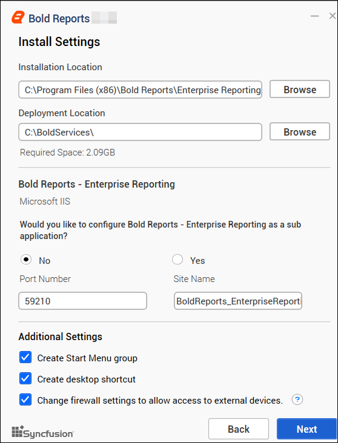

You can deploy the Bold Reports<sup>®</sup> application as the main application or a sub-application.

To configure the Bold Reports<sup>®</sup> application as the main application, select `No` in the `Would you like to configure Bold Reports - Enterprise Reporting as a sub application` block. Then, provide the Port Number and Site Name.

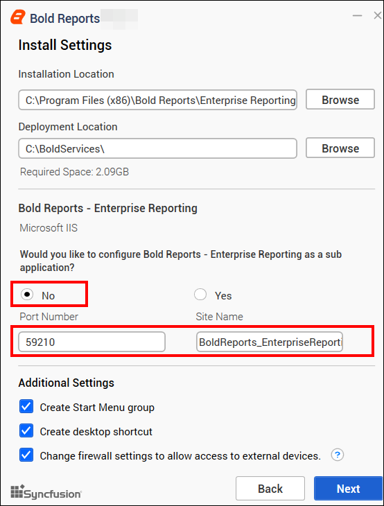

To configure the Bold Reports<sup>®</sup> application as a sub-application, select `Yes` in `Would you like to configure Bold Reports - Enterprise Reporting as a sub application block` and follow these steps:

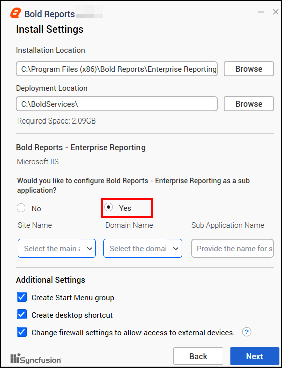

1. Select your main\root application name from the `Site Name` drop-down option.

2. Select the domain name for your main/root application from the `Domain Name` drop-down option.

3. Provide a sub-application name in the `Sub Application Name` field to host Bold Reports<sup>®</sup> Enterprise Reporting as a sub-application.
    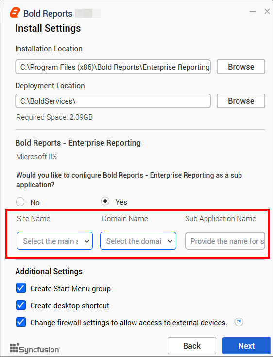

After you provide all the details to host the application in IIS, click `Next` to proceed.

## Why do I need the Chromium Packages?

Bold Reports<sup>®</sup> needs the Chromium packages to export images and PDFs from reports and schedules.

> **IMPORTANT:** Chromium packages are necessary to enable image and PDF export features in reports and schedules from Bold Reports<sup>®</sup>. Without these packages, the image and PDF export options will be disabled.

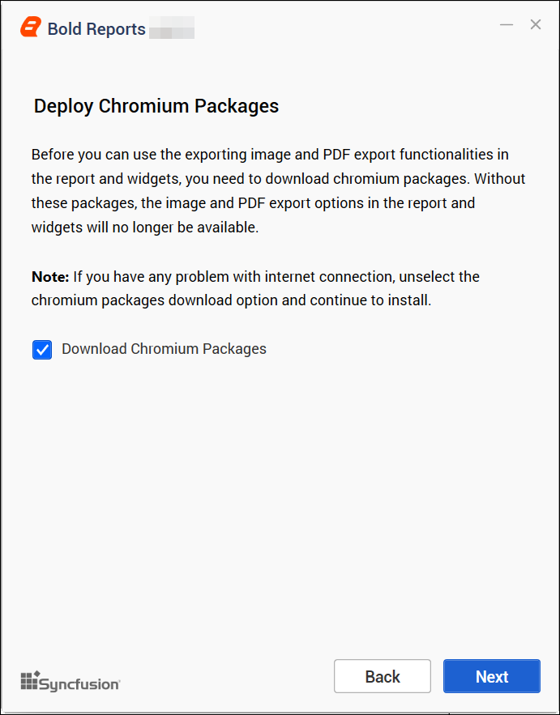

> **NOTE**: If you have problems with your internet connection or have no connection, clear the option to download Chromium Packages and continue with the installation. Follow the guide for [manually installing the Chromium Packages](./../../../administrator-guide/faq/how-to-install-chromium-packages/).

## What is Bold Data Hub?

Bold Data Hub is a Bold Reports<sup>®</sup> application that loads data from various data sources into PostgreSQL, MSSQL, MySQL, and Apache Doris. It provides options to schedule the job at regular intervals to pull data from data sources. It supports transformation using SQL scripts. By default, Python 3 is installed for Bold Data Hub.

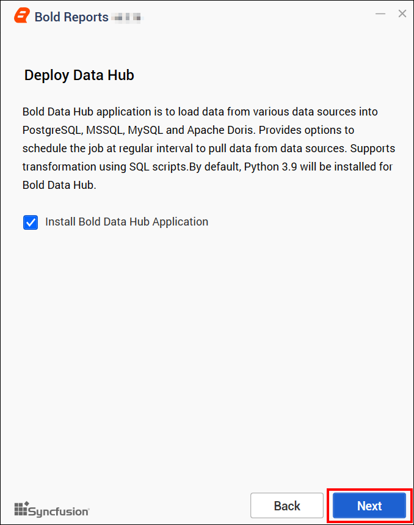

> For Windows OS, Python 3.9 version is required along with Bold Reports<sup>®</sup> On-Premises Edition for Bold Data Hub. If Python 3.9 version is already installed, please specify the Python path in `{Drive}:\BoldServices\etl\etlservice\appsettings.json` and restart the app on the IIS server.

```sh
"PythonPath": "<Drive>:\\BoldServices\\Python39"
```

### How do I install the client libraries?

Bold Reports<sup>®</sup> On-Premises Edition installs the client libraries you select during setup, or later with the ClientLibrary.msi setup.

> **IMPORTANT**: Bold Reports<sup>®</sup> On-Premises Edition uses client libraries, such as Oracle, PostgreSQL, Snowflake, MySQL, and GoogleBigQuery, to connect with their respective SQL database variants. Check the license of each library to provide consent for installation. Only the selected client libraries will be shipped with the product.

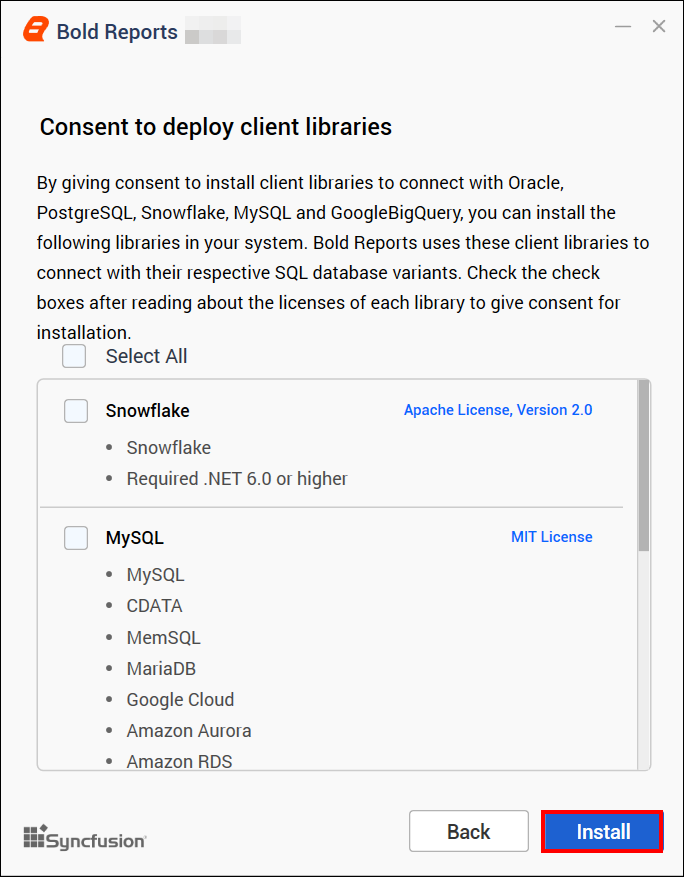

Read and accept the license to ship the selected client libraries, and then click `Install`.

After the installation process is completed, click `Launch Application` to launch the application.

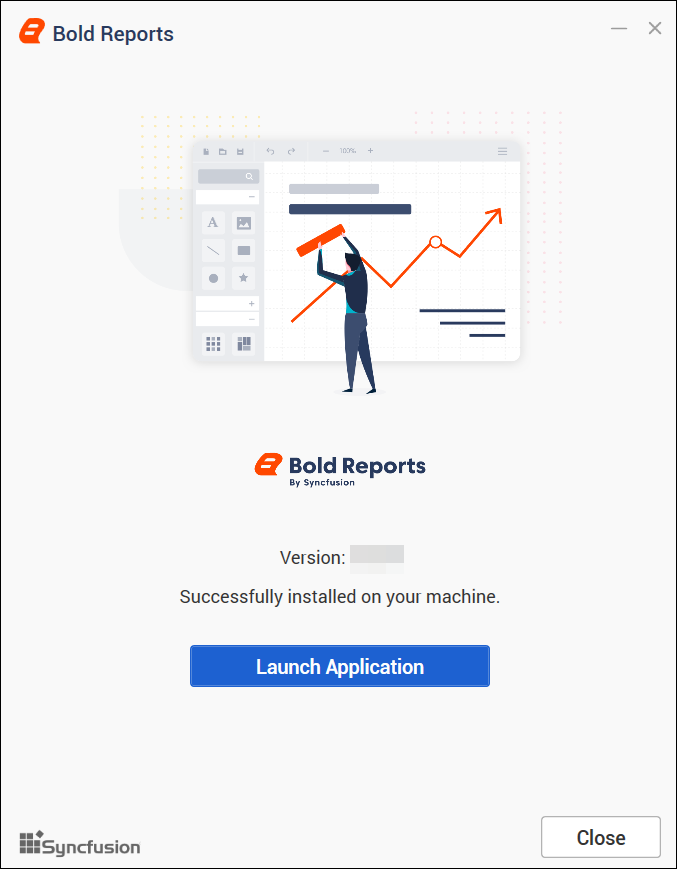

If you did not install the client libraries during this installation, install them with the ClientLibrary.msi setup after installing the Bold Reports<sup>®</sup> setup. Follow these steps to install the client libraries:

1. Go to the location C:\Program Files (x86)\Bold Reports<sup>®</sup>\Enterprise Reporting\Client Library and double-click the setup file named ClientLibrary.msi.

    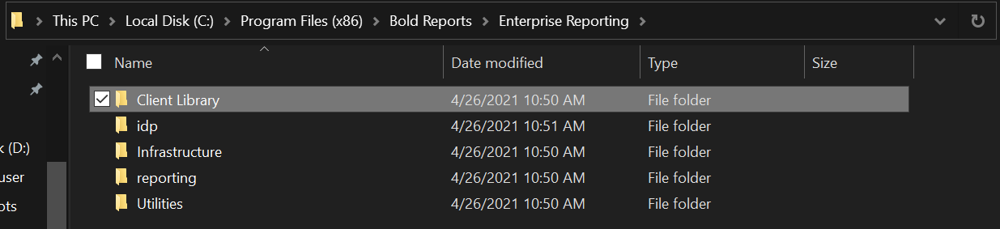
2. The client library dialog opens. Choose and install the required client libraries.
    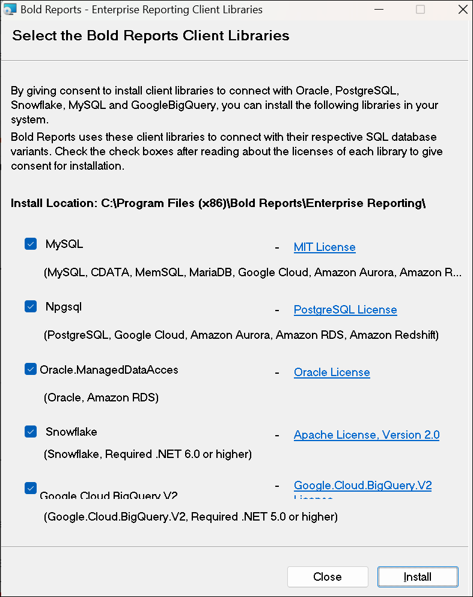

## How to change the binding in the Bold Reports<sup>®</sup> Enterprise Reporting

You change the Bold Reports<sup>®</sup> Enterprise Reporting binding by adding a new binding in IIS and updating the binding information in the UMS application.

1. Add new bindings to Bold Reports<sup>®</sup> Enterprise Reporting edition on IIS as shown in the image below.**`Example: example.com`**
    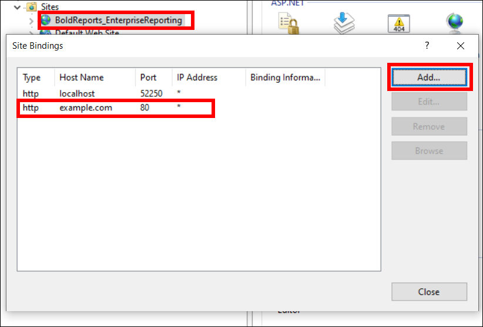
    `Don’t remove existing bindings.`

2. Go to the site settings page of the UMS application using the old binding below and update the new binding information as shown in the image below.**`http://localhost:{port-no}/ums/administration`**
    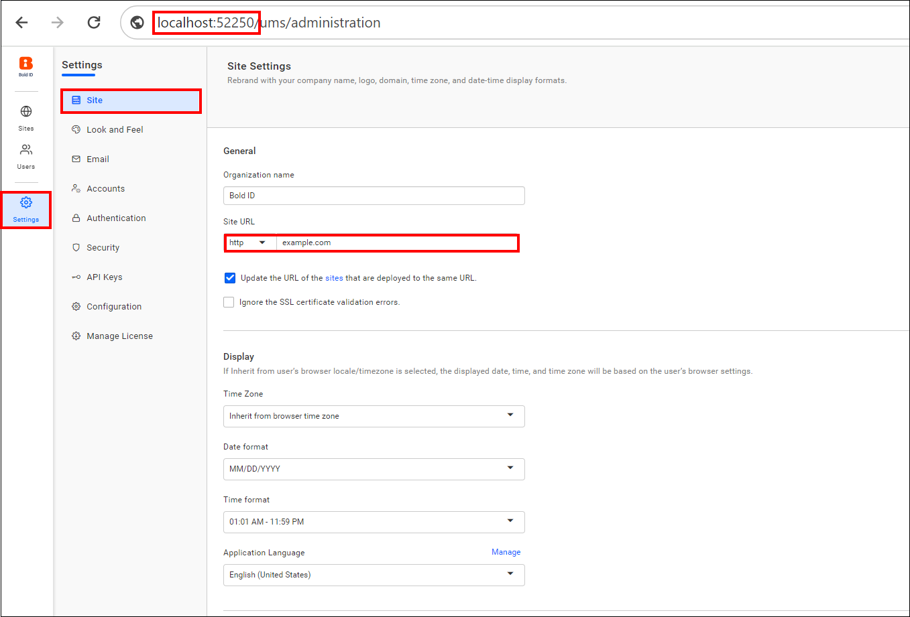

3. Navigate to the site listing page of the UMS application and click `Edit` on the deployed site, as shown in the image below.**`http://localhost:{port-no}/ums/sites`**  
    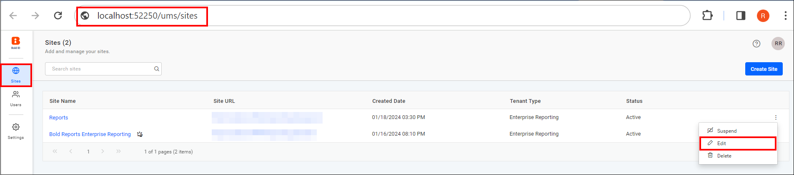

4. Update the new binding information as shown in the image below.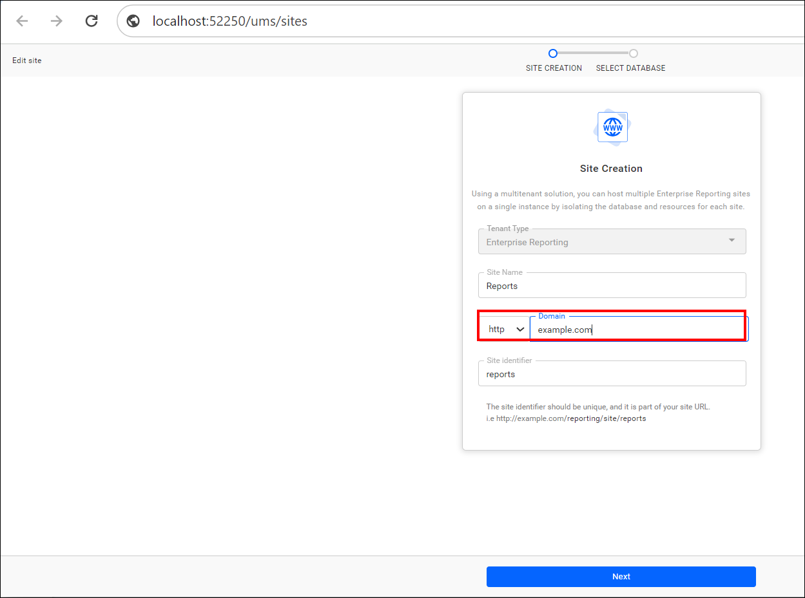
5. Browse the Bold Reports<sup>®</sup> site using the new binding.
6. Repeat steps 3 and 4 to change the custom domain for deployed sites.
> * To configure the Bold Reports<sup>®</sup> On-Premises Edition with newly added bindings in IIS, follow the [guide on mapping a domain name to the Bold Reports<sup>®</sup> site before startup](./../../../administrator-guide/how-to/map-a-domain-name-to-bold-reports-site-before-startup/).

## Frequently asked questions

### Can I host Bold Reports<sup>®</sup> as a sub-application in IIS?

Yes. Select `Yes` in the sub application block and provide the site name, domain name, and sub-application name to host Bold Reports<sup>®</sup> Enterprise Reporting as a sub-application.

### How do I install client libraries after setup?

Run ClientLibrary.msi from C:\Program Files (x86)\Bold Reports<sup>®</sup>\Enterprise Reporting\Client Library, then choose and install the required client libraries.

### Should I remove the existing IIS bindings?

No. When you change the Bold Reports<sup>®</sup> binding, do not remove the existing bindings.

## See Also

* [**Application Startup**](../../../application-startup/)
* [Windows prerequisites for Bold Reports<sup>®</sup>](../prerequisites/)
* [Silent installation on Windows](../silent-installation/)
