# Install Bold Reports<sup>®</sup> Enterprise Reporting in silent mode

You can install and deploy Bold Reports<sup>®</sup> Enterprise Reporting in silent mode by running the installer from the command line with arguments. You can include this silent installer in your existing installation process, and use it for upgrades and sub-application installs.

## How do I install Bold Reports<sup>®</sup> Enterprise Reporting from the command line?

You install Bold Reports<sup>®</sup> Enterprise Reporting in silent mode by extracting the inner installer from `%temp%` and running it from an Administrator command prompt with arguments.

1. [Download Bold Reports<sup>®</sup> Enterprise Reporting](https://help.boldreports.com/enterprise-reporting/deployment/getting-started/) `BoldReports_EnterpriseReporting.exe` from your account. Navigate to the **Registration and Download section** on the linked page, where you can access the Bold Reports<sup>®</sup> application.

2. Run the downloaded `BoldReports_EnterpriseReporting.exe` by double-clicking it. The installer wizard opens automatically and extracts the package into the `%temp%` folder.

3. The `boldreports_enterprisereporting(version)(timestamp).exe` file is extracted into the `%temp%` directory.

4. Run `%temp%.` to open the Temp folder. The `boldreports_enterprisereporting(version)(timestamp).exe` file is in one of the temp folders. The folder name starts with `is`.

    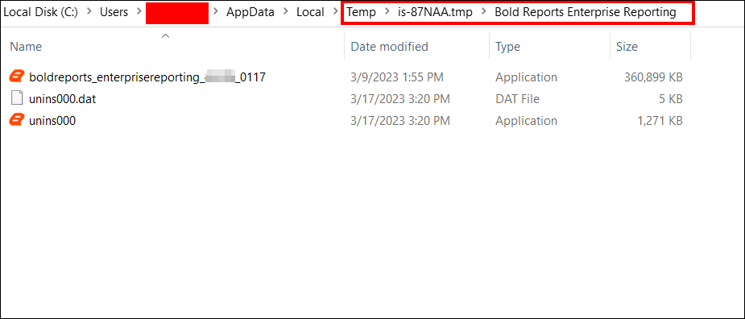

5. Copy the extracted `boldreports_enterprisereporting(version)(timestamp).exe` file and paste it on any of the local drives.

6. Exit the Wizard.

    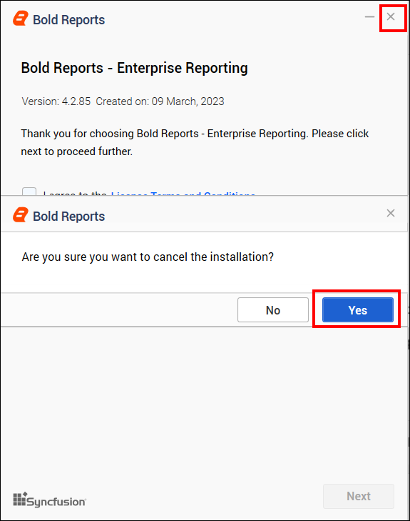

7. Open the Windows command prompt in **Administrator** mode and navigate to the `boldreportenterprisereport(version)(timestamp).exe` file location on the local drive.

8. Provide the necessary arguments in the following command to install the `Bold Reports Enterprise Edition` installer in silent mode.

      **parameters:**
     ```console
    start "" /wait boldreports_enterprisereporting_(version)_(timestamp).exe /Install Silent /InstallPath:{Location to install} /DeploymentPath:{Location to install} /IISPortNo:{Port_No} /IISSiteName:{siteName} /IsSetFirewall:{true/false} /IsUpgrade:FALSE /IsCommonLogin:FALSE /IsDesktopShortcut:{true/false} /IsStartMenuShortcut:{true/false} /IsDataHubServiceEnabled:{TRUE/FALSE} /IsSilentStartUp:{true/false} /JsonFilePath:{Location of the Startup JSON file path}
    ```

9. You can install the Bold Reports<sup>®</sup> On-Premises Edition installer in two ways.

     a. [Configuring the application startup details during the installation](#configuring-the-application-startup-details-during-the-installation)

     b. [Silent installation alone without providing the application startup details](#silent-installation-alone-without-providing-the-application-startup-details)

### Configuring the application startup details during the installation

You can configure the Bold Reports<sup>®</sup> application startup details during the silent installation by passing an application startup JSON file. Use this parameter list if you want to set the application configuration details during the setup installation itself.

After the silent installation is completed, your application is configured by default, and you can start using Bold Reports<sup>®</sup>.

Download the [application_startup](https://github.com/boldreports/api-payload/blob/master/v2/application_startup.json) JSON file and provide ServerConfiguration and UmsConfiguration details in the application_startup.json file.

Provide the Database, Storage and Site details in **ServerConfiguration**.

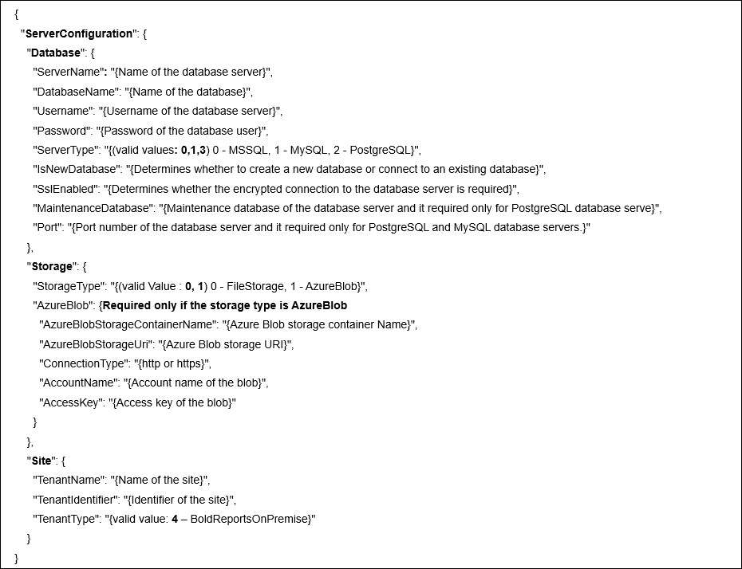

**Example,**

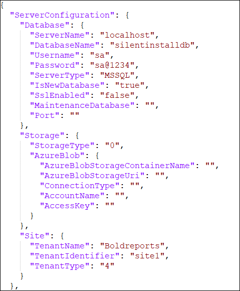

> NOTE: You don't need to provide **DataStoreConfiguration** details, as they are only required for Bold BI. You can ignore them.

Provide the Database, Storage, User and unlockkey details in **UmsConfiguration**.

Follow these steps to get an **unlock key**:
1. Go to [Bold Reports<sup>®</sup> Account](https://www.boldreports.com/account/downloads?tab=self-service) and log in with your account credentials.
2. Go to the Subscriptions section.
3. Click the Get Offline License Key File to download the offline key.
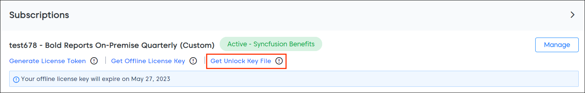

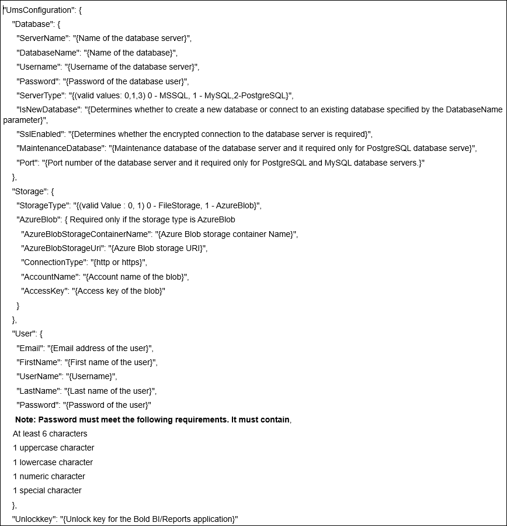

**Example,**

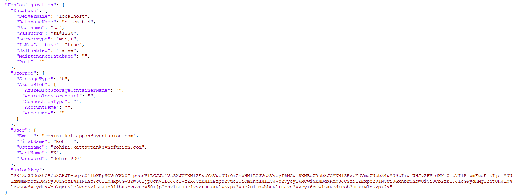

After you provide your inputs in the file, set **IsSilentStartUp** to **true** and provide the path of the JSON file to the installer as an argument.

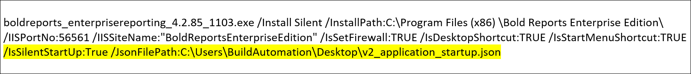

**Example,**

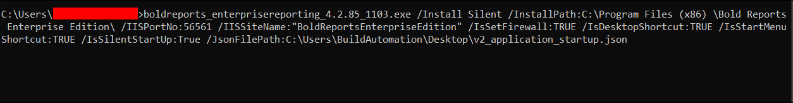

The following screenshot shows the configured Bold Reports<sup>®</sup> application.

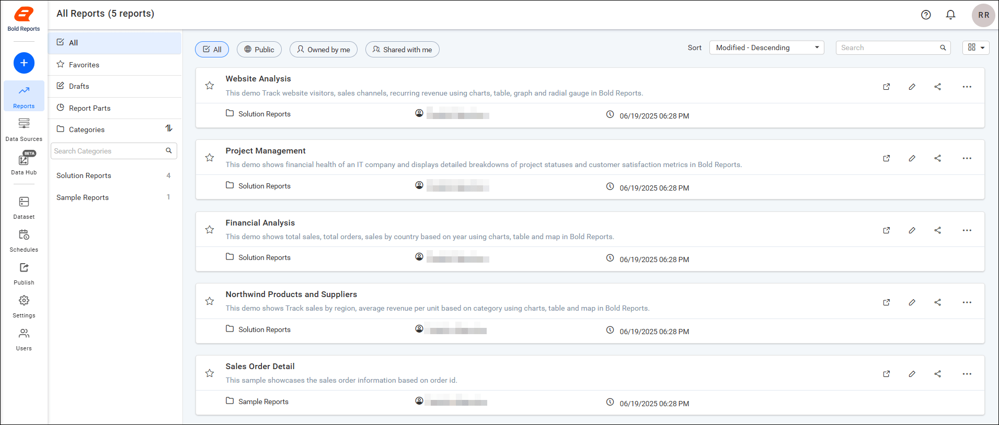

### Silent installation alone without providing the application startup details

You can run the Bold Reports<sup>®</sup> silent installation without startup details by setting **IsSilentStartUp** to **false** and proceeding with the installation.

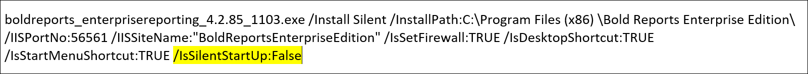

**Example,**

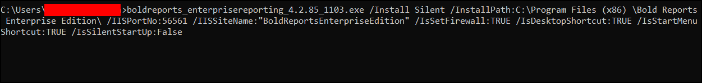

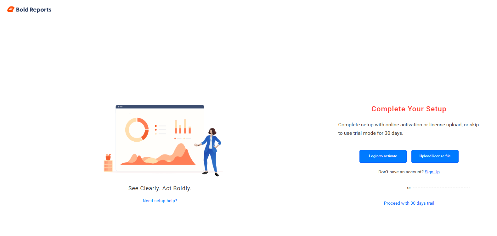

After you provide the startup details in the Bold Reports<sup>®</sup> application, complete your setup by activating the license. For more information, see the [application startup guide](https://help.boldreports.com/enterprise-reporting/application-startup/).

#### How to Upgrade Bold Reports<sup>®</sup> On-Premises Edition in Silent Mode

You upgrade Bold Reports<sup>®</sup> On-Premises Edition in silent mode by running the installer with `/IsUpgrade:TRUE`.

##### Silent Installation Upgrade

If only Bold Reports<sup>®</sup> is installed on your machine, pass the following arguments in the command line to upgrade the Bold Reports<sup>®</sup> On-Premises Edition installer in silent mode.

**Without SubApp parameters:**

**parameters:**

```console
start "" /wait boldreports_enterprisereporting_(version)_(timestamp).exe /Install Silent /InstallPath:{Location to install} /DeploymentPath:{Deployment path} /IISPortNo:{Port_No} /IISSiteName:{siteName} /IsSetFirewall:{TRUE/FALSE} /IsUpgrade:TRUE /IsCommonLogin:FALSE /IsDesktopShortcut:{TRUE/FALSE} /IsStartMenuShortcut:{TRUE/FALSE} /IsDataHubServiceEnabled:{TRUE/FALSE} /IsSilentStartUp:{TRUE/FALSE}

```

##### Example

```console
start "" /wait boldreports_enterprisereporting_9.1.7_0250.exe /Install Silent /InstallPath:"C:\Program Files (x86)\Bold Reports\Enterprise Reporting\" /DeploymentPath:"C:\BoldServices\" /IISPortNo:65301 /IISSiteName:"BoldReportsEnterpriseReporting" /IsSetFirewall:TRUE /IsUpgrade:TRUE /IsCommonLogin:FALSE /IsDesktopShortcut:TRUE /IsStartMenuShortcut:TRUE /IsDataHubServiceEnabled:TRUE /IsSilentStartUp:FALSE

```

**Combination Case Parameter:**

If both Bold Reports<sup>®</sup> and Bold BI are already installed on your machine, pass the following arguments in the command line to upgrade the Bold Reports<sup>®</sup> On-Premises Edition installer in silent mode.

**Without SubApp parameters:**

```console
start "" /wait boldreports_enterprisereporting_(version)_(timestamp).exe /Install Silent /InstallPath:{Location to install} /DeploymentPath:{Deployment path} /IISPortNo:{Port_No} /IISSiteName:{siteName} /IsSetFirewall:{TRUE/FALSE} /IsUpgrade:TRUE /IsCommonLogin:TRUE /IsDesktopShortcut:{TRUE/FALSE} /IsStartMenuShortcut:{TRUE/FALSE} /IsDataHubServiceEnabled:{TRUE/FALSE} /IsSilentStartUp:{TRUE/FALSE}
```

###### Example

```console
    start "" /wait boldreports_enterprisereporting_9.1.7_0250.exe /Install Silent /InstallPath:"C:\Program Files (x86)\Bold Reports\Enterprise Reporting\" /DeploymentPath:"C:\BoldServices\" /IISPortNo:65301 /IISSiteName:"BoldReportsEnterpriseReporting" /IsSetFirewall:TRUE /IsUpgrade:TRUE /IsCommonLogin:TRUE /IsDesktopShortcut:TRUE /IsStartMenuShortcut:TRUE /IsDataHubServiceEnabled:TRUE /IsSilentStartUp:FALSE

```

#### Execute a Silent Installation of Bold Reports<sup>®</sup> as a Sub-Application

You install Bold Reports<sup>®</sup> silently as a sub-application by passing the IIS sub-application arguments to the installer. To install without specifying the application startup configuration, set **IsSilentStartUp** to **false** and proceed with the installation. After the installation is complete, you can configure the startup details within the Bold Reports<sup>®</sup> application.

**parameters:**

```console
start "" /wait boldreports_enterprisereporting_(version)_(timestamp).exe /InstallPath:{Location to install} /DeploymentPath:{Deployment path} /IISSiteName:{siteName} /IISSubAppName:{Sub app name} /IISSubAppDomainName:{Sub app domain name} /IsSetFirewall:{TRUE/FALSE} /IsUpgrade:FALSE /IsCommonLogin:FALSE /IsDesktopShortcut:{TRUE/FALSE} /IsStartMenuShortcut:{TRUE/FALSE} /IsDataHubServiceEnabled:{TRUE/FALSE} /IsSilentStartUp:{TRUE/FALSE}

```

* **IISSiteName**: Name of the site already present in IIS. Bold Reports<sup>®</sup> is hosted as a child site under this site.

* **IsUpgrade**: Set to false during a fresh installation.

* **IISSubAppName**: Name of the Bold Reports<sup>®</sup> sub-application.

* **IISSubAppDomainName**: Domain name of the Bold Reports<sup>®</sup> site (for example, [http://localhost:80](http://localhost:80)).

##### Example

```console
start "" /wait boldreports_enterprisereporting_9.1.7_0250.exe /Install Silent /InstallPath:"C:\Program Files (x86)\Bold Reports\Enterprise Reporting\" /DeploymentPath:"C:\BoldServices\" /IISSiteName:"Default Web Site" /IISSubAppName:Bold /IISSubAppDomainName:"http://localhost" /IsSetFirewall:TRUE /IsUpgrade:FALSE /IsCommonLogin:FALSE /IsDesktopShortcut:TRUE /IsStartMenuShortcut:TRUE /IsDataHubServiceEnabled:TRUE /IsSilentStartUp:FALSE

```

##### Silent Upgrade for Sub-Application

You upgrade a Bold Reports<sup>®</sup> sub-application in silent mode with the following arguments.

**parameters:**

```console
start "" /wait boldreports_enterprisereporting_(version)_(timestamp).exe /InstallPath:{Location to install} /DeploymentPath:{Deployment path} /IISSiteName:{siteName} /IISSubAppName:{Sub app name} /IISSubAppDomainName:{Sub app domain name} /IsSetFirewall:{TRUE/FALSE} /IsUpgrade:TRUE /IsCommonLogin:FALSE /IsDesktopShortcut:{TRUE/FALSE} /IsStartMenuShortcut:{TRUE/FALSE} /IsDataHubServiceEnabled:{TRUE/FALSE} /IsSilentStartUp:{TRUE/FALSE}

```

##### Example

```console
start "" /wait boldreports_enterprisereporting_9.1.7_0250.exe /Install Silent /InstallPath:"C:\Program Files (x86)\Bold Reports\Enterprise Reporting\" /DeploymentPath:"C:\BoldServices\" /IISSiteName:"Default Web Site" /IISSubAppName:Bold /IISSubAppDomainName:"http://localhost" /IsSetFirewall:true /IsUpgrade:TRUE /IsCommonLogin:FALSE /IsDesktopShortcut:TRUE /IsStartMenuShortcut:TRUE /IsDataHubServiceEnabled:TRUE /IsSilentStartUp:FALSE

```

##### Combination Upgrade Case with Sub-App Parameters

You upgrade Bold Reports<sup>®</sup> hosted over Bold BI as a sub-application with the following arguments:

* If you host Bold Reports<sup>®</sup> over Bold BI and want to enable a common login, include **/IsCommonLogin:TRUE** in the command.

**parameters:**

```console
start "" /wait boldreports_enterprisereporting_(version)_(timestamp).exe /InstallPath:{Location to install} /DeploymentPath:{Deployment path} /IISSiteName:{siteName} /IISSubAppName:{Sub app name} /IISSubAppDomainName:{Sub app domain name} /IsSetFirewall:{TRUE/FALSE} /IsUpgrade:TRUE /IsCommonLogin:TRUE /IsDesktopShortcut:{TRUE/FALSE} /IsStartMenuShortcut:{TRUE/FALSE} /IsDataHubServiceEnabled:{TRUE/FALSE} /IsSilentStartUp:{TRUE/FALSE}

```

##### Example

```console
start "" /wait boldreports_enterprisereporting_9.1.7_0250.exe /Install Silent /InstallPath:"C:\Program Files (x86)\Bold Reports\Enterprise Reporting\" /DeploymentPath:"C:\BoldServices\" /IISSiteName:"Default Web Site" /IISSubAppName:Bold /IISSubAppDomainName:"http://localhost" /IsSetFirewall:true /IsUpgrade:TRUE /IsCommonLogin:TRUE /IsDesktopShortcut:TRUE /IsStartMenuShortcut:TRUE /IsDataHubServiceEnabled:TRUE /IsSilentStartUp:FALSE

```

##### Details About Silent Installation Parameters

The Bold Reports<sup>®</sup> silent installation command installs the application in a specific environment, and each parameter customizes the installation for your requirements. Each parameter is described below:

* **boldreports_enterprisereporting_(version)_(timestamp).exe :** The executable file used to install the software. The version number and timestamp are added dynamically, so each build can be uniquely identified.

* **/InstallPath:{Location to install} :** Specifies the directory where the application is installed. Replace {Location to install} with the actual path (e.g., C:\Program Files\My Application). This parameter defines the installation directory for the software.

* **/DeploymentPath:{Deployment path} :** Specifies the directory where the application’s deployment files are placed. Replace {Deployment path} with the actual path (e.g., C:\BoldServices). This parameter determines the location used for storing deployment-related resources.

* **/IISPortNo:{Port No} :** Specifies the port number for IIS (Internet Information Services), the web server on Windows. This parameter assigns a custom port for the web application. Replace {Port No} with the desired port number (e.g., 8080).

    > Note: This parameter is not required when hosting the application as a sub-application.

* **/IISSiteName:{Site Name} :** Defines the name of the IIS site where the application is hosted. Replace {Site Name} with the actual name you want to assign to the site (e.g., My Application Site).

* **/IISSubAppName:{Sub Application Name} :** Specifies the name of the sub-application within the IIS site. If the application is part of a larger site or project, this parameter assigns a name to the specific sub-application. Replace {Sub Application Name} with your sub-application’s name.

    > Note: This parameter is only required if the application is installed as a sub-application (i.e., a child application under an IIS site).

* **/IISSubAppDomainName:{Domain Name} :** Defines the domain name or virtual directory for the sub-application within IIS. Use this if the application runs under a specific domain or URL. Replace {Domain Name} with the appropriate domain (e.g., example.com or myapp.local).

    > Note: This parameter is only required if the application is installed as a sub-application (i.e., a child application under an IIS site).

* **/IsSetFirewall:{TRUE/FALSE} :** Determines whether to configure the firewall during installation.

    * TRUE: The installer sets up the necessary firewall rules.

    * FALSE: No changes are made to the firewall.

* **/IsUpgrade:TRUE :** Indicates that the installation is an upgrade of an existing version. The installer overwrites the older version with the new one. If set to FALSE, the installer performs a fresh installation instead of upgrading.

* **/IsDesktopShortcut:{TRUE/FALSE} :** Specifies whether to create a shortcut on the desktop for the installed application.

    * TRUE: A desktop shortcut is created.

    * FALSE: No desktop shortcut is created.

* **/IsStartMenuShortcut:{TRUE/FALSE} :** Specifies whether to create a shortcut in the Windows Start Menu for the installed application.

    * TRUE: A Start Menu shortcut is created.

    * FALSE: No Start Menu shortcut is created.

* **/IsDataHubServiceEnabled:{TRUE/FALSE} :** Specifies whether to install the Bold ETL (Bold Data Hub) service as part of the installed application.

    * TRUE: The Bold ETL (Bold Data Hub) component is installed and configured.

    * FALSE: The Bold ETL (Bold Data Hub) component is not installed.

* **/IsSilentStartUp:{TRUE/FALSE} :** Indicates whether the application starts silently (without displaying a user interface).

    * FALSE: The application starts normally, showing the user interface.

    * TRUE: The application starts silently without displaying the user interface.

* **/JsonFilePath:{JSON File} :** Specifies the path to a JSON file containing database and IIS site details required for configuration.

If **/IsSilentStartUp** is set to TRUE and you want to include additional parameters for configuring startup settings or other initialization tasks, add the /JsonFilePath parameter in your command to specify the JSON file path.

In summary, the Bold Reports<sup>®</sup> silent installation command offers various installation options for configuring the software package. These include silent installation, IIS setup, firewall management, shortcut creation, and upgrade behavior.

## Frequently asked questions

### How do I get the unlock key for a silent installation?

Go to your Bold Reports<sup>®</sup> Account, open the Subscriptions section, and click Get Offline License Key File to download the offline key.

### Do I need DataStoreConfiguration details?

No. **DataStoreConfiguration** details are only required for Bold BI, so you can ignore them when you install Bold Reports<sup>®</sup>.

### Which parameter enables common login with Bold BI?

Include **/IsCommonLogin:TRUE** in the command when you host Bold Reports<sup>®</sup> over Bold BI and want a common login.

## See also

* [Windows prerequisites for Bold Reports<sup>®</sup>](../prerequisites/)
* [Install and deploy Bold Reports<sup>®</sup> on Windows](../installation-and-deployment/)
* [Install Bold Reports<sup>®</sup> over Bold BI](../install-bold-reports-over-bold-bi/)
