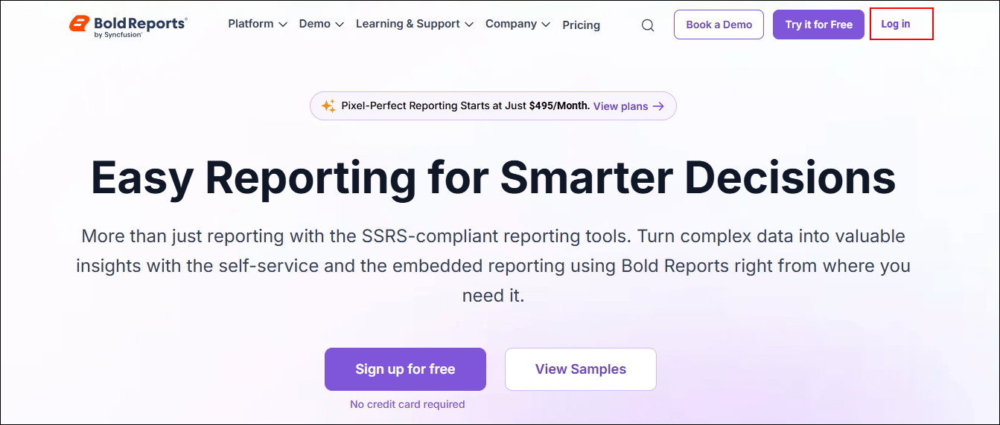
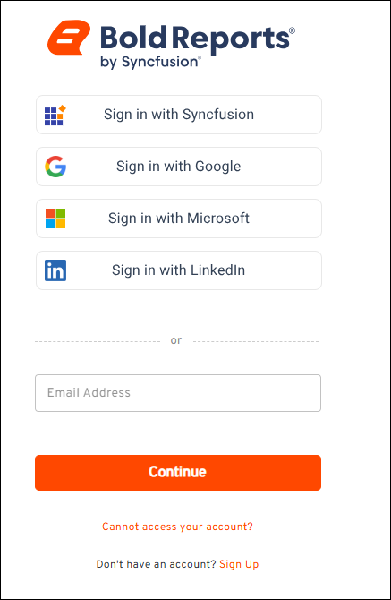
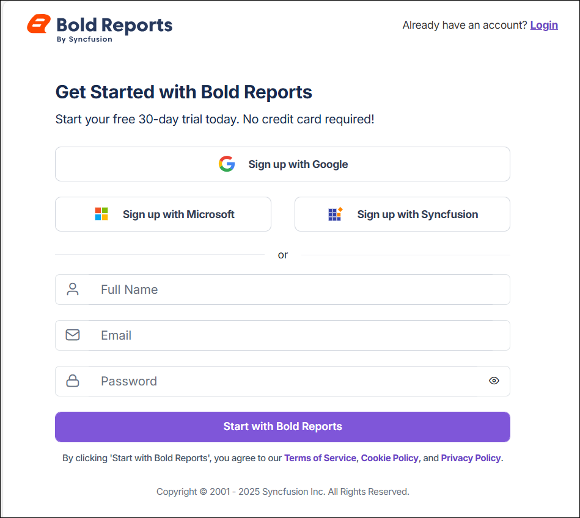
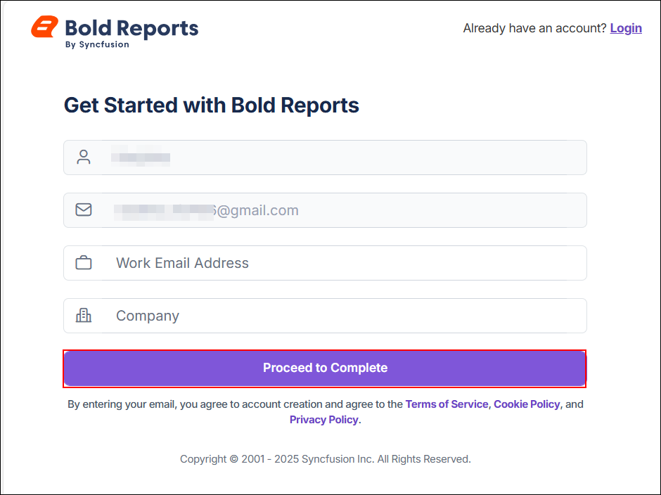
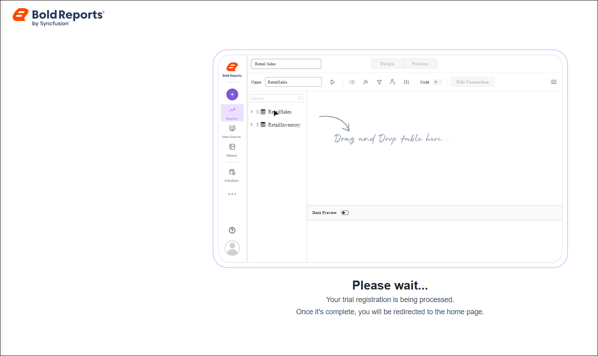
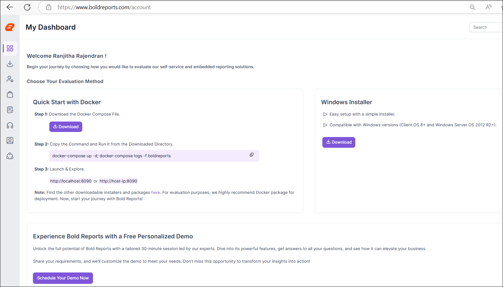

# Get started with Bold Reports® On-Premises Edition

Bold Reports® On-Premises Edition is an end-to-end solution for creating, managing, and sharing interactive business reports. It includes a report server application for easily composing, managing, and sharing reports. Check the system requirements below, then register and download the build.

## Prerequisites for Windows

Bold Reports® On-Premises Edition on Windows needs Windows Client 10+ or Windows Server 2022+, a 4-core CPU, 16 GB of RAM, a supported database and IIS 10.0.

### Hardware Requirements

Bold Reports® On-Premises Edition needs the following hardware to run on Windows:
* **Operating System:** Windows Client 10+ | Windows Server 2022+.
* **CPU:** 4-Core, 2.4 GHz or faster, 32-bit or 64-bit processor.
* **RAM:** 16 GB for 32-bit or 64-bit.
* **Disk Space for Installation Files:** 10 GB.

### Software Requirements

Bold Reports® On-Premises Edition needs the following software to run on Windows:
* **Installer Framework :** .NET Framework 4.5 and above.
* **Database :** PostgreSQL 13.0+ | Microsoft SQL Server 2016+ | MySQL 8.0+ | Oracle Database 19c+.
* **Web Server :** [Internet Information Services (IIS) 10.0](https://en.wikipedia.org/wiki/Internet_Information_Services)
* **Web Browser :** Microsoft Edge | Mozilla Firefox | Chrome | Apple Safari.

## Prerequisites for Linux

Bold Reports® On-Premises Edition on Linux needs a verified Linux distribution, a 4-core CPU, 16 GB of RAM, a supported database and an Nginx or Apache web server.

### Hardware requirements

Bold Reports® On-Premises Edition needs the following hardware to run on Linux:

* **Operating System:** Bold Reports® for Linux can run on various Linux distributions and has been verified on the following operating systems:
    * Ubuntu 20.04+
    * Cent OS Stream 9+
    * Oracle Linux 9.2+
    * Red Hat Enterprise Linux 9.3+
    * Alma Linux OS 9.5
    * Debian 12
    * Rocky Linux 8+
* **CPU:** 4-Core.
* **RAM:** 16 GB.
* **Disk Space for Installation Files:** 10 GB.

### Software requirements

Bold Reports® On-Premises Edition needs the following software to run on Linux:

* **Database:** PostgreSQL 13.0+ | Microsoft SQL Server 2016+ | MySQL 8.0+ | Oracle Database 19c+.
* **Web Server:** [Nginx](https://learn.microsoft.com/en-us/aspnet/core/host-and-deploy/linux-nginx?view=aspnetcore-3.1&tabs=linux-ubuntu#install-nginx) | [Apache](https://learn.microsoft.com/en-us/aspnet/core/host-and-deploy/linux-apache?view=aspnetcore-3.1)
* **Web Browser:** Microsoft Edge | Mozilla Firefox | Chrome.

## Registration and Download

You register and download the Bold Reports® Enterprise Reporting build from the Bold Reports® website. Follow these steps to get the build:

1. Visit the [Bold Reports® website](https://www.boldreports.com/) to register and download the Bold Reports® Enterprise Reporting build.

2. Click the **Log In** button to continue.
    

3. If you already have an account, sign in using one of the available options.
    

4. To create a new account, click the **Sign Up** option shown in the image above.

5. The **Sign Up** option takes you to the page shown below, where you can register using your Google, Microsoft, or Syncfusion® account.
    

6. After you enter your credentials, you are redirected to the page shown below. Click **Proceed to Complete** to finish the registration process.
    

7. After you click **Proceed to Complete**, you are redirected to the trial registration page. When registration is complete, you are taken to your Bold Reports® account page. Select your preferred setup option and click the corresponding download button.
    
    

### Can I try Bold Reports® for free?

Yes. You can create a free account with a 30-day trial of Bold Reports®. For step-by-step instructions, see the [Free Tier user guide](https://help.boldreports.com/enterprise-reporting/bold-reports-free-tier-user-guide/).

## Frequently asked questions

### Which databases does Bold Reports® On-Premises Edition support?

Bold Reports® On-Premises Edition supports PostgreSQL 13.0+, Microsoft SQL Server 2016+, MySQL 8.0+ and Oracle Database 19c+ on both Windows and Linux.

### Which accounts can I use to sign up?

You can register for Bold Reports® using your Google, Microsoft, or Syncfusion® account.

### See Also

* [Installation and Deployment](./../../deployment/deploy-on-windows/installation-and-deployment/)
* [Application Startup](./../../application-startup/)
