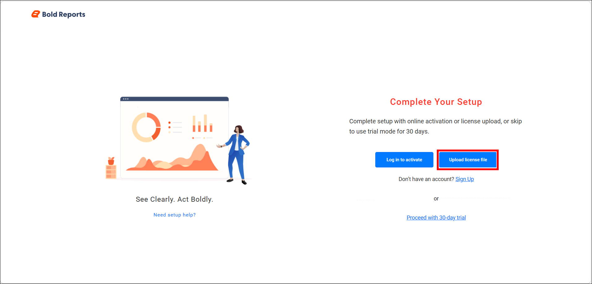
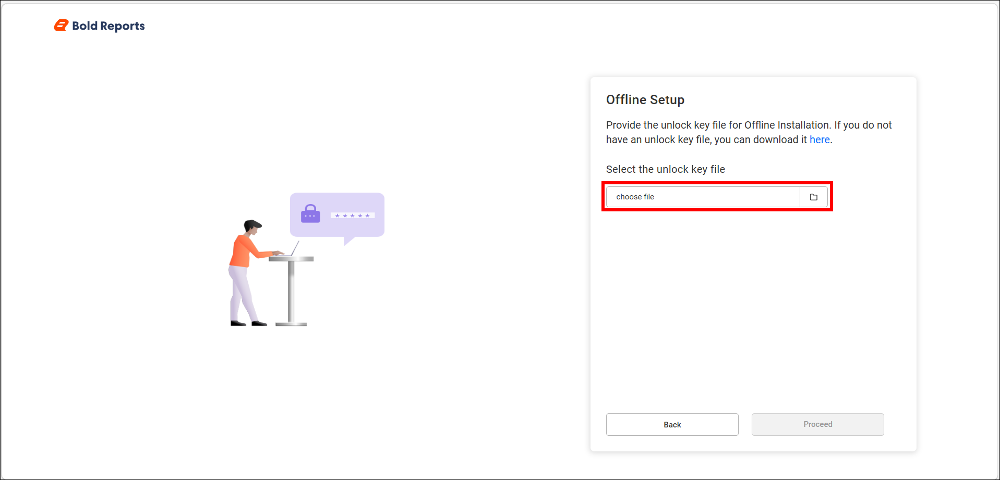
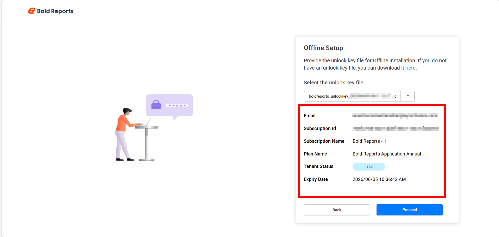
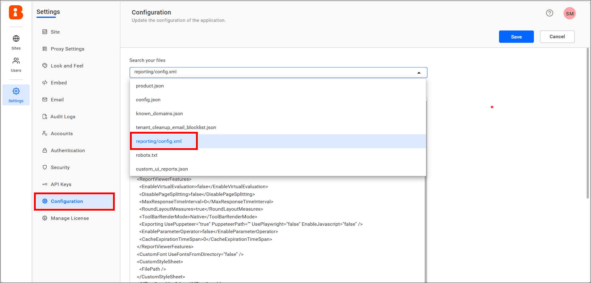
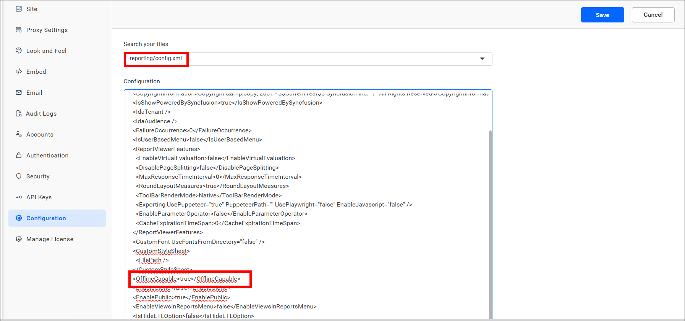

# Install Bold Reports<sup>®</sup> On-Premises Edition offline using Linux

You can activate **Bold Reports<sup>®</sup> Enterprise Edition** on **Linux** offline by uploading your offline license file on the **Licensing** page after installation. If issues occur without an internet connection, you then enable offline mode in `reporting/config.xml`.

> **NOTE:** Offline installation requires a valid offline license key.
> The offline unlock key is available for selected customers only. [Contact Bold Reports<sup>®</sup>](https://www.boldreports.com/contact) to get access to the offline unlock key, and then follow the [offline license key documentation](https://support.boldreports.com/kb/article/13271/how-do-i-get-my-offline-license-key-from-our-bold-reports-account-page") to obtain the required license key.

## Offline Setup for License Activation

Bold Reports<sup>®</sup> redirects you to the **Licensing** page after you complete the installation steps in the [Linux installation documentation](./../../../deployment/deploy-on-linux/).

## License activation

On the Bold Reports<sup>®</sup> **Licensing** page, choose **Upload license file** to proceed with offline activation.

   

## Offline Setup screen

Bold Reports<sup>®</sup> displays the **Offline Setup** dialog after you choose **Upload license file**.

   

## Upload the offline unlock key

You upload the offline unlock key to Bold Reports<sup>®</sup> from the **Offline Setup** dialog.

1. Click **Choose file** and select the offline license file from your local machine.

   

2. After the file is uploaded, click **Proceed** to continue.

After you click **Proceed**, the activation is completed and you can access Bold Reports<sup>®</sup> using the configured URL.

----

## How to enable offline mode after application startup?

You enable offline mode in Bold Reports<sup>®</sup> by setting the **OfflineCapable** node to `true` in `reporting/config.xml`. If **Bold Reports<sup>®</sup> On-Premises Edition** runs without an internet connection, you may see issues such as reports not displaying in the Report Viewer or data source creation errors.

If any of these issues occur after completing offline activation, follow the steps below to resolve them.

## Step 1: Open the configuration settings

You open the Bold Reports<sup>®</sup> configuration file from the **UMS Configuration Settings** page. Go to that page and choose **reporting/config.xml** from the **Search Your Files** drop-down.

   **Example:**  `{your_domain}/ums/administration/config-editor`



## Step 2: Enable the OfflineCapable node

Set the Bold Reports<sup>®</sup> **OfflineCapable** node value to `true` and save the configuration.

   ```sh
   <OfflineCapable>true</OfflineCapable>
   ```



If the **OfflineCapable** node is not available, add the code manually and save the configuration.

Restart the Bold Reports<sup>®</sup> application to apply the configuration changes.

> **NOTE:** To restart the Bold Reports<sup>®</sup> Enterprise application, follow the FAQ on [how to restart the Bold Reports<sup>®</sup> application](./../../../administrator-guide/faq/how-to-restart-the-bold-reports-enterprise-application/).

## How do I upgrade Bold Reports<sup>®</sup> On-Premises Edition?

You can upgrade Bold Reports<sup>®</sup> Enterprise Edition manually to a later version at any time.

> Follow the [Bold Reports<sup>®</sup> upgrade guide](./../../upgrade/on-premises/upgrade-bold-reports-to-latest-version/) to upgrade the Bold Reports<sup>®</sup> Report Server.

## Frequently asked questions

### Who can get an offline unlock key?

The Bold Reports<sup>®</sup> offline unlock key is available for selected customers only. Contact Bold Reports<sup>®</sup> to get access to it.

### What if the OfflineCapable node is missing?

If the **OfflineCapable** node is not in the Bold Reports<sup>®</sup> `reporting/config.xml` file, add it manually and save the configuration.

## See also

* [Bold Reports<sup>®</sup> offline installation](../)
* [Docker offline installation](../docker/)
* [Windows offline installation](../windows/)
