# Upgrade Center on Kubernetes

Bold Reports® Upgrade Center is a secure, in-place upgrade utility for Kubernetes deployments. Administrators can upgrade Bold Reports® from within the application, track progress, review validation results, and recover safely when rollback is required.

## What does Upgrade Center do on Kubernetes?

Upgrade Center automates the following upgrade tasks for Bold Reports® on Kubernetes:

* Database impact analysis
* Affected-table backup
* Pre-upgrade validation
* Controlled Kubernetes rollout
* Post-upgrade validation
* Cleanup
* Monitoring
* Rollback

This reduces manual upgrade effort and gives administrators a guided workflow from start to finish.

## Which Kubernetes platforms does Upgrade Center support?

Upgrade Center supports Kubernetes-based Bold Reports® deployments. It has been validated with the following Kubernetes platforms:

* Google Kubernetes Engine
* Azure Kubernetes Service
* Amazon Elastic Kubernetes Service
* Oracle Container Engine for Kubernetes

To run Upgrade Center, the environment must provide the required deployment configuration, image registry access, database support, and namespace-scoped Kubernetes permissions.

## What are the prerequisites for Upgrade Center?

Before you enable or use Upgrade Center, make sure that the following prerequisites are met:

1. The startup database user must have permission to create and drop databases.
2. The Kubernetes node where the Upgrade Center and validation jobs run must have at least 2 vCPU and 4 GB of free memory available for the upgrade operation.
3. The Kubernetes user applying the Upgrade Center manifests must have permission to create the required Service Account, Role, and RoleBinding resources in the Bold Reports® namespace.

## How do I enable Upgrade Center in Kubernetes?

Upgrade Center can be deployed with kubectl or Helm. Follow the steps in the Upgrade Center deployment documentation:

* Using kubectl: [Deploy Upgrade Center using kubectl](https://github.com/boldreports/boldreports-server-in-kubernetes/blob/master/docs/upgrade-center-deployment.md#deploy-upgrade-center-using-kubectl)
* Using Helm: [Deploy Upgrade Center using Helm](https://github.com/boldreports/bold-reports-kubernetes/blob/master/docs/upgrade-center-deployment.md#deploy-upgrade-center-using-helm)

## How do I open Upgrade Center?

Administrators can open Upgrade Center from the product menu by using the **Check for Updates** option.

The Upgrade Center page displays the following details:

* Currently installed version
* Latest available version
* Available releases
* Custom patch option
* Upgrade history
* Rollback availability

The currently installed version is retrieved from the product version source used by the application. If the installed version is already the latest available version, the available release list is hidden, and the page shows a message that no newer versions are available.

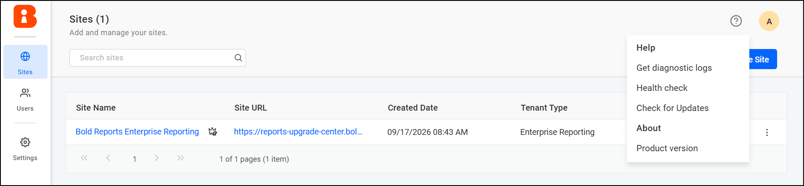

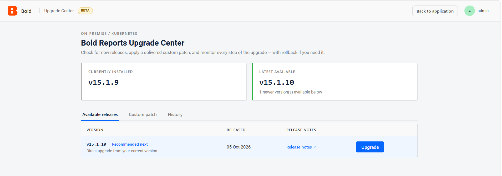

## What upgrade options does Upgrade Center provide?

Upgrade Center provides two upgrade options: a standard release upgrade and a custom patch upgrade.

### How do I upgrade to a standard release?

Use the **Available releases** tab to upgrade to an officially available product version:

1. Open Upgrade Center.
2. Go to **Available releases**.
3. Review the available versions.
4. Select the required target version.
5. Click **Upgrade**.
6. Review the confirmation dialog.
7. Check the affected database tables and warnings.
8. Click **Start Upgrade** to begin.

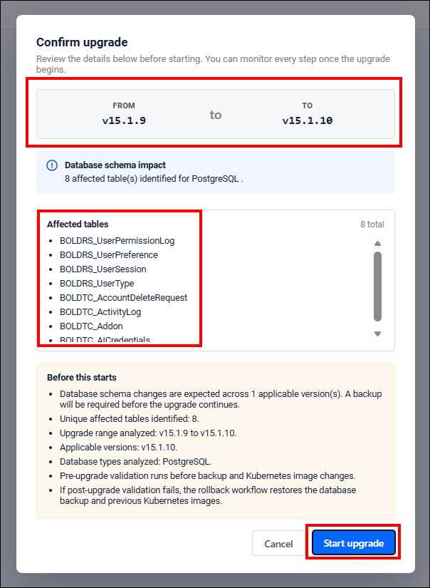

### How do I apply a custom patch?

Use the **Custom patch** tab when Bold Reports® Support provides a custom image tag or patch version:

1. Open Upgrade Center.
2. Go to **Custom patch**.
3. Enter the custom patch version or image tag.
4. Optionally, enter a custom image repository.
5. Click **Validate**.
6. Review the generated image references and validation results.
7. Proceed only if all required images are valid.
8. Confirm and start the upgrade.

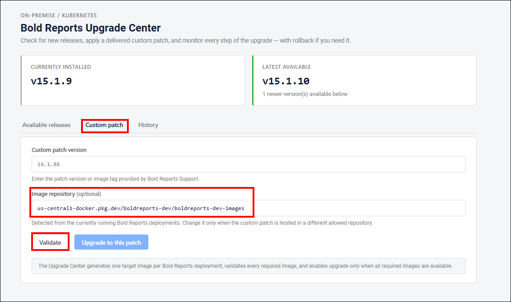

A custom patch upgrade has the following requirements:

* The image tag must be valid and accessible.
* The image repository must be allowed by the configured registry validation rules.
* The patch version must be greater than the currently installed version.
* The custom patch tag can include additional text after the product version, such as `15.1.11_patch`. Upgrade Center uses the product version portion for version comparison.
* Custom patch upgrades update Kubernetes images and use the same monitoring, validation, cleanup, and rollback views as standard upgrades.
* Database schema backup is skipped for custom patch upgrades.

## What happens during a standard upgrade?

A standard upgrade runs the following stages in this order:

1. Database Backup
2. Pre-Upgrade Validation
3. Kubernetes Upgrade
4. Post-Upgrade Validation
5. Cleanup Job

### Database Backup

Before it updates the application images, Upgrade Center identifies the database tables affected by the upgrade and backs up their existing data for all active tenant sites.

> **Important:** Upgrade Center backs up only the tables identified as affected by the upgrade. This table-level backup supports the upgrade and rollback processes. It does not replace a complete, customer-managed database backup. Create and verify a full database backup before you start the upgrade.

### Pre-Upgrade Validation

Pre-upgrade validation verifies that the current Bold Reports® environment is ready before the upgrade begins. If this validation fails, Upgrade Center stops the upgrade before it changes the application images.

### Kubernetes Upgrade

During the upgrade stage, Upgrade Center updates the Kubernetes deployment images and monitors the rollout status.

* Deployments are upgraded in predefined groups.
* Deployments within a group are updated in parallel.
* The next group starts only after the current group is healthy.
* If a required deployment fails, the upgrade stops, and automatic rollback starts when rollback context exists.

After the Kubernetes rollout succeeds, Upgrade Center performs product-level health checks for the configured Bold Reports® services. These checks confirm that the upgraded pods are ready in Kubernetes and respond through the product health endpoints.

### Post-Upgrade Validation

Post-upgrade validation verifies that Bold Reports® works correctly after the upgrade is completed. If this validation fails, Upgrade Center starts automatic rollback when a valid rollback point is available.

### Cleanup Job

The Cleanup Job removes resources created during automated validation, such as temporary test users, sites, and data.

* Cleanup runs through the Playwright Kubernetes runner.
* Cleanup succeeds only when all required cleanup operations pass.
* A cleanup failure is shown as a failed Cleanup Job stage with a manual-cleanup message.

## How do I monitor an upgrade?

### Monitoring page

After the upgrade begins, the monitoring page displays the following stages:

* Schema Backup
* Pre-Upgrade Validation
* Upgrade
* Post-Upgrade Validation
* Cleanup Job

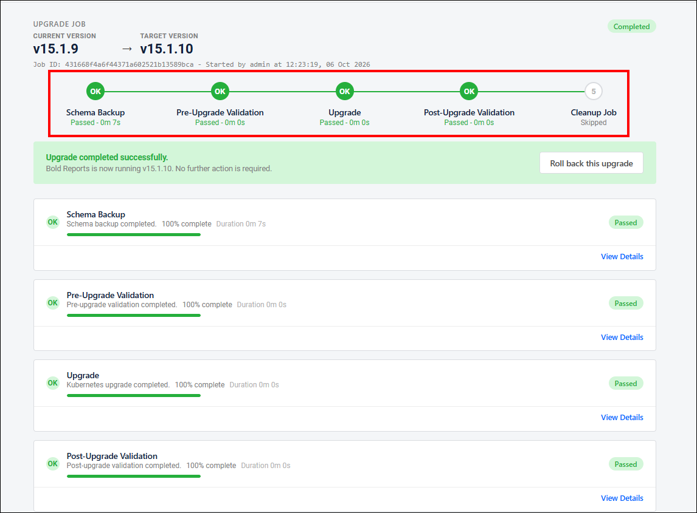

Each stage displays the following details:

* Status
* Progress percentage
* Duration
* View Details
* Complete operation logs
* HTML validation report, after the report is uploaded and stored

### What do the upgrade status values mean?

| Status | Meaning |
|---|---|
| **Pending** | The stage has not started. |
| **Running** | The stage is in progress. |
| **Passed** | The stage completed successfully. |
| **Failed** | The stage failed and requires attention. |
| **Skipped** | The stage was not required. |
| **Rolled back** | The upgrade was reverted to the previous version. |
| **Cancelled** | The administrator cancelled the operation. |

### Stage details

Stage details show concise progress information for each stage.

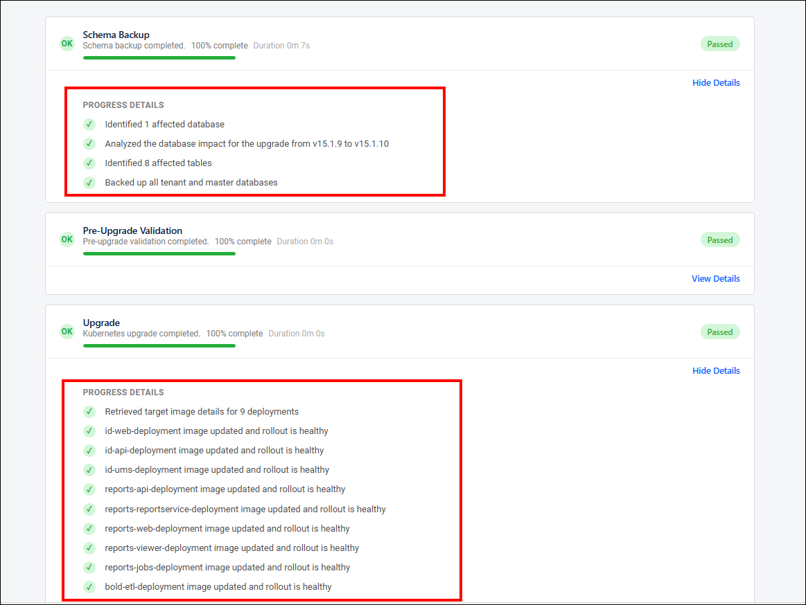

### Complete operation logs

Complete operation logs provide detailed operation-level information, including:

* Database backup and restore messages
* Kubernetes rollout progress
* Validation execution details
* Warnings
* Errors
* Final operation status

Use the **Download Complete Logs** option to download the full operation log for troubleshooting.

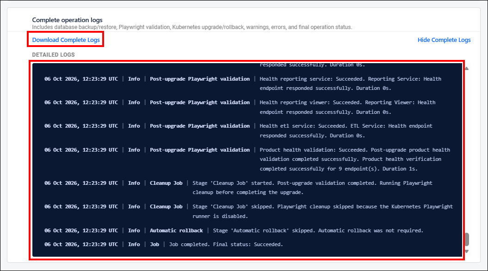

### Playwright reports and results

Upgrade Center runs Playwright validation as a Kubernetes Job by using the configured Playwright runner image. The validation results include:

* Total test count
* Passed test count
* Failed test count
* Skipped test count
* Pass percentage
* Configured pass-rate threshold
* Final validation status

HTML validation reports are uploaded to Upgrade Center and are available through an authenticated Upgrade Center endpoint. Reports are stored separately for each upgrade job and validation stage, and are retained for the latest seven upgrade jobs.

> **Note:** Reports stored in non-persistent application data storage are lost if the Upgrade Center pod is recreated.

## How do I roll back an upgrade?

Upgrade Center supports manual rollback and automatic rollback.

### Manual rollback

Manual rollback is available from the Rollback or History section when a valid rollback point exists.

Rollback is available only within the configured rollback retention window. By default, rollback is available only for the most recent successful upgrade within 7 days. After this period, the rollback option is not displayed, because the required backup and rollback context is outside the supported retention window.

To roll back an upgrade manually:

1. Open Upgrade Center.
2. Go to the History section.
3. Select the available rollback point.
4. Review the rollback confirmation dialog.
5. Confirm rollback.
6. Monitor rollback progress.

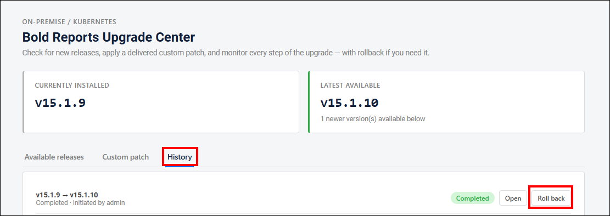

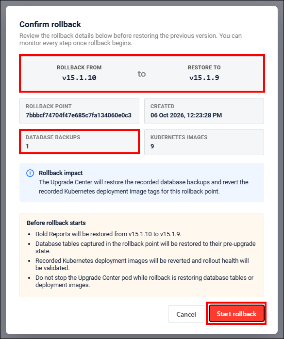

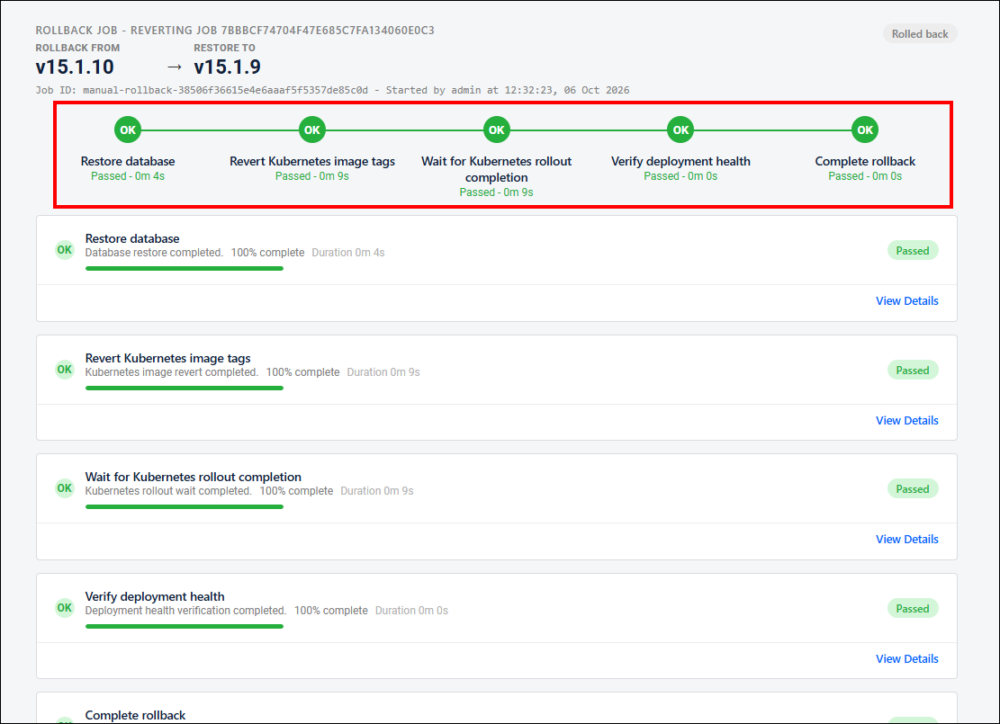

During rollback, Upgrade Center restores the backed-up affected database tables where a backup exists, and reverts the Kubernetes deployment images to the previously recorded image references.

### Automatic rollback

Automatic rollback starts when a failure occurs after upgrade changes have been applied and rollback context exists. The following failures trigger automatic rollback:

* Kubernetes rollout failure
* Product health-check failure
* Post-upgrade validation failure

If the failure occurs before application changes are applied, rollback is not required. Automatic rollback uses the same restore and Kubernetes image-revert workflow as manual rollback.

## Can I cancel an upgrade in progress?

Yes. An administrator can cancel an active operation when cancellation is safe for the current stage. The result depends on when the cancellation occurs:

* If cancellation happens before the application images are changed, Upgrade Center stops the remaining upgrade stages.
* If cancellation happens after the application images have been changed, Upgrade Center triggers rollback to restore the previous version.
* Running Playwright validation jobs and cleanup jobs are stopped or cleaned up.
* The monitoring page and History section show the final cancelled, failed, or rolled-back state.
* If the Upgrade Center pod is recreated during an operation, Upgrade Center reconciles the persisted job state and Kubernetes state before it allows another operation to start.

## Where can I see the upgrade history?

The History section shows previous upgrade and rollback operations, including completed, failed, cancelled, and rolled-back operations. Each history entry includes:

* Source version
* Target version
* Operation type
* Status
* Initiated user
* **Open** option, when job details are available, including for failed and rolled-back jobs

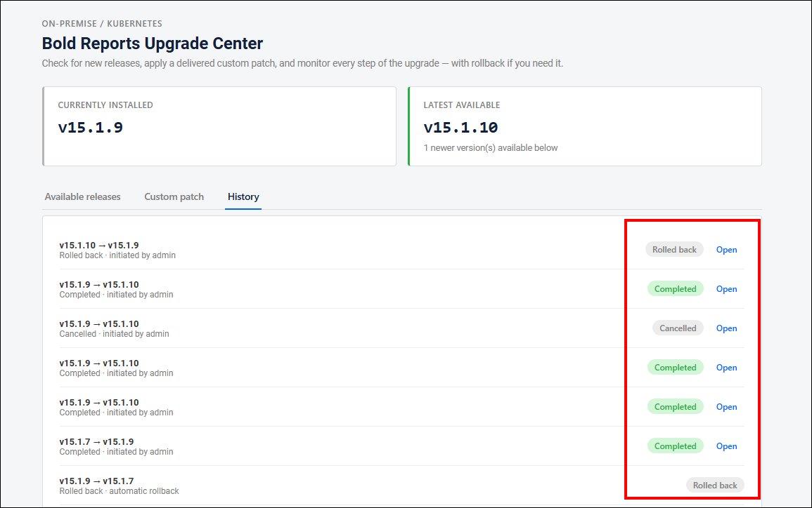

## What are the limitations of Upgrade Center?

Upgrade Center does not support the following scenarios:

* Non-Kubernetes deployments.
* Oracle database configurations, because the current Bold Reports® Playwright validation workflow does not support Oracle.
* Environments with insufficient Kubernetes permissions.

## Frequently asked questions

### How much free memory does the Upgrade Center node need?

The Kubernetes node where the Upgrade Center and validation jobs run needs at least 2 vCPU and 4 GB of free memory for the upgrade operation.

### Does Upgrade Center back up the full database?

No. Upgrade Center backs up only the database tables affected by the upgrade. Create and verify a full database backup before you start the upgrade.

### How long can I roll back an upgrade?

By default, rollback is available for the most recent successful upgrade within 7 days.

### Does Upgrade Center support Oracle databases?

No. Oracle database configurations are not supported, because the current Playwright validation workflow does not support Oracle.

## See also

* [Upgrade Center overview](./../)
* [Deploy Bold Reports® on Kubernetes](./../../deploy-on-kubernetes/)
* [Find the error and debug log files of Bold Reports® in Kubernetes](./../../../administrator-guide/faq/where-can-i-find-the-error-and-debug-log-files-of-bold-reports-in-kubernetes/)
