# Upgrade Bold Reports® Azure App Service version from v2.x to v2.4.19

You can upgrade a Bold Reports® Azure App Service from v2.x to v2.4.19 in the Azure portal by reconnecting its Deployment Center to the Bold Reports® GitHub repository and syncing. Data migration is not required.

## What do I need before upgrading?

Bold Reports® Azure App Service upgrades need access rights to edit the Bold Reports® Azure App Service.

* Bold Reports® releases several major versions in a year. Each version includes new features, bug fixes and other improvements.

* You can review the features and enhancements in the [Release Notes](https://www.boldreports.com/resources/release-history/embedded-reporting/2-3/).

* To upgrade the Bold Reports® Azure App Service, you must have access rights to edit the Bold Reports® Azure App Service.

## How do I upgrade from v2.x to v2.4.19?

You upgrade the Bold Reports® Azure App Service from v2.x to v2.4.19 by following these steps:

1. Log in to the [Azure portal](https://portal.azure.com/).
2. Select `App Services` in Microsoft Azure Services.
   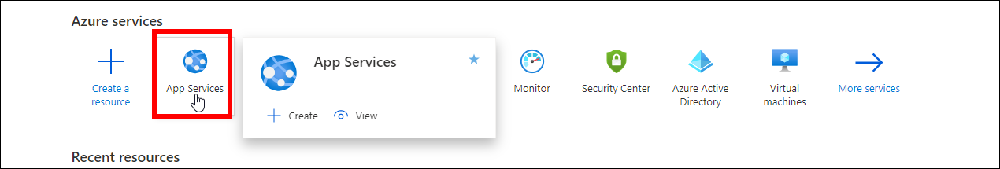
3. Select `Bold Reports Azure App Service`.
4. In the `Overview` section, click the `Stop` button.
   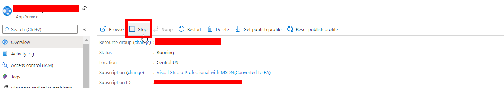
5. Select `Deployment center` in the left panel of the Bold Reports® App Service.
   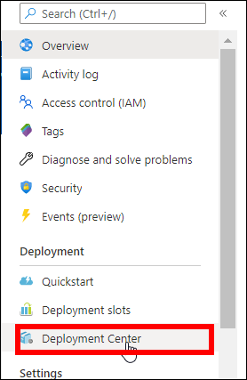
6. In the deployment center, click `Disconnect`. The deployment panel opens.
   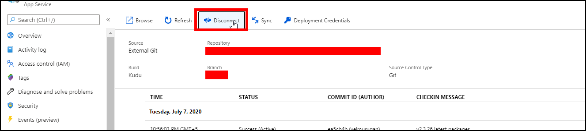
7. Select `External` in the source control tab and click `Continue`.
   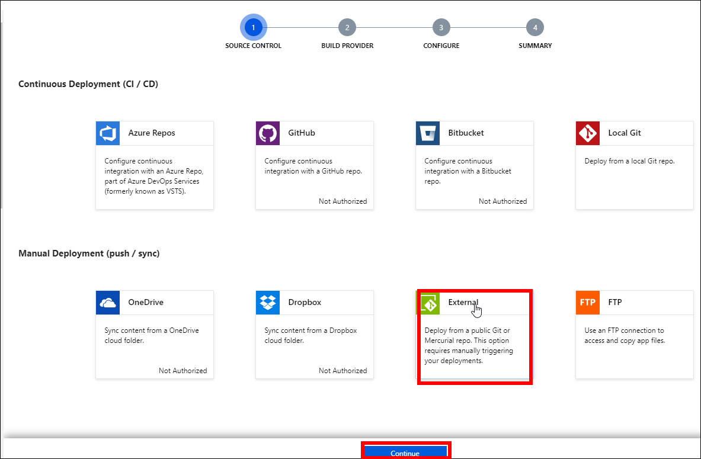
8. Select `App Service build service` and click `Continue`.
   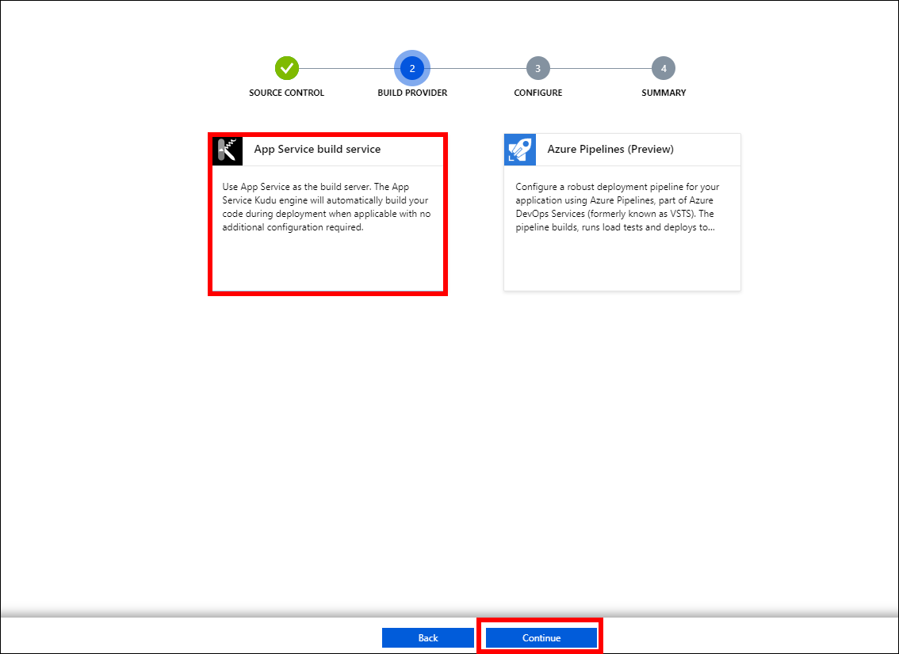
9. Fill in the following details in the `Configure` tab and click `Continue`:
    * Repository - `https://github.com/boldreports/bold-reports-azure.git`
    * Branch - `v{release-version}`
    * Repository Type - `Git`
    * Private Repository - `No`
   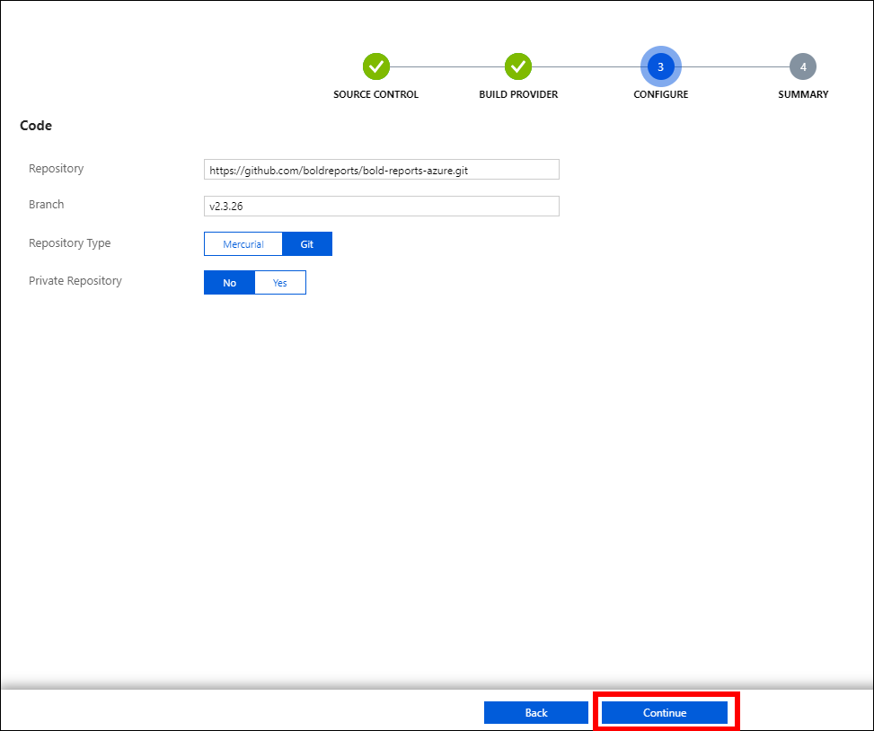
10. Click the `Finish` option. The "Successfully set up deployment" notification is shown in the notifications.
   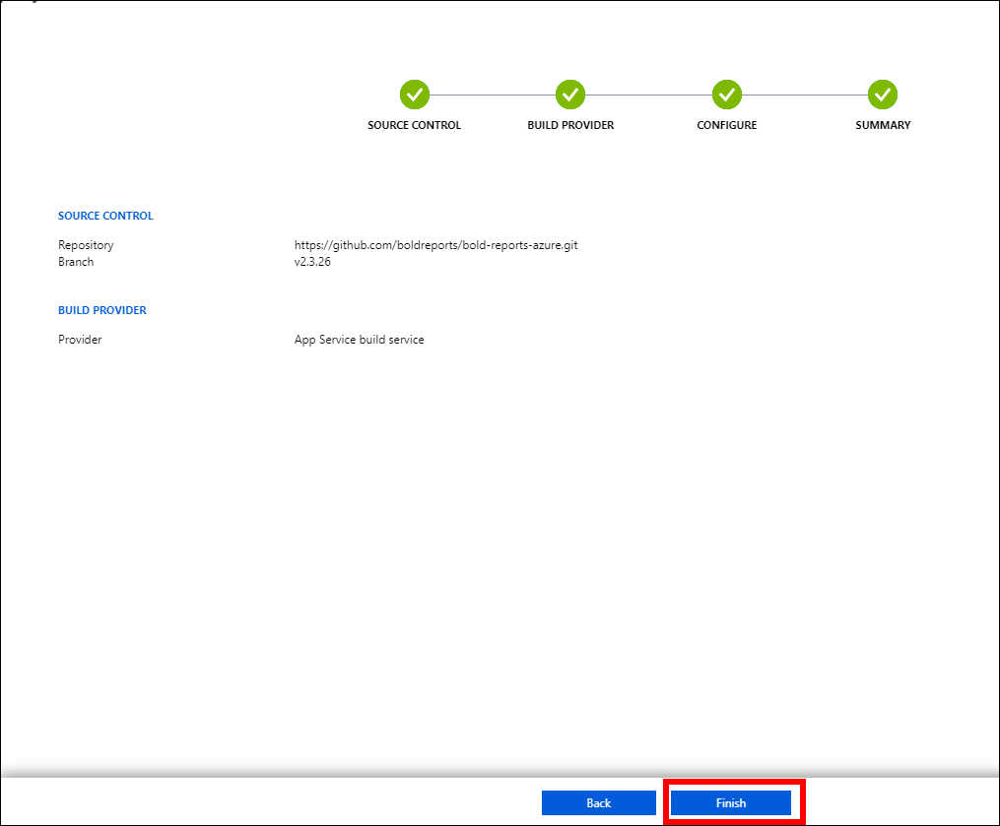
   
11. Select the `Sync` button on the deployment center page.
    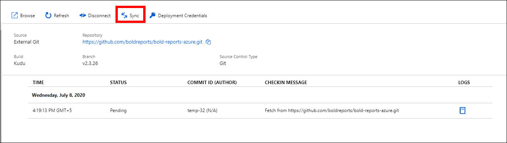
12. A synchronization request submitted notification is shown, and the synchronization progress is shown on the deployment center page.
    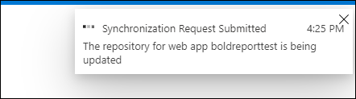
13. Wait until synchronization is completed.
14. Select `App Service Editor` in the left panel of the Bold Reports® Azure App Service, then click `Go`.
    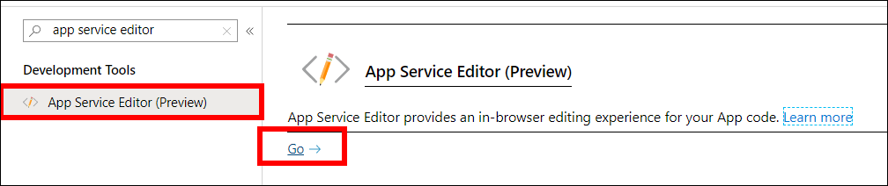
15. Copy your Web App URL, and then update the xml node `InternalAppReportUrl` in the config.xml file under `wwwroot/IDP/UMS/Configuration/boldreports/config.xml`.

   The URL must be, **`InternalAppReportUrl`- `{web App URL}/reporting`**
    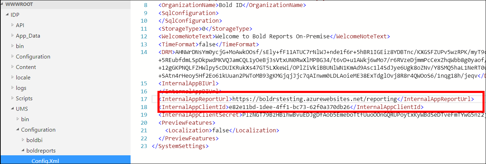
16. Copy your Web App URL, and then update the xml nodes `InternalAppDataServiceUrl` and `InternalAppIdpUrl` in the config.xml file under `wwwroot/Report Server/Configuration/config.xml`.

   The URL must be, **`InternalAppDataServiceUrl` – `{web App URL}/reporting/reportservice`**

   **`InternalAppIdpUrl` – `{web App URL}/`**
    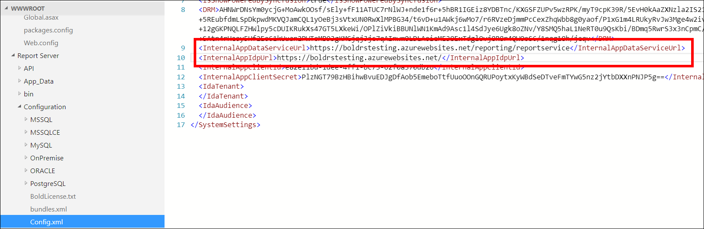
17. Start the Bold Reports® Azure App Service by clicking the `Start` button in the Overview section.
    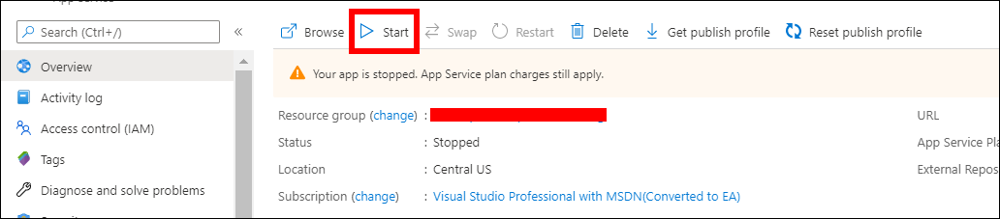
18. The Bold Reports® upgrade process is complete. Launch Bold Reports® by clicking the `browse` option or by typing the Bold Reports® URL in the browser.
    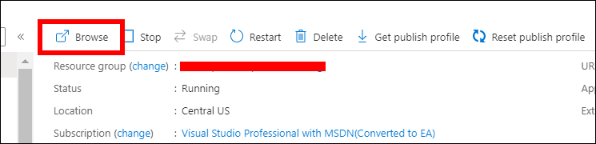

> Data Migration is not required to upgrade Bold Reports® Azure App Service from v2.x to a later version.

## Frequently asked questions

### Do I need data migration to upgrade from v2.x?

No. Data migration is not required to upgrade Bold Reports® Azure App Service from v2.x to a later version.

### Which repository does the Deployment Center use?

The Bold Reports® Deployment Center uses the `https://github.com/boldreports/bold-reports-azure.git` repository with the branch `v{release-version}`.

## See also

* [Create and upgrade Bold Reports® Azure App Service](./../)
* [Upgrade from v2.4.19 to the latest version](./../upgrade-v2.x-to-latest/)
* [Upgrade Bold Reports® Azure App Service from v1.x](./../upgrade-v1.x/)
