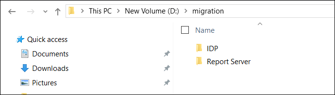
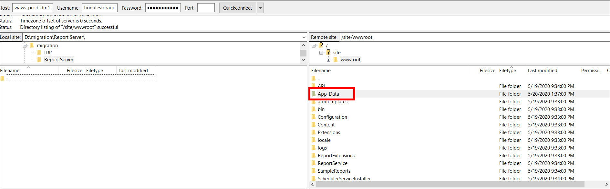
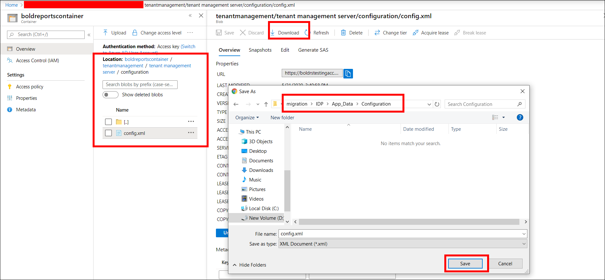
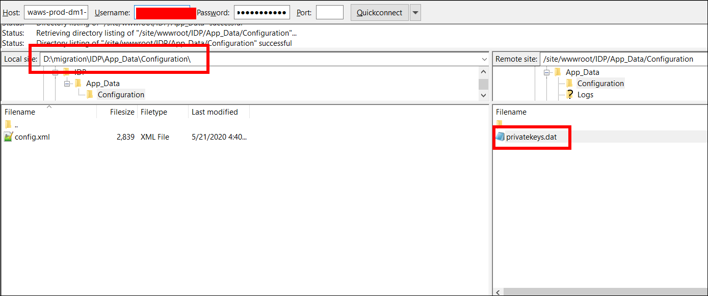
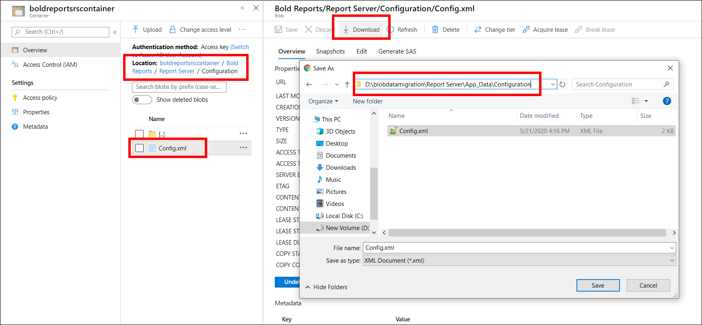
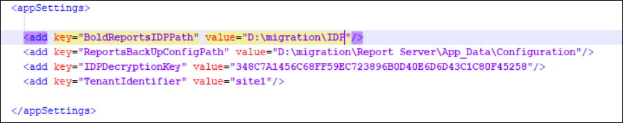
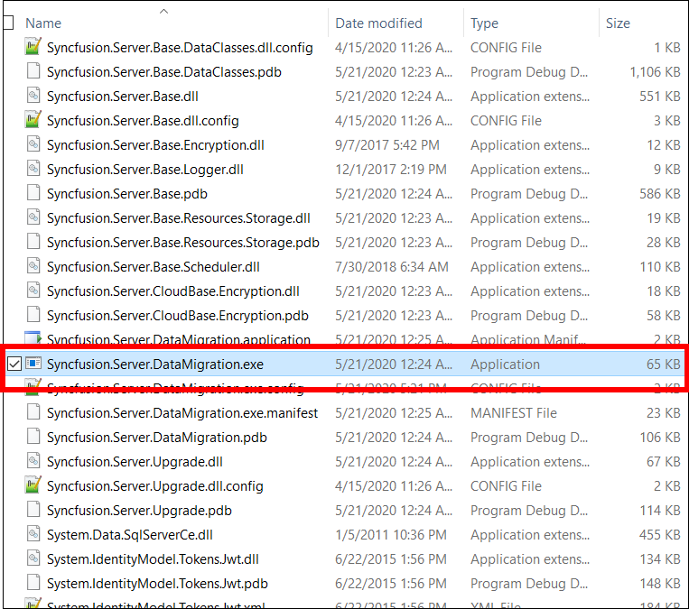

# Upgrade Bold Reports® Azure App Service version from v1.x to v2.3.x

You can upgrade Bold Reports® Azure App Service from v1.x to v2.3.x by creating a v2.3.x App Service, copying your files, and running the data migration utility.

## Create a Bold Reports® Azure App Service with latest version

You first create a new Bold Reports® Report Server Azure App Service that receives the migrated data.

* Create the Bold Reports® Report Server Azure App Service by following [Deploy using an ARM template](./../../../azure-app-service/using-arm-template/). Then, configure the application with a database by following [Application startup](./../../../../application-startup/).

## How do I prepare file storage resources for migration?

You prepare file storage resources by copying the v1.x Report Server App_Data folder and the Bold Reports® Multi-tenant config.xml and key files into local `IDP` and `Report Server` folders.

1. Create the folders `IDP` and `Report Server` on your local machine as shown in the following screenshot.

2. Connect to your Bold Reports® Report Server (single-Tenant) Web App with FileZilla, and drag the App_Data folder to the `Report Server` folder you created.

   

3. Create the sub-folder structure `/App_Data/Configuration/` under the `IDP` folder.

4. Go to the storage account created when you deployed Bold Reports® Multi-tenant. In the container section, navigate to the following location:
`boldreportscontainer/tenantmanagement/tenant management server/configuration`

5. Download the config.xml file to the folder `IDP/App_Data/Configuration`.

6. Connect to your `Bold Reports Multi-tenant` Azure app with FileZilla, and drag the `Privatekeys.dat` file to the local machine under the folder `IDP/App_Data/Configuration/`.

7. Run the [data migration utility](./../../on-premises/upgrade-from-classic-platform/data-migration/#steps-to-run-the-data-migration-utility).

## How do I prepare Azure Blob Storage resources for migration?

You prepare Azure Blob Storage resources by downloading the Bold Reports® Multi-tenant and previous Report Server config.xml files and the key file into local `IDP` and `Report Server` folders.

1. Create the folders `IDP` and `Report Server` on your local machine as shown in the following screenshot.

2. Create the sub-folder structure `/App_Data/Configuration/` under the `IDP` folder.

3. Go to the storage account created when you deployed Bold Reports® Multi-tenant. In the container section, navigate to the following location:
`boldreportscontainer/tenantmanagement/tenant management server/configuration`

4. Download the config.xml file to the folder `IDP/App_Data/Configuration`.

5. Connect to your `Bold Reports Multi-tenant` Azure app with FileZilla, and drag the `Privatekeys.dat` file to the local machine under the folder `IDP/App_Data/Configuration/`.

6. Create the sub-folder structure `/App_Data/Configuration/` under the `Report Server` folder on your local machine.

7. Go to the storage account of the previous Report Server (Single-Tenant). In the container section, navigate to the following location:
`boldreportsrscontainer/Bold Reports/Report Server/Configuration/`

8. Download the config.xml file to the folder `Report Server/App_Data/Configuration`.

9. Run the [data migration utility](./../../on-premises/upgrade-from-classic-platform/data-migration/#steps-to-run-the-data-migration-utility).

## How do I run the data migration utility?

You run the data migration utility by setting the `IDP` and Report Server configuration paths in its config file and then running `Syncfusion.Server.DataMigration.exe`.

1. Download the [data migration tool](https://www.syncfusion.com/downloads/support/directtrac/general/ze/migration_util-1263808578).

2. Extract the file and open the `Syncfusion.Server.DataMigration.exe.config` file. Update the values of the following keys in the config file:

    `<add key="ReportsBackUpConfigPath" value=""/>`

    `<add key="BoldReportsIDPPath" value=""/>`

3. Copy the `IDP` path and paste it as the value of the `BoldReportsIDPPath` key.
For example, `<add key="BoldReportsIDPPath" value="D:\migration\IDP"/>`.

4. Copy the `Configuration` path of the Report Server and paste it as the value of the `ReportsBackUpConfigPath` key.
For example, `<add key="ReportsBackUpConfigPath" value="D:\migration\Report Server\App_Data\Configuration"/>`.

5. Run the tool `Syncfusion.Server.DataMigration.exe` from the extracted location.

> The migration tool migrates the users, groups, permissions, reports, data sources, datasets, and schedules. Users without an email address are skipped, because email is mandatory for the Bold Reports® Report Server.

## Frequently asked questions

### Which version does this upgrade path reach?

The v1.x upgrade path moves your Bold Reports® Azure App Service to v2.3.x.

### What data does the migration tool move?

The Bold Reports® migration tool migrates users, groups, permissions, reports, data sources, datasets, and schedules. Users without an email address are skipped.

## See also

* [Create and upgrade Bold Reports® Azure App Service](./../)
* [Upgrade Bold Reports® Azure App Service from v2.x](./../upgrade-app-service/)
