# Upgrade Bold Reports® Enterprise Reporting version from 2.4.19 to latest

You can upgrade the Bold Reports® Azure App Service from version 2.4.19 to a later version in the Azure portal. You migrate the UMS blob resources, reconnect the deployment to the Bold Reports® GitHub repository, sync, and update the application settings.

## How do I upgrade from v2.4.19 to the latest version?

You upgrade the Bold Reports® Azure App Service from version 2.4.19 by following these steps:

1. Log in to the [Azure Portal](https://portal.azure.com) and select the Bold Reports® Azure App Service in Microsoft Azure Services.

2. In the **Overview** section, click **Stop**.

    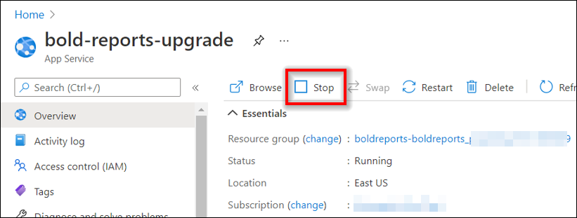

3. Choose **Deployment Center** in the left panel of the Bold Reports® Azure App service.

    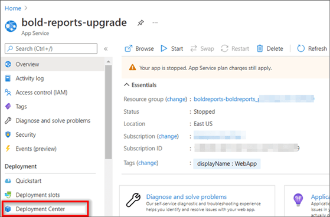

4. To upgrade to v3.1.42, migrate the v2.4.19 or v2.4.10 UMS blob resources to a new blob structure. To do this, click **Sync** in the deployment center blade.

     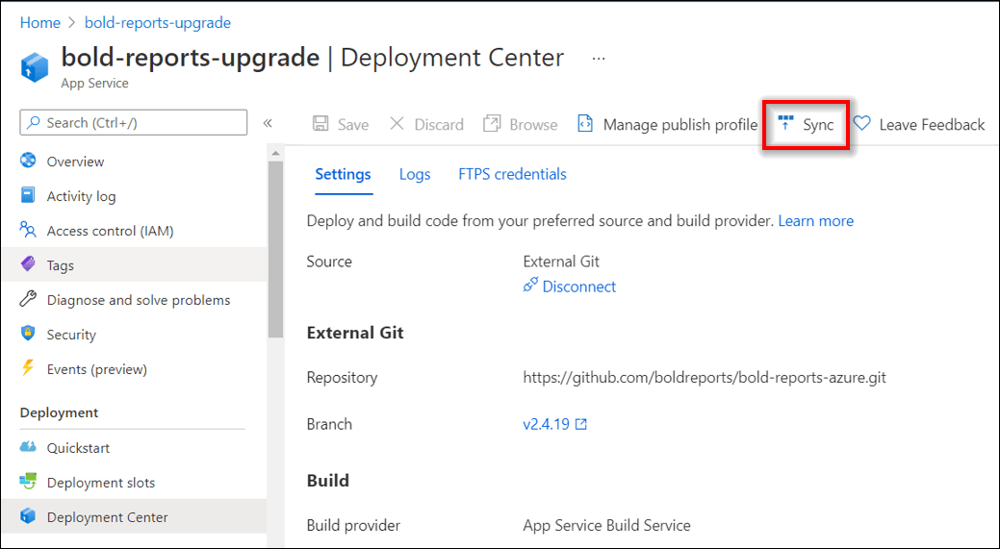

     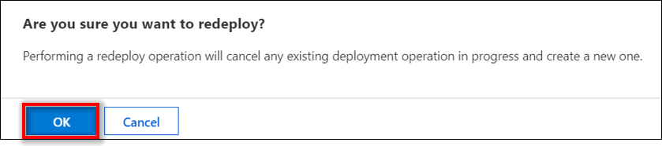

5. Check the deployment status in the logs. When the deployment completes successfully, the logs show a **success** status.

     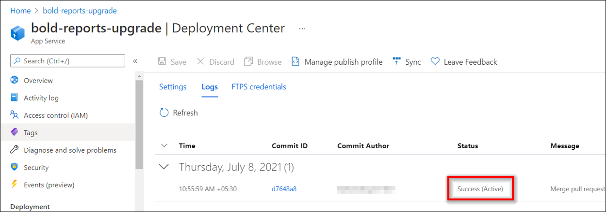

6. After successful deployment, navigate to **WebJobs** in the left panel of the Bold Reports® Azure App service.

     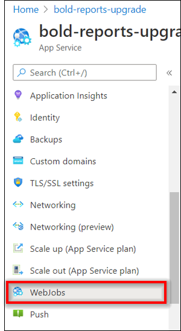

7. In **WebJobs**, the migration utility is available. Click **Run** and wait for the migration to complete.

     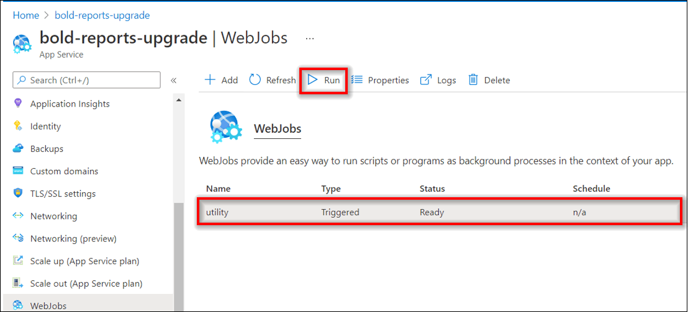

     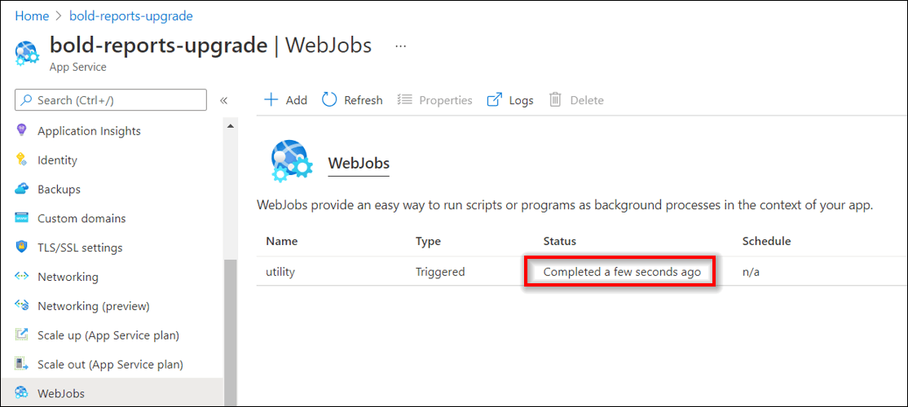

8. To confirm the migration succeeded, go to the blob container used by the Bold Reports® Azure App service and check whether the **boldservices** Blob is created.

     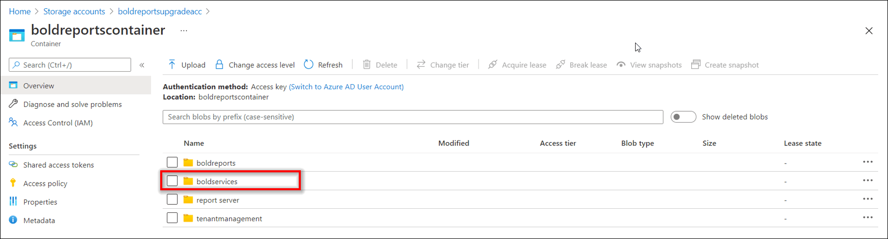

9. After the migration is completed, choose **Advanced Tools** in the left panel of the Bold Reports® Azure App service and click **Go**. The **KUDU console** opens.

     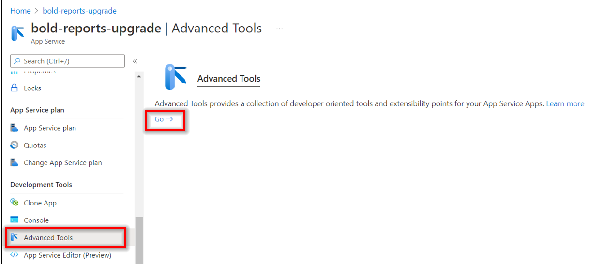

10. In the **KUDU console**, click **Debug Console** and choose **PowerShell**.

     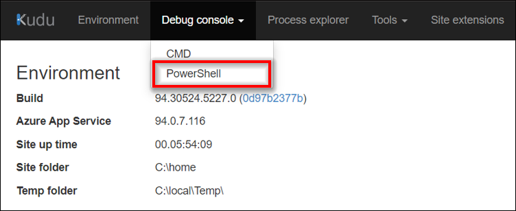

11. In PowerShell, navigate to the path `C:\home\site\repository\.git`.

     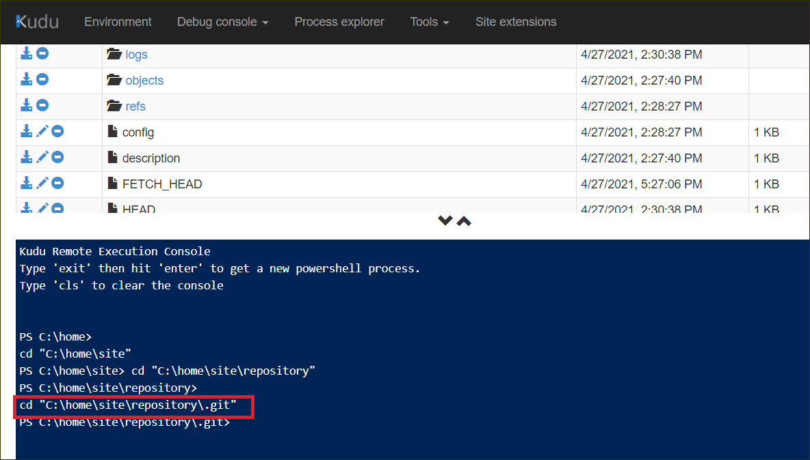

12. Run the git command `git remote rm origin`.

     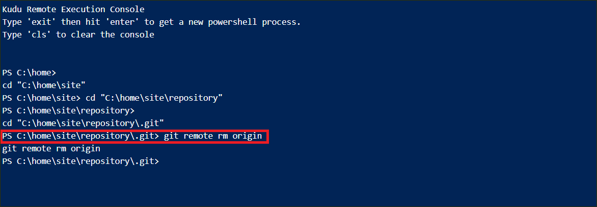

13. After running the command, go to the deployment center and click **Disconnect**. The deployment option opens.

    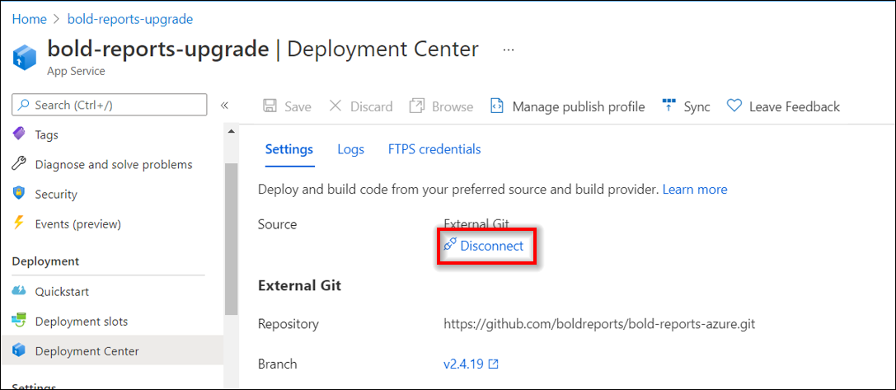

14. Select **External Git** in the source option.

    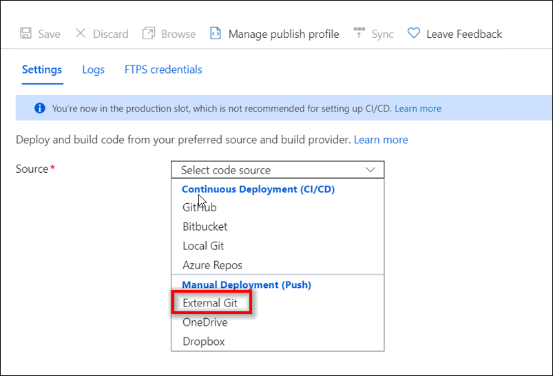

15. In **External Git**, fill out the following information:

    **Repository** - [Bold Reports® Azure repository URL](https://github.com/boldreports/bold-reports-azure.git)

    **Branch** - v3.1.42

    **Repository Type** - Public

    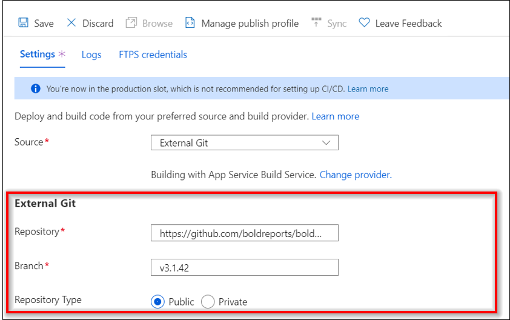

16. Click the **Save** option. The **Successfully set up deployment** notification is shown in the notification blade.

    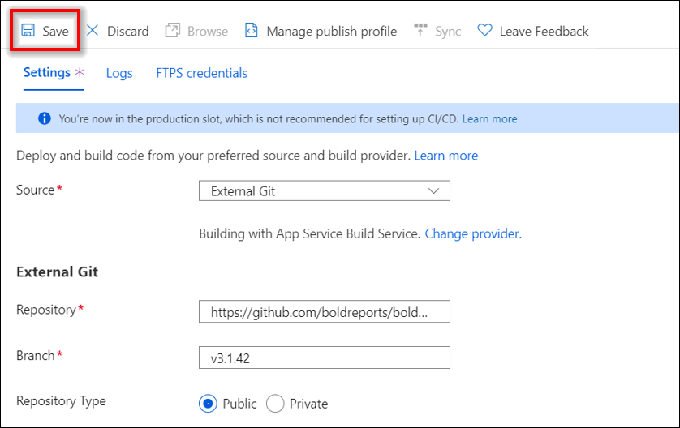

    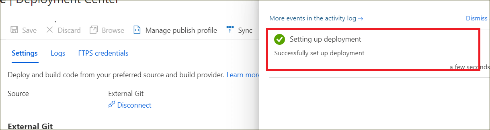

17. After completing the deployment setup, click **Sync** in the deployment center blade.

    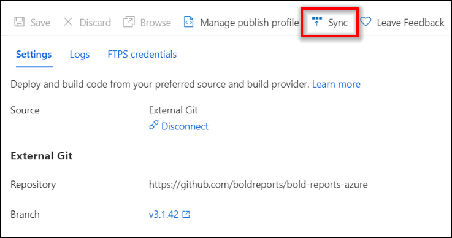

    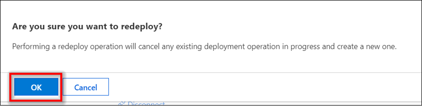

18. The synchronization progress is shown in the deployment options blade.

    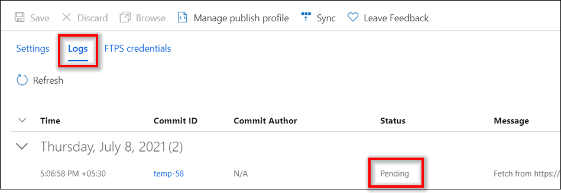

19. Wait until synchronization is completed.

    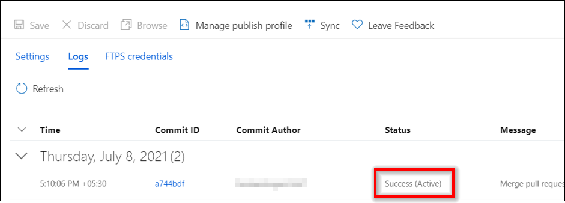

20. After the synchronization is completed, **Save** the following configuration settings.
    * Add the following application settings key.
        <table>
        <tr>
         <th>Key</th>
         <th>Value</th>
        </tr>

        <tr>
        <td>WEBSITE_LOAD_USER_PROFILE</td>
        <td>1</td>
        </tr>
        </table>

    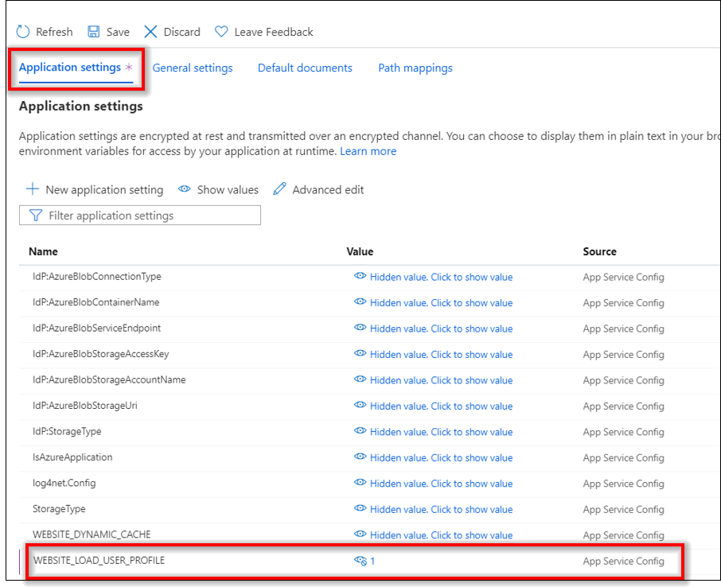
    * Change the following value in General Settings.
        <table>
        <tr>
         <th>Settings</th>
         <th>Value</th>
        </tr>

        <tr>
        <td>.NET version</td>
        <td>.NET 6</td>
        </tr>
        </table>

    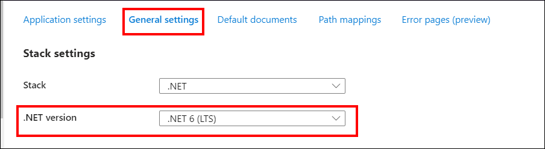
    * Change the Physical Path in Path Mappings.
        <table>
        <tr>
         <th>Virtual Path </th>
         <th>Physical Path (v2.4.19, v2.4.10)</th>
         <th>Physical Path (v3.1.42)</th>
        </tr>

        <tr>
        <td>/</td>
        <td>site\wwwroot\IDP</td>
        <td>site\wwwroot\idp\web</td>
        </tr>

        <tr>
        <td>/api</td>
        <td>site\wwwroot\IDP\api</td>
        <td>site\wwwroot\idp\api</td>
        </tr>

        <tr>
        <td>/reporting</td>
        <td>site\wwwroot\Report Server</td>
        <td>site\wwwroot\reporting\web</td>
        </tr>

        <tr>
        <td>/reporting/api</td>
        <td>site\wwwroot\Report Server\api</td>
        <td>site\wwwroot\reporting\api</td>
        </tr>

        <tr>
        <td>/reporting/jobs</td>
        <td>site\wwwroot\Report Server\jobs</td>
        <td>site\wwwroot\reporting\jobs</td>
        </tr>

        <tr>
        <td>/reporting/reportservice</td>
        <td>site\wwwroot\Report Server\reportservice</td>
        <td>site\wwwroot\reporting\reportservice</td>
        </tr>

        <tr>
        <td>/ums</td>
        <td>Site\wwwroot\IDP\ums</td>
        <td>site\wwwroot\idp\ums</td>
        </tr>
        </table>

    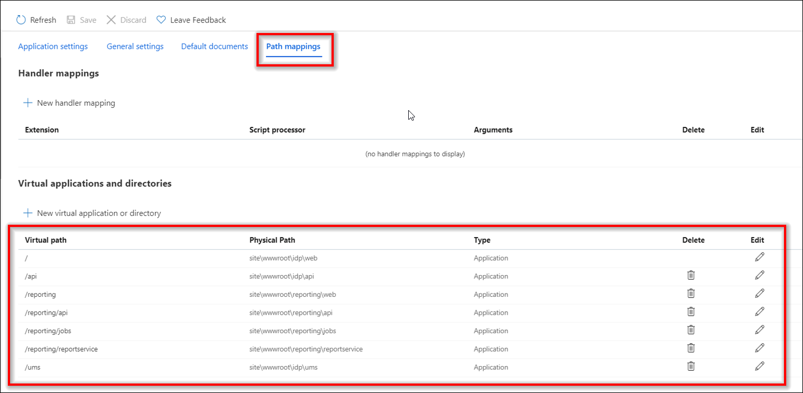

21. Click **Start** in the **Overview** section to start the Bold Reports® Azure App service.

    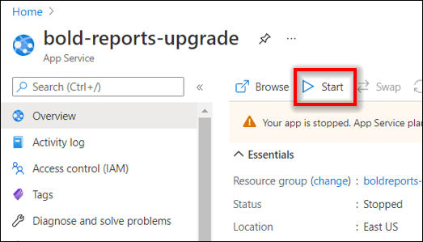

## Frequently asked questions

### Which .NET version does the upgraded App Service use?

After the Bold Reports® upgrade, set the .NET version in General Settings to .NET 6.

### How do I confirm the blob migration succeeded?

Check whether the **boldservices** Blob is created in the blob container used by the Bold Reports® Azure App service.

## See also

* [Create and upgrade Bold Reports® Azure App Service](./../)
* [Upgrade Bold Reports® Azure App Service from v2.x](./../upgrade-app-service/)
