# Upgrading the Bold Reports<sup>®</sup> server to the latest version

To upgrade the Bold Reports<sup>®</sup> Report Server from any version, back up your data and run the Bold Reports<sup>®</sup> Enterprise Installer.

## How often does Bold Reports<sup>®</sup> release new versions?

Bold Reports<sup>®</sup> releases several major versions in a year. Each version includes new features, bug fixes, and other improvements.

You can upgrade Bold Reports<sup>®</sup> On-Premises Edition manually to a later version at any time. The Bold Reports<sup>®</sup> Report Server has no automatic updates. Before you upgrade, review the features and enhancements in the [Bold Reports<sup>®</sup> Release Notes](https://www.boldreports.com/resources/release-history/embedded-reporting/2-2/#2-2-28).

> **NOTE:** Upgrading to a later version does not require a license key. Bold Reports<sup>®</sup> services retrieve the license in the backend after you upgrade to the latest version.

## Upgrading guidelines

Bold Reports<sup>®</sup> recommends that you follow these guidelines when you upgrade the Report Server from an older version:

* Save all the open settings and the unsaved items.
* Ensure no one is working with reports.
* Inform users about the maintenance time.
* For databases, make sure you have a valid network connection to the database while upgrading to the new version.

## Backup the existing data

Before you upgrade Bold Reports<sup>®</sup>, back up all the files and folders from the following locations:
<table>
    <tr>
      <td>
       Bold ID
      </td>
      <td>
      {Deployed Location}\BoldServices\idp
      </td>
    </tr>
    <tr>
      <td>
       Bold Reports<sup>®</sup>
      </td>
      <td>
       {Deployed Location}\BoldServices\app_data
      </td>
    </tr>
    </table>

> **Note:** By default, Bold Reports<sup>®</sup> is deployed in "C:\BoldServices\".

## Proceeding with the upgrade

The Bold Reports<sup>®</sup> upgrade updates your existing database schema to match the installed version. The upgrade process retains all the resources and settings from the previous deployment.

You can download the Bold Reports<sup>®</sup> Enterprise Edition installer from your account on the [Bold Reports<sup>®</sup> Downloads page](https://www.boldreports.com/account/downloads?tab=self-service).

### Steps to upgrade Bold Reports<sup>®</sup> Enterprise Reporting

Upgrade Bold Reports<sup>®</sup> Enterprise Reporting by running the Enterprise Installer and following its prompts.

1. Run the Bold Reports<sup>®</sup> Enterprise Installer.

    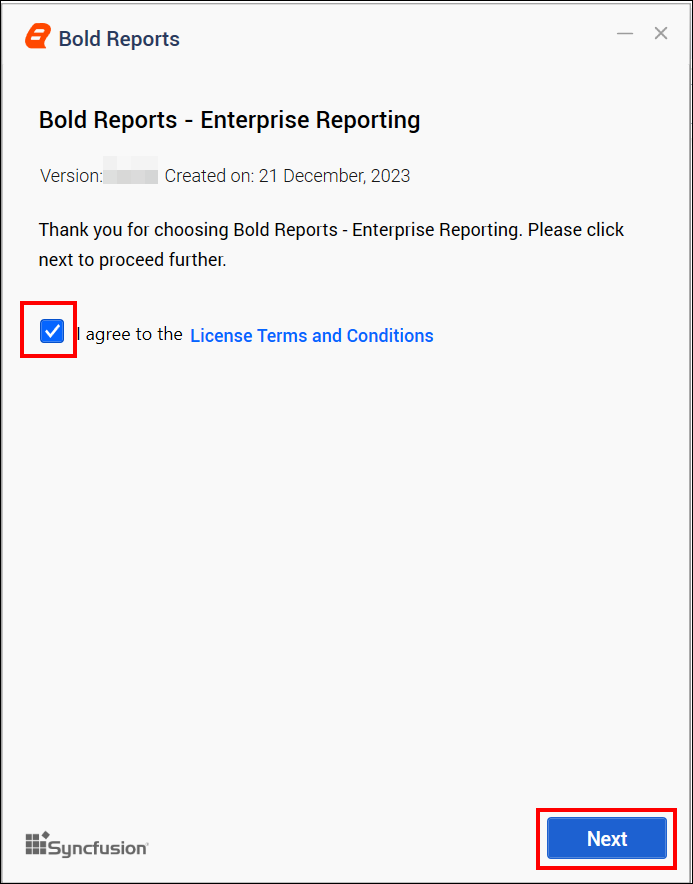

2. To check the license agreement for Bold Reports<sup>®</sup> On-Premises Edition, click `License Terms and Conditions`.
3. Click the `Next` button to proceed.
4. When the upgrade prompt appears, click the `Yes` button to proceed with the installation.

    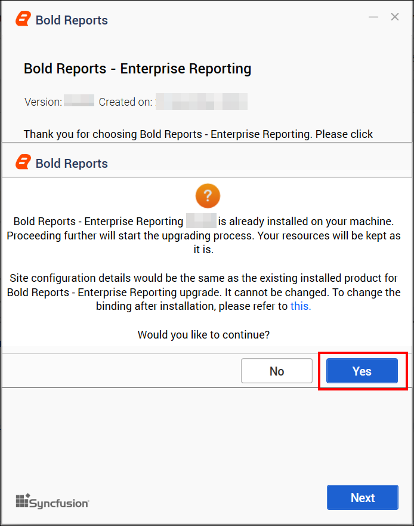

### Hosting type

The Bold Reports<sup>®</sup> Enterprise upgrade uses the existing server hosting type, location, and port number. Click **Next** to upgrade with these settings.

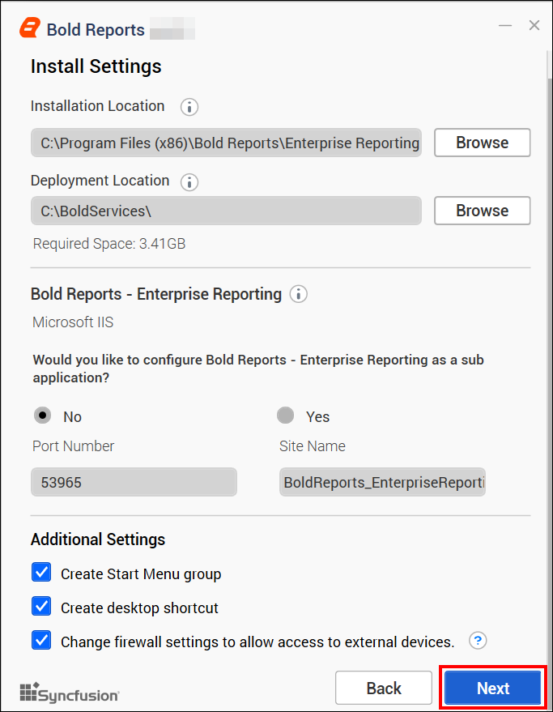

### Chromium Packages

Bold Reports<sup>®</sup> needs Chromium packages to provide the `image and PDF export` features in reports and schedules. Without these packages, the image and PDF export options in reports and schedules are no longer available.

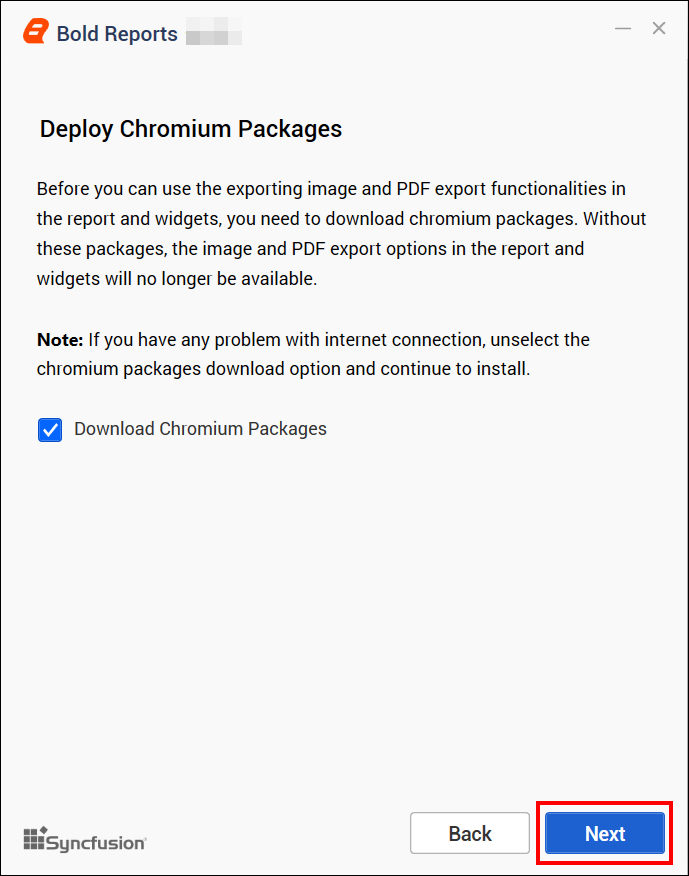

> **NOTE:** To deploy Chromium packages manually in Bold Reports<sup>®</sup>, see [how to install Chromium packages](./../../../../administrator-guide/faq/how-to-install-chromium-packages/).
> Open the config.xml file at the location `{deployment_location}\app_data\reporting\configuration\config.xml`, add the node, and then save the file.<br>
> `<Exporting UsePuppeteer="true" PuppeteerPath="" />`<br>
> 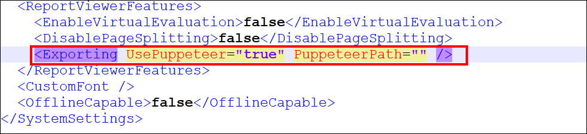

### Bold Data Hub

The Bold Data Hub application loads data from various data sources into PostgreSQL, MSSQL, MySQL, and Apache Doris. Bold Data Hub provides options to schedule the job at regular intervals to pull data from data sources. Bold Data Hub supports transformation using SQL scripts. By default, Python 3 is installed for Bold Data Hub.

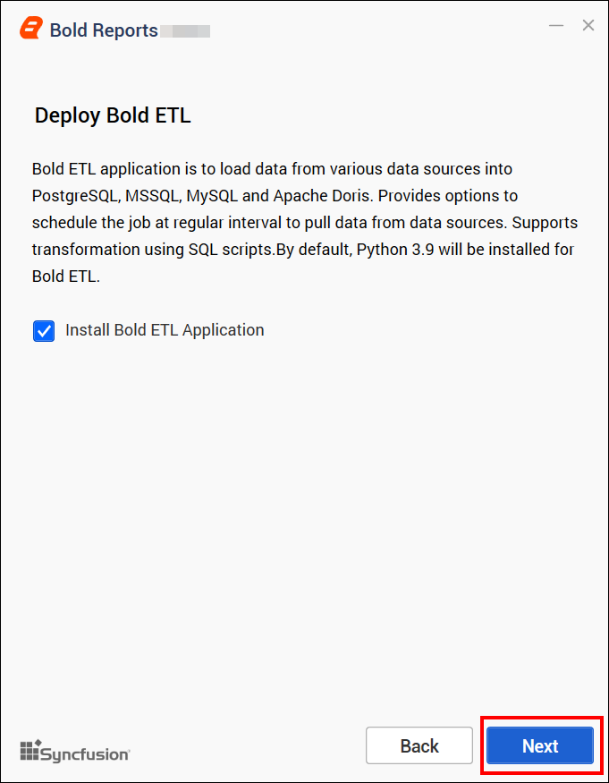

> For Windows OS, Python 3.9 version is required along with Bold Reports<sup>®</sup> On-Premises Edition for Bold Data Hub. If Python 3.9 version is already installed, please specify the Python path in `{Drive}:\BoldServices\etl\etlservice\appsettings.json` and restart the app on the IIS server.

```sh
"PythonPath": "<Drive>:\\BoldServices\\Python39"
```

### Client libraries

Bold Reports<sup>®</sup> Enterprise Edition uses client libraries, such as Oracle, PostgreSQL, and MySQL, to connect with their respective SQL database variants. Check the license of each library to provide consent for installation. Only the selected client libraries are shipped with the product.

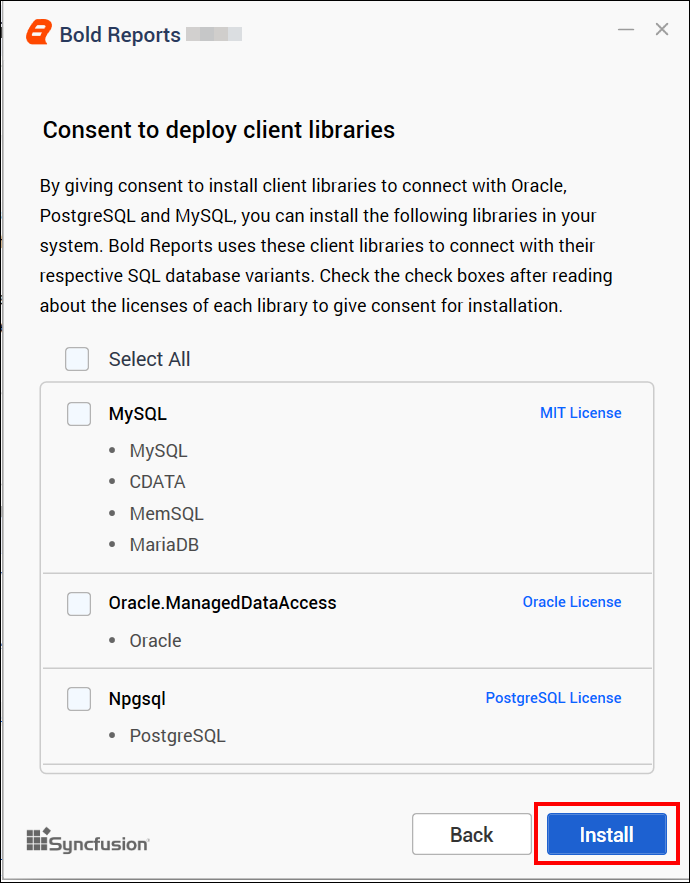

1. Read and accept the license to install the selected client libraries.
2. Click `Install`.
3. After the installation process is completed, click **Launch Application** to launch the application.

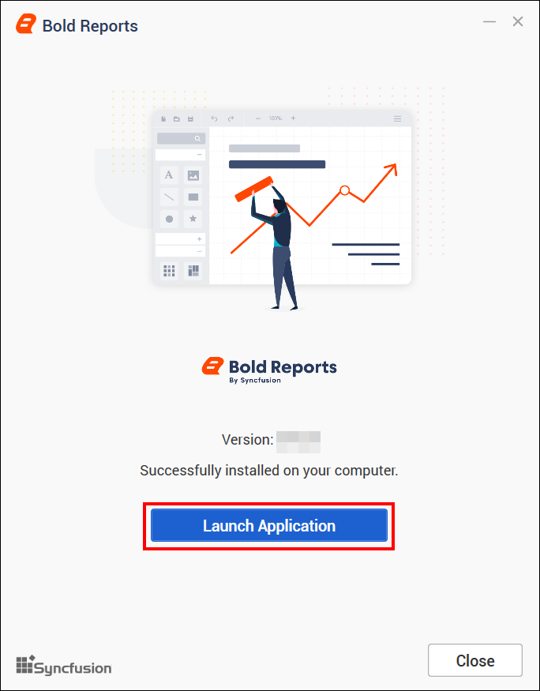

## Upgrade Failure Notification

Bold Reports<sup>®</sup> keeps existing reports available when a database script fails during an application upgrade. The upgrade process continues without interrupting access to existing reports. A notification banner shows that the upgrade is still in progress and that some administrative actions may be temporarily unavailable until the issue is resolved.

  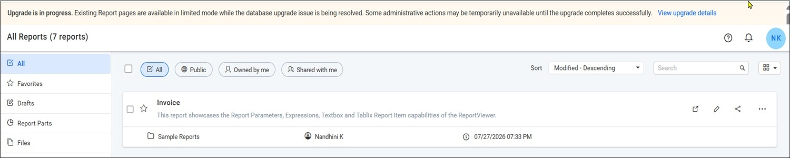

Click `View upgrade details` to view information about the upgrade failure. The details include the upgrade status, database provider, version details, failed script information, and error message.

  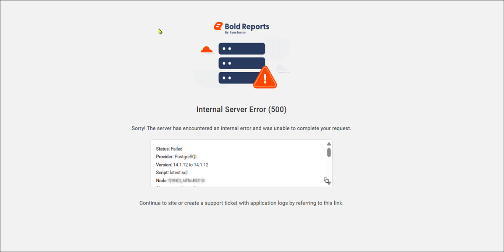

> **Note:** If this notification banner is displayed, the upgrade process encountered an issue. To resolve the issue, [contact Bold Reports<sup>®</sup> support](https://www.boldreports.com/contact) and share the upgrade-related logs with the support team for further investigation.

### How do I download the upgrade logs?

You download the Bold Reports<sup>®</sup> upgrade-related logs from the diagnostic logs option in UMS.

1. Navigate to **UMS** > **Sites**.
2. Click the **Help** icon in the upper-right corner, and select **Get Diagnostic Logs**.
3. Select **Include upgrade failure files**.
4. Click **Download Diagnostic Logs** to download the upgrade-related logs.

  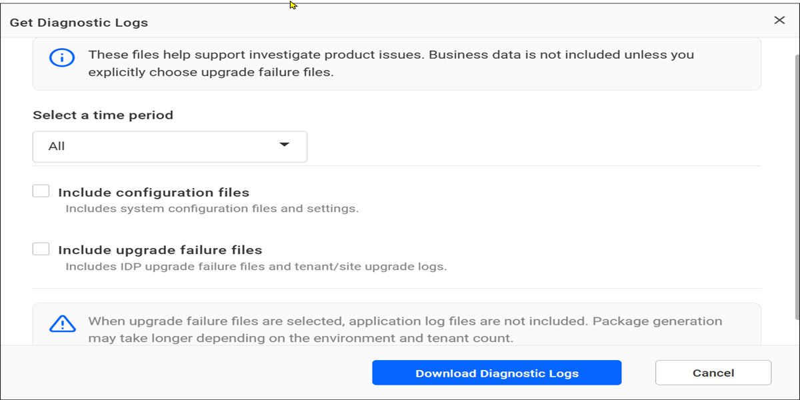

## Frequently asked questions

### Do I need a license key to upgrade Bold Reports<sup>®</sup>?

No. Upgrading to a later version does not require a license key, because Bold Reports<sup>®</sup> services retrieve the license in the backend after the upgrade.

### Does Bold Reports<sup>®</sup> Report Server update automatically?

No. The Bold Reports<sup>®</sup> Report Server has no automatic updates, so you upgrade it manually.

## See also

* [How to install Chromium packages](./../../../../administrator-guide/faq/how-to-install-chromium-packages/)
* [Database permissions required to set up Bold Reports<sup>®</sup>](./../../../../administrator-guide/faq/what-are-the-database-permissions-required-to-set-up-bold-reports/)
* [Upgrade from the classic platform](./../../../../deployment/upgrade/on-premises/upgrade-from-classic-platform/)
